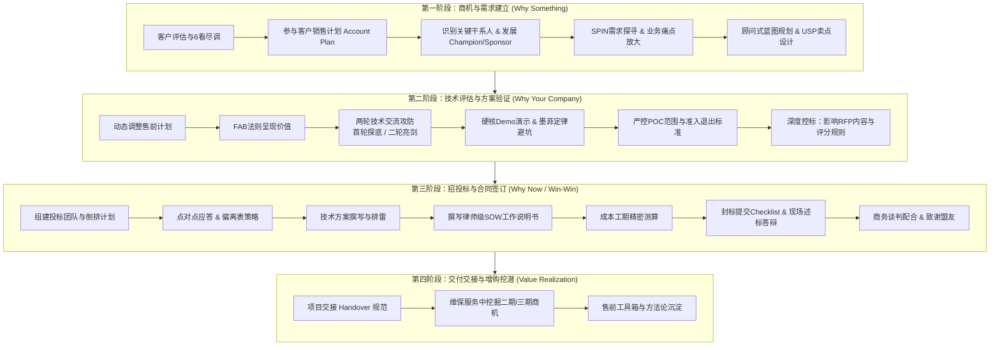

# 《专业售前工程师实战宝典》学习笔记与打法全景

> **课程讲师**：赵成栋（CD老师）—— 20+年售前老兵，前IBM、HP、思科、BMC大中华区及亚太区售前/价值顾问总监，《精通售前》(Mastering Technical Sales) 中文译者，清华大学MBA，北京航空航天大学计算机硕士，售前青云会创始人。  
> **核心方法**：4S专业售前法（Selling Orientation, Customer Success, Solution Engagement, Showcase Value） + IBM Signature Selling (SS) 销售方法论。  
> **整理定位**：面向中国高科技、软件、云计算与集成项目一线售前的**实战打法百科（Pre-Sales Playbook）**。

---

## 一、 售前工程师全生命周期打法全景图

售前不是“拼凑方案的二把刀”，而是企业业务价值的**显示器、桥接器与放大器**。一个标准的B2B/政企项目销售全生命周期中，售前的工作贯穿始终：

---

## 二、 核心理论体系：4S专业售前法

4S专业售前法是贯穿全书的核心顶层逻辑，由4大策略、4大体系与规范化落地指引构成：

| 4S 策略维度 | 英文定义 | 核心心法与定位突破 |
| :--- | :--- | :--- |
| **S1. 销售目标导向** | **Selling Orientation** | 售前不是销售人员的勤杂工或打字员，而是销售目标的**战术参谋与平等业务伙伴**。以公司赢单为目标，敢于对无效劳动说“不”。 |
| **S2. 成就客户为核** | **Customer Success** | 不盲目视客户为“上帝”唯命是从，而是成为其**可信赖的专业顾问**。帮助客户解决真实业务痛点，成就客户的组织目标与个人职业晋升。 |
| **S3. 技术沟通支点** | **Solution Engagement** | 技术不是用来“炫技忽悠”，而是作为交流的载体。核心能力在于**如何向业务人与决策层讲透技术方案的业务可行性、经济合理性与落地确定性**。 |
| **S4. 展示价值法宝** | **Showcase Value** | 拒绝搞关系、做局或无底线诋毁友商。以**持续展示专业价值、兑现业务收益**作为核心竞争武器，打造无法被替代的专家形象。 |

---

## 三、 全书篇章导航与索引

### [第一篇：导论与售前成功基石](./01_第一篇_售前心法与成功基石/)
* [第01讲：课程导读与售前专业进化路径](./01_第一篇_售前心法与成功基石/01_课程导读与售前专业进化路径.md)
* [第02讲：4S专业售前法体系深度解析](./01_第一篇_售前心法与成功基石/02_4S专业售前法体系深度解析.md)
* [第03讲：标杆战役复盘（一）：从陪标绝境到单一来源采购](./01_第一篇_售前心法与成功基石/03_标杆战役复盘_从陪标绝境到单一来源.md)
* [第04讲：标杆战役复盘（二）：硬核技术取胜助推客户成功上市](./01_第一篇_售前心法与成功基石/04_标杆战役复盘_靠技术取胜助推客户上市.md)
* [第05讲：标杆战役复盘（三）：巧设独特卖点（USP）逆风翻盘](./01_第一篇_售前心法与成功基石/05_标杆战役复盘_巧设USP逆风翻盘.md)

### [第二篇：售前岗位再认知与核心方法论](./02_第二篇_售前岗位再认知与方法论/)
* [第06讲：什么是售前：摆脱方案“二把刀”与拼凑者定位](./02_第二篇_售前岗位再认知与方法论/06_什么是售前_摆脱方案二把刀与拼凑者定位.md)
* [第07讲：售前的价值：业务价值的“显示器”、“桥接器”、“放大器”与“稳定器”](./02_第二篇_售前岗位再认知与方法论/07_售前的价值_业务价值的显示器桥接器放大器稳定器.md)
* [第08讲：售前职业发展路径：售前可以干到退休吗？](./02_第二篇_售前岗位再认知与方法论/08_售前职业发展路径_售前可以干到退休吗.md)
* [第09讲：售前核心能力模型：以求胜为箭矢的T型能力结构](./02_第二篇_售前岗位再认知与方法论/09_售前核心能力模型_以求胜为箭矢的T型能力结构.md)
* [第10讲：售前服务对象：谁才是售前最重要的客户？](./02_第二篇_售前岗位再认知与方法论/10_售前服务对象_谁才是售前最重要的客户.md)
* [第11讲：国际大厂销售方法论：深入拆解 IBM SS 七步法实战精髓](./02_第二篇_售前岗位再认知与方法论/11_国际大厂销售方法论_深入拆解IBM_SS七步法实战精髓.md)
* [第12讲：销售过程阶段划分与售前分阶段职责全景蓝图](./02_第二篇_售前岗位再认知与方法论/12_销售过程阶段划分与售前分阶段职责全景蓝图.md)

### [第三篇：建立需求阶段实战指南](./03_第三篇_建立需求阶段实战指南/)
* [第13讲：建立需求阶段概述与前置准备](./03_第三篇_建立需求阶段实战指南/13_建立需求阶段概述与前置准备.md)
* [第14讲：客户评估：识别假商机与沉没成本](./03_第三篇_建立需求阶段实战指南/14_客户评估_识别假商机与沉没成本.md)
* [第15讲：售前启动工作前的“6看”尽调战术](./03_第三篇_建立需求阶段实战指南/15_售前启动工作前的6看尽调战术.md)
* [第16讲：深度参与制定与更新客户销售计划（Account Plan）](./03_第三篇_建立需求阶段实战指南/16_深度参与制定与更新客户销售计划Account_Plan.md)
* [第17讲：穿透客户行业与业务：“不懂业务的售前没有未来”](./03_第三篇_建立需求阶段实战指南/17_穿透客户行业与业务_不懂业务的售前没有未来.md)
* [第18讲：售前核心命题：为何解决 Why Something 远先于 What/How](./03_第三篇_建立需求阶段实战指南/18_售前核心命题_为何解决Why_Something远先于What和How.md)
* [第19讲：识别、分类与管理关键项目干系人（Key Stakeholders）](./03_第三篇_建立需求阶段实战指南/19_识别分类与管理关键项目干系人Key_Stakeholders.md)
* [第20讲：发展客户内部支持者同盟：Champion 与 Sponsor](./03_第三篇_建立需求阶段实战指南/20_发展客户内部支持者同盟_Champion与Sponsor.md)
* [第21讲：洞察干系人驱动力：内在动机（个人利益）与外在逻辑（组织目标）转化](./03_第三篇_建立需求阶段实战指南/21_洞察干系人驱动力_内在动机与外在逻辑转化.md)
* [第22讲：设计不可替代的独特卖点（USP）：售前的攻防护城河](./03_第三篇_建立需求阶段实战指南/22_设计不可替代的独特卖点USP_售前的攻防护城河.md)
* [第23讲：SPIN提问技术在售前需求开发中的实战落地](./03_第三篇_建立需求阶段实战指南/23_SPIN提问技术在售前需求开发中的实战落地.md)
* [第24讲：客户现场调研技巧：“胆大、嘴甜、活又好”](./03_第三篇_建立需求阶段实战指南/24_客户现场调研技巧_胆大嘴甜活又好.md)
* [第25讲：顾问式售前功力：既画“业务大饼”，又做“落地面条”](./03_第三篇_建立需求阶段实战指南/25_顾问式售前功力_既画业务大饼又做落地面条.md)
* [第26讲：项目需求梳理与可行性评估红线](./03_第三篇_建立需求阶段实战指南/26_项目需求梳理与可行性评估红线.md)

### [第四篇：技术评估阶段实战指南](./04_第四篇_技术评估阶段实战指南/)
* [第27讲：技术评估阶段概述与攻势构建](./04_第四篇_技术评估阶段实战指南/27_技术评估阶段概述与攻势构建.md)
* [第28讲：动态调整售前计划：构建立体化技术攻势](./04_第四篇_技术评估阶段实战指南/28_动态调整售前计划_构建立体化技术攻势.md)
* [第29讲：售前心态建设：对自家产品建立“红布信仰”](./04_第四篇_技术评估阶段实战指南/29_售前心态建设_对自家产品建立红布信仰.md)
* [第30讲：售前语言习惯：FAB利益陈述法则](./04_第四篇_技术评估阶段实战指南/30_售前语言习惯_FAB利益陈述法则.md)
* [第31讲：技术交流杀手级PPT的设计逻辑与内容编排](./04_第四篇_技术评估阶段实战指南/31_技术交流杀手级PPT的设计逻辑与内容编排.md)
* [第32讲：售前高维演讲与临场控场技巧](./04_第四篇_技术评估阶段实战指南/32_售前高维演讲与临场控场技巧.md)
* [第33讲：首轮技术交流：“展示能力肌肉，保留技术底裤”](./04_第四篇_技术评估阶段实战指南/33_首轮技术交流_展示能力肌肉保留技术底裤.md)
* [第34讲：持续增进与客户内部支持者 Champion 的情报互换](./04_第四篇_技术评估阶段实战指南/34_持续增进与客户内部支持者Champion的情报互换.md)
* [第35讲：友商与竞争对手态势实时跟踪与动态拆招](./04_第四篇_技术评估阶段实战指南/35_友商与竞争对手态势实时跟踪与动态拆招.md)
* [第36讲：第二轮技术交流：“亮剑锋芒，但不求一剑封喉”](./04_第四篇_技术评估阶段实战指南/36_第二轮技术交流_亮剑锋芒但不求一剑封喉.md)
* [第37讲：产品与方案演示（Demo）：“捞干货、上硬菜”](./04_第四篇_技术评估阶段实战指南/37_产品与方案演示Demo_捞干货上硬菜.md)
* [第38讲：破解演示“墨菲定律”：Demo现场翻车排查与兜底容灾](./04_第四篇_技术评估阶段实战指南/38_破解演示墨菲定律_Demo现场翻车排查与兜底容灾.md)
* [第39讲：专业服务与交付能力包装：“以人为核心”传递确定性](./04_第四篇_技术评估阶段实战指南/39_专业服务与交付能力包装_以人为核心传递确定性.md)
* [第40讲：概念验证（POC）测试控制：克制进场、设定边界、锁定标准](./04_第四篇_技术评估阶段实战指南/40_概念验证POC测试控制_克制进场设定边界锁定标准.md)
* [第41讲：技术评估结果高层汇报：“电梯汇报”争取一把手首肯](./04_第四篇_技术评估阶段实战指南/41_技术评估结果高层汇报_电梯汇报争取一把手首肯.md)
* [第42讲：警惕客户“试用陷阱”：识别白嫖风险与应对策略](./04_第四篇_技术评估阶段实战指南/42_警惕客户试用陷阱_识别白嫖风险与应对策略.md)
* [第43讲：终极售前目标：深度影响与把控客户 RFP 内容与评分标准设计](./04_第四篇_技术评估阶段实战指南/43_终极售前目标_深度影响与把控客户RFP内容与评分标准设计.md)

### [第五篇：招投标与后周期实战指南](./05_第五篇_招投标与后周期实战指南/)
* [第44讲：招投标与商务采购阶段概述](./05_第五篇_招投标与后周期实战指南/44_招投标与商务采购阶段概述.md)
* [第45讲：政企客户常规招投标管理体系与采购流程解密](./05_第五篇_招投标与后周期实战指南/45_政企客户常规招投标管理体系与采购流程解密.md)
* [第46讲：建立高效投标团队与严密倒排投标计划](./05_第五篇_招投标与后周期实战指南/46_建立高效投标团队与严密倒排投标计划.md)
* [第47讲：点对点应答与偏离表编制：“完全满足”背后的风险与艺术](./05_第五篇_招投标与后周期实战指南/47_点对点应答与偏离表编制_完全满足背后的风险与艺术.md)
* [第48讲：投标技术方案撰写：警惕致命的“Copy-Paste”拼盘式失误](./05_第五篇_招投标与后周期实战指南/48_投标技术方案撰写_警惕致命的CopyPaste拼盘式失误.md)
* [第49讲：SOW（工作说明书）撰写精要：像律师一样严密界定边界](./05_第五篇_招投标与后周期实战指南/49_SOW工作说明书撰写精要_像律师一样严密界定边界.md)
* [第50讲：项目成本、工期与风险精密测算](./05_第五篇_招投标与后周期实战指南/50_项目成本工期与风险精密测算.md)
* [第51讲：标书封标、检查与提交：“最后一公里”防翻车 Checklist](./05_第五篇_招投标与后周期实战指南/51_标书封标检查与提交_最后一公里防翻车Checklist.md)
* [第52讲：决胜开标与评标现场：述标技巧、答辩攻防与合规暗礁](./05_第五篇_招投标与后周期实战指南/52_决胜开标与评标现场_述标技巧答辩攻防与合规暗礁.md)
* [第53讲：商务谈判配合与致谢盟友的职场智慧](./05_第五篇_招投标与后周期实战指南/53_商务谈判配合与致谢盟友的职场智慧.md)
* [第54讲：项目交付交接（Handover）：从售前到项目经理的无缝交棒](./05_第五篇_招投标与后周期实战指南/54_项目交付交接Handover_从售前到项目经理的无缝交棒.md)
* [第55讲：维保与服务运营：在客户日常问题中挖掘二期、三期增购商机](./05_第五篇_招投标与后周期实战指南/55_维保与服务运营_在客户日常问题中挖掘二期三期增购商机.md)
* [第56讲：售前日常高频作战支持工具箱与实战应用场景](./05_第五篇_招投标与后周期实战指南/56_售前日常高频作战支持工具箱与实战应用场景.md)

### [第六篇：售前成长与进阶附录](./06_附录与售前实战军火库/)
* [第57讲：寄语售前同行：长期主义、职业尊严与认知护城河](./06_附录与售前实战军火库/57_寄语售前同行_长期主义职业尊严与认知护城河.md)
* [附录A：售前工程师实战必备全流程 Checklist 总表](./06_附录与售前实战军火库/附录A_售前工程师实战必备全流程Checklist总表.md)
* [附录B：4S专业售前核心方法论速查卡片](./06_附录与售前实战军火库/附录B_4S专业售前核心方法论速查卡片.md)

---

## 四、 推荐学习路线

1. **研发/实施转售前新手（快速建立职业感觉）**：
   * 必读：第01~02讲（基石与4S）、第06~10讲（岗位认知与能力模型）、第30讲（FAB法则）、第37~38讲（Demo演示实操）。
2. **1~3年一线打单售前（提升赢单率与控盘能力）**：
   * 重点突破：第14~16讲（客户评估与6看）、第19~21讲（干系人与Champion）、第22讲（USP卖点设计）、第33/36讲（两轮交流策略）、第40讲（控POC）、第43讲（深度控标RFP）。
3. **售前架构师与带队骨干（把控风险与顾问式规划）**：
   * 深度研读：第03~05讲（标杆战役翻盘策略）、第11讲（IBM SS方法论）、第25讲（顾问式蓝图设计）、第47~49讲（偏离表、方案与律师级SOW）、第54~55讲（交付交接与增购挖潜）。
