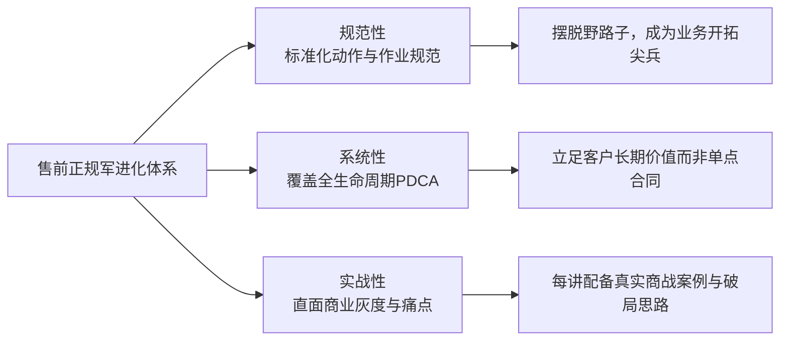
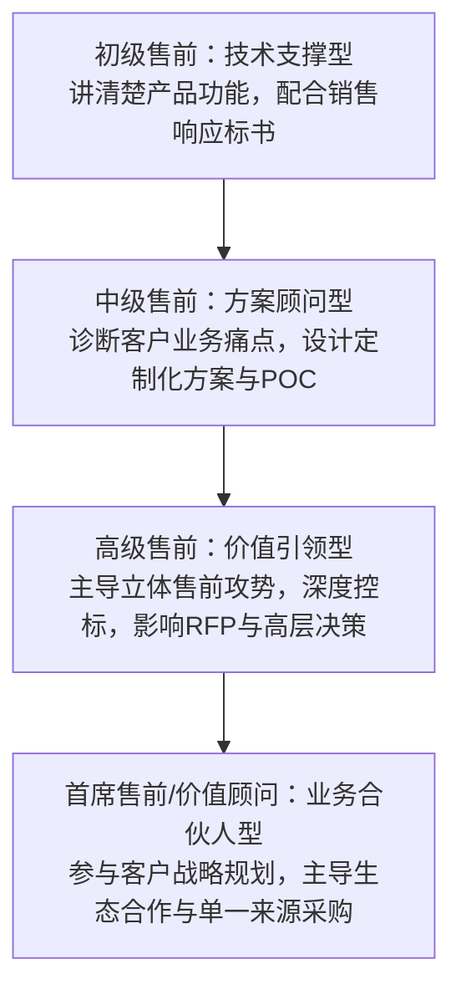

# 第01讲：课程导读与售前专业进化路径

> **【本讲一句话心法】**：售前不是拼凑方案的二把刀，而是从野蛮生长的“游击队”蜕变为敢打硬仗的大厂“正规军”的技术军师。

---

### 一、 场景痛点与认知破局

#### 1. 一线实战痛点
* **低水平野蛮生长**：大部分售前依靠师傅口传心授或个人顿悟，缺乏标准化作业体系；
* **定位被动边缘化**：常被销售人员视作“写PPT、抄标书的打字员”，被客户视作“推销产品的二把刀”；
* **短期合同导向**：只关注眼前单一项目的拿单，忽视客户全生命周期的商业价值与交付落地，导致“签单即亏损，交付即灾难”。

#### 2. 常见认知误区
* 误区一：“只要技术够牛，就能做好售前。”（真相：纯技术思维只会把客户推向竞品，售前拼的是业务洞察与商业价值转化能力。）
* 误区二：“搞定客户关键在搞关系，方案差不多就行。”（真相：没有硬核专业价值与可信赖的方案支撑，所谓的客情关系在真实业务风险面前不堪一击。）

#### 3. 核心认知破局
从**以单点项目为中心**转向**以客户全生命周期价值为中心**；从**拼凑方案的游击队**升级为**规范化、系统化、实战化的正规军**。售前是项目高价中标、可顺利交付、成本受控与客户满意的战略起点。

---

### 二、 核心方法论与课程三大特色

1. **规范性（Standardization）**：将分散的个人经验抽象为标准作业流程（SOP）、Checklist与交付标准，让能力可复制、团队打法可度量。
2. **系统性（Systematicity）**：建立面向客户整体的 PDCA（计划-执行-检查-改进）全生命周期闭环，涵盖商机发掘、立项评估、招投标、合同谈判、项目交付及维保二期。
3. **实战性（Practicability）**：不回避中国政企商业环境中的真实困境与灰度空间，以细节痛点为切入点，提供即学即用的作战工具。

---

### 三、 售前实操标准动作（从新手到专家的进阶阶梯）

1. **第一阶段：建立专业规范与工作边界**
   * 建立规范文档模板库，拒绝随意的“拼凑式方案”；
   * 与销售建立平等的业务合作共识，明确售前不是“打字员”。
2. **第二阶段：构建全生命周期的打单视野**
   * 在项目初期介入（Why Something阶段），参与客户销售计划（Account Plan）；
   * 关注项目交付边界（SOW），将交付风险前置化解在售前阶段。
3. **第三阶段：沉淀业务领域的行业洞察**
   * 深入理解行业客户的核心考核指标（KPI）、组织架构与政治动能，成为客户内部支持者（Champion）信赖的外部专家智囊。

---

### 四、 实战工具箱与售前作业规范

#### 1. 售前工程师专业度自查 Checklist（基准篇）
* [ ] 是否清楚本项目我方与友商的技术优劣势对比（非空泛参数，而是客户业务场景价值）？
* [ ] 是否明确本项目的核心决策人（EB/TB/UB）及其关注核心？
* [ ] 方案中的工期、人力成本与定制边界是否经过交付团队审核？
* [ ] 是否为本次交流/演示准备了针对客户行业痛点的定制化话术？

#### 2. 经典沟通话术示范
* **当销售要求“你帮我随便凑个方案交上去”时**：
  > “李哥，凑一份方案半天就能搞定，但如果在没有摸清客户真正痛点和竞争对手底牌的情况下贸然交方案，很容易暴露我们的底牌并被客户判定为不专业。咱们先花30分钟对一下客户背景和这几项关键信息，我针对性出一版能打痛客户的差异化方案，咱们赢单率至少翻倍。”

---

### 五、 真实标杆案例深度复盘

* **背景**：某大型软件企业售前团队长期被销售人员随意召唤，人均每月应对20+个技术交流与方案，但整体赢单率不足15%，且交付团队频繁投诉售前在SOW中“过度承诺”，导致项目延期亏损。
* **破局动作**：
  1. 引入 4S 规范化售前打法，建立“立项准入6看清单”，对无预算、无痛点、无Champion的假商机实行售前不进场机制；
  2. 售前资源向重点战略客户（Top 20%）倾斜，深入介入客户前期业务咨询与蓝图设计；
  3. 建立售前-交付 Handover（交接）评审机制，方案中技术偏差与交付工期须双向签字确认。
* **成果**：团队响应项目数量下降40%，但重点项目赢单率提升至42%，交付延期率降低60%，售前在团队中的话语权大幅提升。

---

### 六、 血泪教训与避坑红线

> [!WARNING] **红线一：严禁为了配合销售“交差”而盲目出具不具可行性的技术方案。** 一旦中标，模糊的承诺将成为后续实施无法逾越的深坑，甚至导致公司遭受索赔。

> [!CAUTION] **红线二：警惕“纯技术自嗨”。** 很多技术转岗售前喜欢在客户面前滔滔不绝讲微服务、高并发、底层架构，却回答不了“这套系统如何帮客户省钱、多赚钱或规避合规风险”，最终被客户打上“脱离业务”的标签。

---

### 七、 课后思考题与实战研讨指南

#### 思考题 1：你认为你目前所在团队的售前打法，是“野蛮生长的游击队”还是“高度规范的正规军”？主要体现在哪些具体环节？
* **破题思路**：
  * 检查维度包括：是否有统一的售前交付物模板？是否有技术交流前的标准调研机制？是否有POC进场退出准则？是否有严密的偏离表和SOW评审流程？售前在销售战役中是“随叫随到”还是“平等共商”？

#### 思考题 2：为什么说“面向客户长期价值”往往比“签下单个短期合同”对售前自身的职业发展更重要？
* **破题思路**：
  * 单个合同的成功可能依赖客情或价格战，但无法建立个人专业声誉；只有帮客户解决实际业务痛点、保障系统顺利上线产生业务效益，客户内部的Champion才会一路升迁并成为你的终身客户人脉。

#### 思考题 3：你在过往售前经历中，遇到过最痛苦的“销售甩锅”或“交付扯皮”事件是什么？当时缺失了哪一项规范动作？
* **破题思路**：
  * 分析事件发生的阶段（如需求阶段未界定范围、技术阶段未留交流记录、投标阶段无底线完全满足、交付阶段未做Handover），明确对应阶段必须设立的防火墙机制。
