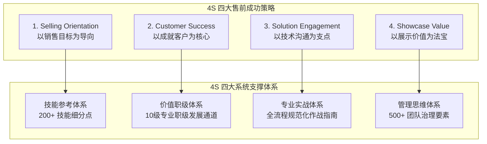
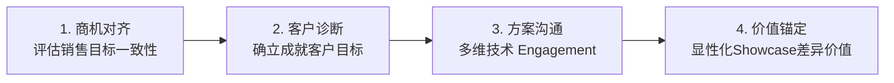

# 第02讲：4S专业售前法体系深度解析

> **【本讲一句话心法】**：4S 不是技巧的堆叠，而是售前职业立场的重构 —— 销售导向为航标、客户成功为基石、技术沟通为杠杆、持续显性化价值为武器。

---

### 一、 场景痛点与认知破局

#### 1. 一线实战痛点
* **被销售呼来喝去**：成为销售员的“随行秘书”或“写标书的苦力”，缺乏独立战略地位与话语权；
* **面对客户诚惶诚恐**：把客户视作“上帝”，有求必应，导致需求无限蔓延、系统实施困难；
* **深陷技术自恋陷阱**：以为掌握复杂的架构、代码和参数就是优秀售前，却无法与客户业务领导在同一频道对话；
* **依赖盘外招与低价内卷**：缺乏清晰的价值呈现能力，最终被友商拖入恶性价格战。

#### 2. 常见认知误区
* 误区一：“售前就是服务销售的，销售怎么说我就怎么做。”（错！售前服务的是**公司的整体销售目标**，而非销售个人的随意指令。）
* 误区二：“做售前关系搞定一切，产品技术只要能糊弄过去就行。”（错！在中国B2B采购合规化、专业化趋势下，技术失真和交付暴雷会直接摧毁企业信誉。）

#### 3. 核心认知破局
**4S专业售前法**，针对中国科技产业与B2B复杂销售环境，重构了售前的职业底层哲学与作业系统，使售前从“从属支援角色”转变为“核心价值引擎”。

---

### 二、 核心方法论：4S成功策略与四大支撑体系

#### 1. 4S 策略深度拆解

| 策略名称 | 核心理念 | 角色定位 | 典型行动准则 |
| :--- | :--- | :--- | :--- |
| **S1. Selling Orientation 以销售目标为导向** | 不是以销售人员个人的主观指令为转移，而是以团队和公司的业务战略目标为导向。 | **销售的技术军师、平等业务合伙人** | 协助销售评估商机可行性，敢于叫停毫无胜算的陪标项目，集中精力打胜仗。 |
| **S2. Customer Success 以成就客户为核心** | 客户不是盲目逢迎的“上帝”，而是需要帮助其解决真实挑战、达成发展愿景的专业伙伴。 | **客户信赖的专业顾问、业务抓手** | 洞察客户隐性业务痛点，不仅帮助客户组织达成ROI，还帮助客户个人干系人获得职场成功。 |
| **S3. Solution Engagement 以技术沟通为支点** | 售前的立身之本不是“闭门死磕技术”，而是“精通如何与客户沟通技术解决方案”。 | **业务与技术的翻译官、转化器** | 以技术为主线、沟通为手段，让客户彻底信服方案的可行性、经济合理性与落地安全性。 |
| **S4. Showcase Value 以展示价值为法宝** | 不靠搞关系做局、不靠贬低诋毁友商，而以持续向客户展示和交付核心价值为终极法宝。 | **受人尊重的行业专家、长效伙伴** | 通过差异化卖点（USP）、结构化收益测算和确定性的交付展示，构筑竞争壁垒。 |

#### 2. 四大系统体系支撑
1. **技能参考体系（200+技能点）**：覆盖需求探寻、方案架构、演讲控场、POC控盘、商务协同等全能力图谱；
2. **价值职级体系（10个层级）**：从初级售前工程师到首席价值顾问（Chief Value Advisor），建立清晰的职业梯队；
3. **专业实战体系**：覆盖项目全生命周期的标准化打法、模板与案例库；
4. **管理思维体系（500+治理要素）**：为售前总监与企业高管提供售前团队ROI评估、产能调配与赋能框架。

---

### 三、 售前实操标准动作（4S 策略落地 SOP）

* **Step 1：商机准入对齐（Selling Orientation）**
  * 召开售前-销售对齐会，核实客户预算、项目排期与关键决策链，确保资源投入符合季度销售重点。
* **Step 2：确立客户成功目标（Customer Success）**
  * 调研客户痛点并明确成功标准：系统上线后客户内部要解决什么关键业务问题？客户项目发起人（Sponsor）的个人战绩是什么？
* **Step 3：设计多层次沟通路径（Solution Engagement）**
  * 针对技术层（TB）讲架构先进性与易维护性；针对业务层（UB）讲操作便捷性与业务增效；针对经济买家（EB）讲成本回报与战略协同。
* **Step 4：持续显性化价值（Showcase Value）**
  * 在技术交流、PPT方案、产品演示与商务竞标的每个接触点，固化我方独特的差异化价值（USP）。

---

### 四、 实战工具箱：售前“平等合伙人”定位重构话术

#### 1. 应对销售无理要求的协同话术
* **情境**：销售催促：“赶紧把这份100页的标书方案复制粘贴搞出来，明天上午就要！”
* **4S导向话术**：
  > “张哥，这份标书复制粘贴半夜就能交差，但这样通篇通用套话的方案在专家评审时根本拿不到高分。从咱们赢单的目标来看，我建议重点把第3章的技术架构和第5章的实施风险管控做针对性定制，凸显咱们比友商快两周上线的优势。今晚我集中攻坚这两个加分点，明天拿出一套能锁住评委眼球的高分方案。”

#### 2. 应对客户过度要求的话术
* **情境**：客户提出超出产品范围的大量免费定制要求。
* **4S导向话术**：
  > “刘总，您的这些构想在业务上非常有前瞻性。作为您的技术顾问，我们需要客观评估：如果一期项目将所有非核心功能都塞进来，开发周期至少拉长3个月，项目延期上线反而会影响咱们部门本季度的重点考核指标。我建议咱们采取‘核心业务快速上线、二期功能模块迭代’的节奏，既保住本期成果，又能更稳妥地落地。”

---

### 五、 真实标杆案例深度复盘

* **背景**：某网络安全软件厂商在与某商业银行合作时，竞争对手采用低价策略，且商务关系深厚。该厂商销售认为此单必败，要求售前“随便应付一下，做个陪标方案”。
* **4S破局运用**：
  1. **Selling Orientation**：售前负责人未盲从销售的弃赛态度，而是从公司年度开拓金融头部客户的销售目标出发，决定主动破局。
  2. **Customer Success**：深入挖掘发现，银行科技部主管正面临监管机构的数据合规突击审计压力，最怕系统部署后发生审计不过关的风险。
  3. **Solution Engagement & Showcase Value**：售前团队不打价格战，而是为银行量身设计了一套“符合银保监会最新合规标准的自动化合规审计组件”，在技术交流会上直击痛点，证明该方案能帮科技部免除合规受罚风险。
* **结果**：银行科技部将该组件列为招标硬性技术指标，友商因无法快速自研满足而丢分，该厂商以高价成功赢单。

---

### 六、 血泪教训与避坑红线

> [!WARNING]
> **红线一：严禁做“好好先生”和“需求复读机”。** 客户提什么需求都记录承诺，最终导致方案庞杂、成本失控、交付逾期，不仅无法成就客户，反被客户问责。

> [!CAUTION]
> **红线二：警惕销售与售前的责任转嫁。** 当项目处于低劣势时，部分销售会借由“售前方案没写好”或“技术演示不给力”甩锅。售前必须在项目各阶段留存交流纪要、偏离声明与风险备忘录。

---

### 七、 课后思考题与实战研讨指南

#### 思考题 1：请对照 4S 中的“Selling Orientation”，反思你最近参与的一个项目，你是在执行销售的指令，还是在推进团队的销售目标？二者有何本质区别？
* **破题思路**：
  * 执行指令是战术打杂（如被动写文档、跑腿演示）；推进目标是战术协同（如主动分析赢面、指出方案硬伤、设计控标条款、主动筛选高价值机会）。

#### 思考题 2：如何平衡“成就客户（Customer Success）”与“公司利益（Company Profit）”之间的潜在矛盾？
* **破题思路**：
  * 成就客户指的是成就客户的**真实业务目标与长期价值**，而非满足客户某一个别人员的无理要求或过度免费索取；通过分期规划（Phase 1/Phase 2）、标准产品适配与交付边界清晰化，实现客户成功与公司合理利润的双赢。

#### 思考题 3：如果你的产品在技术参数上全面落后于行业龙头友商，如何通过“Solution Engagement”和“Showcase Value”找到打赢项目的切入点？
* **破题思路**：
  * 避开友商占优的通用性能参数，转向客户特定痛点场景的适配性、本地化服务响应速度、定制化灵活性、总体拥有成本（TCO）以及落地确定性，打造局部唯一性的独特卖点（USP）。
