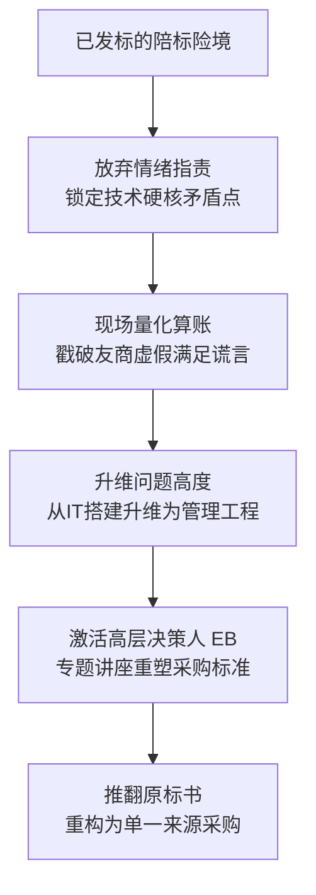

# 第03讲：标杆战役复盘（一）：从陪标绝境到单一来源采购

> **【本讲一句话心法】**：拒绝做无谓的陪标炮灰；用无法辩驳的技术量化铁证戳破竞争对手的吹嘘，将技术采购升维为管理变革，把必败之局逆转为单一来源采购。

---

### 一、 场景痛点与认知破局

#### 1. 一线实战痛点
* **发标才知情，被拉去当陪标炮灰**：很多客户经理在项目前期毫无作为，等客户招标文件正式发布后，才火急火燎催促售前投标，美其名曰“我和客户领导关系很铁，一定能赢”；
* **标书通篇是友商控标条款**：打开标书发现参数全部针对友商产品定制，正规应答不仅严重偏离，且履约成本可能超预算十倍；
* **销售内部博弈压力大**：售前如果直接拒绝，容易被销售扣上“不支持业务”、“思想消极”的帽子。

#### 2. 常见认知误区
* 误区一：“客户经理和领导关系好，硬着头皮投一下，万一撞大运中标了呢？”（真相：发标才知情的项目，99%是友商早已锁定的做局项目，进场就是免费抬轿。）
* 误区二：“去跟客户说‘你们标书偏袒友商，我们不投了’。”（真相：这种指责只会激怒客户，客户绝不会承认，只会反驳‘方案和价格合适我们肯定选你们’。）

#### 3. 核心认知破局
不打情绪仗，打**专业逻辑仗**。选择**高难度、可量化、无法反驳的技术硬指标**作为切入点，现场帮助客户算清业务与财务账，暴露友商虚假承诺的巨大实施风险，从而推动客户在技术决策层“重新建立需求”。

---

### 二、 核心方法论：陪标翻盘的四维推演模型



1. **破局点选择标准（抓大放小）**：
   * 避开主观性描述（如“功能易用性”、“界面友好度”）；
   * 锁定行业公认的严苛指标（如高可用性、并发事务性能、多活灾备等），用数学和行业标杆事实说话。
2. **问题升维法则**：
   * 客户往往把复杂的数字化变革当成普通的“软件采购”；
   * 售前要将其从“采购一个工具”升维为“一项关乎业务成败的管理变革工程”，从而吸引更高层决策者（EB - Economic Buyer）的介入。

---

### 三、 售前实操标准动作（翻盘五步 SOP）

* **Step 1：冷静研判标书，拒绝盲目进场**
  * 核查发标时间点、定制化参数与预算匹配度，若判定为典型陪标，坚决拒绝直接投标应答。
* **Step 2：精选单一量化突破口**
  * 在数百条指标中提炼出 1~2 个友商为了控标而“过度承诺”的极端技术指标（如 99.99% 持续可用性）。
* **Step 3：拜访客户关键项目经理，以“退”为“进”**
  * 声明“我方因无法满足某些过高要求而决定退出”，态度真诚专业；
  * 现场给客户推导达成该指标所需的机房供电、双活容灾、双倍软件许可等巨大隐形成本，迫使客户说出真实底牌（“友商承诺都能满足”）。
* **Step 4：指出交付现实风险，升维项目性质**
  * 明确告知：“行业内目前尚无一次性上线如此多模块的成功先例，上线容易但落地推广极难，本质是管理变革。”
* **Step 5：锁定高层汇报，重新定义规则**
  * 提出举办高层专题研讨会（要求主管技术总经理/副总裁出席），主题聚焦于《某项目典型失败原因剖析与成功之道》，会后锁定项目主导权。

---

### 四、 实战工具箱与经典对话脚本

#### 1. 应对客户“友商都说能满足”的话术
> “张工，我很理解。但从工程落地的严肃性来看，标书里要求的‘99.99%可用性’意味着一年非计划停机时间不能超过52分钟。目前国内公有云单实例承诺通常在99.9%左右。要真正达到4个9，需要双机房双路供电、网络全冗余、两套完整热备软件及实时数据镜像。如果供应商仅仅在偏离表上写‘完全满足’，而没有给出详尽的容灾架构设计和至少3倍的硬件预算支持，最终系统上线一旦宕机，承担责任的将是贵方项目团队。”

#### 2. 陪标项目筛选与翻盘可行性决策表

| 评估维度 | 放弃投标（果断止损） | 尝试翻盘（转守为攻） |
| :--- | :--- | :--- |
| **客户层级触达** | 只能接触到基层经办人，无法约见主管领导 | 存在约见技术副总裁或CIO（EB）的通道 |
| **标书指标硬伤** | 友商设置的纯软性专利或特定编号参数 | 存在违背技术常识或带来巨大财务浪费的极端指标 |
| **项目关键影响** | 边缘支撑小工具，领导不关心上线成败 | 核心业务系统，一旦实施失败会导致管理层被问责 |

---

### 五、 真实标杆案例深度复盘

```
【客户类型】大型外企高科技制造企业
【博弈险境】客户已公开发标，销售经理声称“与领导关系铁”逼迫售前投标。售前发现标书完全由竞品操刀，成本是预算十倍以上，判定为免费陪标。
【破局切入】锁定标书中“系统可用性达 99.99%（四个九）”条款。
【实战推演】：
  1. 售前直奔客户项目经理处声明“本项要求我司无法做到，特来告知弃标理由”；
  2. 详细推导 99.99% 意味着年停机<1小时，需两套冗余软件、双路供电及专属机房支持，目前预算根本无法支撑；
  3. 客户惊恐坦白：“友商交流时拍胸脯说没问题，没想到背后这么复杂！”
  4. 售前进一步指出该项目涵盖模块过多，本质是管理变革项目而非普通系统安装；
  5. 客户项目经理主动提议邀请主管技术总经理（EB）召开高层研讨会；
  6. 售前讲授《典型失败原因分析与成功之道》，引发管理层强烈共鸣。
【战役成效】主管技术总经理当场认可其专业度，推翻原招标进程，项目重构并指定由该售前团队以单一来源（Sole Source）方式主导实施！
```

---

### 六、 血泪教训与避坑红线

> [!WARNING] **红线一：千万不要在客户面前揭穿“你们标书抄了友商”。** 哪怕标书里连友商的名字都没删干净，也不要直接攻击客户的操守。客户出于合规与自尊，必然极力否认并彻底关闭沟通大门。

> [!TIP] **技巧：以退为进是最好的进攻。** 承认“我们正规大厂做不到（因为严谨，遵守工程常识）”，反衬出友商的“毫无底线与信口开河”，激发客户项目团队内心对项目上线烂尾的恐惧。

---

### 七、 课后思考题与实战研讨指南

#### 思考题 1：如果客户项目经理在听完你指出的严峻技术风险后，依然无动于衷（比如他拿了友商好处，铁了心做局），售前该如何决断？
* **破题思路**：
  * 果断止损撤出。当基层经办人已被完全利益绑定且无法向上穿透到更高的经济买家（EB）时，继续纠缠只会浪费公司宝贵资源。此时应向销售主管出具正式的技术风险备忘录，封存证据，转向其他高赢面机会。

#### 思考题 2：为什么把项目定义为“管理变革工程”往往比定义为“IT技术系统”更容易打动客户高管？
* **破题思路**：
  * IT系统是成本中心，高管不关心技术细节；管理变革关乎跨部门协同、业务效率与组织政绩，属于价值中心。将技术方案与高管的组织战略、KPI考核和职场政绩挂钩，才能获取一把手的预算支持与信任。

#### 思考题 3：如果你的竞争对手在标书里什么都敢写“完全满足”，售前如何提前在客户心中埋下“防伪炸弹”？
* **破题思路**：
  * 提前向客户提供《技术验证与POC测试用例指南》或《方案真实性核验问卷》，建议客户要求各供应商提供现场配置录屏、已有上线客户的生产环境巡检报告或第三方压测报告，用实证逼退友商的虚假承诺。
