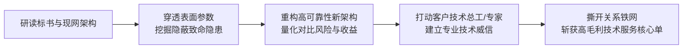

# 第04讲：标杆战役复盘（二）：硬核技术取胜助推客户成功上市

> **【本讲一句话心法】**：不是“空有技术赢不了项目”，而是你的技术平庸得未能给客户带来不可替代的业务确定性；真正的硬核技术创新足以打破关系垄断。

---

### 一、 场景痛点与认知破局

#### 1. 一线实战痛点
* **“关系决定论”的心理宿命感**：许多技术背景出身的售前和中小公司老板常常自怨自艾：“人家销售天天陪客户吃饭喝酒搞关系，咱们辛辛苦苦做技术有什么用？到头来还不是陪跑？”
* **技术平庸化、同质化**：方案千篇一律，照搬行业模板，无法展现出与友商有显著代差的专业深度；
* **面对亿元级大项目不敢主动破局**：自认没有客情积累，抱着“凑热闹、练练兵”的陪跑心态，缺乏反向破局的魄力。

#### 2. 常见认知误区
* 误区一：“在B2B政企大客户采购中，技术根本不重要，商务关系搞定一切。”（真相：在小额通用商品采购中关系可能起效，但在亿元级核心骨干工程中，一旦系统瘫痪，技术决策人要承担行政问责与职业生命终结的巨大风险。此时**技术确定性是第一安全感**。）
* 误区二：“客户标书给定的技术路线就是圣旨，我们只要按部就班照搬应答就好。”（真相：很多标书的初步方案存在严重架构缺陷，不敢指出缺陷才是真正的失职。）

#### 3. 核心认知破局
**“关系能够开门，但唯有技术能够关单（Close the deal）并保平安。”** 不是技术无用，而是你的技术还未达到能让客户总工和专家眼前一亮的专业高度。通过深度技术审查发现潜在致命架构隐患，并提出颠覆性的优化方案，技术可以直接撕开关系铁幕。

---

### 二、 核心方法论：从“技术自嗨”到“技术破局”的价值飞轮



1. **关系型公司与技术型公司的生态分工**：
   * 在大型复杂集成项目中，关系型集成商往往擅长拿下“重资金、低毛利、重垫资”的硬件设备供货包；
   * 真正高技术壁垒、高毛利、高话语权的是**架构咨询与核心技术服务包**。售前要学会“田忌赛马”，用技术优势收割核心价值。
2. **技术安全感是技术决策者（TB）的核心利益**：
   * 客户总工程师、架构师最大的内在诉求不是给谁发财，而是**“项目绝对不能出安全生产事故、系统绝对不能挂”**。
   * 售前提出解决致命隐患的方案，本质上是在拯救总工的职业生涯。

---

### 三、 售前实操标准动作（技术撕网打法 SOP）

* **Step 1：开展“红队审查（Red Teaming）”，推演极端场景**
  * 不仅看标书要什么，更要在脑海中压测系统的峰值流量、容灾切换、单点故障（SPOF）与安全边界，寻找标书设计中的先天硬伤。
* **Step 2：形成“隐患诊断报告”与“创新替代架构”**
  * 严谨论证：在标书原架构下，未来业务激增或极端异常时会发生什么连锁崩溃；
  * 给出经过严谨计算的全新设计，说明如何在不增加大幅预算的前提下根治该隐患。
* **Step 3：述标与讲标环节大胆“技术亮剑”**
  * 讲标不仅念PPT，而是开门见山点出：“经专家组复核，原技术蓝图存在一处高危隐患，我们为此专项定制了优化架构。”
  * 现场用数据和推演图震撼全场专家评委。
* **Step 4：承接总工技术闭门交流，锁定服务标包**
  * 获得总工程师亲自邀请后，派出顶级架构师阵容，以纯技术干货交流，彻底坐实不可替代的技术领先性，顺理成章承接核心技术服务。

---

### 四、 实战工具箱：技术方案排雷与架构审查清单

#### 1. 复杂系统架构“致命隐患”排查 Checklist
* [ ] 链路中是否存在单点故障（SPOF）？主备切换时间是否满足极端要求？
* [ ] 在业务峰值冲高 5~10 倍时，底层存储 IOPS 和数据库连接池是否会发生雪崩式拥塞？
* [ ] 跨机房数据同步是否存在脑裂（Split-brain）风险？
* [ ] 权限隔离与数据传输是否存在国家合规与安全漏洞？

#### 2. 述标汇报中的技术破局话术
> “各位专家评委，我们仔细研读了本次招标的技术规范书。贵方设计的整体框架非常宏大，但在第4.2节的骨干网跨区路由设计上，若遇突发光缆中断，收敛切换时间预计超过90秒，这对于实时金融交易将造成不可逆的事务锁死。为此，我们没有简单复制常规应答，而是专项设计了‘双环自愈+智能BGP快速收敛’架构，将切换时间压缩至毫秒级。以下是我们经过实测的压测推演数据……”

---

### 五、 真实标杆案例深度复盘

```
【项目背景】某一线城市亿元级骨干网络工程公开招标，业内巨头与本地深厚关系型厂商云集。
【入场心态】某民营高科技创业公司毫无客户关系，本抱着“大项目练兵、权当陪跑”的心态参与。
【售前洞察】深入研究招标技术方案后，售前架构师发现原有顶层网络架构存在严重的单点拥塞与容灾缺陷，一旦上线将面临瘫痪隐患。
【破局亮剑】：
  1. 在讲标答辩环节，该团队并未按部就班照本宣科，而是直言不讳地指出现行设计隐患，并当场提出了一套极具前瞻性的创新设计方案；
  2. 一周后，该城市项目的总工程师亲自发出闭门邀请，召集专家深入研讨其全新架构；
  3. 经过严密论证，客户专家组全面采纳了该团队的创新设计。
【最终战果】尽管亿元级硬件供货部分被关系型总包商拿走，但该民营公司凭借无可争议的技术制高点，全资斩获了核心技术服务标包。自此确立“技术取胜”战略，两年后成功于香港联交所敲钟上市！
```

---

### 六、 血泪教训与避坑红线

> [!WARNING]
> **红线一：指出客户方案隐患时，切忌“嘲讽式否定”。** 方案大概率出自客户某些专家或设计院之手。沟通时必须强调“原方案在常规场景下非常优秀，只是在未来超大规模演进时面临新挑战”，给客户专家保留十足面子。

> [!TIP]
> **技巧：技术交流要“抓关键决策人（TB/总工）”。** 商务人员只关心佣金和过票，只有对系统故障负全责的总工程师，才会为你的硬核技术设计拍案叫绝并保驾护航。

---

### 七、 课后思考题与实战研讨指南

#### 思考题 1：如果一个项目客户关系已经被友商牢牢锁死，在什么情况下我们依然值得用“硬核技术方案”去拼一把？
* **破题思路**：
  * 项目属于高风险、高技术难度、强监管合规的核心工程；客户技术领导（如总工、CIO）具有一票否决权或强技术话语权；标书方案存在明显致命漏洞而友商无法修复。

#### 思考题 2：为什么说“硬件供货靠关系垫资，技术服务靠专业硬核”是高科技企业走向健康盈利甚至上市的必由之路？
* **破题思路**：
  * 纯硬件转售毛利低、垫资重、账期长，容易受制于商务关系和资金链断裂；而以自有核心技术、架构服务、软件版权为主的技术服务，具备高毛利、轻资产、高客户黏性的特点，是资本市场给予高估值和IPO上市的核心驱动力。

#### 思考题 3：作为一名售前工程师，你平时如何沉淀自己的“红队审查”能力，让自己在拿到标书第一眼就能看出竞品架构的破绽？
* **破题思路**：
  * 研读行业标杆故障复盘报告；深入交付一线观摩系统排障过程；参与大厂高可用架构压测实验；建立自己产品与主流竞品的“架构优劣势深度技术透视表”。
