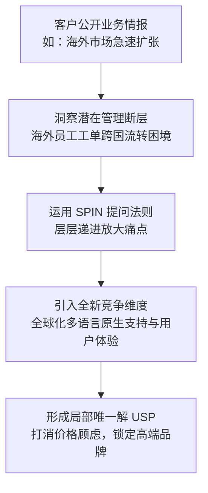

# 第05讲：标杆战役复盘（三）：巧设独特卖点（USP）逆风翻盘

> **【本讲一句话心法】**：USP 不需要是全球独一无二的专利黑科技，而是在“当前特定项目、特定对手、特定客户诉求”下的局部唯一解；售前的职责是为项目定制 USP。

---

### 一、 场景痛点与认知破局

#### 1. 一线实战痛点
* **产品同质化严重，深陷“质优价高”困境**：高端成熟产品功能全面，但客户常反馈“你们功能确实强，但很多我们用不上，本土竞品便宜又好用”，直接将选型拉入价格血拼；
* **售前介入过晚（临近发标）**：客户已经对各家产品形成了固有成见，常规功能演示与参数对比根本无法动摇客户选型倾向；
* **过度依赖后方标准营销材料**：总部的产品手册只写通用功能，无法提供针对特定竞品的“杀手级”差异化武器。

#### 2. 常见认知误区
* 误区一：“USP必须是产品研发团队打造出来的独家发明或颠覆性专利。”（真相：真正的打单USP往往是**一线售前根据客户特定业务动向定制挖掘**出来的。）
* 误区二：“客户嫌我们贵，我们就应该跟领导申请打折降价。”（真相：在价格战的泥潭里，高端厂商永远不可能比小厂商更便宜，降价只会稀释利润并丢失品牌价值。）

#### 3. 核心认知破局
**重新定义战场**。当在客户划定的旧维度（“价格与基础易用性”）处于劣势时，售前绝不能在旧维度内苦苦挣扎，而必须**引入客户未曾考虑、友商无法满足、且关乎客户未来战略成败的“全新竞争维度”**。

---

### 二、 核心方法论：打单级 USP 挖掘与 SPIN 引导模型



1. **USP的本质是“局部唯一”而非“全球唯一”**：
   * 只要在面对这五六家特定竞品时，这个卖点只有你能做到、且客户认为极度重要，它就是完美的打单 USP。
2. **SPIN提问链在USP中的实战闭环**：
   * **S (情境问题)**：了解现状 —— 当前系统未来是否覆盖海外分支？
   * **P (难点问题)**：挖掘隐患 —— 海外员工遭遇核心系统故障，如何流转工单至国内二三线运维？
   * **I (暗示/后果问题)**：放大后果 —— 本土竞品机翻的“中式英语”如果导致海外员工投诉到区域业务一把手，IT项目成效是否会遭到高层质疑？
   * **N (价值问题)**：抛出解药 —— 采用经过全球500强验证的原生多语言平台，是否既规避了海外反弹，又彰显了IT部门支持国际化战略的宏大视野？

---

### 三、 售前实操标准动作（定制 USP 五步法）

* **Step 1：开展客户外围战略情报尽调**
  * 浏览客户官网新闻动态、财报公告、战略发布会及招聘网站，寻找客户当年的战略扩张点（如：出海、下沉、合规审计、并购重组等）。
* **Step 2：寻找客户战略动向与IT系统的交叉盲区**
  * 对比客户当前的采购需求范围，找出其在组织协同、数据打通、合规风控上“尚未考虑”的系统性断点。
* **Step 3：评估竞品阵营的硬性短板**
  * 明确本土竞品在此类交叉场景上的致命短板（如：缺乏跨国多语言本地化经验、缺乏海外合规认证等）。
* **Step 4：约见项目核心负责人，实施 SPIN 引导**
  * 严禁直接推销功能，通过由浅入深的提问，引导客户负责人自行推导出“若不解决此问题，项目上线必遭高层问责”的恐惧感。
* **Step 5：将 USP 与客户负责人的职场政绩深度绑定**
  * 把多花预算的理由，从“购买多余软件功能”升维为“为IT部门赢得支持企业全球化战略的声誉”。

---

### 四、 实战工具箱：SPIN 提问设计表（以出海场景为例）

| SPIN阶段 | 提问设计示范 | 客户心理反应 |
| :--- | :--- | :--- |
| **S (Situation)** | “王总，注意到贵司近期在东南亚和欧洲扩张迅猛，这套内部服务管理系统后续会开放给外籍员工使用吗？” | “还没考虑那么远，打算让他们当地IT自建。” |
| **P (Problem)** | “目前咱们核心业务系统的二三线运维都在国内总部，如果当地自建系统，跨国工单如何流转？系统断点如何打通？” | 意识到这是一个之前被忽略的技术与管理死角。 |
| **I (Implication)** | “如果让本土竞品简单做一套中式英文翻译界面，外籍员工看不懂导致报障延误，把意见反馈到海外业务大区总裁那里，是否会直接影响管理层对本次IT项目成效的满意度？” | 眉头紧皱，意识到可能引发高层跨部门政治问责的严重后果。 |
| **N (Need-Payoff)** | “如果我们提供一套原生支持数十国地道语言、经全球500强企业成熟验证的平台，虽然前期略微多一点投资，但能彻底杜绝跨国投诉，同时向集团高层展现IT部门全球化支撑的战略视野，您觉得是否物超所值？” | 心理防线彻底动摇，价格敏感度大幅下降。 |

---

### 五、 真实标杆案例深度复盘

```
【项目背景】某大型中资跨国企业采购全员“员工服务管理系统（ESM）”，5~6家本土供应商入围，唯有讲师所在团队为外企供应商。
【竞争态势】客户评估团队已初步形成定论：外企产品功能强大但价格昂贵且功能过剩；本土产品简单易用且价格低廉，客户决意采购本土软件。
【情报捕获】售前通过客户官网新闻敏锐捕捉到关键情报：客户正大规模加速出海业务，海外招募大量外籍员工。
【破局实操】：
  1. 售前直奔项目主管负责人，连续抛出跨国工单流转与海外运维协同的盲区问题；
  2. 针对客户提出的“让本土厂商做一套英文翻译版”，售前犀利指出“中式英语机翻”将造成外籍员工体验极差，极易激化海外高管与总部IT的矛盾；
  3. 适时亮出产品“全球数十国原生多语言架构”这一被数千家跨国名企验证过的独家优势；
  4. 升维价值：证明略高投资带来的不仅是产品，更是IT部门“支撑集团全球化战略”的政治资本与政绩亮点。
【最终战果】彻底推翻客户“买便宜本土软件”的既定决议，将多语言全球化列为核心硬指标，高价全盘赢单！
```

---

### 六、 血泪教训与避坑红线

> [!WARNING] **红线一：严禁向客户兜售“客户根本不需要的伪USP”。** 如果客户未来五年绝无出海计划，你在多语言能力上花费千言万语，只会坐实“你们产品功能过剩还死贵”的负面印象。USP 必须建立在客户**真实业务演进的必然路径**上。

> [!TIP] **技巧：永远不要在对手的主场（低价）里同态竞争。** 遇到低价对手时，降价是最无能的招数；售前的最高境界，是把竞争焦点从“采购成本（Purchase Price）”拉升到“业务失败风险与战略综合回报（Strategic ROI）”。

---

### 七、 课后思考题与实战研讨指南

#### 思考题 1：如果你的产品在业内普遍被评价为“功能复杂、价格高昂”，面对以“简单实用、低价灵活”为卖点的本土竞品时，你应该从哪些角度设计你的 USP？
* **破题思路**：
  * 转向底层架构稳定性（未来5年扩展无需推倒重来）、高并发海量数据承载力、严格的数据权限隔离与安全审计标准、以及大中型复杂项目的成熟上线方法论与风险兜底能力。

#### 思考题 2：为什么说“USP往往不是总部产品市场部（PMM）在办公室里规划出来的，而是由一线售前在打单现场定制出来的”？
* **破题思路**：
  * 总部PMM面对的是宏观市场通用画像，提炼的是通用卖点（Feature）；而一线项目面对的是具体的客户政治生态、具体的几个对手和特定的战略阶段。一线售前必须像侦探一样拼凑线索，动态组合产品特性，定制出仅在当前战役中生效的“必杀USP”。

#### 思考题 3：试想一下，如果客户对你提出的隐患全盘接受，但转头要求本土低价竞品“照葫芦画瓢”加急开发出该功能，售前该如何防御？
* **破题思路**：
  * 强调“成熟度与验证成本”。用数据说明该能力需要数年迭代和成百上千家客户的生产验证；指出定制开发将导致项目延期数月、成为小白鼠试验田，并在标书评分标准中设置“必须具备3个以上相同场景成熟上线运营案例”等硬性资质门槛。
