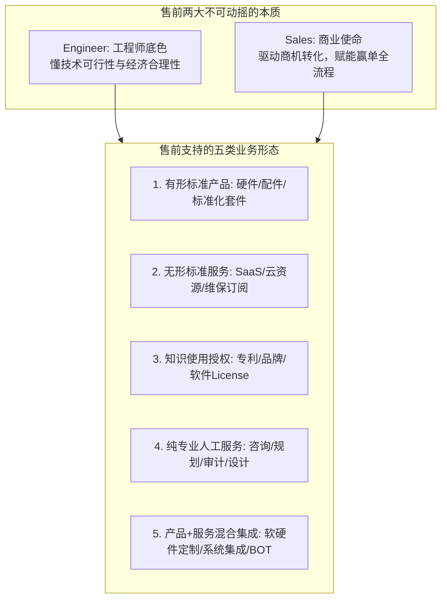

# 第06讲：什么是售前：摆脱方案“二把刀”与拼凑者定位

> **【本讲一句话心法】**：售前（Sales Engineer）的本质是“懂技术的工程师”与“赢单使命的驱动者”；不是拼凑胶水的二把刀，而是用技术沟通促成商业交易的操盘手。

---

### 一、 场景痛点与认知破局

#### 1. 一线实战痛点
* **身份认同迷失**：研发嫌弃“懂点皮毛、技术不精、天天吹牛”；销售视作“随叫随到、帮忙排版胶水方案的苦力”；客户提防“推销软件、言过其实的忽悠”；
* **工作边界模糊成“杂物桶”**：公司里找不到人干的脏活、累活、改格式、跑腿接盘，往往全推给售前；
* **职位称谓混乱繁杂**：全球有超过 200 种针对该角色的称谓（Pre-sales, Sales Engineer, Solution Architect, Value Consultant...），不同称谓背后权责与技能要求天差地别。

#### 2. 常见认知误区
* 误区一：“售前就是技术做不下去了才去转岗的‘技术逃兵’。”（真相：纯技术实现只解决 How，而售前必须融汇商业逻辑、业务场景、人际心理与工程边界，综合难度与综合能力要求远高于单一编码。）
* 误区二：“售前只要方案写得厚、PPT做得炫，能唬住客户就行。”（真相：缺乏可交付性与技术严谨性的拼凑方案，在招投标与实施验收环节必将暴雷。）

#### 3. 核心认知破局
**售前（Sales Engineer）是懂技术的工程师，其存在的终极使命是支持销售过程并赢得客户合同。** 一旦脱离了“懂技术”的专业底色或脱离了“支持赢单”的商业目标，售前岗位就会失去立足根基。

---

### 二、 核心方法论：四类标杆企业 JD 透视与五大业务形态分类

#### 1. 跨行业大厂售前岗位 JD 职能横向透视

| 企业类型与代表 | 岗位名称 | 核心职责焦点 | 售前后延能力边界 |
| :--- | :--- | :--- | :--- |
| **互联网巨头云厂商** (如阿里云) | 云业务架构师 (Enterprise Solution Architect) | 行业数字化转型咨询、业务/应用/技术三层架构设计、推动被集成生态落地、招投标标书与方案宣讲。 | 强调区域市场分析、行业专家地位与大型生态架构规划。 |
| **平台服务型科技企业** (如美团智能设备) | 智能设备售前工程师 | 餐饮后厨智能设备定义、PEST/SWOT市场分析、非标产品从0到1宏观框架与项目进度把控。 | 深度融合产品经理（PRD定义）与项目经理（进度质量把控）职能。 |
| **国际知名软件外企** (如SAP Concur) | 资深解决方案顾问 (Senior Solution Consultant) | 产品深度定制演示、针对竞争对手制定最具说服力的战略方法、升级特性同步、向产品研发反馈市场需求。 | 严格标准的国际售前典范：聚焦技术交流、竞品对抗与售前-研发飞轮。 |
| **走出国门的国际工程企业** | 海外外配套工程师 (BOM/BOQ方案专家) | 通信站点外配套行销方案包装、全套系统（供电/机房/空调）高难度配置选型、制定BOM/BOQ与报价模型。 | 涵盖产品定价、服务定价与海外本地分包商培训认证。 |

---

### 三、 售前实操标准动作（摆脱“拼凑者”的专业化四步法）

* **Step 1：厘清并锚定本司业务形态**
  * 对齐产品交付属性：明确公司做的是标准软件（注重演示与标准适配），还是定制集成（注重工程界限与SOW）。
* **Step 2：建立岗位权责防火墙与输入输出规范**
  * 拒绝“无商机尽调、无明确需求、无销售陪同”的三无盲目派单；明确售前输出物包括《客户痛点诊断书》、《定制化技术方案》、《竞争偏离分析表》。
* **Step 3：从“功能参数搬运”转向“业务价值设计”**
  * 方案编制杜绝机械复制白皮书；每一页方案必须包含“客户现状痛点 - 针对性技术架构 - 客户可量化收益”。
* **Step 4：打通售前与产研/交付的双向反馈闭环**
  * 定期整理一线客户高频失分点与流失原因，向产品团队输出需求缺陷清单；与交付团队联合复盘交付成本偏离度。

---

### 四、 实战工具箱：售前职责边界与拒绝“打杂”话术

#### 1. 应对销售将售前当作“排版打字员”的话术
> “张哥，标书排版和格式调整我完全可以协助，但如果我花两天时间做纯格式工，咱们就错过了针对客户评标专家做‘架构控标点’设计的最佳时机。我的核心精力应该用来把这几个技术加分项做深做透，排版部分建议协调助理或商务同事分工协作，这样咱们胜算最高。”

#### 2. 售前支持业务评估自测表（Go / No-Go 评估准则）

| 准入考量项 | 达标标准（建议售前深度介入） | 未达标红线（警惕沦为打杂陪跑） |
| :--- | :--- | :--- |
| **预算明确度** | 客户已立项或具备明确的专项采购预算 | 仅客户基层人员口头打听，无预算立项规划 |
| **决策链触达** | 销售已约见或具备约见业务/技术决策人（TB/EB）渠道 | 仅能接触无决定权的外部中介，无法直接接触客户 |
| **需求合理性** | 与我方产品核心能力匹配度 $\ge 60\%$ | 全定制且违背我方底层架构，沦为纯外包垫资 |

---

### 五、 真实标杆案例深度复盘

* **背景**：某中型软件集成公司售前小李，常被销售随意指派去帮不同行业的客户“写可研方案”，每天四处粘贴各种云原生、微服务套话，累得精疲力竭，但年终打单赢单率不足 10%，被销售主管评价为“技术二把刀，方案千篇一律”。
* **破局动作**：
  1. 小李依据 SAP 与阿里云的售前 JD 标准，梳理出《公司标准售前服务目录与输入门槛》；
  2. 针对零售行业重点客户，拒绝通篇抄袭网络架构图，而是亲自下沉到客户门店蹲点调研库存盘点流程，将客户“库存盘点耗时 8 小时”抽象为“边缘端离线并发同步架构”；
  3. 方案彻底去除了空洞的名词堆砌，精准击中客户运营总监的痛点。
* **成效**：该零售客户在未招标前便指定小李的方案为技术可行性白皮书，项目直接以单一来源议标落地。小李摆脱了打杂身份，被破格提拔为行业解决方案总监。

---

### 六、 血泪教训与避坑红线

> [!WARNING]
> **红线一：严禁做狂喷 Buzzword（时髦技术空话）的“南郭先生”。** 大数据、大模型、数字孪生、低代码等词汇张口就来，却说不清基本业务逻辑。一旦遇到客户真正的技术专家质询，瞬间原形毕露，彻底摧毁公司声誉。

> [!CAUTION]
> **红线二：不要把研发交付的活全包揽在自己身上。** 售前可以画概念架构，但涉及详细代码实现和工时核算时，必须引入交付架构师联合会审，切忌在售前阶段给客户做未经技术论证的口头定制承诺。

---

### 七、 课后思考题与实战研讨指南

#### 思考题 1：你了解的不同企业（如互联网大厂、外企软件公司、传统集成商）的售前岗位，职责有哪些异同？各有何优缺点？
* **破题思路**：
  * 大厂与外企售前分工精细、规范化高、工具完备（如SAP Concur），但个人自由裁量权较小；传统集成商售前身兼多职（售前+商务+采购+售后），虽然综合应变能力强，但容易陷入低水平打杂、专业壁垒薄弱。

#### 思考题 2：如果你听到研发或实施同事在背后议论“售前就是拼凑技术方案的二把刀”，你会如何客观理性地看待并回击？
* **破题思路**：
  * 无需情绪化争吵。一方面承认售前在单一代码或实施配置细节上的深度确实不及专业一线人员；另一方面展现售前不可替代的核心壁垒：**商业洞察力、客户沟通与信任构建能力、以及将技术转化为客户愿景与真金白银合同的能力**。

#### 思考题 3：在 ToB 业务领域，为什么有些小企业不需要专职售前，而发展到一定规模后必须设立专职售前？
* **破题思路**：
  * 初期小微企业产品单一，创始人或资深销售+核心研发即可直接成单；当企业进入规模化发展、客单价提升、面对复杂政企多部门博弈时，技术与业务之间的鸿沟急剧放大，必须依靠专职售前实现高效规模化“桥接与转化”。
