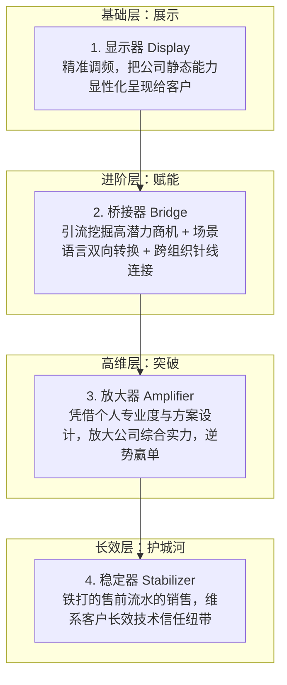

# 第07讲：售前的价值：业务价值的显示器、桥接器、放大器与稳定器

> **【本讲一句话心法】**：售前是连接技术与商业的灵魂杠杆 —— 做好“显示器”只是及格，精于“桥接器”才能立足，升维为“放大器”与“稳定器”才能跨越年龄周期，成为千金难求的核心资产。

---

### 一、 场景痛点与认知破局

#### 1. 一线实战痛点
* **职业怀疑与价值贬损**：“项目赢了是销售关系硬，项目输了是售前方案烂”；售前陷入“随波逐流做工具人”的沮丧；
* **中年危机与年龄焦虑**：许多售前担忧：“如果只是复制粘贴方案、跑腿做演示，30岁后比不过刚毕业年轻人能熬夜出差，出路在哪里？”
* **商业环境演进与技能脱节**：依旧沉迷于旧时代“陪吃陪喝搞关系”的小道，面对日益合规化、专业化、看重技术实证的政企采购大趋势无所适从。

#### 2. 常见认知误区
* 误区一：“ToB业务本质就是拼关系，技术只是走过场的幌子。”（真相：2010年前或许关系权重极大；但在当今高合规、高技术门槛环境下，技术权重已超过50%。关系只能敲开门，没有硬核方案背书，没人敢在风险合同上签字。）
* 误区二：“把公司的标准PPT完整念一遍，售前的价值就体现完了。”（真相：这只是最基础的初级显示功能，根本谈不上创造增量商业价值。）

#### 3. 核心认知破局
**售前是企业业务价值的四大器：显示器、桥接器、放大器与稳定器。** 售前的专业声誉与方案设计，能够让一家原本资质平平的公司赢得超预期的核心大单；在销售走马灯轮换的残酷现实中，售前是客户心中真正长存的技术信任基石。

---

### 二、 核心方法论：售前价值“四器模型”深度剖析



#### 1. 售前四大价值维度矩阵

| 价值定位 | 核心运作逻辑 | 关键能力要求 | 客户感知与商业成效 |
| :--- | :--- | :--- | :--- |
| **1. 显示器<br>(Display)** | 类似智能电视机调频：根据客户所处行业与痛点，从公司浩瀚材料库中提取、加工产品与服务能力，生动展示给客户。 | 素材加工、文档编制、产品DEMO演示。 | 让客户“看得明白”，建立对公司基础能力的感性认知。 |
| **2. 桥接器<br>(Bridge)** | **① 引流**：识别哪些需求能转化为高毛利可交付合同（防止手里有锤子看哪都像钉子）；<br>**② 转换**：将客户大白话转化为技术架构，再将技术细节转化为客户收益；<br>**③ 连接**：穿针引线连接客户内部干系人与公司内部资源。 | 商业敏锐度、业务-技术双语翻译、跨部门协调掌控力。 | 跨越供需两端鸿沟，让双方需求无缝咬合，推动项目立项。 |
| **3. 放大器<br>(Amplifier)** | 即使公司当前综合资源并非业内第一，甚至内部流程混乱，售前凭借顶级的专业设计、方案洞察与个人信誉，**超水平放大公司能力表现**。 | 行业前瞻洞察、高超说服力、个人专业声誉、批判性解局能力。 | 打破硬实力劣势，赢得原本难以企及的标杆战略大单。 |
| **4. 稳定器<br>(Stabilizer)** | “铁打的售前，流水的销售”。在销售人员频繁离职、老交付团队撤场的真空期，售前作为客户心中唯一持续存留的技术信任载体，稳定客户合作军心。 | 长期主义人脉维护、客户全生命周期技术把控。 | 抵御企业经营舆论波动，稳固老客户基本盘并孵化二期续约。 |

---

### 三、 售前实操标准动作（从“显示器”向“放大器”跃迁 SOP）

* **Step 1：执行精准“调频显示”**
  * 杜绝全量PPT轰炸；交流前了解客户业务痛点，只展示与该痛点高度相关的模块，打造清爽的第一印象。
* **Step 2：启动“桥接三动作（引流、转换、连接）”**
  * **引流筛查**：审查需求是否匹配我方核心优势，拒绝把公司带入无限亏损的非标泥潭；
  * **双向转换**：向客户汇报时，禁用晦涩技术缩写，全篇转换为“业务流程节约时间/资金”；向研发提报时，转换为精准的功能用例与非功能约束；
  * **组织连接**：主动发起跨部门对齐会，把客户业务科室与IT科室拉入共同蓝图框架。
* **Step 3：打造“方案放大器”效应**
  * 当产品存在局部劣势时，设计“外延式专业服务与风控体系”，向客户证明：“选择我们，售前专家团队将全程伴随指导上线，风险远低于选大厂却派新手实施”。
* **Step 4：构筑个人“信任稳定器”资产**
  * 即使项目签单后交棒给实施，定期（每季度）回访客户技术负责人，了解现网运行情况，积累专属个人信誉。

---

### 四、 实战工具箱：售前“桥接转换”双向语言翻译手册

#### 1. 业务语言与技术语言对照转换范例

| 客户业务领导的大白话（输入） | 研发/技术层面的规范表达（内部） | 售前向高层汇报的价值语言（输出） |
| :--- | :--- | :--- |
| “每到月底报销系统就卡死，员工总来我办公室抱怨！” | 高并发事务阻塞、数据库连接池耗尽、读写未分离。 | “采用分布式读写分离架构，保障月末数百人并发提报时不发生瞬时卡顿，根除跨部门负面投诉。” |
| “我们想要一个大屏，领导视察时要显得高大上。” | 实时流计算引擎、数据可视化大屏、微前端嵌入。 | “构建集团级作战指挥全景看板，实现核心经营数据秒级穿透，为管理层战略决策与视察汇报提供权威数字化窗口。” |
| “我们各地分公司数据乱七八糟，根本合不到一起。” | 异构系统数据清洗、ETL同步任务、主数据MDM治理。 | “建立全集团统一的数据标准中枢，消除信息孤岛，使各区域财务数据自动合规对齐，满足上市审计标准。” |

---

### 五、 真实标杆案例深度复盘

```
【项目背景】某快速成长的民营工业互联网企业，参与某大型国有重工集团“智能产线监控平台”选型。
【竞争态势】对手为两家国际巨头（如西门子、通用电气），品牌声誉与资金实力远超该民营企业；客户普遍对民营企业的技术成熟度与持续经营能力抱有疑虑。
【放大器破局】：
  1. 售前负责人敏锐发现：外企巨头方案虽强，但由于总部研发在海外，对于客户特有的国产数控机床协议解析响应极慢，实施周期动辄一年；
  2. 售前团队连续3天在车间一线测试，基于公司轻量化边缘网关现场开发出针对老旧机床的自适应采集驱动，并在技术论证会上直接现场联调跑通数据；
  3. 售前在蓝图规划中承诺：“提供原厂核心架构师驻场陪产服务，保障3个月内一期产线数据点亮”；
  4. 售前的敬业态度与现场展现的极速响应能力，彻底折服了客户生产副总裁与设备部专家。
【战役成效】客户排除万难推选该民营公司中标。售前不仅放大了公司的快速响应优势，更用个人专业背书抹平了品牌规模劣势！
```

---

### 六、 血泪教训与避坑红线

> [!WARNING] **红线一：警惕“手里有锤子，看什么都像钉子”。** 具备某种技术能力的售前，最容易犯盲目引流的错误 —— 只要客户提需求就拼命搭桥，把公司不擅长、成本不可控的活全揽进来，最终拖垮交付团队。

> [!TIP] **进阶心法：“做一块红布”。** 正如摇滚歌曲《一块红布》所唱，优秀的售前要像一块红布一样，蒙在销售的头上，蒙在客户关键决策人的头上，用前瞻性蓝图和确定性规划，让所有人心中都笃定看到“业务成功的幸福未来”。

---

### 七、 课后思考题与实战研讨指南

#### 思考题 1：请客观评估你当前处于“显示器、桥接器、放大器、稳定器”中的哪一个层级？你计划如何实现向更高阶跃迁？
* **破题思路**：
  * 显示器能熟练讲PPT与演示；桥接器能打通业务与技术翻译，精准筛查商机；放大器能凭个人专业影响力扭转劣势大单；稳定器能在销售更替中持续掌控客户信任。进阶关键在于深耕特定行业的业务场景，构建不可替代的个人专业声誉。

#### 思考题 2：为什么说“语言与逻辑的双向转换能力”是售前最难但也最值钱的核心壁垒？
* **破题思路**：
  * 技术专家通常缺乏商业语境，销售通常缺乏技术底层逻辑。售前是唯一能够“下通代码架构、上通商业ROI、横通多方博弈”的角色。这种翻译能力无法被通用AI或机械文档轻易替代，是打通交易闭环的核心枢纽。

#### 思考题 3：“铁打的售前，流水的销售”这一现象在你的工作中是否普遍？作为售前，如何合法合规地将这种长效客户信任沉淀为自己的职业护城河？
* **破题思路**：
  * 在项目交付与维保期保持与客户骨干的正常专业技术交流，持续提供行业前沿白皮书与技术建议；在坚守公司商业秘密的前提下，树立“靠谱、专业、能解决实际问题”的个人品牌形象，使客户不论人事如何变动，遇到重大技术决策都会主动向你咨询。
