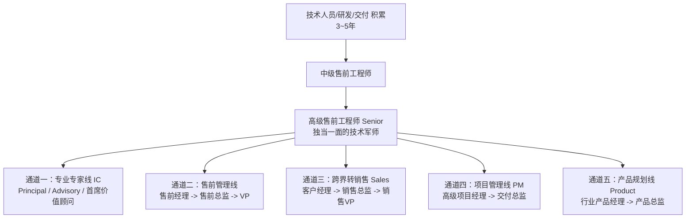

# 第08讲：售前的职业发展路径：售前可以做到退休吗？

> **【本讲一句话心法】**：售前完全可以做到退休，甚至退休之后才是黄金期 —— 决定职业寿命的从来不是生物学年龄，而是你是否完成了从“技能打杂工”到“行业业务合伙人”的价值跃迁。

---

### 一、 场景痛点与认知破局

#### 1. 一线实战痛点
* **35岁年龄焦虑与体能瓶颈**：常年出差、频繁加班写方案和熬夜打单，许多售前担心过了35岁体能下降，会被更年轻便宜的新人淘汰；
* **天花板困境与职业倦怠**：做了四五年售前，发现工作内容陷入“写方案、做演示、应答偏离表”的低水平重复循环，职业天花板隐现；
* **发展路径模糊**：不清楚究竟该走专业技术专家路线，还是该转管理、转销售、转产品，缺乏长周期职业规划。

#### 2. 常见认知误区
* 误区一：“售前是吃青春饭的工种，到了一定年纪必须转管理或转销售，否则死路一条。”（真相：全球顶尖科技企业中，大批白发苍苍的资深首席顾问依然活跃在最前线，他们与政企CXO高层谈笑风生，是企业打单最宝贵的定海神针。）
* 误区二：“大学刚毕业做售前起点高、见识广，是绝佳路线。”（真相：极度不推荐应届生直接做售前。缺乏底层技术实现或工程交付经验，容易沦为空洞的名词复读机，前5~10年成长极度艰难。）

#### 3. 核心认知破局
**售前完全可以做到老，甚至“退休后去做顶级售前顾问”已成为行业新趋势。** 甲方高管（如银行CIO、政府信息化主管）退休后加盟乙方巨头担任首席行业顾问，本质上做的就是顶层售前。售前的价值壁垒随行业沉淀、人脉声誉和对复杂业务的穿透力而持续升值。

---

### 二、 核心方法论：售前五大职业上升通道与专家进阶矩阵



#### 1. 售前专业技术线（IC - Individual Contributor）四阶进阶

| 职级阶梯 | 核心定位与业务范围 | 对内对外影响力 | 核心衡量指标 |
| :--- | :--- | :--- | :--- |
| **中级售前工程师**<br>(Intermediate) | 独立支撑中小型项目，熟练借助公司标准材料完成常规交流、演示与投标。 | 扮演好“显示器与桥接器”，配合资深人员打大仗。 | 方案交付时效性、演示失误率、常规投标完成度。 |
| **高级售前工程师**<br>(Senior) | 销售的核心技术军师；在中大型复杂项目中独当一面；主导立体技术攻势，设计杀手级USP。 | 与销售平起平坐，能影响客户内部关键支持者（Champion）。 | 中大项目赢单率、控标成功率、方案可交付性。 |
| **专家级售前**<br>(Principal / Advisory) | 具备独特的专业风格，在特定行业、关键技术或标杆大客户中建立绝对权威。 | 客户对个人的信任超越背后的公司；公司不可或缺的业务合伙人。 | 战略级标杆战役操盘、行业生态影响力。 |
| **首席顾问 / 价值合伙人**<br>(Chief Value Advisor) | 脱离具体编码与细节配置，善于用平实语言将极复杂战略转化为商业愿景。 | 直接对话部委领导、省市一把手或500强董事会。 | 亿元级单一来源项目主导、行业标准制定。 |

#### 2. 售前转型的四大跨界通道
* **转销售（Sales）**：优势极大。具备扎实技术底色与场景引导能力的售前转销售后，既能跑关系又能聊方案，极易成为金牌销售乃至销售VP；
* **转项目管理（PM）**：售前作为最懂客户原始诉求和需求边界的人，在签单后直接挂帅项目经理，能无缝确保方案落地不走样；
* **转产品管理（Product）**：售前长期泡在客户业务现场，最清楚竞品优缺点和用户真正痛点，转型做行业产品经理能精准把控PRD；
* **转售前管理（Management）**：从自己打单到带领团队打单，负责售前作业流程标准化、资源梯队搭建与考核激励。

---

### 三、 售前实操标准动作（突破成长天花板的三项刻意练习）

* **Step 1：完成“底层技术向业务洞察”的重心转移**
  * 在从业前3年夯实技术功底后，从第4年起刻意减少对纯配置参数的钻研，大量阅读行业政策白皮书、客户财报与业务运行机制。
* **Step 2：构建跨岗位的“回流体验”机制**
  * 适时申请轮岗或跨界：从售前到交付带一个难缠项目；或从乙方跳到甲方工作2~3年体验采购博弈，再回归乙方做售前。视角将获得降维打击般的升华。
* **Step 3：打造个人在垂直行业的“标志性战绩（Signature Deal）”**
  * 至少在一个垂直细分领域（如银行核心风控、智慧医院互联互通、电力自动化调度等）操盘并打透2~3个行业标杆项目，确立业内知名度。

---

### 四、 实战工具箱：售前个人职业发展规划评估表（IDP）

#### 1. 售前 3~5 年发展规划自评矩阵

| 评估维度 | 当前现状自评 (1~5分) | 目标期望 (3年后) | 破局举措与行动抓手 |
| :--- | :--- | :--- | :--- |
| **技术与架构广度** |  | 掌握行业主流云、数、智及网络顶层架构设计 | 主动考取行业权威顶层认证（如TOGAF），研读头部竞品白皮书 |
| **行业业务敏锐度** |  | 精通客户核心科室业务流转与KPI考核诉求 | 每季度深度精读2家行业头部客户的招股书或年度财务报告 |
| **高层对话与演讲能力** |  | 能在15分钟内向非技术高管讲清复杂方案商业价值 | 刻意训练“电梯汇报法”，录音复盘自己的讲标表现 |
| **行业声誉与人脉网络** |  | 建立跨公司、跨客户的稳定专家同行信任圈 | 参与行业峰会主题演讲，在专业社区沉淀原创打单案例复盘 |

---

### 五、 真实标杆案例深度复盘

```
【标杆人物】某全球顶级科技外企 Band 10（十级工，相当于大区总经理级别）资深专家老张。
【职业选择】老张曾长期领导该外企庞大的地区业务与销售团队，但在职业成熟期主动卸任行政管理职务，转任“首席售前价值顾问”，不带行政下属，专职挂帅带领虚拟专家团队攻坚国家级超大型项目。
【核心打法】：
  1. 老张脱离代码和配置细节多年，但具备极高维度的“复杂技术平实化表达”功力；
  2. 在面对部委高级领导和省部级决策层时，老张从不使用任何技术黑话，而是用“城市防洪排水网络与蓄水池”比喻复杂的分布式高可用容灾架构，让完全不懂计算机的政界领导听得频频点头；
  3. 老张凭借其在行业数十年的声誉，直接代表外企高层与客户一把手建立战略互信。
【启示】技术的最高境界是返璞归真。年龄带来的不是衰老，而是对人性、政治、商业与技术的终极驾驭力。
```

---

### 六、 血泪教训与避坑红线

> [!WARNING] **红线一：警惕应届生直接做售前陷阱。** 如果刚毕业就做售前，由于从未真正写过核心代码或踩过现场交付的深坑，极容易形成“轻浮、嘴碎、空谈理论”的毛病。一旦在方案交流时被客户资深工程师提问底层技术逻辑，瞬间卡壳，遭受职场重大打击。

> [!CAUTION] **红线二：不要在单一岗位视角上长期固化思维。** 一直待在同一家公司做单一产品的售前，极容易产生严重职业倦怠并固化认知。适度跨界（换行业、换产品线、甚至甲乙方互换）是打破瓶颈的最佳路径。

---

### 七、 课后思考题与实战研讨指南

#### 思考题 1：你未来 3~5 年的职业规划倾向于五大通道中的哪一条（专家线、管理线、销售线、项目线、产品线）？当前公司平台能否支撑你的诉求？
* **破题思路**：
  * 若热爱技术深度与方案自由度，选择专家线；若长于人际资源协调与团队建设，选择管理线；若渴望更高经济回报与更强结果掌控，转向销售线；若发现自身对用户痛点和产品打磨极度敏感，转向产品线。

#### 思考题 2：为什么有人认为“售前做 2~3 年经验就足够了，再多做几年也没有显著增量价值”？这种论调的根本盲区在哪里？
* **破题思路**：
  * 该观点针对的是只停留在“显示器（做PPT、背参数）”阶段的初级低水平售前；如果售前上升到“桥接器、放大器与稳定器”，涉及深层次业务咨询、干系人政治博弈与复杂控标，其价值随着年限、案例与人脉沉淀呈现指数级增长。

#### 思考题 3：如果一名资深售前想在未来转型为“能直接对话政企一把手的首席价值顾问”，他在当下应当刻意训练什么能力？
* **破题思路**：
  * 训练“去术语化（De-jargonization）”的平实语言表达；站在客户一把手的KPI、产业政绩和财务审计视角思考问题；提升对宏观宏观经济、行业监管政策的敏感度。
