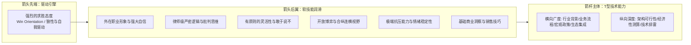

# 第09讲：售前核心能力模型：以求胜为箭矢的T型能力结构

> **【本讲一句话心法】**：售前的核心能力不是炫技与忽悠，而是一支射向战场的“利箭” —— 以强烈的求胜态度为箭头，以缜密的软技能为羽翼，以深广兼备的T型技术力为箭杆。

---

### 一、 场景痛点与认知破局

#### 1. 一线实战痛点
* **被贴上“靠嘴忽悠”标签**：行业内充斥着狂喷 Buzzword（时髦热词）、满嘴空话但一问三不知的“南郭先生”，败坏了售前职业风气；
* **研发/交付岗位的轻视**：研发常讥讽“售前懂的那点技术不过是渣渣，代码都写不利索”；售前自身底气不足，缺乏能力坐标系；
* **打单疲软缺乏狼性**：把售前当普通打卡上班，项目输赢无动于衷，无法调动销售与客户的战斗情绪。

#### 2. 常见认知误区
* 误区一：“售前懂的技术必须比一线研发架构师还要深。”（真相：研发关注 How 的具体代码实现细节；售前关注围绕客户业务场景的**技术可行性与经济可行性**，二者能力图谱完全不同。）
* 误区二：“售前能力最核心的是口才好、能说会道。”（真相：口才只是表象；没有深邃的逻辑推演、批判性思维与求胜意志，夸夸其谈在专业客户面前一触即溃。）

#### 3. 核心认知破局
**售前能力不是单一技能，而是一套高度综合的“战斗力系统”。** 它以“求胜态度”为穿透点，以“律师般的严密逻辑与同理心”为润滑剂，以“广博深入的T型技术结构”为主体骨架。

---

### 二、 核心方法论：售前能力“箭矢模型（The Arrow Model）”



#### 1. 箭头前端：态度（求胜欲望）
* 售前是战斗在一线的战士。没有强烈的赢单渴望，技术再好也只是旁观者；
* 求胜心驱动售前在逆境中主动调整战术、反复推演竞品漏洞、甚至为了一个疑难点通宵达旦；
* 招聘考核核心：**自驱力与战斗渴望永远排在技能之前**。

#### 2. 箭头后翼：关键软技能六维矩阵

| 软技能维度 | 核心要求与标准 | 实战场景体现 |
| :--- | :--- | :--- |
| **1. 职业形象与自信** | 干净整洁、落落大方；自信是专业能力的放大器。 | 首次拜访（尤其见高层）着装适度保守；发言沉稳不畏缩。 |
| **2. 严密逻辑与批判思维** | 像科学家一样理性论证；像律师一样严谨表达。 | 在SOW、偏离表及技术方案中字斟句酌；拆解对手暗设的指标陷阱。 |
| **3. 有原则的灵活性** | 灵活寻找替代方案，但以技术可行性与经济合理性为底线。 | 不做“好好先生”，在涉及成本失控和项目烂尾的高危点上**敢于且善于说“不”**。 |
| **4. 开放与合纵连横** | 商场没有永远的朋友，只有共同的利益；具备生态合作格局。 | 与上游标准机构、芯片平台、下游集成商甚至友商结成战术同盟。 |
| **5. 心理抗压与抗挫** | 情绪极度稳定，在高压下动作不走样变形。 | 面对客户刁难质询、测试故障、内部政治甩锅时不慌乱、不崩溃。 |
| **6. 商业销售感知** | 具备 Technical Sales（技术销售）的商业嗅觉。 | 敏锐感知销售的佣金痛点、客户的预算节点与回款风险。 |

#### 3. 箭杆主体：T 型技术结构
* **横向（广度）**：关注“场景联合度” —— 了解宏观经济趋势、行业监管政策、客户业务全流程以及跨领域的关联技术；
* **纵向（深度）**：关注“评估准确度” —— 精准评估技术方案在生产环境落地时的高并发瓶颈、安全隐患与真实成本。

---

### 三、 售前实操标准动作（箭矢能力锤炼 SOP）

* **Step 1：战前建立“必胜心流”**
  * 接手项目时，不问“这个项目我们能应付吗”，而是问“这个项目通过什么策略能够彻底击穿对手拿下它”。
* **Step 2：训练“像律师一样推敲文字”**
  * 在编写工作说明书（SOW）、技术条款响应和合同附件时，逐字推敲“支持”、“包含”、“配合”等动词的责任边界，杜绝模糊表达。
* **Step 3：打造专属“知识广度雷达图”**
  * 绘制本行业的跨技术生态图谱（如：云计算、大数据、数据库、网络安全、业务中间件等），每周查漏补缺。
* **Step 4：实战演练“建设性说不”**
  * 遇到客户离谱要求，不直接否定，而是拿出成本与工期推演表：“张总，这个功能可以实现，但由于改动底层，工期将延长3个月、增加40万预算，我建议采用方案B……”

---

### 四、 实战工具箱：售前“建设性说不”话术与原则清单

#### 1. 应对客户不合理定制需求的黄金话术结构
$$\text{共情理解} + \text{客观代价推演} + \text{技术/经济红线} + \text{更优替代路径}$$

* **话术示范**：
  > “李主任，您提出的这个实时全量同步想法非常有前瞻性（共情）。但是从工程实践来看，该接口在日终跑批峰值时会导致核心数据库发生行级死锁，极易引发生产事故（代价推演）。作为对项目上线成败负责的专业顾问，我们必须提醒此项隐患（红线）。为了既满足各科室查阅报表的需求，又保障核心系统万无一失，我们建议采用‘日间准实时增量抽取+夜间批量归档’方案，既零风险，又能提前两周交付（替代路径）。”

#### 2. 售前软硬技能自评打分表（季度复盘）
* [ ] 面对大客户技术高管质询时，是否能做到不慌张、不盲目承诺、从容应对？
* [ ] 本月编写的方案与文档中，是否存在容易引起交付扯皮的模棱两可字眼？
* [ ] 是否深入了解过所支持销售本季度的个人业绩指标与打单紧迫度？
* [ ] 是否能画出我司产品在客户全业务链条中所处的完整上下游拓扑图？

---

### 五、 真实标杆案例深度复盘

```
【项目背景】某大型政务云平台招标，某投标厂商派出两位售前：一位是纯技术极客老王（精通底层Linux内核与K8s源码，但性格木讷、不善沟通）；另一位是具备“箭矢能力”的综合型售前小张。
【实战碰撞】：
  1. 局长在听取技术汇报时提出：“我们想要未来全市政务系统秒级无感迁移，你们能做到吗？”
  2. 极客老王立刻开启纯技术辩驳：“局长，这根本不符合计算机分布式理论！网络延迟和CAP定理决定了绝对不可能无感！”现场气氛瞬间降至冰点，局长面露不悦；
  3. 售前后端小张敏锐察觉局长的核心动机是“怕政务系统宕机影响民生政绩”，立刻接过话筒：“局长，您关注的政务平稳过渡是本次工程的生命线。老王指的是在底层物理层绝对的零秒无延迟在业内尚未实现；但在业务应用层，我们设计了‘双轨并行+影子流量热切’机制，老百姓办事感知到的延迟控制在毫秒级以内，完全能够做到业务零中断、市民零感知！”
  4. 局长听后非常满意，当即点头认可。
【战役成效】小张凭借严密的业务转换与同理心软技能，化解了技术自嗨带来的危机，牢牢锁定了政务云主导权。
```

---

### 六、 血泪教训与避坑红线

> [!WARNING] **红线一：严禁以“老实人”自居而放弃求胜意志。** 很多售前抱有“做一天和尚撞一天钟”的打工心态，技术交流照本宣科，对竞争对手的动态不闻不问。没有求胜欲望的售前，不仅无法赢得销售的尊重，也会在团队中迅速边缘化。

> [!CAUTION] **红线二：警惕在客户面前展现出“技术傲慢”。** 哪怕客户技术水平确实有限，也绝不可在言语和神态中流露嘲讽或不耐烦。用通俗易懂的语言帮助技术薄弱的客户建立信心，才是顶级售前的修养。

---

### 七、 课后思考题与实战研讨指南

#### 思考题 1：对照“箭矢能力模型”，你认为你目前最锋利的优势是什么？最脆弱的短板是哪一块（求胜态度、软技能、T型广度还是深度）？
* **破题思路**：
  * 技术转型的售前往往长于纵向深度，但欠缺横向广度与商业/沟通软技能；销售背景转型的售前往往长于态度与软技能，但欠缺技术可行性评估的严谨度。唯有找准短板刻意补足，方能打造锋利箭矢。

#### 思考题 2：为什么说“有原则地说不”往往比“百依百顺地说好”更能赢得客户深度信任？
* **破题思路**：
  * 凡事都说好的是推销员（Salesperson），敢于从工程现实与预算风险出发踩刹车的是专业顾问（Trusted Advisor）。客户把千万级项目托付给你，最看重的是你能帮他避开上线烂尾的巨大雷区。

#### 思考题 3：面对复杂的跨组织博弈，售前应当如何运用“合纵连横”策略来构建自身方案的不可替代性？
* **破题思路**：
  * 主动联合客户现网中已有的大型核心供应商（如主流操作系统、数据库厂商或核心集成商），将自身产品与他们的基础底座做深度适配认证，形成联合解决方案生态，以此排挤单一单点竞争对手。
