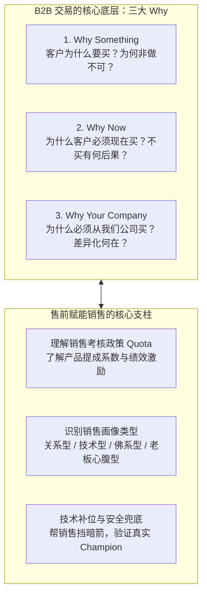

# 第10讲：售前服务对象：谁才是售前最重要的客户？

> **【本讲一句话心法】**：长期来看，销售才是售前最重要的客户 —— 将销售视作内部核心客户去服务与赋能，才能真正实现“兄弟同心、其利断金”，迎来个人职业与声誉的飞跃。

---

### 一、 场景痛点与认知破局

#### 1. 一线实战痛点
* **售前与销售的天然对立情绪**：“销售签了大单拿几十万提成吃香喝辣，售前通宵写标书累死累活只拿几千块死工资”；严重的心理不平衡导致合作消极抵触；
* **相互甩锅与信任赤字**：项目做成是销售的功劳，项目丢了怪售前方案不灵光；售前抱怨销售“不懂技术瞎承诺”，销售抱怨售前“不懂人情世故不给力”；
* **服务对象认知偏差**：很多售前认为自己只服务外部甲方客户，或者只服务自己的售前部门主管，忽视了一线销售这一最直接的利益共同体。

#### 2. 常见认知误区
* 误区一：“我只要技术过硬、对得起客户，销售高不高兴跟我没关系。”（真相：你的直接主管不可能每次都陪你去客户现场，**销售对你的评价是主管给你评定绩效、年终奖与晋升的最关键输入**。）
* 误区二：“销售都是唯利是图的奸商，售前必须跟他们划清界限。”（真相：没有销售签回的真金白银合同，公司就无法生存，售前岗位便毫无意义。）

#### 3. 核心认知破局
**“皮之不存，毛将焉附。”** 售前存在的唯一合法性就是支持销售打赢战役。将销售视为你内部最重要的“战略客户”，理解他们的焦虑、奖金激励机制与打单逻辑，用技术帮销售赢单、帮销售兜底、帮销售赚钱，销售自会投桃报李，成为你职场晋升的最强助推器。

---

### 二、 核心方法论：B2B销售三大底层命题（3-Why）与销售赋能模型



#### 1. 穿透 ToB 销售的三大“为什么（3-Why）”

| 核心命题 | 业务本质 | 售前核心赋能动作 |
| :--- | :--- | :--- |
| **Why Something<br>(为何要做)** | 唤醒客户组织痛点，将潜在问题转化为预算立项。 | 协助销售调研客户业务隐患，提供行业标杆失效分析，推动客户立项。 |
| **Why Now<br>(为何当下买)** | 制造紧迫感，防止项目被无限期搁置拖延。 | 从合规监管节点、系统崩溃临界点、业务考核周期等维度论证拖延代价。 |
| **Why Your Company<br>(为何选我们)** | 构筑竞争壁垒，阻击对手，促成独家中标。 | 提炼打单级 USP，设置杀手级控标条款，确保方案不可替代性。 |

#### 2. 一线销售的四种典型画像与相处攻略

| 销售画像 | 典型特征与痛点 | 售前最佳合作与赋能姿态 |
| :--- | :--- | :--- |
| **1. 关系型老炮** | 客户高层关系深厚，商务公关能力极强，但对技术细节一窍不通；最怕技术交流翻车丢面子。 | **充当首席技术军师**：替他把控技术底线，汇报前帮他梳理关键大白话要点，交流时为他撑足专业场面。 |
| **2. 技术型销售** | 工程师出身转型做销售，懂技术也懂产品，但往往容易陷入技术细节争论，忽视高层政治。 | **充当互补战略伙伴**：适度提醒其关注高层经济买家（EB）与采购程序，协助其处理繁重方案编制。 |
| **3. 核心心腹型** | 随新任销售VP空降而来，核心生存能力是执行领导意图；手握大区重点潜力商机。 | **全力支持打响样板**：以120%的热情配合其攻下开门红项目，借助其影响力在管理层树立专业口碑。 |
| **4. 佛系养老型** | 已实现财务自由或追求生活平衡，对业绩激进程度一般。 | **合理控制投入期望**：保持标准专业配合，避免在此类商机上透支过多售前精力。 |

---

### 三、 售前实操标准动作（把销售服务成铁杆同盟 SOP）

* **Step 1：主动摸底销售的“KPI 与钱袋子”**
  * 年初了解销售负责的客户名单、年度 Quota 额度、以及不同产品线（如自研软件 vs 硬件转售）的提成考核系数。
* **Step 2：协助销售排查“真假 Champion”**
  * 销售容易被客户的客套话迷惑。售前通过专业技术问卷与技术交流，帮销售暗中核实该客户联系人是否具备项目预算权与决策影响力。
* **Step 3：交流现场“高情商补位与递话筒”**
  * 在客户现场与销售眼神默契配合；当客户提出尖锐商务问题时，售前绝不越权乱答，巧妙把话语权转回销售；当技术受攻击时，果断挺身而出化解。
* **Step 4：项目复盘主动“推功揽过”**
  * 中标后在公司群和主管面前充分赞誉销售的商务攻坚能力；若不幸丢单，主动从技术与控标角度总结客观教训，不背后甩锅。

---

### 四、 实战工具箱：售前与销售日常协同默契指南

#### 1. 应对销售“无边界承诺”的现场补位话术
* **情境**：在客户高层面前，销售为了拿单拍胸脯：“没问题，这个定制开发我们下个月免费给你们做完！”
* **售前高情商接话话术**：
  > “正如张总刚才所展现的，我们公司服务贵方的诚意是绝对百分之百的。在具体工程落地上，为了保障核心系统的上线稳定性，我们技术团队会在会后把这个定制需求纳入一期专项评估，制定一份最稳妥的排期路线图向您汇报。”（*既保住了销售的面子与诚意，又在合同签署前保留了技术排期与收费的缓冲空间。*）

#### 2. 销售满意度自查清单（售前自我审视）
* [ ] 我支持的头部销售，是否愿意在关键大客户会议上必须带我出席？
* [ ] 销售在被客户技术刁难时，第一个想到求助的人是不是我？
* [ ] 我是否清楚我所配合销售目前最缺的是技术方案、资质案例还是控标条款？
* [ ] 在销售主管面前，这些销售对我的评价是否以正面赞誉为主？

---

### 五、 真实标杆案例深度复盘

```
【背景】某资深售前老王与一位刚入行两年的年轻销售小刘搭档。小刘业务生疏，但在老王眼里，小刘为人勤奋、敢打敢拼。
【协同过程】：
  1. 在某省农信社信创新核心选型战役中，小刘由于经验不足，被客户采购科长冷落，几乎想放弃；
  2. 老王没有像其他老油条一样抱怨“销售太嫩带不动”，而是主动把小刘当成最重要的客户：
     - 老王利用自身行业沉淀，帮小刘梳理了该行科技部当前面临的痛点，给小刘设计了“上门破冰的3个业务问题”；
     - 每次客户交流前，老王都与小刘进行15分钟现场角色扮演（Role-play）演练；
     - 在技术方案答辩会上，老王凭借硬核的技术架构为小刘狠狠撑住了场子；
  3. 小刘深受感动，全力在外围调动商务资源公关。
【战役成效】两人默契配合拿下该行千万级标杆大单。小刘一战成名并晋升销售总监，在全司年终大会上公开感谢老王；此后小刘团队的所有重大项目均指定老王为首席顾问，老王当年轻松拿下全司最高售前年终奖。
```

---

### 六、 血泪教训与避坑红线

> [!WARNING]
> **红线一：售前绝不可为了讨好销售而突破法律合规底线。** 绝不参与商业贿赂、做假账、虚假应答欺诈等灰色交易。合规是职业生涯的生命线，一旦出事，销售可以换公司，售前的专业名誉将彻底毁于一旦。

> [!CAUTION]
> **红线二：警惕极少数“甩锅恶霸型”销售。** 确实存在极少数平时不作为、丢单全推给售前的恶劣销售。面对此类人员，售前必须在项目各环节留存文字纪要（如邮件、钉钉确认），必要时向售前主管申请调换对接人，远离负能量消耗。

---

### 七、 课后思考题与实战研讨指南

#### 思考题 1：如果销售拿到大笔佣金而你只有很少的提成，你该如何调整心理状态？
* **破题思路**：
  * 认知利益与风险对等：销售背负着严苛的指标压力、底薪低、流动性极大，随时面临业绩不达标被淘汰的风险；售前收入相对稳定、职业生命周期更长；此外，若渴望高提成，可在积累深厚技术与打单经验后，主动申请转岗做销售。

#### 思考题 2：当资深售前遇到年轻新手销售时，往往容易产生“售前嫌销售不懂、销售怕售前强势”的矛盾，该如何化解？
* **破题思路**：
  * 资深售前要放下“技术前辈”的身段，用“教练心态”赋能年轻人，帮其树立信心；明确分工：售前负责把控技术方向与方案质量，鼓励并协助年轻销售发挥其勤奋拜访、摸排外围情报的精力优势，实现互补共赢。

#### 思考题 3：如何运用“3-Why模型”（Why Something, Why Now, Why Your Company）来判断一个销售报上来的项目是“真商机”还是“凑数泡沫”？
* **破题思路**：
  * 逐一核实：客户为什么非做不可（是否有业务急迫痛点与明确预算立项）？为什么今年必须签（是否有政策硬性截止日期）？为什么可能选我们（是否有我们的独家优势或内部支持者）？如果三个问题销售一个都回答不上来，则判定为低价值泡沫。
