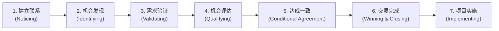

# 第11讲：国际大厂销售方法论：深入拆解IBM SS七步法实战精髓

> **【本讲一句话心法】**：销售方法论不是束缚行动的教条表格，而是一座精准指引打单航向的灯塔 —— 读懂 IBM SS 七步法，才能在任何复杂项目迷局中看清所处位置与关键动作。

---

### 一、 场景痛点与认知破局

#### 1. 一线实战痛点
* **盲目跟单与无序消耗**：不知道项目进展到什么阶段，客户一个电话就通宵写方案，最后发现对方只是调研探底；
* **销售与售前缺乏协同语言**：销售嘴里的“马上要签了”和售前眼里的“八字没一撇”形成巨大认知鸿沟；
* **业绩预测形同虚设**：销售管道（Pipeline）充斥着大量虚假商机，临近季末业绩断崖式崩盘。

#### 2. 常见认知误区
* 误区一：“销售方法论是管理层用来监控销售的官僚工具，售前不需要关心。”（真相：销售方法论决定了销售的晋升、考核与日常动作。**不懂方法论的售前，永远无法看懂销售的真实意图，更无法进行高质量协同**。）
* 误区二：“大厂的方法论太重太繁琐，只有外企能用，国内民企不实用。”（真相：国内科技巨头与各行各业的销售高管大多师承 IBM 等外企黄埔军校；无论形式如何变化，企业客户采购的底层决策规律从未改变。）

#### 3. 核心认知破局
**IBM Signature Selling Method（SSM / SS 七步法）** 是全球B2B科技销售管理的集大成者。它将混沌复杂的商机转化过程，拆解为**7个逻辑严密的推进阶段**，每个阶段均配有严苛的“活动清单”与“退出/完成标志（Milestone）”。售前掌握该框架，便拥有了穿透商机迷雾的全局透视镜。

---

### 二、 核心方法论：IBM SS 七步销售法全景图谱



#### IBM SSM 七个阶段深度规范对照表

| 阶段阶段与英文名称 | 阶段核心目标 | 销售与售前关键动作（Activity） | 阶段完成/通过标志（Exit Criteria） |
| :--- | :--- | :--- | :--- |
| **Stage 1<br>建立联系 (Noticing)** | 双方建立互信接触，客户与我方均认可建立长期业务联系有益。 | 1. 深度研读客户业务、行业动态与财报；<br>2. 摸排客户IT架构与技术偏好；<br>3. 制定吸引客户的先导理念（Idea）。 | **① 完成客户销售计划（Account Plan）；**<br>**② 绘制业务举措与方案映射图；**<br>**③ 客户关键人表达进一步交流意愿。** |
| **Stage 2<br>机会发现 (Identifying)** | 针对客户的关键业务举措，挖掘潜在立项机会。 | 1. 深入调研客户业务目标的痛点与内容；<br>2. 评估客户行动的紧迫度与动机；<br>3. 建立 CRM 管道线索（Pipeline）。 | **① 客户认可我方业务理念；**<br>**② 双方确认采取行动的紧迫性与必要性。** |
| **Stage 3<br>需求验证 (Validating)** | 推动客户形成明确的技术与采购意愿，锁定预算。 | 1. 澄清业务目标，细化业务需求；<br>2. 将需求推演至概念方案（Concept）；<br>3. 识别并发展内部支持者（Champion/Sponsor）。 | **① 客户正式确认业务需求；**<br>**② 客户设立采购预算；**<br>**③ 找到并验证内部支持者身份。** |
| **Stage 4<br>机会评估 (Qualifying)** | 评估赢单概率，进行战略决策（Go / No-Go）。 | 1. 评估采购标准与评分表，测算胜率；<br>2. 编制初步方案并与客户对齐；<br>3. 召开内部立项评审会，决定是否继续。 | **① 完成初步技术方案沟通；**<br>**② 公司正式决策继续战略跟进（Go）。** |
| **Stage 5<br>达成一致 (Conditional Agreement)** | 客户全面认可技术方案，同意进入排他商务谈判。 | 1. 细化技术方案，打造独特价值主张；<br>2. 绘制落地蓝图（Blueprint）与实施排期；<br>3. 完成方案质量与交付成本评审。 | **① 双方共同书面认可技术方案；**<br>**② 客户正式同意启动商务谈判。** |
| **Stage 6<br>交易完成 (Winning & Closing)** | 扫清法律与商务障碍，签订正式具备法律效力的合同。 | 1. 根据商务预算优化调整技术方案；<br>2. 编制律师级任务说明书（SOW）；<br>3. 配合开展价格与法务条款谈判。 | **① 双方盖章确认 SOW 工作说明书；**<br>**② 正式签订采购销售合同。** |
| **Stage 7<br>项目实施 (Implementing)** | 确保方案高质量落地，兑现价值并挖掘二期商机。 | 1. 售前与交付团队无缝 Handover；<br>2. 设立阶段检查点，管理客户期望；<br>3. 与客户高层保持回访，探寻新线索。 | **① 客户对项目交付成果满意验收；**<br>**② 客户同意作为对外样板案例宣传；**<br>**③ 成功孵化二期/增购商机。** |

---

### 三、 售前实操标准动作（运用 SS 方法论打盘 SOP）

* **Step 1：在 CRM 管道中核验阶段真实度（防假商机）**
  * 当销售声称项目进入 Stage 4（评估阶段）时，售前对照标准核查：客户是否确认了预算？是否有明确的 Champion？若没有，坚决退回 Stage 2 或 3，拒绝盲目投入大量售前资源。
* **Step 2：在 Stage 1~3 深度介入，构筑主导权**
  * 真正的顶级打单，胜负在 Stage 3 之前就已经注定。售前要在需求验证期帮助客户撰写《可行性研究报告》，把自家特色参数注入客户立项标准。
* **Step 3：在 Stage 5 严控蓝图评审（Blueprint Review）**
  * 方案达成一致阶段，召集交付总监与产品专家联合会审，确保交付范围明确、风险兜底，不给 Stage 6 和 7 埋雷。
* **Step 4：在 Stage 7 主动回访孵化“样板效应”**
  * 配合项目经理完成里程碑，主动整理《客户业务价值收益报告》，将成果包装成标杆案例（Reference Story），反哺下一个循环的 Stage 1。

---

### 四、 实战工具箱：IBM SS 销售阶段检核卡（Scorecard）

#### 1. 商机阶段自查与决策核验表

| 关键阶段 | 核心质询问题（售前向销售发问） | 达标放行标准 |
| :--- | :--- | :--- |
| **Stage 2 进 Stage 3** | “客户为什么要在今年解决这个问题？不解决会死人吗？” | 客户存在不可逆的监管罚款、业务停摆或明确高层考核压力。 |
| **Stage 3 进 Stage 4** | “谁是我们在客户内部的 Champion？他愿意为我们冒什么风险？” | 客户内部有实权业务负责人，且愿意为我们提供竞争情报和预算动向。 |
| **Stage 4 进 Stage 5** | “我们的技术方案是否让客户认可了不可替代的业务价值？” | 客户明确认可我方价值主张（Value Proposition），且评分表倾向我方。 |
| **Stage 5 进 Stage 6** | “SOW的边界是否清楚？交付团队是否对成本和工期签字？” | SOW通过内部法务与交付双重评审，无模糊免责死角。 |

---

### 五、 真实标杆案例深度复盘

```
【项目背景】某大型国有银行信贷风险系统换代，预算3000万元。多家顶级厂商参与角逐。
【典型困境】某竞争对手急功近利，跳过前期业务调研，直接给客户推销高大上的微服务与AI风控平台，催促客户快点发标（试图直接跳到 Stage 4/5）。
【IBM SS 打法运用】：
  1. 讲师团队严格遵循 SS 七步节奏。在 Stage 1 耗时两个月研究该行历年年报、不良资产率变化与银保监会最新监管通报，形成《新监管下城商行信贷业务演进白皮书》；
  2. 进入 Stage 2，团队与该行风险管理部总经理（Sponsor）开展多次闭门沙龙，将其核心痛点聚焦于“小微企业贷前穿透式反欺诈”；
  3. 进入 Stage 3，售前协助该部门梳理出详细业务需求用例，并帮助该行在内部立项会成功申请到专项创新预算，彻底坐实不可替代的 Champion 盟友关系；
  4. 到了 Stage 4 和 5，客户在编写招标文件时，80% 的技术指标直接采纳了前期研讨成果。
【战役成效】当竞品还在琢磨怎么应标时，该团队已牢牢锁定评分制高点，毫无悬念以高价中标！
```

---

### 六、 血泪教训与避坑红线

> [!WARNING] **红线一：严禁跨阶段“霸王硬上弓”。** 许多不成熟的销售在客户连 Why Something（为什么要买）都没想清楚时，就强拉售前去做产品功能演示（Demo）。这不仅是在浪费时间，更会过早暴露底牌，让客户产生戒备心理。

> [!CAUTION] **红线二：警惕把“伪客户支持者”当成真正的 Champion。** 很多时候客户基层技术人员对你态度热情、天天找你聊天，销售就误以为这是 Champion。实际上他既无预算权也无话语权，甚至只是在搜集资料交差，极易导致项目在 Stage 4 惨遭滑铁卢。

---

### 七、 课后思考题与实战研讨指南

#### 思考题 1：请对照你所在公司的销售管理现状，分析当前是否存在一套成型的方法论？与 IBM SS 相比，有哪些简化或缺失的环节？
* **破题思路**：
  * 国内很多中小企业往往“缺失 Stage 1 客户销售计划”与“缺失 Stage 3 需求验证”，直接从零散线索跳到粗暴投标，导致售前沦为无意义的投标机器。引入阶段里程碑审核，是提升团队打单 ROI 的核心。

#### 思考题 2：有人认为 IBM SS 模型过于庞大笨重，在中小项目或敏捷 SaaS 销售中用起来太累。你如何看待这种观点？
* **破题思路**：
  * SSM 形式可轻量化，但底层逻辑不可省。对于小单或 SaaS，可以将 7 步压缩合并为 3 步（如：需求唤醒 $\rightarrow$ 价值验证 $\rightarrow$ 签约落地），但其核心的“确认痛点、寻找支持者、Go/No-Go决策”的本质逻辑依然完全适用。

#### 思考题 3：作为售前，当销售要求你在客户尚未确认预算（未过 Stage 3）的情况下，投入整整两周写一份200页的定制方案，你应当如何应对？
* **破题思路**：
  * 不应直接生硬抗拒；而是依据 SSM 原则向销售提出：“在预算未明晰前，高投入定制方案容易打偏。我先提供一份20页的《行业标杆概念架构与收益蓝图》，协助你去客户那里测试预算与立项意向。一旦客户确认立项，我立刻全力以赴输出完整方案。”
