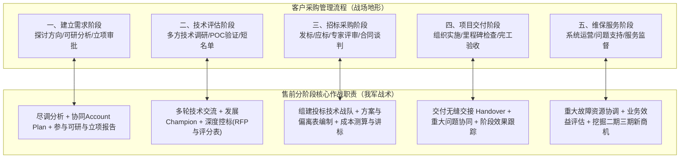

# 第12讲：销售过程阶段划分与售前分阶段职责全景蓝图

> **【本讲一句话心法】**：内部方法论是打单的作战沙盘，客户采购流程才是战场的真实地形 —— 售前唯有将自身动作严丝合缝地锚定在客户的五个采购阶段中，方能步步为营，锁定胜局。

---

### 一、 场景痛点与认知破局

#### 1. 一线实战痛点
* **拿内部流程当令箭，脱离客户节奏**：很多售前在客户内部立项未定前，就催促客户要技术参数；或在客户急需可研报告时，非要按公司流程做产品功能演示，节奏完全脱节；
* **跨阶段权责混乱，边界扯皮**：售前不知道什么时候该进场、什么时候该退场，招投标时与交付团队互相推诿，交付后无人管二期；
* **长周期项目中的迷茫与失落**：政企重大项目往往横跨数年，人事更迭频繁，售前在漫长的长跑中容易丧失耐性与战略定力。

#### 2. 常见认知误区
* 误区一：“我们公司的销售管理流程走到哪一步，客户就必须配合走到哪一步。”（真相：**客户的采购合规流程是法律和组织规章赋予的刚性约束**。乙方永远只能尊重并映射到客户的流程中，而不可能让客户按乙方的CRM节奏办事。）
* 误区二：“售前的活儿在合同签订的那一刻就彻底终结了。”（真相：缺乏严密交接（Handover）的售前是短视的。交付暴雷会直接反噬售前声誉，且二期、三期的增购商机全在交付与维保的泥土中孕育。）

#### 3. 核心认知破局
**售前的专业性，体现在对客户采购全生命周期的全景掌控。** 将销售内部视角（如 IBM SS）与客户采购流程（建立需求 $\rightarrow$ 技术评估 $\rightarrow$ 招标采购 $\rightarrow$ 项目交付 $\rightarrow$ 维保运营）建立双向映射，并在每个阶段恪守售前的输入、核心动作与输出交付物。

---

### 二、 核心方法论：客户采购全生命周期与售前职责全景映射图



#### 客户采购五大阶段与售前后端职责全景对照表

| 阶段阶段划分 | 客户侧核心目标与关键活动 | 客户阶段完成标志 | 售前核心作战职责与输出交付物 |
| :--- | :--- | :--- | :--- |
| **一、建立需求阶段<br>(Initiation)** | 1. 基于战略与业务痛点探讨方向；<br>2. 成立研究小组，梳理初步思路；<br>3. 开展可行性分析，编制立项报告并提报内审。 | **立项报告获管委会或高层正式审批通过** | 1. 客户背景6看尽调与痛点挖掘；<br>2. 与销售共同制定客户销售计划（Account Plan）；<br>3. **交付物**：《项目可行性研究咨询报告/技术白皮书》。 |
| **二、技术评估阶段<br>(Evaluation)** | 1. 广泛了解业内主流方案优劣；<br>2. 组织重点供应商技术交流、Demo与POC；<br>3. 制定最终招标需求与供应商短名单（Shortlist）。 | **技术需求规范书定稿，移交采购科室** | 1. 主导两轮技术交流（首轮探底，次轮亮剑）；<br>2. 稳固客户内部支持者（Champion）；<br>3. **交付物**：《定制化技术蓝图》、《控标版技术规范建议书与评分表》。 |
| **三、招标采购阶段<br>(Procurement)** | 1. 确定采购形式（公开招标/邀请/单一来源）；<br>2. 发售标书，组织答疑与开标；<br>3. 评标委员会评审，确定中标人并谈判合同。 | **正式发布中标通知书，签署商务合同** | 1. 组建投标团队，倒排封标计划；<br>2. 编写技术标方案，严谨把控点对点应答与偏离表；<br>3. 精准测算实施成本与工期风险；<br>4. **交付物**：《投标技术方案书》、《律师级SOW工作说明书》。 |
| **四、项目交付阶段<br>(Delivery)** | 1. 组建客户项目组，提供实施条件；<br>2. 里程碑节点成果检查与进度管控；<br>3. 组织功能测试、初验与最终终验。 | **双方正式签署《项目完工验收报告》** | 1. 与项目经理及实施团队召开全面交接会（Handover）；<br>2. 解答交付团队对前期方案与客户政治背景的疑问；<br>3. 参与关键里程碑评审，掌握一线交付效果；<br>4. **交付物**：《售前向交付团队交接白皮书（Handover Sheet）》。 |
| **五、维保服务阶段<br>(Operation)** | 1. 日常运营系统，产生业务效益；<br>2. 出现生产级异常时寻求原厂支撑；<br>3. 评估维保服务质量与二期扩容诉求。 | **合同维保周期结束，启动续约流程** | 1. 突发重大危局时协调后方专家资源协同救火；<br>2. 定期回访客户一把手，测算系统商业投资回报（ROI）；<br>3. 在客户日常使用痛点中挖掘二期、三期增购商机；<br>4. **交付物**：《系统运行业务价值总结报告》、《二期扩容建议书》。 |

---

### 三、 售前实操标准动作（全流程控局关键节拍）

* **Step 1：战前采购流程对齐**
  * 初次接触客户，必须向经办人摸清其内部立项采购的“标准流程卡”：需要经过哪几个委员会评审？上不上党委会/总裁办公会？采购属于公开招标还是框架协议采购？
* **Step 2：将自身方案植入“立项可研”**
  * 在第一阶段主动代劳客户写《项目立项可行性报告》，把自身的架构优势潜移默化转化为客户立项的必备前提。
* **Step 3：技术评估期锁定“评分偏好”**
  * 在第二阶段通过硬核交流与POC，说服客户在招标评分表中将我方优势（如原生多语言、微服务治理、自主产权）列为硬性加分项。
* **Step 4：合同签署前完成“交付Handover”**
  * 在第三阶段中标公示后，立即拉齐交付项目经理做 SOW 逐条过堂，不留模糊隐患；合同签署后完成书面交接签字。
* **Step 5：维保期建立“定期巡检与商机雷达”**
  * 每半年陪同客服或技术支持进行一次客户业务巡检，主动发现客户因业务扩张带来的新短板，抢先开启下一个生命周期。

---

### 四、 实战工具箱：售前交接白皮书（Handover Sheet）标准模板

#### 1. 售前转交付（Pre-Sales to Delivery）交接核验单

| 核验模块 | 核心交接内容记录 | 风险等级与应对预案 |
| :--- | :--- | :--- |
| **商务与政治背景** | 核心经济买家（EB）与支持者（Champion）名单及性格偏好；客户内部反对派关注点。 | 提示交付团队在现场沟通时避免触碰特定敏感政治话题。 |
| **方案与SOW边界** | 承诺的核心功能范围、明确拒绝的排他需求、定制开发人月上限。 | 高度警惕客户现场要求“免费搭车开发”未在SOW中的功能。 |
| **技术架构与偏离** | 标书点对点应答中的“部分满足”或“定制满足”项具体落地实现思路。 | 明确哪些模块需要研发总部提供专项补丁或二次开发支持。 |
| **硬件与环境依赖** | 客户承诺提供的服务器配置、网络带宽、机房权限及到货周期。 | 若客户前置环境未就绪，如何界定工期顺延责任。 |

---

### 五、 真实标杆案例深度复盘

```
【经典战事】某全球顶级外企在某国家级超级工程中长达十年的拉锯战。
【漫长长跑】：
  1. 该国家级工程预算超亿元，由于体制改革、技术标准演进与领导换届，整个采购周期整整拉锯了十年；
  2. 十年间，客户主管领导换了4任，总工程师换了3任；乙方公司的销售换了数位，售前后端更迭了5任；
  3. 最终的一任销售坚持跟进了数年，抓住国家数字化基建政策窗口，成功赢下近亿元大单；因当年销售奖励取消封顶，该销售一人独得超过年薪三倍的巨额奖金；
  4. 最后一任售前因参与了最终投标，分到了2000元奖金彩蛋。
【深度启示与反思】：
  - 为什么售前只拿2000元？因为该售前仅参与了最后发标后的“标书编制与打字（Stage 3）”，并未深度参与前期的需求塑造与价值控标；
  - 真正高价值的售前必须在第一、二阶段就深度扎根，若能主导前期的架构标准确立，无论人事如何更替，都将成为无可争议的首席架构师，享有不可替代的行业话语权与专家津贴。
```

---

### 六、 血泪教训与避坑红线

> [!WARNING]
> **红线一：严禁“签单即失联，交付全不管”。** 很多售前把合同一签就甩手不管，对实施团队提出的方案疑问漠不关心。一旦交付受阻、客户扣留尾款并向公司投诉，售前将面临主管的严厉问责。

> [!CAUTION]
> **红线二：警惕销售与售前之间的“灰色职责地带”。** 比如编写招标文件澄清函、联系专家、测算第三方外采硬件底价等工作。若职责不清，极易出现两不管盲区。在打单启动时必须召开售前-销售工组会，白纸黑字明确分工界面。

---

### 七、 课后思考题与实战研讨指南

#### 思考题 1：在你目前所在的公司，从商机到维保的全生命周期中，售前通常在哪个阶段介入？存在哪些痛点与阶段缺失？
* **破题思路**：
  * 很多低水平公司往往在“第三阶段（客户发标）”才仓促拉售前进场，导致长期处于陪标劣势；成熟公司往往要求售前在“第一阶段（立项前）”就介入客户调研，甚至协助编制客户预算。

#### 思考题 2：如果你手中负责一个时间跨度可能长达 2~3 年的重大战略项目，你会采取何种策略保持长期跟进，同时平衡当期的短期考核压力？
* **破题思路**：
  * 采取“长短结合”策略：将大项目的推进拆解为阶段性里程碑（如完成立项咨询报告、完成概念验证POC、入围框架短名单），并将这些里程碑作为售前当季重点绩效加分项；同时兼顾 2~3 个周期短的小快灵项目以完成当期赢单指标。

#### 思考题 3：如何处理售前与销售的职责边界模糊问题（例如：测算硬件外采成本、组织现场投标物料到底该谁负责）？
* **破题思路**：
  * 原则：“专业对口、各司其职”。涉及技术架构、配置参数、原厂技术选型由售前负责；涉及商务议价、渠道返点、资金垫资、打印装订封标等商务物料由销售与商务助理统筹。在团队内部建立标准《售前-销售分工职责矩阵（RACI表）》。
