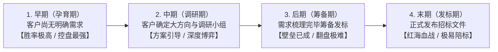

# 第13讲：建立需求阶段概述与前置准备

> **【本讲一句话心法】**：真正的顶尖售前绝不等待客户发标，而是在客户尚未形成清晰需求前提前入局，将自身的技术优势潜移默化地烙印在客户立项的基因里。

---

### 一、 场景痛点与认知破局

#### 1. 一线实战痛点
* **介入过晚，沦为免费陪标**：80% 的普通售前总是在客户已经正式发标（末期）或招标文件定稿（后期）时才进场。此时竞品早已完成了控标布局，售前再怎么熬夜赶方案也只是给友商“抬轿子”；
* **前期漫无目的，投入无序消耗**：部分售前虽然较早接触客户，但缺乏系统性方法，与客户东拉西扯，既没帮客户梳理出可研立项报告，也没能建立 Champion 同盟，导致项目“无疾而终”；
* **为他人做嫁衣的风险**：缺乏对采购流程控制手段的销售和售前，辛辛苦苦帮客户启发了需求并申请了预算，结果招标时由于没有技术护城河，反被低价竞争对手或当地关系型厂商摘了桃子。

#### 2. 常见认知误区
* 误区一：“客户没发标、没提明确需求前，售前去了也没用，根本无从下手。”（真相：**没有需求才是最大的商机**。在客户认知空白期介入，售前才能扮演顾问角色，定义客户的需求标准。）
* 误区二：“只要介入得越早，赢单概率就必然越高。”（真相：早期介入必须有一个核心前提 —— 销售具备强有力的干系人掌控与商机控盘能力，否则纯属‘义务劳动’。）

#### 3. 核心认知破局
**售前介入的四个时期：早期（孕育期）、中期（调研期）、后期（采购筹备期）、末期（发标竞价期）。** 建立需求阶段是整个打单生命周期中**投资回报率最高、竞争阻力最小、客情建立最深**的黄金战略窗口。

---

### 二、 核心方法论：售前介入四大生命周期与价值跃迁



#### 售前介入时期与博弈格局全景对照表

| 介入时期 | 客户内部核心状态 | 售前面临的竞争态势 | 售前核心战略目标与打法 |
| :--- | :--- | :--- | :--- |
| **早期介入<br>(建立需求阶段)** | 客户高层提出痛点愿景，但基层毫无头绪，未立项、无明确预算。 | **竞争空白或蓝海状态**；友商尚未大举杀入。 | **充当首席规划顾问**：开展6看尽调，协助编写可研报告与立项报告，确立游戏规则。 |
| **中期介入<br>(方案调研阶段)** | 客户指定专人成立技术选型小组，对外广泛收集方案。 | 2~3 家核心友商同台竞技，各显神通。 | **主导深度技术交流与SPIN引导**：快速识别并绑定内部支持者（Champion），植入 USP 卖点。 |
| **后期介入<br>(采购筹备阶段)** | 客户已完成初步参数定稿，正在移交采购部门审批。 | 友商大概率已完成深度控标，我方处于被动防守。 | **红队审查与强行撕网**：寻找对方方案致命缺陷，以高可用/安全合规等硬指标推动客户重审。 |
| **末期介入<br>(已发标阶段)** | 标书已公开发售，招标评分标准与技术参数锁死。 | 胜负天平已向做局友商倾斜，90% 属于陪标陷阱。 | **果断止损或极限翻盘**：若无高层特殊通牒，坚决拒绝投标；若翻盘需直接约见经济买家（EB）。 |

---

### 三、 售前实操标准动作（建立需求阶段作战 SOP）

* **Step 1：商机准入资格审查（客户评估 + 6看）**
  * 在答应销售投入大精力前，完成客户法律合规性、财务信用、采购强制性要求及“6看”评估，过滤低劣商机。
* **Step 2：深度协同制定《客户销售计划（Account Plan）》**
  * 与销售梳理客户关键组织架构、历史采购记录、技术底座现状（Technical Profile）与本年潜在预算池。
* **Step 3：聚焦核心命题 —— 攻坚“Why Something”**
  * 杜绝过早兜售自家产品功能，全力通过 SPIN 提问法则，帮助客户业务部门论证“为什么这个项目非做不可、为什么当下必须立项”。
* **Step 4：穿透干系人并绑定关键支持者（Champion）**
  * 绘制干系人权力与态度矩阵，找到既懂业务又有个人诉求的科室主管，为其赋能，使其成为我方在客户内部的“义务销售”。
* **Step 5：代笔或指导编制《立项可行性研究报告》**
  * 遵循客户内部立项审批流程，协助客户 Champion 准备上报材料，将我方的技术架构逻辑无缝注入立项必备条件中。

---

### 四、 实战工具箱：售前早期介入作战准备清单

#### 1. 建立需求阶段售前任务执行 Checklist
* [ ] 是否已核查客户是否属于合法合规的业务对象（不在合规黑名单/制裁清单中）？
* [ ] 是否已摸清客户本年度数字化/IT的总投资规模与本项目的预期预算区间？
* [ ] 是否在客户内部找到了至少一位愿意提供真实业务痛点信息的支持者（Champion）？
* [ ] 是否帮助客户清晰论证了“不做本项目将会遭受的监管处罚或业务损失”？
* [ ] 提供的技术规划是否契合客户现网技术栈，且预埋了我方的独家优势？

#### 2. 早期拜访破冰话术示范
> “张处长，我们注意到近期业内关于新监管合规要求的研讨非常热烈。今天我和销售李经理来拜访，不打算给您演示产品或推销软件，我们非常想先听听咱们处室在当前业务并发量激增的背景下，一线人员在实际操作中遇到了哪些最头疼的堵点？我们看看能否结合业内几家标杆单位的踩坑教训，给咱们处室做点参考输入。”

---

### 五、 真实标杆案例深度复盘

```
【项目背景】某大型省级交通枢纽筹备建设“智慧调度一体化监控指挥中心”，项目尚处于概念萌芽期，无正式预算。
【早期切入战术】：
  1. 某集成厂商售前团队在得知客户领导有初步构想后，在发标前整整9个月即切入；
  2. 售前并未急于推销大屏硬件或服务器，而是深入一线调度班组跟班作业3天，梳理出《一线调度业务八大瓶颈与突发应急响应滞后根因分析》；
  3. 售前陪同调度处处长（Champion）多次向分管厅长做专题汇报，将原本零散的设备改造诉求，升维为“省部级综合应急示范工程”；
  4. 售前全程代拟了《立项可行性研究报告》与《系统建设预算概算书》，将自主研发的高并发视频流智能分发架构列为立项核心技术路线。
【最终战果】项目顺利通过省发改委审批立项，预算从最初的500万追加至2200万。由于技术规范书完全源于售前的可行性报告，招标时该团队以极高技术分无悬念夺标！
```

---

### 六、 血泪教训与避坑红线

> [!WARNING] **红线一：严禁在销售完全没有“控标能力”时替客户盲目做前期。** 早期介入需要耗费售前数周甚至数月心血。若销售纯属“关系小白”、在客户高层和采购科室毫无话语权，辛辛苦苦培育出的立项需求极易在发标时被具备强硬关系的对手截胡。

> [!CAUTION] **红线二：不要在建立需求阶段过早进入价格和技术实现细节争吵。** 该阶段核心是凝聚“要做这件事（Why Something）”的共识，过早纠缠于软件具体功能菜单、字段配置或报价折扣，极易让客户感到厌烦并转移关注焦点。

---

### 七、 课后思考题与实战研讨指南

#### 思考题 1：为什么在客户“还没有明确需求”的早期介入，项目的整体赢单率往往最高？
* **破题思路**：
  * 早期介入使我方成为客户认知的“启蒙导师”，能够在竞争对手尚未知晓的情况下定义技术框架与选型标准；客户对前置付出的供应商具有天然的心理信任偏向，后续评标指标基本按我方量身定做。

#### 思考题 2：如何识别一个早期商机到底值得“重兵投入”还是应当“保持观望”？
* **破题思路**：
  * 关键看两个指标：① 客户痛点是否具备不可拖延的急迫性（是否有高层催促、政策红线、考核扣分）；② 销售是否具备触达核心决策买家（EB）的路径。若二者兼备，果断重兵投入；若仅是基层技术人员的技术好奇，则轻量跟进。

#### 思考题 3：作为售前，如果在早期深度介入帮助客户写完了立项报告，在招标采购前如何防止“为他人做嫁衣”？
* **破题思路**：
  * 在立项报告与初步技术规范中，巧妙嵌入 2~3 个与我方独特卖点（USP）深度绑定、竞品难以短期交付且高度契合客户利益的“技术软锁”（如特定的数据结构标准、专利算法、已上线成熟案例要求等）。
