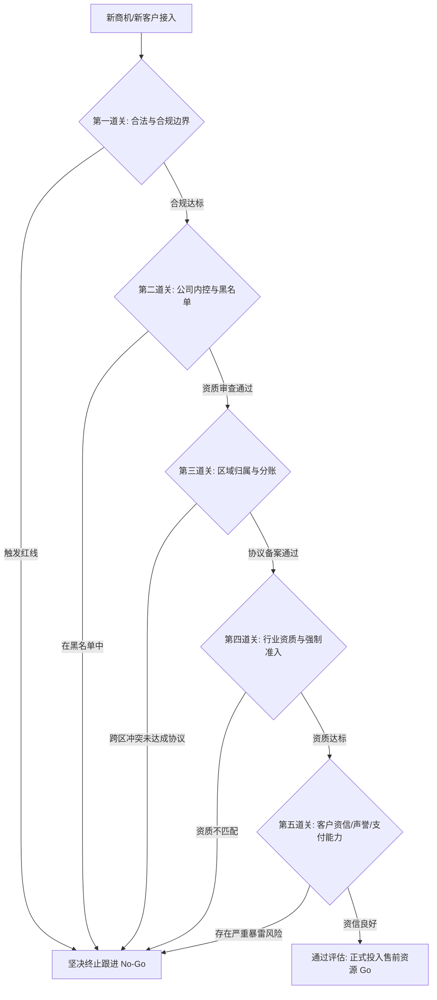

# 第14讲：客户评估：识别假商机与沉没成本

> **【本讲一句话心法】**：不是所有找上门的生意都是好生意 —— 在盲目投入售前精力前开启风险雷达，学会识别“饮鸩止渴式”假商机，是保护团队与公司的第一道生命线。

---

### 一、 场景痛点与认知破局

#### 1. 一线实战痛点
* **热情进场，落寞离场**：销售拍胸脯说“关系特别铁”，售前跟进数月写方案、做演示，最后因公司无法开票或不具备资质连标都投不了，心血付诸东流；
* **“老赖”客户拖垮现金流**：项目做完了验收遥遥无期，二期都上线了一期首付款还没给，销售拿到提成跳槽，售前与实施却要深陷无休止的索赔扯皮；
* **踩中合规与内控地雷**：盲目承接被国际制裁禁售、涉及高危转口贸易或公司内部黑名单客户的项目，导致团队面临合规重罚乃至灭顶之灾。

#### 2. 常见认知误区
* 误区一：“只要有单子就得接，客户规模越大、名气越响，项目就越靠谱。”（真相：很多家喻户晓的传统巨头在信息化上的年预算可能少得可怜；某些明星企业的企业文化极度苛刻，甚至存在系统性白嫖供应商方案的劣迹。）
* 误区二：“做售前只管技术方案，商务合规和客户资信是销售与法务的事。”（真相：当项目烂尾或遭遇死局，消耗的是售前最宝贵的青春与精力。懂得前置评估客户的售前，才能把弹药用在真正的刀刃上。）

#### 3. 核心认知破局
**“欲速则不达。”** 凡是那种“你今天不来下午就找别人、耽误两天就丢”的项目，大概率本来就不是你的机会。学会前置过滤掉无法履约、无法回款、或消耗巨大生命的恶劣项目，不是错失商机，而是为公司和个人规避了巨大的财务与职业风险。

---

### 二、 核心方法论：客户准入资格五维评估雷达模型



#### 客户准入评估五维关键指标体系

| 评估维度 | 核心考量重点与风险特征 | 典型暴雷场景案例 | 售前应对准则与防御动作 |
| :--- | :--- | :--- | :--- |
| **1. 国际与国家合规限制** | 最终用户（End User）是否在受限交易名单中；是否存在多层转口贸易规避制裁。 | 某大型通信设备商违反海外制裁禁令向特定国家供货，遭受数十亿美元巨额罚单并面临停摆。 | 涉及敏感海外地域或转口贸易的业务，必须报送公司法务与合规部（Compliance）做书面审查。 |
| **2. 内部黑名单与客诉状态** | 客户历史履约情况；过往项目是否存在恶性欠款、拒付尾款或正在进行诉讼。 | 某软件大厂与某商业银行因历史纠纷暗中暂停合作逾1年，一线售前不知情仍耗时跟进，投标日前夕被紧急叫停。 | 接触老客户前，在财务系统与CRM核查该客户应收账款（AR）状态与法务涉诉记录。 |
| **3. 签约主体与团队归属** | 客户合同签约法人实体的注册地是否属于本办事处/事业部的管辖配额。 | 跨区域跨分公司抢单，售前忙前忙后大半年，中标后业绩全部划归异地兄弟分公司。 | 若必须跨区支持，要求销售双方领导事先签署书面《内部业绩分账协议》，并邮件抄送双方大区总。 |
| **4. 行业资质门槛** | 行业信创要求（国产化比例）；等保三级/密评、涉密集成、军工涉密等硬性资质。 | 客户要求供应商具备甲级涉密资质或原厂CMMI5认证，我司不具备且不允许联合体投标，开标直接废标。 | 研读客户行业招投标法例，第一时间核对我司资质库，缺硬性资质时提前寻求具备资质的总包合作。 |
| **5. 客户财务信用与资信** | 客户经营稳定性（实控人内斗/被查）；历年IT预算真实规模；回款账期与甲方企业文化。 | 某民企实控人被羁押导致部门解体；知名企业名气大但年IT预算不足50万；个别“要命式”甲方无休止免费索取。 | 企查查/天眼查排查股权诉讼风险；向行业友商打听其验收难易度与付款声誉；评估IT投资真实性。 |

---

### 三、 售前实操标准动作（客户风险排查四步法）

* **Step 1：执行“外围大数据透视”（企查查/天眼查/裁判文书网）**
  * 查询客户股权结构、实际控制人变更、被执行人信息、裁判文书涉诉数量，重点关注是否频繁与供应商发生“合同买卖纠纷”。
* **Step 2：核算客户“IT投资性价比”**
  * 检索客户历年公开的中标公告与采购记录，测算其在同类系统上的历史采购均价与年度预算池，核实其是否有足够的预算支付我方产品。
* **Step 3：审查合同关键商务边界（防霸王条款）**
  * 提前探听客户过往的标准合同条款：是否有“无上限违约金”？是否强制要求提供“完整产品底层源代码/设计图纸”？付款节点是否属于“交付前零首付、终验后拖延付款”？
* **Step 4：出具《商机准入评估备忘录》并明确退路**
  * 若发现严重红线，以书面形式向销售经理和售前主管列明风险点，礼貌建议放弃或转为轻量级维系。

---

### 四、 实战工具箱：客户风险核验打分表（Radar Checklist）

#### 1. 客户评估风险体检表

| 评估维度 (每项20分) | 满分标准 (20分) | 扣分项 (0~10分) | 得分 |
| :--- | :--- | :--- | :--- |
| **合法合规与政策** | 符合本国与国际全部法律，非制裁对象 | 存在转口贸易嫌疑，或面临反垄断/资质被吊销风险 |  |
| **财务信用与回款** | 现金流充沛，历史付款记录优良，首付款 $\ge 30\%$ | 诉讼缠身，拖欠旧供应商尾款超过1年，零首付要求 |  |
| **IT预算匹配度** | 专项预算已获批，金额大于我方标准报价 | 未批预算，仅口头画饼，或年IT预算远低于产品单价 |  |
| **合作历史与声誉** | 行业口碑良好，尊重技术，有成熟验收交付先例 | 业界公认“要命式甲方”，项目失败率高，动辄扣款索赔 |  |
| **资质与组织归属** | 资质完全匹配，签约主体与本团队管辖权一致 | 缺少核心资质需挂靠，或跨大区分账不清极易扯皮 |  |
| **总分汇总** | **$\ge 80$ 分：合格优质客户（Go）** | **$< 60$ 分：高危假商机（建议坚决 No-Go）** |  |

#### 2. 应对销售带见“不靠谱客户”的高情商阻击话术
> “王哥，咱们做成一个大客户都不容易。在正式去拜访前，我刚才查了一下他们历年的采购记录，发现他们近两年同类系统的中标价普遍在20万左右，而我们这套方案仅原厂硬件和基础底座成本就近50万。如果我们贸然按高规格去交流，客户极大概率拿我们当标杆去压低小厂商的价格。为了不浪费咱们的时间，建议您先探一下他们这次的真实预算盘子，如果确实有增量预算，我立刻为您定制一套杀手级方案跟您一起去。”

---

### 五、 真实标杆案例深度复盘

```
【项目背景】某初创软件企业售前团队接到南方某地代理商的紧急需求，称手头有当地重点政府数字化项目，希望嵌入该软件，并承诺“先不付首款，等项目实施完成并验收后一次性全额付清100%款项”。
【踩坑过程】：
  1. 团队当时求单心切，在网上简单看了一下该代理商官网觉得实力雄厚，未做工商与涉诉尽调便仓促签约入场；
  2. 售前与技术人员耗时3个月完成了定制开发与现场部署，最终客户（政府单位）也已顺利上线使用；
  3. 待收尾请款时，签约的代理商老总彻底失联，公司总机无人接听。
【真相与破局】：
  - 后来通过层层关系打听才得知：早在签约前，该代理商股东就因经济案件被羁押，公司内部早已爆发夺权内斗，各部门员工作鸟兽散；
  - 所幸售前团队在现场直接与最终政府客户建立了良好的技术信任；查明该政府客户尚未向代理商拨付款项后，团队协助政府单位走法律程序解除了原采购合同，并直接与政府单位补签了单一来源直签合同，最终追回了80%的款项。
【启示】侥幸回款不能掩盖前期客户评估的重大失职。若提供的是硬件集成项目，垫资采购成本直接会导致创业公司资金链断裂倒闭！
```

---

### 六、 血泪教训与避坑红线

> [!WARNING] **红线一：严禁轻信“先干活、验收完一次性付款”的口头承诺。** 在ToB商业世界里，健康的商务合同必须遵循“首付款 - 到货款 - 初验款 - 终验款 - 质保金”的里程碑规则。零首付意味着乙方承担了 100% 的财务杠杆与违约风险。

> [!CAUTION] **红线二：远离那些“以折磨供应商为荣”的恶性甲方。** 行业内存在极少数将严苛刁难、推倒重来、全员通宵当做政绩管理的病态甲方。资深售前宁可被公司问责，也绝不把团队推入这种吞噬身心健康和职业前途的黑洞中。

---

### 七、 课后思考题与实战研讨指南

#### 思考题 1：为什么说“由于耽误了一两天而失去的项目机会，从来就不是你的真正机会”？
* **破题思路**：
  * 真正有诚意、有理性采购流程的大客户，决策周期长、评估维度广，绝不会因为一两天的方案准备延迟而草率定生死；那些急赤白脸催促“明天不交就出局”的项目，多半是拉你当临时陪标炮灰或套取免费方案。

#### 思考题 2：如果你发现销售报上来的一个“意向大客户”刚好在公司的欠款黑名单上，但该销售与你私交极好，你会怎么做？
* **破题思路**：
  * 私下坦诚沟通，直接出示公司内控部门的黑名单记录与过往诉讼背景；向其讲清利害：哪怕侥幸签单，公司内控合规与财务也绝不会盖章发货，反而会耗尽销售的当季精力并引来管理层批评，劝其果断转向其他优质客户。

#### 思考题 3：如果一个客户规模宏大、名声在外，但调研后发现其内部对于该系统的年预算只有几万元，而你司系统客单价在百万元以上，售前应该采取什么策略？
* **破题思路**：
  * 策略一：尝试做升维引导，用行业监管与严重故障后果促使高层追加立项预算；策略二：若判定预算绝无提升可能，果断进行降维适配，推荐标准化轻量版或合作伙伴低端产品，适度止损，严禁投入定制化售前资源。
