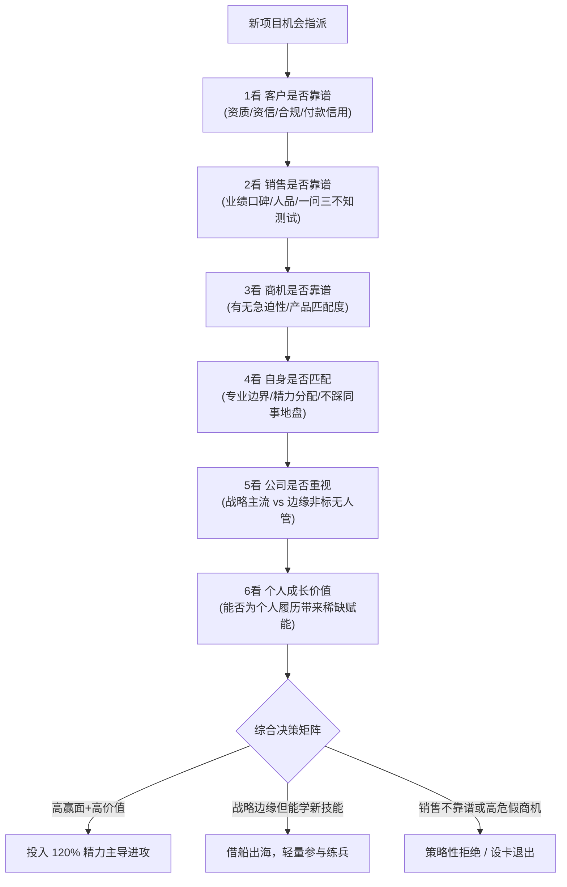

# 第15讲：售前启动工作前的“6看”尽调战术

> **【本讲一句话心法】**：聪明的售前从不盲目接单 —— 战前“6看”是保护个人精力与职场声誉的滤网，决定了你打的是一场建功立业的胜仗，还是一场耗尽心力的苦役。

---

### 一、 场景痛点与认知破局

#### 1. 一线实战痛点
* **来者不拒，沦为“救火队员”**：任何销售丢过来的商机都不假思索地接，导致手中堆积十几个半生不熟的项目，天天熬夜却颗粒无收；
* **跟错销售，背负沉重黑锅**：遇到“一问三不知”或“满嘴跑火车”的不靠谱销售，现场被客户问得体无完肤，丢单后还被反咬一口“售前技术不行”；
* **陷入非核心边缘业务泥潭**：主动接下公司既不重视、又无交付团队支撑的非标边缘项目，签单后无人交付，最终售前被迫转型去现场常驻当苦力。

#### 2. 常见认知误区
* 误区一：“领导和销售分配的项目，售前没有任何选择权，只能硬着头皮干。”（真相：资深售前懂得运用隐蔽技巧和客观事实‘做局过滤’，把资源集中在大概率打赢的优质战役上。）
* 误区二：“只要项目金额足够大，就一定是好项目。”（真相：金额再大，如果产品严重不匹配、交付全靠外采拼凑、且客户只认极端低价，中标就是灾难的开始。）

#### 3. 核心认知破局
**Work Smart（聪明地工作）。** 售前接手项目前必须展开私下的“内心尽调”。从**客户、销售、商机急迫性、个人能力、公司重视度、个人长期价值**六个维度审视盘面，决定“接不接、怎么接、投入多少成精力”。

---

### 二、 核心方法论：售前启动前“6看”决策罗盘



#### 售前“6看”核心核验指标与避坑雷达

| “看”的维度 | 深度核查关键点 | “不靠谱”危险信号 | 售前应对与精力分配策略 |
| :--- | :--- | :--- | :--- |
| **一看：客户靠谱度** | 上一讲客户评估指标：合规、涉诉、黑名单、真实IT预算规模。 | 涉诉老赖、零首付要求、无IT预算仅空谈概念。 | 触发硬伤一票否决，坚决拒绝介入。 |
| **二看：销售靠谱度** | 历史业绩水平、同事间口碑、是否喜欢甩锅推责；对客户组织架构的掌握度。 | **一问三不知**，或**天马行空胡乱吹嘘**，把话说的极满却拿不出干货。 | 开展“三问题摸底测试”；若极不靠谱，引入售前经理把关设防。 |
| **三看：商机靠谱度** | 客户是否存在**真实的急迫性**（痛点、监管罚单、高层考核、预算截止期）；方案匹配度。 | “客户只是随便问问”、“方案看着办”、“不着急今年做”。 | 缺乏急迫性的项目必拖延，仅提供标准白皮书，不投入定制力量。 |
| **四看：能力匹配度** | 自身专业领域（知识库）是否能支撑；是否跨界侵占了团队其他售前的地盘。 | 完全不懂底层、强行越俎代庖，或引发内部同事恶性竞争。 | 主动将商机流转给专业对口的售前同事，维持团队政治和谐。 |
| **五看：公司重视度** | 属于公司主流核心业务，还是分支机构无支持的非标冷门方向。 | 公司内部无交付团队、无研发路线图、中标即成孤儿。 | 警惕盲目接单；若公司无战略决心，尽量避免做孤胆英雄。 |
| **六看：个人增值度** | 本项目能否为自己带来稀缺的新技术经验（如AI智能体、大数据湖仓、前沿架构）。 | 重复性简单拼凑，毫无技能沉淀价值。 | 若属于未来爆发赛道（如当年自动驾驶/如今AI），即使前五看稍逊也可参与练兵！ |

---

### 三、 售前实操标准动作（策略性拒绝与设卡 SOP）

* **Step 1：开展“销售背景摸底三问测试”**
  * 当销售要求售前进场时，直接提问：
    1. “张哥，客户负责该项目的分管处长和具体牵头科长是谁，他们怎么评价现状？”
    2. “客户为什么今年一定要上这个系统？最迟何时必须挂网招标？”
    3. “客户准备的预算大概在哪个量级？资金来源是自有资金还是专项补贴？”
  * 若销售支吾回答不上来，进入设卡流程。
* **Step 2：运用“反向提要求法（Information Hurdle）”**
  * 礼貌回应：“为了确保交流效果，请您先找客户把这几个前置信息（组织架构、业务量峰值、现网架构）摸清楚。只要信息一到位，我立刻连夜出方案。”不靠谱的销售往往知难而退。
* **Step 3：借力售前主管设立“规则防火墙”**
  * 提前与主管约定默契：“凡是我评估风险极高的项目，我会引导销售找您审批资源。”由主管从团队资源调配高度出面拒绝或降级处理。
* **Step 4：引导销售共同开展《机会可行性评审》**
  * 与销售坐下来，拿出一张纸共同打分，通过客观数据让销售自行意识到该项目胜率极低，主动放弃无谓消耗。

---

### 四、 实战工具箱：售前“优雅拒绝不靠谱项目”话术库

#### 1. 应对销售盲目催促的“专业推脱”话术
* **情境**：销售催促：“下午带上电脑跟我去见客户，现场随便讲讲，很急！”
* **话术**：
  > “王哥，咱们面对这种新客户，第一次技术交流的‘专业第一印象’决定了后续能不能控标。如果我们在连客户当前用的什么系统、痛点在哪都不清楚的情况下仓促开讲，很容易讲偏甚至暴露我们的产品短板。我这边整理了一份《前置调研问题清单》（仅5个问题），您先用微信发给对方确认一下，拿到答复后我针对性准备半小时，咱们下午去就是‘降维打击’。”

#### 2. 商机启动前 6 看打分卡（内部决策自测）

```
【项目名称】：___________________    【负责销售】：___________
[ ] 1看客户：无涉诉违约记录，资信与预算可靠 （权重 20%）
[ ] 2看销售：销售业绩稳定、懂业务、不甩锅 （权重 20%）
[ ] 3看商机：痛点急迫，有政策/考核倒逼节点 （权重 25%）
[ ] 4看能力：与自身主线能力匹配，未越界踩线 （权重 10%）
[ ] 5看重视：公司主流战略方向，有交付兜底保障 （权重 15%）
[ ] 6看个人：能提升个人行业权威度与前沿履历 （权重 10%）
综合评定：[ ] 建议全力打单(>80)   [ ] 标准支持(60-80)   [ ] 策略退出(<60)
```

---

### 五、 真实标杆案例深度复盘

```
【反面教训】某大厂资深售前老刘的主动请缨悲剧。
【背景】偏远山区某煤矿计划建设一套“井下人员定位与应急通讯监控系统”，预算高达1500万。老刘见金额巨大，主动向主管请缨跟进。
【售前后端盲目点】：
  1. 煤矿监控并非公司核心软件主业，公司毫无矿山安全经验与现成产品（忽视 4看与 5看）；
  2. 行业正处于去产能末期，市场空间急剧萎缩，该地区传统采购纯靠当地私人关系和极端低价；
  3. 老刘沉迷于“大单光环”，陪同销售狂砸精力跟进大半年。
【惨痛结局】：
  - 销售为了拿单，在投标时以腰斩式的超低价中标，方案里拼凑了大量低端第三方硬件；
  - 中标后，公司交付部门全员拒接该项目（“我们没经验，谁接谁背锅”）；
  - 最终管理层只能硬性指派老刘脱离售前岗位，转任项目经理常驻偏远煤矿深山近整整两年；
  - 每天没日没夜在矿井排障，勉强终验回京后，该产品线被公司彻底裁撤，老刘白白荒废了两年黄金职业期。
```

---

### 六、 血泪教训与避坑红线

> [!WARNING] **红线一：严禁做“谁叫都去”的职场老好人。** 在售前团队中，最廉价也是死得最快的就是有求必应的“老好人”。不懂得策略性拒绝，你就会成为所有垃圾商机、甩锅销售的回收站。

> [!TIP] **进阶心法：紧跟团队顶尖销售（Top Sales）。** 冠军销售的敏锐嗅觉与成单率远高于普通人。主动将个人80%的精力与顶尖销售的核心客户深度绑定，赢单概率和个人声誉将获得乘数效应。

---

### 七、 课后思考题与实战研讨指南

#### 思考题 1：如果一个项目从客户、销售、公司重视度来看都极差，但却能让你接触到极其前沿的新技术（如最前沿的大模型落地架构），你接还是不接？
* **破题思路**：
  * **策略性接单，但严控投入边界**。作为个人“借船出海”的跳板，利用该项目积累前沿实战经验、技术架构方案与试错经验；但务必向销售和管理层讲清交付边界，防止过度承诺被绑死在后期烂尾工程中。

#### 思考题 2：为什么说“一问三不知”的销售固然可怕，但“满嘴跑火车、把话说太满”的销售往往更危险？
* **破题思路**：
  * 一问三不知的销售只是能力弱，售前尚能主导控局；而满嘴跑火车的销售会在客户面前信口开河做各种不可能落地的空头承诺，甚至私下与客户达成违规交易，最终将售前与交付团队推入灾难性的违约甚至法律诉讼深渊。

#### 思考题 3：如果遇到自己非常渴望参与的标杆大项目，但主管分配给了其他同事，你该如何高情商地争取？
* **破题思路**：
  * 不去争抢主导权，而是以“技术补位专家”的姿态申请加入虚拟联合团队：“主管，这个金融大项目非常关键，张哥主导很合适。我之前刚好在同类型项目的分布式容灾模块踩过坑，我申请作为副手协助张哥负责这一章的攻坚，保障咱们团队万无一失。”既展现了大局观，又获得了参与核心战役的机会。
