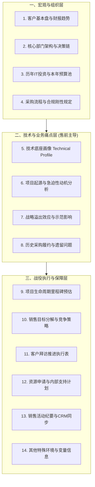

# 第16讲：深度参与制定与更新客户销售计划（Account Plan）

> **【本讲一句话心法】**：Account Plan 不是应付管理层的填表差事，而是大客户战役的沙盘作战地图 —— 售前唯有深度共建并主导 Technical Profile，才能从全局视角掌控战机。

---

### 一、 场景痛点与认知破局

#### 1. 一线实战痛点
* **销售视计划为负担，拒绝落笔**：“计划赶不上变化，写这玩意儿耽误时间”、“只要我年底交回合同数就行，很多台底下的事情不便写出来”；导致打单思路全在销售脑子里，售前完全两眼一抹黑；
* **信息断层导致协作脱节**：技术交流时售前不知道客户高层的真实政治意图，方案写得文不对题；售前被销售指派去“见招拆招”，每次交流都从零开始；
* **人员流动导致资产清零**：一旦资深销售或骨干售前离职，客户沉淀数年的技术底座、人脉偏好、历史痛点全部丢失，新接手人员只能重复踩坑。

#### 2. 常见认知误区
* 误区一：“Account Plan 纯粹是销售的活，售前一个搞技术的参和什么？”（真相：没有技术视角的 Account Plan 只是单纯的公关关系网；**融入了客户现网架构与技术演进路线的 Account Plan，才是真正能落地的打单总纲**。）
* 误区二：“写了计划就必须一成不变地执行。”（真相：Account Plan 是一份动态活文档，是团队定期复盘客户态势、修正作战打法的基准线。）

#### 3. 核心认知破局
**“不打无准备之仗。”** 如果销售不做 Account Plan，售前也必须为核心大客户自发建立一份 **Technical Account Plan（技术售前打法计划）**。它是售前向公司申请专家资源、协调后方研发支持、以及保护自身免于后期被甩锅的“铁证与抓手”。

---

### 二、 核心方法论：客户销售计划（Account Plan）14维全景架构



#### Account Plan 核心构成模块解析

| 模块类别 | 核心字段内容 | 售前在其中的独特价值贡献 |
| :--- | :--- | :--- |
| **1. 客户基本面** | 集团架构、主营业务、行业地位、近3年营收净利趋势、年度战略主题。 | 提炼宏观战略关键词，为技术交流奠定高维格局。 |
| **2. 组织与决策链** | 牵头部门、配合部门负责人名单、性格偏好、政治诉求。 | 识别谁是技术把关人（TB）、谁是最终决策者（EB）。 |
| **3. 预算与采购流程** | 采购模式（公开/单一来源）、审批层级、本年专项预算池大小。 | 评估方案规格上限，防止方案超预算导致客户无法立项。 |
| **4. 技术底座画像<br>(Technical Profile)** | **① 现行系统品牌与版本；② 数据库与底层OS架构；③ 上下游接口与集成协议；④ 现存技术瓶颈。** | **【售前核心主战场】**：建立详尽的技术档案，摸清对手弱点，为方案设计提供精密参数依据。 |
| **5. 动机与急迫性** | 业务痛点根因、监管考核压力、领导政绩诉求。 | 将痛点转化为必须上马该系统的“Why Something”铁证。 |
| **6. 历史合作数据** | 过去3~5年采购记录、遗留故障、维保续订率、客户使用满意度。 | 盘点历史遗留包袱，提前准备救火补丁或防御说辞。 |
| **7. 目标与策略** | 重点攻坚标包、合同预期金额、放弃的低价值机会。 | 协助销售做“田忌赛马”式的商机筛选与资源聚焦。 |
| **8. 资源申请计划** | 需要售前后方架构师、研发定制、高管站台的具体时间表。 | 白纸黑字锁定公司支持资源，避免临近投标时因资源撞车而断供。 |

---

### 三、 售前实操标准动作（构建与维护 Technical Account Plan SOP）

* **Step 1：战前建立《大客户技术档案库（Technical Profile）》**
  * 每当从客户处获取到一张网络拓扑图、一份旧系统接口文档或一次服务器配置清单，立即归档至该客户的 Technical Profile 文件夹中。
* **Step 2：每月召开一次“售前-销售战情对齐会”**
  * 针对 Top 3 大客户，对照 Account Plan 逐行过堂：本月拜访了哪些关键人？客户预算是否发生异动？技术验证进展如何？
* **Step 3：将关键活动同步回 CRM 管道**
  * 将重大技术交流、高层研讨纪要录入公司销售管理系统，使管理层实时感知该客户的推进深度。
* **Step 4：实施平滑交接（Account Handover）**
  * 当项目涉及人员轮换或新增售前支持时，直接调出 Account Plan 进行30分钟沙盘推演，实现团队作战能力的无缝传承。

---

### 四、 实战工具箱：客户技术底座画像（Technical Profile）标准模板

#### 1. 售前必备 Technical Profile 调研记录卡

```markdown
# 【客户名称】核心系统 Technical Profile（技术底座画像）

### 一、 基础设施与现网环境
- **机房与云底座**：[如：自建私有云 OpenStack / 华为云HCS / 阿里云专有云]
- **服务器与操作系统**：[如：x86架构 200台 / 飞腾/鲲鹏信创服务器 50台；麒麟V10]
- **核心数据库**：[如：Oracle 19c RAC 主备 / 达梦DM8 / MySQL集群]
- **网络与安全架构**：[骨干带宽、内外网隔离网闸、WAF与等保三级防护现状]

### 二、 业务应用与集成拓扑
- **现行业务系统**：[系统名称 / 供应商 / 上线年份 / 当前承载并发峰值]
- **上下游核心接口**：[RESTful API / WebService / MQ消息队列 / 数据同步工具]
- **历史核心顽疾**：[如：月末结算性能严重衰减 / 容灾切换存在数据不一致风险]

### 三、 客户关键技术干系人画像
- **CIO / 技术总监**：[姓名/技术偏好/关切点：如极度重视安全信创与自主可控]
- **架构主管 / 科长**：[姓名/性格特点：如严谨保守，只认行业成熟案例，抵触推倒重来]
```

---

### 五、 真实标杆案例深度复盘

```
【项目背景】某大型股份制商业银行启动新一代分布式中间件全行选型，项目涉及上千个业务微服务改造，合同金额近5000万。
【破局打法】：
  1. 负责该行的销售老孙与资深售前老林深度合作，历时4个月打磨了一份长达60页的《全行科技演进 Account Plan》；
  2. 老林主导了其中的 Technical Profile 模块，详尽摸排了该行信贷、网银、核心计费等 8 大核心系统的中间件版本、调用拓扑及历次生产故障记录；
  3. 当竞品厂商还在给该行科技部大而化之地宣讲通用云原生概念时，老林在交流中直接出示了《针对该行现网三大技术死锁瓶颈的微服务平滑解耦路线图》；
  4. 科技部总经理拍案叫绝：“你们比我们内部的开发人员还要清楚现网架构的痛点！”
【战役成效】这份技术档案直接转化为该行未来三年的科技改造蓝图，老林团队毫无悬念地锁定了全行独家战略框架协议。
```

---

### 六、 血泪教训与避坑红线

> [!WARNING] **红线一：严禁做“躺在抽屉里的死计划”。** 最忌讳的是年初为了应付公司检查突击填了一份 Account Plan，之后整整一年再未打开更新。脱离动态业务变化的静态计划，毫无实战价值。

> [!CAUTION] **红线二：不要把所有的情报都押在销售一人身上。** 很多销售的信息来源单一，甚至被片面客情蒙蔽。售前要利用自身在技术交流、现场排障中与客户一线工程师建立的交情，从技术侧独立交叉验证情报的真实性。

---

### 七、 课后思考题与实战研讨指南

#### 思考题 1：如果一个大客户销售对你说：“你一个搞技术的，管那么多客户背景和销售计划干嘛，叫你出方案你就出方案”，你会如何应对？
* **破题思路**：
  * 保持专业定力，无需情绪对抗；明确向其指出：“如果不了解客户的预算规模和高层动机，方案极易打偏甚至暴露短板，反而会降低张哥您的赢单概率；给我20分钟对齐背景，我出具的方案能直接帮您锁定加分项。”若销售依然固执己见，则严格按标准支持，不额外透支个人精力。

#### 思考题 2：为什么说“好记性不如烂笔头”在售前维护客户 Technical Profile 时体现得尤为突出？
* **破题思路**：
  * 大型客户系统极其复杂，涉及数十个厂商、数百个接口和上千项技术参数，人的记忆必然随着时间衰减而遗漏细节；一旦在后续投标或现场交流中报错一个接口参数，客户专家对你的专业信任度将瞬间崩塌。

#### 思考题 3：如何借助 Account Plan 中的“资源申请计划”，保护售前自身免受“项目丢单后的内部政治甩锅”？
* **破题思路**：
  * 在计划中清晰界定打单所需的关键前置条件（如：需要公司安排特定行业专家于某月前到位、需要提供特定资质等）；若后期因公司内部资源未能如期调配导致失利，Account Plan 即是客观反映事实、厘清责任边界的最佳证据。
