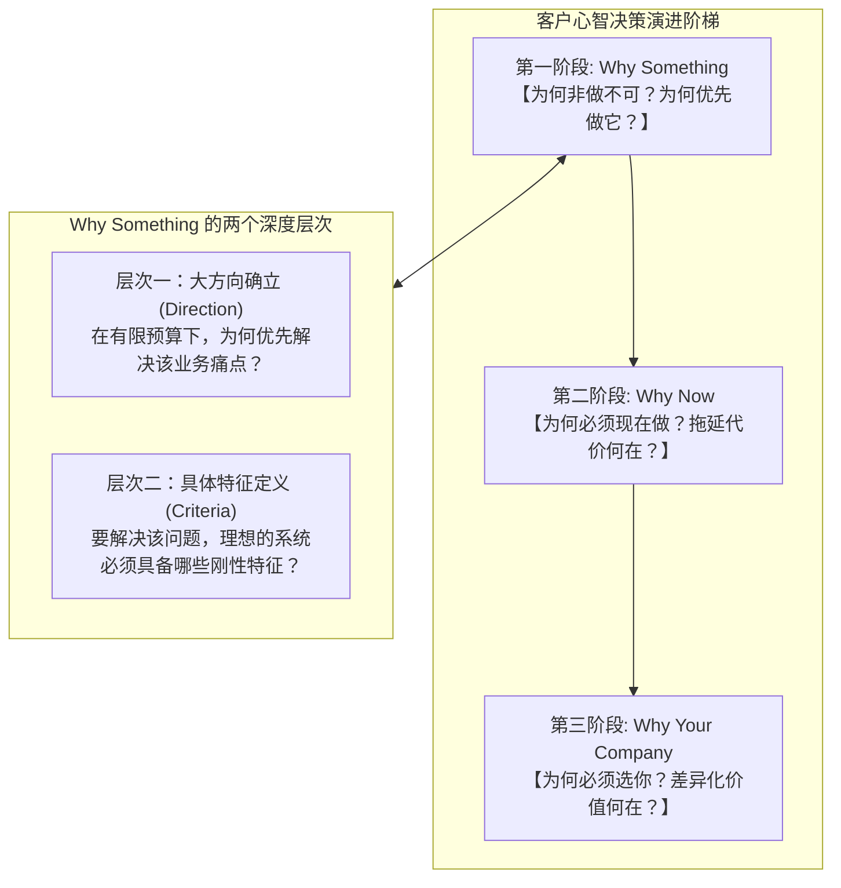

# 第18讲：售前核心命题：为何解决 Why Something 远先于 What 和 How

> **【本讲一句话心法】**：丢单的根源从来不是最后一步的比价，而是你在最初的“Why Something”阶段缺席 —— 谁帮客户定义了“为什么非做不可”及其底层指标，谁就提前锁定了最终胜局。

---

### 一、 场景痛点与认知破局

#### 1. 一线实战痛点
* **急于自夸遭客户反感**：刚见客户第一次，就急吼吼地打开几十页PPT炫耀“我们公司行业第一、资质最全、案例最多”，客户却礼貌而冷漠地打哈欠；
* **“客户认可方案却转头买了别家”**：售前费尽心血做了演示，客户连夸方案好，结果招标时却以不可思议的低价选了竞品，售前百思不得其解；
* **陷入价格血拼的泥潭**：在客户已经明确要买什么（What）和怎么买（How）之后才进场，只能在客户划定的现成跑道上与对手拼折扣、拼让利。

#### 2. 常见认知误区
* 误区一：“ToB打单最核心的是解决‘Why Your Company（为什么选我们）’，客户不选我们前面做再多也是白搭。”（真相：**客户之所以最终没选你，根本原因是你前期没有把‘Why Something’做扎实**。没有深度塑造立项标准的售前，在终局必然被价格战洗牌。）
* 误区二：“客户既然叫我们来交流，说明客户已经想清楚要做这个项目了。”（真相：政企客户预算池有限，多个业务部门争夺同一笔预算。很多时候客户只是在漫无目的地搜集素材，项目随时可能因动力不足而胎死腹中。）

#### 3. 核心认知破局
**B2B 采购决策必须经历顺序严密的“3-Why飞轮”。** 客户的预算和精力是高度有限的。在客户组织内部尚未就“为什么这件事非做不可、不做会承受什么灾难”达成全员共识前，任何针对自家公司（Why Your Company）的推销都是过早暴露、引发防御心理的无效噪音。

---

### 二、 核心方法论：B2B 决策的三层演进与 Why Something 的双重境界



#### 生活场景映射：选美术培训班与 ToB 决策的本质相通性

| 决策阶段 | 个人生活场景（给孩子报美术班） | 复杂企业采购场景（某企业上马数字化项目） |
| :--- | :--- | :--- |
| **机构错误动作** | 销售一上来就自夸：“我们师资是清华美院毕业、得过很多大奖，快报名吧！”（家长只会觉得贵，根本不愿掏钱）。 | 售前一上来就宣讲：“我们分布式底座最牛、微服务最强、案例最多！”（客户业务一把手毫无感觉）。 |
| **客户核心心智**<br>*(层次一：方向)* | 预算与时间极其有限。在音乐、舞蹈、编程、主持中，**为什么非要报美术班（Why Something）**？ | 年度IT预算有限。在OA升级、CRM改造、安全加固中，**为什么必须优先立项做本系统**？ |
| **深层动机溯源** | 家长理科出身，过去工作做PPT配色差吃大亏；且面向AI时代，唯有人类艺术审美创造力是不败护城河。 | 业务线正面临监管合规严查的巨额罚单风险，或由于系统卡顿正遭受集团高层的严厉问责。 |
| **具体特征锁定**<br>*(层次二：特征)* | 确定报美术后，必须具备：① 离家3公里以内；② 启发式小班教学；③ 兼顾素描与审美眼界。 | 确定立项后，必须具备：① 原生跨国多语言；② 毫秒级事务容灾；③ 必须具备同业3家以上成功落地先例。 |
| **终局水到渠成** | **此时再去筛选机构，符合这些独特特征的机构全城仅剩1~2家，价格不再是阻碍！** | **当招标文件发布时，评分标准与硬性指标已与我方高度一致，高价赢单理所当然！** |

---

### 三、 售前实操标准动作（攻坚 Why Something 四步 SOP）

* **Step 1：协助客户发起“业务痛点资产盘点”**
  * 与客户骨干梳理现状：过去12个月内，现行业务流程发生了多少次堵点？造成了多少工时浪费与经济损失？
* **Step 2：将隐性痛点升维为“组织级生存危机”**
  * 结合外部监管通报、行业标杆竞争动向，帮助客户撰写《业务风险预警备忘录》，证明“维持现状的代价远大于采购新系统的预算”。
* **Step 3：主导设计系统选型的“第二层次特征（Level 2 Criteria）”**
  * 在客户确立方向后，主动协助其制定选型评估框架，将我方的技术架构优势（如高可用双活、低代码定制、细粒度数据隔离）无缝包装为“行业必须达标的工程规范”。
* **Step 4：自然过渡至 Why Your Company**
  * 当客户依据这份由你深度参与制定的标准去市面上比选时，客户会惊喜地发现：“市面上只有你们的方案从第一天起就完全契合我们的立项标准！”

---

### 四、 实战工具箱：痛点量化与 Why Something 论证模板

#### 1. 业务损失与立项必要性测算模型（ROI & Cost of Inaction）

$$\text{拖延/维持现状代价 (Cost of Inaction)} = \text{人工返工工时成本} + \text{业务流失损失} + \text{潜在监管处罚敞口}$$

* **论证话术示范**：
  > “张总，如果我们继续沿用现有的手工审批流程，全集团每年因报销单据流转平均耗费 12,000 个工时，折合人力沉没成本近 180 万元；更关键的是，近期税务与审计新规出台，纸质发票核验漏洞在季度抽查中极易面临通报处罚。相比之下，本期数字化费用管控系统投资仅 80 万元，上线当年即可收回全部投资并彻底杜绝合规敞口。”

---

### 五、 真实标杆案例深度复盘

```
【项目背景】某大型制药企业，老旧的实验室数据管理系统（LIMS）经常出现小故障，但研发部门觉得“凑合能用”，迟迟不愿立项更换。
【友商平庸动作】：
  - 两家竞品软件厂商多次上门，给药企研发副总演示其新一代系统的UI如何美观、功能如何丰富，副总均以“没有预算，以后再说”为由搁置。
【顶尖售前攻坚 Why Something】：
  1. 讲师团队售前深入调研国家药监局（NMPA）关于“临床试验数据完整性（Data Integrity）与不可篡改审计追踪”的最新飞行检查标准；
  2. 售前调取了该药企老系统数据库日志，现场指出：老系统未加密存储实验原始审计记录，一旦遭遇飞行检查，可能直接导致其正在申报的重磅新药被暂停审批！
  3. 售前为药企量身编制了《数据合规风险审查报告与新一代LIMS系统准入规范（含不可篡改区块链存证标准）》；
  4. 药企高层震惊，当月召开紧急办公会，将该项目列为本年度最高优先级“特批抢险立项”工程！
【战役成效】由于技术规范中的不可篡改标准完全源自该售前团队的自研特性，竞品在后续评审中因不具备该特性直接在初审被淘汰，该团队高价全盘拿下！
```

---

### 六、 血泪教训与避坑红线

> [!WARNING]
> **红线一：严禁在客户尚未确立“Why Something”前盲目亮出底牌。** 如果客户甚至还没想清楚做不做，你就把详细的产品架构图、技术白皮书和底层源代码全交上去，客户转头就会把你的方案拿给他的关系户厂商去抄袭立项。

> [!CAUTION]
> **红线二：不要把 Why Something 局限在技术缺陷上。** 仅仅证明“老系统代码老旧、架构过时”根本无法打动业务高管。必须把技术缺陷转化为“对业务增长的阻碍、对客户个人的考核风险”，才能激发客户的立项动力。

---

### 七、 课后思考题与实战研讨指南

#### 思考题 1：结合你在日常生活中的一次昂贵消费（如买车、买房、高额培训等），反思你自己的决策过程，你是在哪个瞬间真正确认了“Why Something”？
* **破题思路**：
  * 分析促使你掏钱的“转折点事件”：往往不是销售的吹嘘，而是你自身生活中的某一痛点（如家庭人口增加导致空间不足、孩子升学需求）达到了不可容忍的临界点。ToB 采购在组织心理学上完全遵循同样的决策规律。

#### 思考题 2：为什么说“如果你在 Why Something 的 Level 2（具体特征定义）阶段缺席，后续在 Why Your Company 阶段将极度被动”？
* **破题思路**：
  * 因为具体特征的定义就是招标评分标准的雏形。如果由竞品完成了 Level 2 的定义，标书参数必然全是竞品的长处和你的短处；哪怕你最后使出浑身解数证明公司实力，也会因为客观指标不满足而丢分出局。

#### 思考题 3：如何巧妙运用“Cost of Inaction（不做任何事的代价）”，击碎客户“今年预算吃紧、明年再看看”的拖延托词？
* **破题思路**：
  * 帮客户算违约与风险账：指出推迟一年虽然省了眼前的采购款，但现网系统在峰值崩溃造成的业务中断损失、合规罚款、以及竞争对手先行一步夺走客户的商机损失，远远超过上马该系统的费用。
