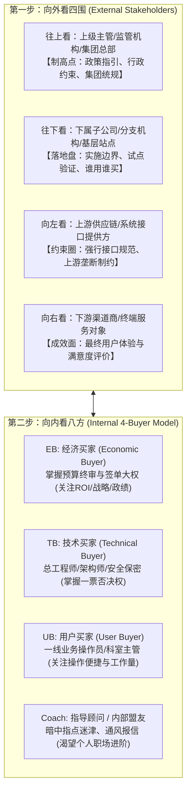

# 第19讲：识别、分类与管理关键项目干系人（Key Stakeholders）

> **【本讲一句话心法】**：项目成败在人不在物 —— 向外看四围、向内看八方，在售前阶段将干系人的利益地图绘制清楚，才能避免“先天不足、出生暴雷”的悲剧。

---

### 一、 场景痛点与认知破局

#### 1. 一线实战痛点
* **底层火热，高层一票否决**：与客户基层技术人员聊得热火朝天，方案改了十几版，结果上报到分管副总裁那里，直接被一句“不符合集团最新规划”全盘枪毙；
* **踩中跨部门政治地雷**：方案只照顾了信息科技部的诉求，却得罪了业务运营部门或财务审计部门，评审会上被其他处室群起而攻之；
* **“官大一级压死人”的外部突袭**：在子公司辛苦推进的大单，眼看就要立项，集团总部突然下发红头文件要求“全集团统规统建”，项目瞬间搁浅。

#### 2. 常见认知误区
* 误区一：“干系人管理是项目中标后、交付实施阶段项目经理（PM）的事，售前不需要操心。”（真相：**项目的政治地雷都是在售前孕育阶段埋下的**。如果售前阶段未理顺干系人利益，合同签下之日就是灾难爆发之时。）
* 误区二：“搞定关键人就是搞定最高领导一个人。”（真相：高层固然有一票否决权，但基层负责起草需求、技术部门负责技术把关、业务部门负责验收。任何一个环节出现敌对派，都能让项目流产。）

#### 3. 核心认知破局
**售前必须具备“立体雷达视角”。** 将客户作为一个整体系统：**向外看四围（上级主管、下级分支、上游供给、下游渠道）**，**向内看八方（EB经济买家、TB技术买家、UB用户买家、Coach指导者）**。用政治清醒保障技术方案的平稳落地。

---

### 二、 核心方法论：内外全维干系人透视网与经典买家角色模型



#### 客户内部四大买家角色（4-Buyer）深度剖析矩阵

| 买家角色 | 组织典型职位 | 核心心理关注点（内在诉求） | 在项目中的关键权力 | 售前核心应对策略 |
| :--- | :--- | :--- | :--- | :--- |
| **EB (经济买家)<br>Economic Buyer** | 总裁、分管副总裁、CIO、财务总监、局长。 | 投入产出比（ROI）、组织战略协同、对上汇报政绩、不违规无风险。 | **最终批准与资金否决权**（唯一能直接释放预算的人）。 | 高度概括的高层汇报，聚焦商业收益与宏观蓝图，避免陷入底层技术细节。 |
| **TB (技术买家)<br>Technical Buyer** | 总工程师、IT运维主管、网络安全科长、架构师。 | 系统不能挂、符合技术规范、信创可控、不给自己找麻烦。 | **技术可行性一票否决权**（无法决定买谁，但能判定谁不合格）。 | 展现极致严谨的技术可行性、压测数据、容灾冗余与安全合规背书，消除其安全焦虑。 |
| **UB (用户买家)<br>User Buyer** | 一线业务处长、科员、网点业务员、客服主管。 | 界面简不简单、能不能少加班、会不会增加我的录入负担。 | **日常使用与最终验收评价权**（上线后能否用起来的关键）。 | 突出人性化交互体验、自动化增效、减少手工繁琐流程的实际价值。 |
| **Coach (内部教练)<br>或 Champion** | 处室业务骨干、技术骨干、项目经办人。 | 渴望通过本项目树立个人威信、获得晋升资本或专业认可。 | **情报提供与内部游说引导权**（告诉你谁反对、谁支持、真实底牌）。 | 深度绑定其个人政绩，为其量身提供汇报材料，帮其在内部管理层面前“挣足面子”。 |

---

### 三、 售前实操标准动作（干系人识别与管控 SOP）

* **Step 1：战前“外部红头文件与集团政策盘查”（向外看）**
  * 查阅该行业上级监管机构（如国资委、银保监、卫健委）近半年的政策通报与集团公司战略红头文件，寻找“大政方针”背书。
* **Step 2：现场“名片与座次解码”（向内看）**
  * 交流现场观察座次与发言权重：谁坐在正中？技术人员回答前是否先看某位领导的眼色？谁提的问题最尖锐？迅速标记出隐形 EB 与 TB。
* **Step 3：绘制《项目干系人权力/利益态度九宫格》**
  * 明确每一位关键人是“铁杆支持”、“中立观望”还是“隐形反对派”，制定针对性拉拢或中和策略。
* **Step 4：开展分层定制化沟通**
  * 对 EB 讲“大饼与政绩”；对 TB 讲“架构底色与安全兜底”；对 UB 讲“操作减负与易用性”；对 Coach 提供“专属弹药”。

---

### 四、 实战工具箱：干系人权力利益矩阵与沟通计划表

#### 1. 干系人分析与攻坚作战表

| 干系人姓名与职务 | 角色分类 (EB/TB/UB/Coach) | 当前态度 (支持/中立/反对) | 核心个人诉求 (Personal Agenda) | 我方应对策略与行动抓手 | 责任人 |
| :--- | :--- | :--- | :--- | :--- | :--- |
| **张总（分管副总裁）** | EB | 中立偏支持 | 期望打造全省标杆，为年终集团述职增光 | 安排高层对等拜访，提供《标杆示范工程规划报告》 | 销售总监 |
| **李处（科技部总工）** | TB | 反对（偏向友商A） | 极度保守，担心更换系统导致现有数据库瘫痪 | 邀请其参观我方零故障连续运行5年的老客户生产机房 | 售前专家 |
| **王科长（牵头经办人）** | Coach / Champion | 坚定支持 | 渴望作为项目牵头人晋升副处长 | 全程代笔立项报告，在报告中突出王科长团队的创新成果 | 售前主笔 |
| **赵主管（一线运营）** | UB | 观望 | 抱怨目前旧系统录入复杂，天天加班 | 现场演示极简UI与批量自动化导入，赢得一线好评 | 售前顾问 |

---

### 五、 真实标杆案例深度复盘

```
【项目背景】某大型能源集团下属二级煤矿企业，招标“全矿山智能化安全生产综合中枢”，金额3500万。
【暗礁险境】：
  - 某投标厂商在二级煤矿现场工作极其扎实，矿长（当地EB）与机电科长（UB）均表示全力支持；
  - 但该厂商售前团队忽视了“向外往上看”：集团总部近期正在制定“全集团智能化建设统一数据标准”，且集团科技部某副主任具有强势监管权；
  - 竞品厂商悄悄走通了集团科技部的关系，集团突然下发一份关于规范数据接口的指导意见。
【顶尖售前破局反击】：
  1. 该厂商售前负责人得知情报后，并未在煤矿现场盲目抱怨，而是立刻“向上看”：
  2. 联合公司高管直奔集团科技部副主任处汇报，出示其在国家能源局参与制定的行业标准草案；
  3. 售前主动提出：“我们在该煤矿的试点，将100%严格按照集团规划的标准落地，并自费为集团打造一套‘全集团下属矿山统一数据汇聚中台’规范雏形，帮科技部完成集团级数字化政绩”；
  4. 集团副主任大喜过望，由反对转为力挺，指定该煤矿为集团统一标准的“首期样板试点单位”。
【战役成效】不仅守住了二级煤矿的3500万大单，更借此撕开了未来全集团数亿元智能化中枢的独家准入大门！
```

---

### 六、 血泪教训与避坑红线

> [!WARNING]
> **红线一：严禁忽视技术把关人（TB）的“一票否决权”。** 很多搞商务关系的销售只盯着一把手（EB），完全冷落甚至蔑视底层的技术专家和安全负责人。TB 虽然没有拍板买你的权力，但他只要在评审报告中写一句“存在严重技术安全漏洞”，就足以让一把手放弃你以求自保。

> [!CAUTION]
> **红线二：不要在敌友未明前暴露核心支持者（Coach）。** 客户内部的 Coach 冒着政治风险为你提供竞争情报。在公开会议上必须严格保护其立场，切忌口无遮拦地声称“王科长早就跟我们说过了”，这会直接将盟友置于被政敌孤立排挤的死地。

---

### 七、 课后思考题与实战研讨指南

#### 思考题 1：如果一个项目的最终决策人（EB）极度支持你们，但负责技术把关的总工程师（TB）与竞争对手私交极深、坚决反对你们，售前应当采取什么拆招策略？
* **破题思路**：
  * ① 避免正面冲突，不给 TB 挑出硬伤的借口；② 组织权威第三方专家（如国家级评测机构或行业知名学会）出具权威检测认证报告，以绝对中立的专业背书对冲 TB 的主观偏见；③ 借助 EB 的威权压制，但在方案中给予 TB 足够的安全冗余与面子保留。

#### 思考题 2：为什么说“向外看（上级主管部门与集团总部）”往往能为售前提供最强有力的打单武器？
* **破题思路**：
  * 因为下级机构天然具有“讲政治、畏惧合规问责”的心理。下级领导最不敢违抗的就是上级的文件规定。将你的技术方案包装成“贯彻落实上级某某红头文件精神的标杆落地抓手”，下级领导推行该项目就具备了无可辩驳的正当性与紧迫感。

#### 思考题 3：如何判断一个看似热情的客户联系人，到底是真正能帮你打单的“Coach”，还是套取免费方案交差的“伪支持者”？
* **破题思路**：
  * 实施“风险与情报对等测试”：要求其提供核心竞争情报（如竞品的真实报价区间、评分表的暗设条款）、或要求其引荐拜访更高的决策领导（EB）。真正的 Coach 会全力协调；伪支持者则会百般推脱、只索取材料而不付出任何实质代价。
