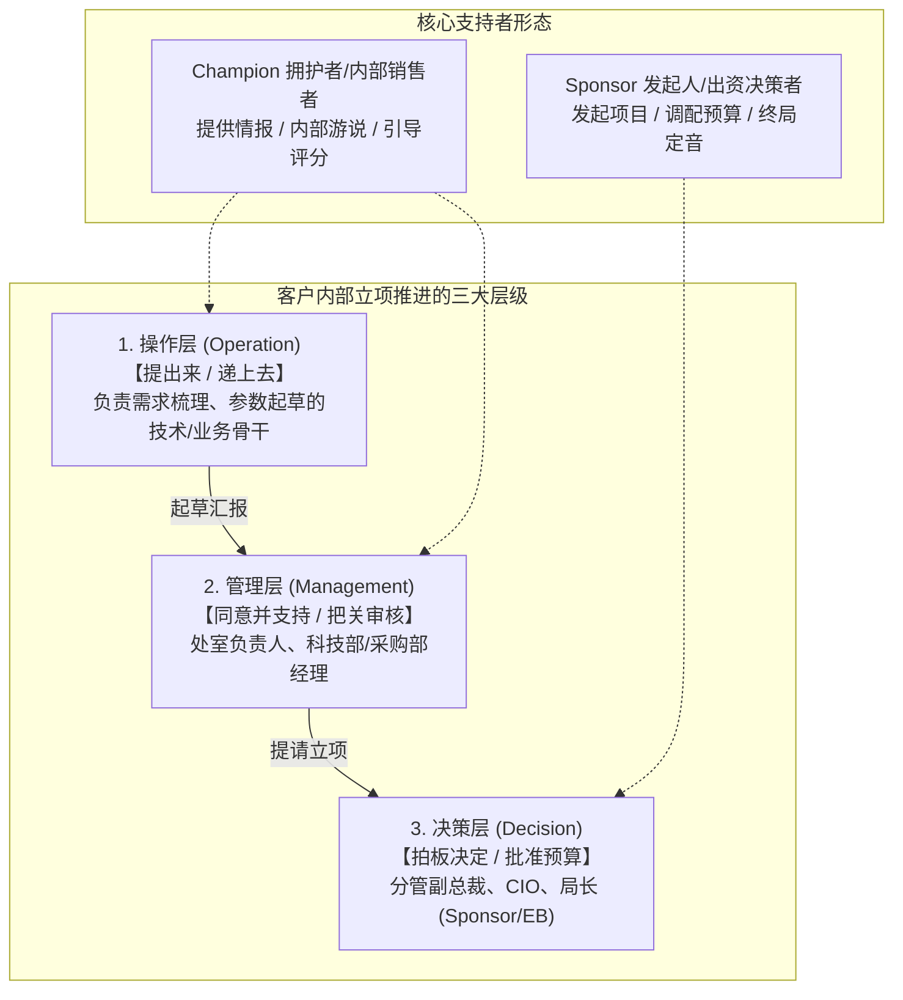

# 第20讲：发展客户内部支持者同盟：Champion 与 Sponsor

> **【本讲一句话心法】**：ToB 赢单的最高境界不是你在客户面前口若悬河，而是客户内部的支持者（Champion）替你冲锋陷阵做“内部销售”；售前要做盟友身后的“影子军师”。

---

### 一、 场景痛点与认知破局

#### 1. 一线实战痛点
* **单兵作战，寸步难行**：销售与售前在客户门外干着急，根本不知道客户内部评审会讨论了什么、高层领导偏向谁、预算究竟卡在哪个部门；
* **误把“热情客套”当“铁杆盟友”**：把客户基层经办人的热情接待当成 Champion，对方要什么方案就通宵提供，结果到了关键表决阶段，对方一句话都不敢说，甚至转头把方案转给了竞争对手；
* **依赖庸俗利益交换面临巨大合规暴雷**：仍企图通过吃喝送礼、私下返点绑定支持者，在当今严苛的审计与反腐大环境下，极易导致项目叫停甚至引发牢狱之灾。

#### 2. 常见认知误区
* 误区一：“Champion 是销售去公关的，售前只要搞好技术交流就行。”（真相：**真正的专业级 Champion（如技术总监、业务骨干）最信赖的是售前的专业度**。销售搞定的是人际情感，售前赋予的是能够支撑其向上汇报的技术安全感与政绩成果。）
* 误区二：“只要搞定客户最大的一把手（Sponsor），下面的基层支持者无所谓。”（真相：大领导日理万机，不可能亲自去写标书、比对参数。没有基层操作层和中层管理层的扎实支撑，高层意志根本无法穿越科室阻力落地。）

#### 3. 核心认知破局
**政企打单必须打通“操作层、管理层、决策层”三维支持链路。** 所谓 Champion，是愿意在客户内部为你承担政治风险、自发开展**“内部销售（Internal Selling）”**的同盟军。售前的核心使命是用不可挑剔的专业方案为 Champion 赋能，做其背后的战略智囊。

---

### 二、 核心方法论：客户内部三层推进机制与 Champion / Sponsor 角色模型



#### Champion 与 Sponsor 的核心区别与协同特征

| 角色属性 | Champion（拥护者 / 内部销售者） | Sponsor（发起人 / 资金赞助者） |
| :--- | :--- | :--- |
| **典型职位** | 牵头科长、业务骨干、主责架构师、项目组长。 | 分管副总裁、科技部总经理、CIO、管委会一把手。 |
| **核心权力** | 制定选型标准、起草招标文件、组织技术评估与汇报。 | 审批立项、分配资金预算、在董事会或党委会终局拍板。 |
| **内在动机** | 渴望业务创新政绩、渴望树立专业威信、谋求职场晋升。 | 达成集团战略考核、避免安全生产问责、提升组织整体ROI。 |
| **行为特征** | **主动通风报信、私下透露竞品底牌、教导我方如何破局。** | 站台背书、排除内部干扰、要求按既定方向快速推进。 |
| **售前赋能方式** | **为其代笔写汇报材料，提供杀手级USP，让其在领导面前出彩。** | **提供宏观行业对标与蓝图规划，提供ROI测算与风险兜底承诺。** |

---

### 三、 售前实操标准动作（甄别与赋能 Champion 四步 SOP）

* **Step 1：开展 Champion“真伪压力测试（Acid Test）”**
  * 识别出潜在支持者后，必须通过以下 3 项动作验证其真伪：
    1. **测试信息穿透力**：请其提供竞争对手在现场的技术表现或客户真实预算底牌，看其是否愿意共享；
    2. **测试高层引荐力**：请其协助引荐约见其顶头上司或分管高管（EB），看其是否有能力排期；
    3. **测试内部担责意愿**：在内部技术方案出现分歧时，看其是否愿意在会议上公开为我方技术路线辩护。
* **Step 2：为 Champion 定制“向上汇报弹药库”**
  * 杜绝将几十页写满产品参数的PPT直接丢给 Champion。
  * 专门为其提炼一份“5页极简高层汇报材料”（包含：行业监管背景、同业标杆做法、预期业务增效、预算概算与工期排期），署名为客户部门内部成果。
* **Step 3：打造“影子智囊（Ghost Advisor）”信任关系**
  * 无论白天黑夜，对 Champion 提出的任何技术困惑或领导质询，做到 15 分钟内极速响应，协助其体面应对内部所有政治质询。
* **Step 4：借 Champion 穿透并锁定 Sponsor**
  * 在 Champion 向上汇报打下良好基础后，由其作为桥梁引荐我方高管与技术首席拜访 Sponsor，完成从操作层到决策层的闭环合围。

---

### 四、 实战工具箱：Champion 赋能清单与真伪甄别核验表

#### 1. Champion 真伪鉴别清单（Scorecard）

| 行为特征 | 真正的高价值 Champion（得分项） | 仅图套取方案的伪支持者（扣分项） |
| :--- | :--- | :--- |
| **情报回传** | 主动私下通报：“友商昨天交流提出了XX方案，领导不太满意，你们得重点准备XX。” | 一味索取我方材料，问及对手情况时顾左右而言他：“大家都在看。” |
| **向上引荐** | 主动提议：“这个架构思路很好，下周二下午局长有半小时空档，我带你们上去汇报。” | 百般推脱：“高层领导平时不见供应商，你们跟我谈就代表跟领导谈了。” |
| **文件流转** | 允许我方协助梳理甚至代拟招标技术需求草案。 | 拿了我方技术方案后石沉大海，开标时发现参数全为竞品量身定制。 |
| **综合判定** | **满足以上2项以上者：核心战略盟友，全力赋能！** | **满足以上0项者：普通技术联络员，严格防范泄密！** |

#### 2. 为 Champion 赋能的典型话术示范
> “王科长，您下周向局领导汇报《新一代系统规划》的压力我们非常理解。领导平时最看重的是宏观政绩与风险可控。我和团队昨晚专门为您把这份材料精简成了5页汇报要点，重点突出了‘咱们处室如何在全省首创两网融合机制’，底层所有复杂的技术实现我们都折叠到了附录里。您可以直接用这版向领导汇报，如果领导有任何细节质询，随时给我打电话，我全程在线为您做技术后盾！”

---

### 五、 真实标杆案例深度复盘

```
【项目背景】某省级电力公司筹备“智慧电网设备状态全景感知中台”，预算2800万。竞争对手为某电力垄断老牌巨头。
【破局实操】：
  1. 售前小王在前期调研中结识了电力科学研究院的青年技术骨干小李（博士毕业，渴望在院内树立技术权威，典型潜在 Champion）；
  2. 售前小王并未搞庸俗宴请，而是与小李泡在实验室连续讨论电力边缘物联协议，小王利用公司在大数据流计算领域的开源成果，帮助小李在国家级核心期刊发表了一篇重磅论文；
  3. 小李彻底视小王为技术知己与职场贵人，主动担任项目 Champion：
     - 小李将老牌巨头私下提交的方案致命漏洞（基于集中式数据库、无法支撑百万级电表高并发秒级采样）全盘告诉小王；
     - 小王针对性制定了《分布式时序流处理高并发架构设计方案》；
     - 小李在院内立项评审会上舌战群儒，公开力挺该架构；
  4. 最终小李陪同院领导（Sponsor）向上级集团汇报时，全盘采纳了该设计标准。
【战役成效】招标文件直接将分布式时序流处理列为关键一票否决项，老牌垄断对手无力招架丢标，小王团队成功斩获大单！小李因该项目立项成功破格晋升研究室副主任。
```

---

### 六、 血泪教训与避坑红线

> [!WARNING] **红线一：严禁向 Champion 索取超出其承受范围的“违法违规要求”。** 例如强逼其在开标前偷盗未公开的商业机密底价或违规泄露专家名单。真正的专业售前是通过“公开的技术标准与架构优势”影响结果，绝不将盟友逼入犯罪深渊。

> [!CAUTION] **红线二：警惕单点依赖（Single Point of Failure）。** 很多售前只在客户内部培养了一位 Champion，结果该骨干突然轮岗调离或离职，项目瞬间陷入信息真空。成熟售前必须在核心处室至少交叉培养 2 位不同层级的支持者。

---

### 七、 课后思考题与实战研讨指南

#### 思考题 1：为什么说“帮助 Champion 获得职场成功（晋升、立功、出彩）”比“单纯的请客送礼”能建立稳固十倍的同盟关系？
* **破题思路**：
  * 送礼是短期、低级、不可持续的利益诱惑，且伴随极高的纪检法律风险，任何人都能用更高的利益将其砸塌；而赋能其职场成长、助其在组织内树立威信与专业政绩，关乎其个人终身职业发展，这种基于互相成就的专业信任坚不可摧。

#### 思考题 2：如果你发现某个项目的牵头经办人态度极其热情，但通过测试发现他完全无法约见其主管领导（EB），售前该如何继续推进？
* **破题思路**：
  * 一方面保持对该经办人的尊重与方案支持（防止其成为反对阻碍）；另一方面，通过销售的外围商务网络或借助公司高管对等拜访通道，从更高维度（如行业峰会、战略合作备忘录）自上而下穿透触达 EB，再顺理成章将指令下达给该经办人执行。

#### 思考题 3：如何巧妙地让 Champion 产生“这个方案是我自己的构想，而不是乙方的推销”的心理拥有感（Ownership）？
* **破题思路**：
  * 在交流与方案探讨时，多使用肯定句式：“正如张科长刚才高瞻远瞩指出的那样……”、“结合张科长提出的创新构想，我们进一步深化设计了……”；将方案的功劳与创新点全部归功于 Champion，使其在向高层汇报时自发产生极强的维护欲。
