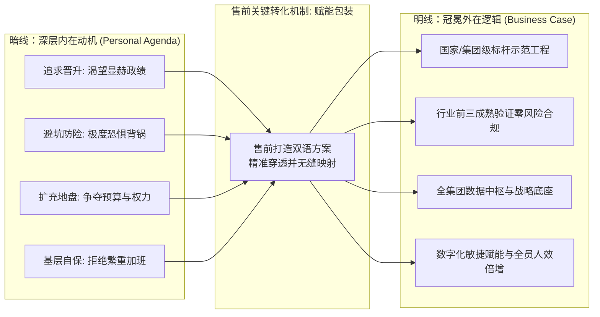

# 第21讲：洞察干系人驱动力：内在动机与外在逻辑转化

> **【本讲一句话心法】**：人的一切商业决策都由内在动机驱动，却必须依靠外在逻辑辩护 —— 售前的功力在于：洞察其不可言说的个人私利，并为之穿上一套经得起审计检验的“大义铠甲”。

---

### 一、 场景痛点与认知破局

#### 1. 一线实战痛点
* **死讲组织大义，客户无动于衷**：售前口干舌燥地证明“这套系统每年能为贵司节约200万运营成本”，客户处长却面无表情、反应冷淡；因为这节约的200万进不了他个人的口袋，反而可能因为系统升级导致其处室编制被裁减；
* **看不懂客户背后的“真实抗拒”**：明明技术方案无可挑剔，客户某位关键专家却在会上百般挑刺。售前以为是技术参数没讲清，殊不知触动了该专家“害怕新系统太复杂导致自身技术权威丧失”的隐秘恐惧；
* **方案通不过党委会/总裁办公会**：即使客户骨干私下极度认可你，但因为售前没有帮他准备一套天衣无缝的“官方合规说辞”，导致其在向领导和评审委员会汇报时被其他部门质疑得哑口无言。

#### 2. 常见认知误区
* 误区一：“在B2B政企采购中，大家都是代表组织利益，只要方案对公司有益，客户自然会支持。”（真相：**组织利益是由一个个有血有肉、有升迁诉求、有避坑恐惧的具体个人来执行的**。忽视个人利益的方案，在组织内部根本寸步难行。）
* 误区二：“给客户谋利益就是搞违规分成。”（真相：这是最低级且高危的做法。顶级的售前是帮助客户在合法合规的前提下，达成其职场晋升、部门扩权与安全避责。）

#### 3. 核心认知破局
**职场决策的“双轨模型”：内在动机（Personal Agenda）与外在逻辑（Business Case）。** 
* **内在动机**是决策的真正发动机（他想要什么、害怕什么）；
* **外在逻辑**是决策的合法性包装（向纪检、审计、高层领导汇报的堂皇理由）。
售前必须做到：**以“内在动机”为锚点打动人，以“外在逻辑”为铠甲武装人**。

---

### 二、 核心方法论：干系人“动机-逻辑”双轨转化四维模型



#### 四类典型干系人的“动机-逻辑”双向转化字典

| 典型干系人群体 | 隐秘内在动机（真实诉求） | 售前为其量身包装的外在逻辑（汇报口径） | 售前方案核心侧重点与设计技巧 |
| :--- | :--- | :--- | :--- |
| **年轻进取型骨干**<br>(牵头科长/副处长) | **渴望立功出彩，争夺晋升副职资本。** 渴望在全行/全系统出名，树立个人专业威望。 | **“打造行业首创的标杆创新工程”**：落实国家最新战略精神，具有极强示范效应与成果申报价值。 | 方案突出“前瞻性、自主知识产权、行业获奖潜力”；协助其申请软件著作权或行业示范案例。 |
| **临退保守型主管**<br>(老总工/资深处长) | **只求平安着陆，极度害怕系统出事背锅。** 宁可不做、绝不错；最怕新技术引入不可预测的故障。 | **“业界前三头部标杆成熟验证的零风险选择”**：严格遵循监管审计规范，架构成熟稳健，完全合规。 | 方案突出“万无一失”：高可用灾备切换时间、已有成熟大厂投产证明、平滑迁移与业务秒级回退预案。 |
| **强势扩权型总监**<br>(科技部总经理) | **争夺跨部门主导权与更多预算编制。** 期望将其他业务处室的数据与系统掌控在自己手里。 | **“构建全集团统一技术中台与数据底座”**：破除信息孤岛，实现数字化集约化管控，赋能全行业务。 | 方案突出“中枢与底座定位”：多租户隔离、集中式权限管理、统一数据标准汇聚，助其坐实中心地位。 |
| **苦不堪言型一线**<br>(业务经办/基层柜员) | **害怕工作量剧增，讨厌繁琐学习成本。** 最怕新系统上线后天天手工录入、频繁加班。 | **“一线基层减负增效的数字化抓手”**：贯彻以人为本，优化工作流转，实现全流程自动化与智能辅助。 | 演示极简UI设计、自动化OCR提取、一键智能审批；证明新系统上线后“每天可少加班1小时”。 |

---

### 三、 售前实操标准动作（探寻动机与打造铠甲 SOP）

* **Step 1：私下开展“微表情与职场诉求探针测试”**
  * 在非正式场合（如茶水间、会后同行接送途中）抛出试探性问题：“张处，看咱们部门今年发展势头极好，这个项目做成后，在咱们局里/行里的定位是什么？”
  * 仔细观察对方谈及“立功创新”还是“安全稳定”时的情绪波动，锁定其真实内心诉求。
* **Step 2：审查并剔除方案中“伤害其个人利益”的毒丸**
  * 检查技术方案：是否在无意中削弱了该主管的部门编制？是否暗示其现存管理体制存在严重过失？若是，立即重新调整措辞，将痛点归因于“外部技术演进与业务规模爆发带来的必然挑战”。
* **Step 3：为干系人配备全套“防御性答辩话术”**
  * 预演在内部立项会或董事会上可能遭受的跨部门围攻（如财务质询预算高、业务质询工期长），提前为该关键人撰写“标准防御性问答脚本（Q&A）”。
* **Step 4：在汇报材料中将“大义”拔高到极致**
  * 将项目立项背景与国家政策、部委红头文件、客户一把手的年度发言要点严格对齐，使反对派在公开会议上无法从宏观道德与政治高度进行反驳。

---

### 四、 实战工具箱：干系人“问答话术备忘录”设计模板

#### 1. 协助客户内部汇报的《争议点应答 Q&A 铠甲》范例

| 潜在反对部门的质询挑战 | 客户关键人不可言说的内在顾虑 | 售前为客户关键人武装的外在逻辑应答脚本 |
| :--- | :--- | :--- |
| **财务部质询**：<br>“当前经济形势紧张，这个项目预算近千万，能不能砍半或明年再做？” | 担心预算被砍导致项目流产，自己半年白忙活，政绩落空。 | “本项目的近千万预算，包含了未来5年的集中平滑演进。若今年砍半做局部修补，明年与后年将产生重复建设与异构数据打通成本，测算下来综合TCO将暴增40%；且今年立项可争取到市发改委30%的数字化转型专项资金补贴，错过今年申报窗口将彻底失去补贴机会。” |
| **审计/风控部质询**：<br>“为什么要选这家民营公司，而不是选国资老牌大厂？” | 害怕被怀疑存在利益输送，引来纪检审计调查风险。 | “我们严格比对了市面全部5家供应商。该民营团队是国家发改委该项行业标准的唯一起草单位之一，且其核心自主知识产权通过了国家工信部一类安全认证；老牌大厂在底层仍采用海外开源框架，存在严重的断供与合规后门风险。选择该团队是出于绝对国家合规与自主可控的客观考量。” |

---

### 五、 真实标杆案例深度复盘

```
【项目背景】某大型省属三甲医院筹备新一代“互联互通智慧医院集成平台”，涉及全院40余套老旧系统打通。
【干系人暗流】：
  - 信息中心刘主任（TB）年近55岁，性格极度保守，私下极度排斥大动干戈换平台，害怕“一旦老HIS系统瘫痪，直接影响门诊挂号，自己晚节不保被降职”；
  - 院领导班子（EB）则急切渴望在年内通过国家卫健委“电子病历五级与互联互通四级甲等”评审，这是申报国家区域医疗中心的核心硬指标。
【售前的动机洞察与铠甲打造】：
  1. 某软件售前敏锐捕捉到刘主任的核心内在动机是“避险保平安，绝对不能背锅”；
  2. 售前并未去给刘主任宣讲平台架构有多么前沿，而是花了整整一周撰写了《业务零中断热备迁移与应急回退专项方案》；
  3. 售前给刘主任准备了一套完整说辞：“主任，这套架构采用‘外挂式消息总线旁路监听’机制，老系统一行代码不用改，新老系统双轨并行运行。如果新平台在任何一个瞬间出现异常，一键旁路切回原状，门诊和住院业务0感知、0中断！”
  4. 随后，售前帮助刘主任起草了向院长的汇报PPT，将方案核心升维为：“以极高稳定性支撑全院冲击国家互联互通四级甲等评审”。
【战役成效】刘主任心中的安全感被彻底点燃，由原先的暗中抵触彻底转变为主动推动者，在全院院长办公会上据理力争，全票通过采购决议！
```

---

### 六、 血泪教训与避坑红线

> [!WARNING]
> **红线一：千万不要把干系人的“内在动机”摊在阳光下说破。** 永远不要当着客户的面说“张总，这能帮您升官/争地盘”。动机只能心照不宣，语言上必须100%保持在组织利益、业务价值与行业大义的专业轨道上。

> [!CAUTION]
> **红线二：警惕外在逻辑“漏洞百出”。** 为客户包装外在逻辑时，引用的数据、合规条文与ROI测算必须经得起财务与审计部门的反复推敲。如果外在逻辑存在明显常识硬伤，反而会把支持你的客户置于被政敌抓住把柄的险境。

---

### 七、 课后思考题与实战研讨指南

#### 思考题 1：如果一个项目的业务处长极度渴望上新系统（想出政绩），但主管技术的总工坚决反对（害怕出安全故障），售前应该如何调解并设计两全其美的方案？
* **破题思路**：
  * 在方案中做“双轨设计”：在业务应用层突出业务处长渴望的“场景创新与大屏成果展示”，在底层技术架构中全盘采用技术总工认可的“高可用双活、数据脱敏、渐进式热备平滑过渡”，同时满足二者的内在动机。

#### 思考题 2：为什么很多技术过硬的售前，经常在客户跨部门评审会上遭遇惨败？根本原因通常是什么？
* **破题思路**：
  * 根本原因在于“单维技术思维”：只从IT技术视角证明方案有多完美，完全忽视了跨部门其他利益相关者（财务、风控、一线业务、法务）的内在痛点，没有为不同利益相关者预备防御性的外在逻辑。

#### 思考题 3：如何巧妙发现一个初次见面的客户决策人内心深处最关切的“隐秘恐惧（Fear）”？
* **破题思路**：
  * 探寻其历史失败项目与监管处罚记录：“咱们院/行在上一期系统升级或监管检查时，领导重点提出了哪些需要汲取的教训？”客户倾诉痛苦与教训的地方，就是其内心最深层次的安全恐惧所在。
