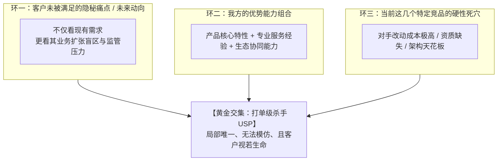

# 第22讲：设计不可替代的独特卖点（USP）：售前的攻防护城河

> **【本讲一句话心法】**：USP 的真谛从来不是“全球唯一的技术专利”，而是面对“当前项目这几个特定对手时，唯有你能交付且客户极度渴望的局部唯一解”；设计 USP 是一线售前的真正担当。

---

### 一、 场景痛点与认知破局

#### 1. 一线实战痛点
* **产品同质化严重，深陷价格内卷**：各家功能大同小异，技术架构你抄我我抄你，客户觉得“你们谁做都差不多”，最终只能比谁敢报超低价；
* **总部的标准化营销材料在现场失灵**：总部产品市场部（PMM）提供的产品白皮书通篇是通用套话，在面对特定的几家死敌竞品时，根本无法形成一击必杀的差异化优势；
* **产品存在明显短板时的心理自卑**：自知自家产品在某些功能上不如对手，售前缺乏重新定义竞争规则的魄力，打单全程处于被动挨打状态。

#### 2. 常见认知误区
* 误区一：“USP 必须是研发团队造出来的独家黑科技或国际专利。”（真相：**真正的打单级 USP 往往是一线售前在打单现场组合挖掘出来的**。很多时候不是技术功能不同，而是服务模式、交付确定性、或场景结合点的不同。）
* 误区二：“把我们产品的所有优点都列出来就是 USP。”（真相：凡是竞争对手也能做到的优点，都只是行业及格线，绝不是 USP。列得越多，客户越抓不住核心。）

#### 3. 核心认知破局
**重新划定战场边界。** USP（Unique Selling Proposition）的威力在于“局部排他性”。只要在当前这个特定客户、面对这 3~4 家特定竞品时，这个卖点只有你能做到、且能精准击中客户决策人的核心痛点，它就是无坚不摧的杀手级 USP。

---

### 二、 核心方法论：打单级 USP 设计三环交叉推演模型



#### 常见打单级 USP 的四种创新定制维度

| USP 创新维度 | 设计逻辑与切入点 | 竞品短板对冲机制 | 典型实战场景范例 |
| :--- | :--- | :--- | :--- |
| **1. 业务场景深度定制<br>(Vertical Scenario)** | 避开通用软件功能，将方案与客户特定垂直工序或管理盲区深度咬合。 | 通用软件大厂不愿为了单个项目改动底层逻辑。 | 针对重工制造业老旧非标机床协议，定制自适应边缘解析驱动。 |
| **2. 架构演进与战略对齐<br>(Strategic Alignment)** | 结合客户未来 2~3 年的战略动向（如出海、并购、信创），提前预埋能力。 | 本土小厂商仅能满足当前国内现状，缺乏跨国或全信创架构沉淀。 | 原生多语言全球化部署架构，杜绝中式机翻引发的跨国投诉。 |
| **3. 落地确定性与服务保障<br>(Delivery Assurance)** | 当产品功能与对手持平时，将“确定性与兜底机制”包装为卖点。 | 对手外包实施，项目烂尾风险高；大厂响应迟缓。 | 承诺提供原厂核心架构师驻场陪产上线，并承诺关键故障15分钟极速响应。 |
| **4. 总体拥有成本反转<br>(TCO Inversion)** | 初次采购价格略高，但证明其能在后续运维、扩容与耗损中节约巨额资金。 | 低价竞品初期便宜，但后续接口费、定制费与服务器能耗极其昂贵。 | 软硬一体优化架构，减少50%的服务器采购数量与机房能耗开销。 |

---

### 三、 售前实操标准动作（定制打单 USP 五步 SOP）

* **Step 1：情报排摸 —— 锁定具体对手名单**
  * 摸清本次参与角逐的 2~3 家核心竞品到底是谁。了解各家参选产品的底层架构代际、在业内的常见失分缺陷。
* **Step 2：战略透视 —— 寻找客户未曾考虑的新变量**
  * 浏览客户官网、战略新闻及高管发言，寻找客户在出海扩张、集团管控、合规审计等维度的未来趋势。
* **Step 3：交叉对齐 —— 提炼“我有、对手无、客户痛”的独特命题**
  * 将客户的未来趋势与对手的固有缺陷交叉对比，提炼出一句穿透力极强的差异化论断。
* **Step 4：SPIN 提问 —— 引导客户自行推导 USP 的必要性**
  * 运用情境、难点、暗示、价值提问链，让客户主动认识到：“如果不具备这项能力，项目上线后必将面临灾难性后果”。
* **Step 5：规则固化 —— 将 USP 写入技术规范与评分标准**
  * 趁热打铁，协助客户在招标文件技术评分表中设立 5~10 分的专属加分门槛，完成技术闭环。

---

### 四、 实战工具箱：打单 USP 评估与竞品排他分析表

#### 1. 竞品 USP 攻防对抗分析卡

| 客户核心需求/场景 | 竞品A（行业龙头）方案表现 | 竞品B（本地低价商）表现 | 我方定制化解决方案 | 我方杀手级 USP 定义（话术提炼） |
| :--- | :--- | :--- | :--- | :--- |
| **海量并发高频读写** | 依赖外置高昂商业数据库，费用极高 | 单机MySQL集群，日终易发生死锁 | 自研分布式时序存储引擎，原生支持分片 | **“零额外数据库许可成本下的百万级无感并发，为贵司节约200万外采费用”** |
| **多分支跨国业务协同** | 仅有英文版，本地化汉化粗糙 | 仅有中文版，无多时区与多币种核算 | 原生支持数十国地道本地化界面与汇率换算 | **“经过全球500强验证的原生多语言架构，护航企业出海战略不踩坑”** |
| **老旧现网平滑割接** | 强制要求客户全量停机并替换底层硬件 | 纯人工手工录入同步，易丢数据 | 提供自研旁路影子双轨比对平滑割接工具 | **“首创旁路影子热切技术，实现业务零停机、数据零丢失的平滑升级”** |

---

### 五、 真实标杆案例深度复盘

```
【项目背景】某大型中资高端制造企业采购全集团“统一办公协同与差旅费用管理平台”，预算1200万。
【竞争态势】：
  - 4家本土头部低代码与办公厂商参与竞标，价格极低、界面美观、定制灵活；
  - 讲师所在团队方案产品成熟，但价格是本土厂商的近两倍；客户选型小组已初步决定采购本土低价软件。
【售前的 USP 逆风翻盘】：
  1. 售前并未在常规的移动端审批、表单设计等红海功能上与本土厂商纠缠；
  2. 售前翻阅客户财报，敏锐发现该企业正在欧洲与东南亚大举建厂并购，海外外籍员工数量激增；
  3. 售前在技术交流中开辟全新竞争维度：
     - 直击痛点：“海外员工如何向国内总部报销？本土厂商的中式英文翻译是否会引发跨国劳务合规与外籍员工投诉？”
     - 亮出局部唯一解：我方产品具备欧盟 GDPR 严格合规认证与原生数十国多币种税率自动抵扣能力，这是任何一家本土厂商在未来3年内都无法自研满足的硬核能力；
  4. 升维价值：证明略高投资不仅是买软件，更是为集团全球化合规保驾护航。
【战役成效】客户总会计师与CIO全盘采纳该建议，将“具备欧盟GDPR合规认证与跨国多币种原生核算能力”设为一票否决项，本土厂商全军覆没，我方以高价全额中标！
```

---

### 六、 血泪教训与避坑红线

> [!WARNING]
> **红线一：严禁制造“客户根本不在乎的伪卖点”。** 如果你的所谓独家优势，客户听了之后觉得“这对我没有任何价值”，那就不是卖点，而是暴露产品死贵、华而不实的证据。卖点必须与客户真实的“痛点与利益”强挂钩。

> [!CAUTION]
> **红线二：警惕对手的“跟进反制”。** 若提炼的卖点只是简单的软件UI或浅层功能，对手往往能在2周内连夜加急开发一个简易演示版来拆招。USP 最好建立在需要较长研发周期、或需要特定资质认证/标杆客户证明的“厚重壁垒”上。

---

### 七、 课后思考题与实战研讨指南

#### 思考题 1：为什么说“USP 的关键是局部唯一，而不是全球独一无二”？请举一个你工作中的实际例子。
* **破题思路**：
  * 因为打单不是学术评奖，不需要争世界第一。只要在面对现场这特定几家对手时，你的某个方案特性是对手无法交付且客户必须具备的，你在该战役中就拥有了绝对排他性。

#### 思考题 2：如果你的产品在品牌知名度上远不如行业龙头大厂，而在价格上又不如本地小厂商便宜，作为售前，你应当从哪些维度为产品设计 USP？
* **破题思路**：
  * 从“灵活性与落地确定性”切入：大厂傲慢、响应慢、派新手交付；小厂不稳、产品烂尾风险高；我方可打造“原厂资深专家直属交付、提供核心定制灵活性、且具备中型项目成熟验证”的最佳性价比与零风险定位。

#### 思考题 3：如何检验你在技术交流中抛出的 USP 是否真正打痛了客户决策人？
* **破题思路**：
  * 观察客户的追问深度与动作反应：如果客户眉头紧锁、开始针对该卖点反复向其他技术骨干质询现网现状，甚至主动询问“在标书里如何规范描述该项要求”，证明该 USP 已经成功刺入客户心智。
