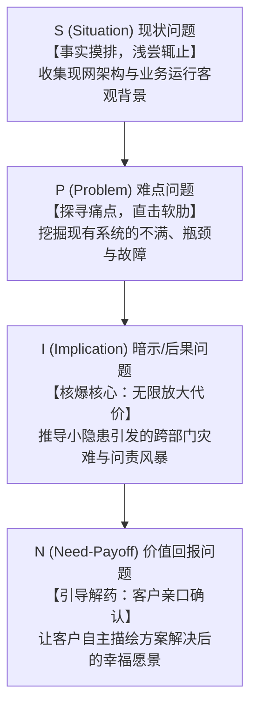

# 第23讲：SPIN提问技术在售前需求开发中的实战落地

> **【本讲一句话心法】**：优秀的售前从不急于给出答案，而是擅长提出震撼人心的问题 —— 运用 SPIN 提问链，让客户亲口说出自己的痛苦与渴望。

---

### 一、 场景痛点与认知破局

#### 1. 一线实战痛点
* **“医生不问诊，上来就开药”**：一坐下来就滔滔不绝讲自己系统的上百项功能，客户神情冷漠，感觉你在生硬推销；
* **痛点问得太浅，客户觉得“凑合能用”**：客户承认现有系统确实有点慢、偶尔有小报错，但表示“不影响核心业务，没必要花大几百万换新系统”，项目立项被无限期搁置；
* **问了一堆事实性问题导致客户反感**：整场交流都在盘问客户“你们有多少台服务器、用什么操作系统、多少人使用”，把技术交流变成了审讯查户口，客户极度疲惫。

#### 2. 常见认知误区
* 误区一：“SPIN 只是销售人员的话术技巧，售前主要是做技术宣讲，不需要学提问。”（真相：**技术型提问的杀伤力远超纯销售商务提问**。售前唯有将技术逻辑融入暗示问题（I问题），才能把隐蔽的技术隐患转化为无法承受的业务灾难。）
* 误区二：“提问越多越好，显得我们调研仔细。”（真相：现状问题（S问题）问得越多，客户越烦躁；真正的高手只问极少量的精炼S问题，把主要火力集中在放大痛苦的I问题与激发渴望的N问题上。）

#### 3. 核心认知破局
**客户不会为了他“尚未感受到致命危险”的小毛病掏大钱。** SPIN 不是单纯的聊天工具，而是一套**严密的心智引导漏斗**。通过由浅入深的四步连环提问，将客户心中“无所谓的微小瑕疵”，在逻辑推演中层层放大为“关乎生死存亡的系统性危机”，最终让客户主动恳求你提供解决方案。

---

### 二、 核心方法论：售前专业级 SPIN 提问链漏斗模型



#### SPIN 四大提问维度在售前实战中的深度拆解

| 维度与英文全称 | 核心目标与心理定位 | 售前设计要领与典型误区 | 售前实操提问示范（以分布式数据库替换为例） |
| :--- | :--- | :--- | :--- |
| **S (Situation)<br>现状问题** | 摸清客户业务与现网技术事实。 | **要领**：会前通过调研能查到的绝不现场发问；控制在2~3个关键问题以内。<br>**误区**：像查户口一样连续盘问客观事实。 | “王总，了解到咱们行目前核心借记卡业务底层采用的是传统的单机Oracle数据库，当前的日均交易笔数大概在什么量级？” |
| **P (Problem)<br>难点/隐患问题** | 激活客户对现有瓶颈的不满与担忧。 | **要领**：聚焦与我方优势强相关的痛点发问；引导客户亲口说出“卡顿、难用、总报错”。 | “在‘双十一’或月末分红跑批的高峰期，这套数据库是否存在读写争抢、响应延迟甚至锁表的情况？” |
| **I (Implication)<br>暗示/后果问题** | **【SPIN的精髓与核心】**：推导该难点若不解决，将引发哪些连锁恶果。 | **要领**：将技术卡顿引申至**财务损失、客户投诉、监管处罚、高层问责**四个维度。<br>**误区**：不敢追问后果，停留在技术表面。 | “如果锁表时间超过2分钟，手机银行交易超时导致大量储户转账失败并在微博投诉，监管局一旦启动突击审查，这是否会直接影响到咱们科技部在全行的年度KPI考核？” |
| **N (Need-Payoff)<br>需求价值问题** | 引导客户主动肯定解决方案的价值。 | **要领**：让客户自己说出收益，而不是你替他宣扬。<br>**误区**：自己抢答“所以买我们产品吧”。 | “如果有一种分布式架构，能够在业务洪峰冲高10倍时做到毫秒级平滑分流扩容，且全面符合信创合规标准，您觉得是否能彻底免除您在重大节假日值守时的后顾之忧？” |

---

### 三、 售前实操标准动作（设计打单级 SPIN 脚本 SOP）

* **Step 1：逆向推演（From Benefit to Question）**
  * 先写出我方产品的独家杀手级卖点（如：高可用双活容灾秒级切换）；
  * 逆向反推客户缺少该能力时，在极端场景下会发生什么灾难性故障（如：光缆被挖断后整个数据中心瘫痪半小时）。
* **Step 2：编制《I问题（后果问题）武器库》**
  * 围绕该灾难，精心设计 3 个层层递进的“I问题”：
    - 业务层影响（多少业务中断？损失多少交易额？）
    - 组织层影响（外部舆情与监管处罚？）
    - 个人层影响（责任人面临何种行政问责？）
* **Step 3：现场实施“提问-倾听-沉默-追问”节奏**
  * 抛出 P 问题后，保持绝对安静，让客户完整倾诉；
  * 在客户承认难点后，顺势抛出 I 问题，让客户的紧迫感与焦虑情绪充分发酵；
  * 当看到客户陷入深思或神情严峻时，及时抛出 N 问题送上解药。

---

### 四、 实战工具箱：售前高频技术场景 SPIN 提问脚本卡

#### 1. 场景：推动客户将老旧自建系统升级为统一平台

```markdown
# 【场景：说服客户业务总监升级老旧系统】SPIN 对话脚本

- [S 现状提问]：
  “张总，目前咱们集团下属5家分公司的财务数据，是各自在本地系统结算，还是已经通过专线汇总到总部？”
  （客户答：“目前是各自分散在本地Excel和旧软件里做，每月初再手工汇总报上来。”）

- [P 难点提问]：
  “这种分散上报的模式，在月末合并报表时，各分公司科目不一致或数据口径打架的情况频繁吗？财务团队核对起来吃力吗？”
  （客户答：“特别头疼，每次月末财务科全员连轴转加班，还经常对不上账。”）

- [I 后果提问 - 致命一击]：
  “如果因为数据延迟或口径错误，导致集团向上交所提报的季度财报数据出现重大偏差，引来监管部门的问询函甚至勒令重述，这是否会给集团管理层的资本信誉带来极其被动的负面影响？”
  （客户神情严峻：“这绝对不行，这是要承担资本市场严重问责的大事故！”）

- [N 价值提问 - 奉上解药]：
  “如果有一套统一的标准数据中枢，能够在各分公司记账的同时自动进行跨区域口径核验与合并，使集团财报产出时间从原来的7天缩短至4小时，且100%符合上市审计合规要求，您觉得这对于提升财务部的管理话语权会有多大帮助？”
  （客户拍桌子：“如果能做到这个，今年必须优先立项把这个系统换掉！”）
```

---

### 五、 真实标杆案例深度复盘

```
【项目背景】某大型第三方物流集团，车辆调度一直采用电话+微信群的半人工模式，调度总监认为“跑了这么多年都很顺畅，没必要花大钱买调度算法系统”。
【售前运用 SPIN 巧妙破局】：
  1. 售前小李首先问 [S]：“李总，咱们集团目前大概有多少台长途干线货车在跑？平均每辆车的空驶率大概在多少？”（客户自豪答：“我们车队有800多辆车，空驶率行业平均25%左右，算管得很不错的。”）
  2. 紧接着抛出 [P]：“在突发恶劣天气或路网封闭时，调度员靠人工群发微信重新规划路线，发生漏单、派错车或司机压车滞留的情况多吗？”（客户坦承：“确实难免，每月总有十几起司机抱怨甚至扣运费扯皮。”）
  3. 致命追问 [I]：“我们粗略测算了一下，800辆车如果因为路线规划不合理，哪怕空驶率只增加3%，全集团一年在柴油和过桥费上的无效开销就超过 400 万元；更严重的是，当生鲜冷链运输因派车延误导致货物腐烂，引发大客户索赔并退订长期运力协议时，这对于咱们车队在集团内部的利润考核会造成多大冲击？”（客户陷入沉默，脸色铁青）。
  4. 顺势提问 [N]：“如果我们的一体化智能调度引擎能实现全网路况毫秒级动态重算，把空驶率压低5个百分点，一年帮车队省下大几百万净利润并实现全流程责任透明追踪，您觉得这是否值得在下季度向总裁提报立项？”
【战役成效】调度总监由原先的“抵触不屑”瞬间转变为“急切立项者”，当天即协同售前小李撰写立项申请，该项目最终以单一来源方式采购了小李团队的整套算法平台。
```

---

### 六、 血泪教训与避坑红线

> [!WARNING]
> **红线一：严禁把 I 问题（暗示问题）变成“人身攻击或嘲讽”。** 提问必须保持客观的建设性姿态。切忌说“你们系统怎么这么烂”、“你们怎么这么落后”。要站在“体谅对方苦衷、共同探寻行业最优解”的同盟军视角发问。

> [!CAUTION]
> **红线二：不要在 P 问题之后立即跳过 I 问题直接推销功能。** 很多新手售前一听到客户说“系统确实有点慢”，就迫不及待抢白“我们系统最快了”。客户还没意识到慢的严重后果，价格抗拒就会立刻爆发。**没有充分发酵痛点的提问，等于白问**。

---

### 七、 课后思考题与实战研讨指南

#### 思考题 1：为什么说在 SPIN 提问体系中，“I问题（暗示/后果问题）”是决定项目成败与预算额度大小的关键分水岭？
* **破题思路**：
  * 因为客户往往低估现有小毛病的破坏力（温水煮青蛙）；I 问题的作用是“将隐性的、长期的、微弱的痛苦，转化为显性的、即时的、致命的危机”。危机的严重程度，直接决定了客户愿意为此支付的预算量级。

#### 思考题 2：挑选你目前主推的一项核心产品技术特性，尝试按照“S-P-I-N”逻辑设计一组连环提问脚本。
* **破题思路**：
  * 练习范式：先确定该特性的核心价值（如自动巡检报警），反推客户现有痛点（人工巡检漏报），再深挖其严重后果（重大安全事故、监管停业整顿），最后让客户肯定自动巡检的不可替代性。

#### 思考题 3：如果在交流现场，客户对你抛出的 P 问题回答“我们这方面完全没有问题，运转得非常完美”，售前应当如何机智破局？
* **破题思路**：
  * 绝不与客户争辩，改换提问赛道：“那太棒了，这说明贵司在基础管理上极具前瞻性！那面对行业内正在发生的最新外部趋势（如某项新法规/出海业务演进），咱们系统在承接下一阶段扩展时，是否存在新的适应性挑战呢？”从现有问题转向未来战略挑战。
