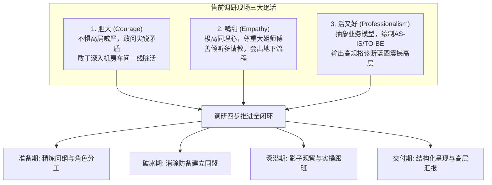

# 第24讲：客户现场调研技巧：“胆大、嘴甜、活又好”

> **【本讲一句话心法】**：真正的需求从不写在红头文件里，而在基层操作员的抱怨中 —— 现场调研要做到“胆大破冰、嘴甜共情、活好惊艳”，方能挖出最底层的真需求。

---

### 一、 场景痛点与认知破局

#### 1. 一线实战痛点
* **调研浮于表面，沦为走过场**：发一份几十页的冷冰冰问卷让客户填，收回来的全是“还可以、无所谓、能满足”等敷衍套话，根本摸不到业务核心脉搏；
* **不敢见大领导，见了一线又被敷衍**：面对高层领导不敢开口、畏首畏尾；去一线科室调研时，基层员工以为是领导派来考核查岗的，处处防备，守口如瓶；
* **调研报告写成“流水账抱怨集”**：堆砌了几十条零碎的琐碎问题（如打印机总卡纸、字体太小），却无法抽象出关乎企业商业成败的顶层业务流程缺陷。

#### 2. 常见认知误区
* 误区一：“调研就是问客户‘你们想要什么功能’。”（真相：**福特汽车创始人曾说：‘如果我问客户想要什么，他们只会说想要一匹跑得更快的马。’** 客户只能描述现状表象，售前的价值是通过现象透视本质，为客户设计汽车。）
* 误区二：“做技术调研只要懂系统架构就行，人际沟通无所谓。”（真相：基层员工之所以用你的旧系统痛苦，是因为他们在私底下有一整套‘绕开系统的地下工作流’。没有高情商的沟通，你永远看不到真实真相。）

#### 3. 核心认知破局
**现场调研是售前与客户的“亲密接触”。** 顶尖售前在调研现场必须练就三大杀手锏：**“胆大”（敢于穿透层级直面核心矛盾）、“嘴甜”（高度共情让人卸下防备掏心窝子）、“活又好”（产出的诊断报告与流程蓝图让高层惊为天人）**。

---

### 二、 核心方法论：现场深度调研“三绝模型”与端到端闭环



#### “胆大、嘴甜、活又好”实战行为准则对照表

| 核心维度 | 关键心态与定位 | 现场典型实战动作 | 客户感知与收益 |
| :--- | :--- | :--- | :--- |
| **胆大<br>(Courage)** | 拥有平等的专家气场，不卑不亢；敢于揭开组织内部的皇帝新衣。 | 1. 敢于约见一把手直接质询战略目标；<br>2. 敢于直面业务与IT部门的相互推诿；<br>3. 敢于下沉到最脏最累的现场（矿井/库房/柜台）。 | 客户高层感到你是有担当、有战略穿透力的行业顾问，而非唯唯诺诺的乙方小跟班。 |
| **嘴甜<br>(Empathy)** | 杜绝技术傲慢；做最忠实的倾听者，理解一线人员的委屈与辛苦。 | 1. 进门先肯定一线人员的专业经验（“向李师傅多请教”）；<br>2. 引导抱怨：“这破系统平时肯定没少耽误您下班吧？”<br>3. 随身带小糖果/小礼品，快速拉近距离。 | 一线操作员放下戒备，主动展示其私下用Excel记账、绕开现有系统的真实暗流。 |
| **活又好<br>(Excellence)** | 具备极高维度的技术与业务抽象建模能力；交付物降维打击。 | 1. 现场绘制现行流程泳道图（AS-IS Process）；<br>2. 提炼未来优化流程蓝图（TO-BE Blueprint）；<br>3. 输出具备出版级水准的《业务流程诊断报告》。 | 客户领导翻阅报告时深感震撼：“比我们自己总结得还透彻，这个项目必须交给他们！” |

---

### 三、 售前实操标准动作（现场调研四步闭环 SOP）

* **Step 1：调研准备期 —— 拒绝空泛问卷**
  * 会前根据客户岗位划分，设计专属的《角色化访谈提纲》（高层问战略愿景，中层问跨科室卡点，基层问单据操作摩擦），每个提纲问题不超过 8 个。
* **Step 2：调研切入期 —— 开展“影子观察法（Shadowing）”**
  * 不仅坐着问，更要站在操作员身后观摩其完整处理 3 笔业务单据的全过程；记录其敲击键盘次数、跨系统切换窗口次数、以及手工填纸质单据的摩擦点。
* **Step 3：调研深潜期 —— 挖掘“地下流程（Workaround）”**
  * 寻找现行系统的替代黑工序（如：员工私下建立的微信群流转、私人Excel宏工具），这是客户现网系统最致命痛点的真实外溢表现。
* **Step 4：调研收口期 —— 绘制“AS-IS 与 TO-BE 流程对比图”**
  * 将零散抱怨抽象为结构化的泳道图，清晰标注“红叉（痛点与风险）”与“绿箭头（新系统带来的自动化增效）”，并当面向分管领导做结题汇报。

---

### 四、 实战工具箱：现场调研访谈话术与流程诊断模板

#### 1. 面对不同层级对象的访谈破冰话术

| 访谈对象 | 破冰与深挖经典话术 | 核心目标 |
| :--- | :--- | :--- |
| **一线业务员<br>(基层大姐/专员)** | “王姐，我们今天来绝对不是搞考核的，我们深知一线业务量大、辛苦。您平时在用这个旧系统录单子时，最让您抓狂、最耽误您准点下班的操作是哪几步？” | 引导其尽情吐槽，获取最真实的操作阻碍与地下流程。 |
| **处室科长<br>(业务中层)** | “李科长，咱们处室在向局/行领导汇报月度指标时，从其他部门调取数据最耗费精力的环节卡在哪？有哪些数据目前是靠各科室手工拼凑的？” | 挖掘跨部门数据孤岛与协同断点。 |
| **分管副总/CIO<br>(决策高层)** | “刘总，如果站在全行未来三年的战略角度看，如果本系统成功上线，您最希望在向董事会述职时展示哪两项最具突破性的标志性成果？” | 锚定最高决策层的终极政绩与验收心智。 |

---

### 五、 真实标杆案例深度复盘

```
【项目背景】某大型港口集装箱码头，拟建设“智能堆场数字孪生调度系统”，预算1800万。某国际软件巨头与某敏锐民营团队同时进驻现场调研。
【两家调研表现天壤之别】：
  - 国际软件巨头派出西装革履的顾问，在客户空调会议室坐了一下午，发了一堆英文问卷让调度科长填写，科长随便画勾草草了事；
  - 该民营团队售前老周展现“胆大嘴甜活又好”：
    1. 【胆大】：老周换上安全帽和劳保服，直接爬上40米高的桥吊驾驶舱，并在酷热的集装箱堆场跟随卡车司机跑了整整两天现场；
    2. 【嘴甜】：老周给现场调度大叔递烟买红牛，诚恳请教：“师傅，系统里派的路线和您实际跑的路线经常不一样，您平时是怎么绕开它调配车皮的？”大叔感动不已，全盘道出“由于定位漂移，老系统推荐的泊位经常冲突，我们全靠对讲机盲喊”的核心隐患；
    3. 【活又好】：老周熬夜绘制了一份《码头集卡空驶死锁拓扑图》与《基于高精度北斗的动态防冲突调度TO-BE全景图》。
【战役成效】在最终汇报会上，老周放出了现场调研实拍图与精准的数据分析，港务局局长拍案而起：“这才是真正懂港口运营的专家！”直接将该民营团队定为唯一深度合作伙伴。
```

---

### 六、 血泪教训与避坑红线

> [!WARNING] **红线一：严禁在调研现场当着领导的面“出卖基层员工”。** 如果基层员工信任你，告诉你他们平时工作敷衍或绕开系统，你切忌在汇报PPT中写“基层违规操作严重”。必须将其包装为“现有IT支撑不足，倒逼一线人员耗费巨大额外精力手工补救”，保护盟友安全。

> [!CAUTION] **红线二：不要只调研业务，不调研IT运维人员。** 很多售前只顾着讨好业务科室，把方案设计得极度复杂，却完全忽视了IT运维部是否有人力维护。被忽视的IT部门会在后期技术评审会上以“无法运维保障”为由给予致命一击。

---

### 七、 课后思考题与实战研讨指南

#### 思考题 1：如果去客户现场调研时，客户基层员工态度极其冷淡、充满戒备（以为你们是来抓工作漏洞的），你该如何运用“嘴甜”技巧快速破冰？
* **破题思路**：
  * 开宗明义亮出立场：“各位老师千万别紧张，我们来不是找茬挑刺的，我们是来给大伙儿向上级反映困难、申请减负工具的。我们特别想听听大家平时受这套老软件的哪些委屈，我们负责把大家的困难用专业语言写成报告递给领导解决！”瞬间将对立关系转化为统一战线。

#### 思考题 2：为什么说绘制清晰的“AS-IS（现状流程）”与“TO-BE（未来蓝图）”对比图，是售前“活又好”的最直观体现？
* **破题思路**：
  * 因为文字描述往往冗长晦涩，而流程泳道图具有强烈的视觉穿透力；通过红绿色彩对比，能够一眼让高层看清“现状有多混乱低效、改造后有多清爽高效”，直观证明方案的重构价值。

#### 思考题 3：在现场调研中，如何避免被个别爱抱怨的基层员工带偏，防止方案沦为零碎杂乱的“功能打补丁”？
* **破题思路**：
  * 坚持“宏观战略牵引微观抱怨”：对收集到的抱怨进行“归因聚类分析”（分类为：数据孤岛、接口延迟、流程冗余、底层性能），将零散的抱怨统一归纳到顶层核心架构的改造蓝图里。
