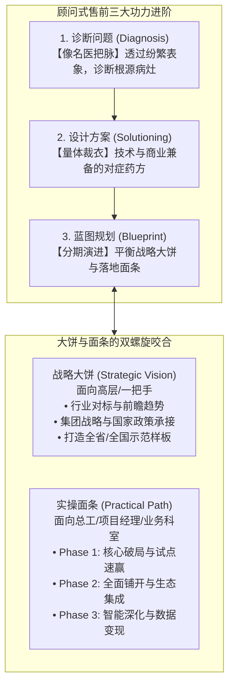

# 第25讲：顾问式售前功力：既画“业务大饼”，又做“落地面条”

> **【本讲一句话心法】**：只有“大饼”是空中楼阁的大忽悠，只有“面条”是缺乏格局的包工头 —— 顾问式售前的顶级功夫，在于既能用宏伟蓝图激发高层的雄心，又能用精密路径给出一口口吃得下的确定性。

---

### 一、 场景痛点与认知破局

#### 1. 一线实战痛点
* **方案悬在半空，被批“假大空”**：PPT通篇是宏大叙事、数字化转型战略、AI智慧中枢，客户高层听着激动，但总工程师一问“具体第一步怎么做、数据怎么割接”，售前支支吾吾，被质疑为“只吹牛不落地的骗子”；
* **方案陷在泥潭，被批“没格局”**：纯技术背景售前一头扎进具体的服务器配置、代码接口和配置参数里，客户一把手听了直皱眉头：“花几百万就为了干这么点修修补补的琐事？看不出对我单位战略有什么大价值！”
* **项目规划贪大求全导致烂尾**：缺乏分期演进规划，试图在一期工程中把未来十年的功能全堆进去，导致需求无边界蔓延、工期失控、最终成为烂尾暴雷工程。

#### 2. 常见认知误区
* 误区一：“搞售前只要会画高大上的架构大图忽悠住领导就行。”（真相：没有落地执行路径的宏大愿景，根本无法通过技术委员会严苛的立项评审与预算核查。）
* 误区二：“给客户写方案就是老老实实罗列产品功能清单。”（真相：功能清单是产品说明书，绝不是解决方案。**方案的核心是‘问题诊断与价值演进蓝图’**。）

#### 3. 核心认知破局
**顾问式售前（Consultative Pre-Sales）的核心是“战略大饼”与“实操面条”的阴阳平衡。** 
* **画大饼**：满足高层决策者（EB）对战略政绩、行业标杆和商业愿景的宏大渴望；
* **做面条**：满足中层管理者（TB/UB）对分步落地、风险受控、切实解决手头痛点的确定性需求。

---

### 二、 核心方法论：顾问式售前三阶演进与“大饼-面条”平衡罗盘



#### “画大饼”与“做面条”两手硬技能对照表

| 维度对比 | 战略大饼（Strategic Big Pie） | 实操面条（Actionable Noodles） |
| :--- | :--- | :--- |
| **沟通对话对象** | 党委书记、董事长、总裁、CIO、厅局长（EB）。 | 总工程师、IT运维主管、项目经理、科室业务骨干（TB/UB）。 |
| **核心解决问题** | “这个项目在宏观上能帮单位获得什么荣誉、地位与长远红利？” | “明天进场怎么干？怎么平滑割接？出了故障怎么回退？” |
| **呈现表现形式** | 顶层规划框架图、数字化成熟度雷达图、行业对标矩阵。 | 实施甘特图、数据迁移映射表、网络割接窗口方案、SOW边界表。 |
| **失衡典型症状** | **【严重缺饼】**：被视为低端IT包工头，预算被大幅腰斩，难以形成溢价。 | **【严重缺面】**：被视为空中楼阁大忽悠，通不过专家技术可行性评审。 |
| **最佳结合点** | **“顶层设计有高度，分步实施有抓手，短期见效有保障。”** |

---

### 三、 售前实操标准动作（编制顾问式蓝图 SOP）

* **Step 1：出具《业务与系统病灶诊断书（Diagnosis）》**
  * 杜绝头痛医头。将客户表层的散碎痛点，归因抽象为“三层病灶”：
    - 基础设施层病灶（算力不足、单点故障）
    - 数据治理层病灶（标准不一、信息孤岛）
    - 业务流程层病灶（跨部门手工流转、响应迟缓）
* **Step 2：构建“1+1+N”顶层设计大饼（Top-Level Architecture）**
  * 设计高维视觉框架：**1套统一安全与标准规范 + 1个集约化中枢底座 + N个场景化敏捷微服务**，打造极具战略美感的顶层全景图。
* **Step 3：切分“三期演进施工路线图（Roadmap）”**
  * **一期（速赢试点）**：攻坚最急迫的单一痛点，3~6个月见成效，树立组织信心；
  * **二期（全面推广）**：横向打通各关联系统，实现数据跨部门沉淀流转；
  * **三期（数智深耕）**：引入智能化算法与数据变现，实现长效运营。
* **Step 4：锁定“关键里程碑风险防范预案”**
  * 针对一期落地的关键节点（如旧数据割接、双轨试运行），给出精准的工时测算与回退冗余方案。

---

### 四、 实战工具箱：项目演进蓝图与分期建设规划模板

#### 1. 顾问式项目三期规划设计表（Roadmap Blueprint）

| 建设阶段 | 建设周期 | 核心工程内容与抓手 | 标志性产出与里程碑 | 客户业务价值兑现 |
| :--- | :--- | :--- | :--- | :--- |
| **Phase 1<br>强基固本·试点速赢** | 1~6个月 | 部署核心标准平台，打通2个关键业务科室，完成存量核心数据清洗迁移。 | 完成首个试点车间/科室投产，出具初验报告。 | 解决最紧迫痛点，使一线操作耗时降低50%，**让领导看到立竿见影的政绩**。 |
| **Phase 2<br>横向打通·生态协同** | 6~18个月 | 全面推广至集团所有分公司，完成与财务、ERP、OA等8大外围系统集成。 | 全行/全集团实现业务无缝闭环流转，系统终验。 | 彻底打破信息孤岛，实现跨区域业财一体化，运营成本降低30%。 |
| **Phase 3<br>数智赋能·价值跃迁** | 18~36个月 | 构建经营决策数字大屏，引入预测性算法与AI辅助决策中枢。 | 申报国家级/行业级数字化标杆示范工程。 | **达成宏伟战略大饼**，形成企业自主数据资产，支撑高层战略决策。 |

---

### 五、 真实标杆案例深度复盘

```
【项目背景】某大型省属文旅集团，下辖30余个景区、酒店与演艺资产，各景区自建老旧票务系统，数据完全割裂，集团拟投资3000万建设“全省一盘棋智慧文旅综合中枢”。
【两家厂商汇报大PK】：
  - 厂商A（纯画大饼）：PPT制作精美绝伦，大谈“文旅元宇宙、全息沉浸式体验、AI虚拟人导游”，董事长听得心潮澎湃，但文旅总工程师直接发问：“目前五大核心景区用的是三家不同厂商的老闸机，硬件协议完全不开源，元宇宙能自动识别闸机开门吗？”厂商A顾问哑口无言，当场被淘汰；
  - 厂商B（既画大饼又做面条）：
    1. 【大饼篇】：开篇展示《全省文旅一张网：打造文旅部数字示范样板工程》，战略格局拉满；
    2. 【面条篇】：拿出长达20页的《老旧异构闸机协议自适应网关改造实操方案》：
       - “第一阶段：投入20万元定制旁路协议转换盒，不换一台闸机，两周内实现票务数据上云；
       - 第二阶段：打造全省统一会员营销中台；
       - 第三阶段：打造客流热力大屏与智慧文旅元宇宙运营”；
    3. 既给董事长画出了国家级样板的诗和远方，又给总工算清了每台闸机如何省钱落地的施工账。
【战役成效】董事长与总工程师高度一致拍板：厂商B既懂战略又懂施工，非他们莫属！
```

---

### 六、 血泪教训与避坑红线

> [!WARNING] **红线一：严禁为了画大饼而承诺“违背工程常识的虚幻工期”。** 很多售前为了迎合领导，吹嘘“三个月全部完成全系统重构上线”。这种不切实际的大饼一旦写进合同，项目必死无疑，实施团队和售前都会被卷入违约漩涡。

> [!CAUTION] **红线二：不要把“面条”做得太硬太细导致自己被绑死。** 在建立需求阶段，分期规划要保持适度弹性。过早确定详细的代码级实现细节，会失去后续技术评估与商务谈判的调优空间。

---

### 七、 课后思考题与实战研讨指南

#### 思考题 1：如果一个项目的客户领导只想听“宏伟前瞻的概念”（只想吃大饼），而对底层实施毫无兴趣，售前是否还需要准备详细的“面条”方案？为什么？
* **破题思路**：
  * **必须准备，但要“藏在附录里”**。向一把手汇报时全篇展现大饼；但大领导听完后必然会召集总工和处长进行可行性审查。一旦专家提问，立刻调出详尽的面条方案对答如流，方能彻底打消决策层对落地风险的顾虑。

#### 思考题 2：为什么说“分期规划（Phase 1/Phase 2/Phase 3）”是平衡大饼与面条的最佳战术缓冲带？
* **破题思路**：
  * 分期规划将庞大而高风险的愿景拆解为可度量的阶段成果。一期工程聚焦“小投入、快见效、低风险”，帮助客户领导迅速交出政绩；同时为二期和三期的持续增购锁定了排他性准入通道。

#### 思考题 3：如何判断一份技术方案到底属于“高质量的解决方案”还是“低水平的产品功能说明书”？
* **破题思路**：
  * 检查方案的逻辑起点：如果起点是“产品功能模块介绍（功能菜单介绍）”，则是低水平说明书；如果起点是“客户业务场景痛点根因诊断”，继而推导出“针对性架构设计”，最后以“量化的客户商业回报”收尾，则是顶级顾问式方案。
