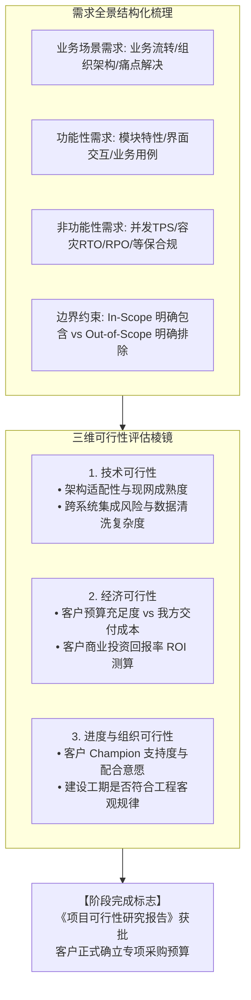

# 第26讲：项目需求梳理与可行性评估红线

> **【本讲一句话心法】**：优秀的售前不仅懂得如何点燃需求，更懂得如何为需求划定清晰的边界 —— 可行性评估是打单的“安全阀”，守住红线才能确保“高价中标且顺利交付”。

---

### 一、 场景痛点与认知破局

#### 1. 一线实战痛点
* **需求无限蔓延成“无底洞”**：客户在立项阶段随口提了上百条个性化要求，售前毫无防守意识全盘照收，导致项目立项范围极度臃肿，交付预算严重失控；
* **“功能性满足”掩盖了“非功能性死穴”**：只关注软件界面菜单能不能点通，忽视了并发量、容灾切换、数据清洗等非功能性约束，导致系统上线第一天就被洪峰流量冲垮；
* **可行性报告沦为走过场的敷衍模板**：从网上随便抄一份通用的可研报告交差，缺乏客户现网数据测算与严密的ROI论证，立项评审会上被财政或外部评审专家当场否决。

#### 2. 常见认知误区
* 误区一：“在建立需求阶段，客户提什么我们都先答应下来，反正后面签合同还可以再扯皮。”（真相：**客户立项报告中的需求范围，往往会一字不差地变成后续招标文件的硬性技术规范**。前期不踩刹车，后期就必须吞下无法交付的苦果。）
* 误区二：“技术可行性就是看看我们的产品功能能不能对得上。”（真相：技术可行性不仅看我方产品，更看客户现有机房算力、网络带宽、异构系统接口配合度与外部数据依赖。）

#### 3. 核心认知破局
**需求梳理不仅是“做加法”，更是严密的“做减法与设边界”。** 建立需求阶段的终局标志，是产出一份兼具**业务说服力、技术确定性与财务合理性**的《项目可行性研究报告》，并顺利通过客户管委会或财政局的立项审批，锁定真金白银的专项预算。

---

### 二、 核心方法论：需求结构化梳理模型与三维可行性评估棱镜



#### 需求梳理与可行性评估核心要素对照表

| 评估维度 | 核心核验指标与标准 | 典型高危隐患信号 | 售前风控与纠偏策略 |
| :--- | :--- | :--- | :--- |
| **功能与范围边界<br>(Scope Boundary)** | 明确界定“一期包含的核心模块（In-Scope）”与“二期迭代模块（Out-of-Scope）”。 | 客户提出大量非标外围接口定制，且要求一期全部免费上线。 | 坚定执行“分期剥离策略”：将低频、高风险非标需求移入二期远期规划。 |
| **非功能性性能<br>(Non-Functional)** | 事务吞吐峰值（TPS）、并发用户数、高可用指标（RTO故障恢复时间 / RPO数据丢失量）。 | 标书草案提出“99.999%可用性”或“秒级全网无感热切”等违背工程常识的极端指标。 | 现场帮助客户推导达成该极端指标所需的数倍硬件与双活成本，促使其回调至合理区间。 |
| **技术可行性<br>(Technical)** | 底层芯片/OS/数据库兼容性；第三方老旧系统接口是否开放。 | 现网老系统已无原厂支持，属于完全封闭的“黑盒系统”，拒绝开放API。 | 在可行性报告中明确标注“外部依赖前置条件”，将接口改造责任界定给客户或第三方。 |
| **经济与成本可行性<br>(Economic)** | 客户预算上限 $\ge$ 标准产品报价 + 实施人月成本 $\times 1.4$（保障合理毛利）。 | 预算仅有50万，但要求开发工作量超50个人月，项目处于严重亏损区间。 | 削减定制开发工作量，采用标准模块适配，或推动客户申请追加创新预算。 |

---

### 三、 售前实操标准动作（可研编制与需求收口 SOP）

* **Step 1：开展“需求分类筛选会（MoSCoW 优先级法则）”**
  * 与客户 Champion 坐在一起，将收集到的数百条诉求分类为：
    - **Must-have（必选）**：核心业务必须依赖的生命线功能（占一期 60%）；
    - **Should-have（应当有）**：显著增效但有替代方案的功能（占一期 20%）；
    - **Could-have（可以有）**：有则更好的体验优化（转入二期备选）；
    - **Won't-have（本次绝不包含）**：明确排除在本次立项范围之外。
* **Step 2：主导代拟《项目立项可行性研究报告（Feasibility Report）》**
  * 报告严格遵循政企规范：包含【现状痛点背景】、【建设必要性与紧迫性】、【总体建设蓝图与技术路线】、【投资概算与资金筹措】、【预期效益与风险防范】五大核心章节。
* **Step 3：联合交付总监开展内部“成本与风险会审（Red Review）”**
  * 在向客户正式提交前，拉齐公司交付项目总监逐条审核工期与人月成本，确保方案“可实施、可交付、有利润”。
* **Step 4：协助客户通过立项审批，锁定预算池**
  * 配合 Champion 参加客户内部立项答辩会，回答评审专家关于技术路线与预算合理性的质询，直到正式批文下发。

---

### 四、 实战工具箱：项目立项可行性研究报告标准大纲模板

#### 1. 《项目可行性研究白皮书》标准化结构目录

```markdown
# 【客户名称】新一代数字化核心系统建设项目可行性研究报告

### 第一章 项目建设背景与必要性 (Why Something)
1.1 国家及行业监管最新指导政策解读
1.2 现有系统运行现状与核心业务瓶颈分析
1.3 建设本项目的必要性与不作为的风险代价 (Cost of Inaction)

### 第二章 总体架构设计与建设目标 (What & How)
2.1 建设原则：顶层规划、稳妥演进、自主可控
2.2 业务架构、应用架构与技术架构全景图
2.3 一期建设核心范围 (In-Scope) 与非功能性指标 (TPS/RTO/RPO)
2.4 明确排除的外围建设范围说明 (Out-of-Scope)

### 第三章 技术路线选型论证与成熟度对比
3.1 集中式架构 vs 分布式云原生架构对比论证
3.2 关键底层环境兼容性要求（信创芯片/操作系统/数据库适配准则）
3.3 实施落地确定性保障机制

### 第四章 项目实施分期规划与风险防范
4.1 分期建设计划路线图（Phase 1 / Phase 2 / Phase 3）
4.2 现有数据清洗与平滑迁移双轨回退应急预案
4.3 组织协同与第三方配合前置条件约束

### 第五章 投资概算与预期效益分析 (Financial ROI)
5.1 软硬件配置与实施咨询详细投资概算表
5.2 预期量化业务收益与投资回收周期（ROI）测算
```

---

### 五、 真实标杆案例深度复盘

```
【项目背景】某大型省属农信社筹备“移动信贷风控移动作业中枢”，业务部门提出海量离奇要求，预算计划申请600万。
【高危隐患】：
  - 业务部提出要在iPad端实现“离线3D人脸活体检测+毫秒级离线反洗钱黑名单图谱碰撞”；
  - 某新手售前为了讨好客户，未加论证直接写入了初步需求草案；
  - 交付架构师审阅后大惊失色：移动端算力与本地存储根本无法支撑百万级离线图谱碰撞，一旦立项，没有任何一家供应商能交付，项目必成死局！
【资深售前踩刹车破局】：
  1. 资深售前老王迅速介入，开展三维可行性评估，现场给信贷部处长做技术推导：“移动端芯片算力无法跑动百万节点图谱，强行离线计算将导致iPad发热死机、闪退率达80%”；
  2. 老王运用 MoSCoW 法则为需求划定边界：“一期核心是实现‘毫秒级云端在线特征碰撞’，移动端仅保留轻量级人脸特征提取；离线端仅支持基础单据暂存”；
  3. 老王协助处长将调整后的方案编制为严密的可行性研究报告，投资概算精简优化至520万；
  4. 报告在全行科技创新评审委员会上全票通过，省联社正式批复立项资金。
【战役成效】该行不仅规避了上线死机的灾难性事故，更锁定了科学理性的技术指标，老王团队顺理成章成为该项目的首席设计方。
```

---

### 六、 血泪教训与避坑红线

> [!WARNING] **红线一：严禁在立项阶段遗漏“外部环境依赖前置条件”。** 如果项目需要客户提供机房专线、需要第三方提供API接口，必须在可研报告中明确约定为“项目启动的前提条件”。否则一旦第三方拖延数月不给接口，客户反而会问责我方逾期违约。

> [!CAUTION] **红线二：警惕预算估算过低（钓鱼工程）。** 有些销售为了促成快速立项，故意把预算压得很低（“先立个小项把坑占住”）。结果导致后续招标预算严重不足，连采购基础服务器的钱都不够，最终把团队拖入严重亏损的泥潭。

---

### 七、 课后思考题与实战研讨指南

#### 思考题 1：为什么说“建立需求阶段”结束的最关键标志是客户“项目立项被批准且确立了专项预算”？
* **破题思路**：
  * 因为在立项审批前，所有的交流和方案都只是口头意向或设想，随时可能因政策变动或预算砍削而取消；只有当立项报告正式盖章下发、财政或企业账户锁定了专项资金编码，项目才真正具备了不可逆的商业生命力。

#### 思考题 2：如何运用“MoSCoW法则”，在不激怒客户业务骨干的前提下，合理剔除不切实际的非标定制要求？
* **破题思路**：
  * 不直接否定，而是采取“价值顺延法”：“这个功能非常有前瞻性，但如果放在一期，会导致整个核心系统的上线延期3个月；为了保障领导最关注的当期核心业务快速上线，我们建议将这项创新功能列为二期重点迭代模块”，既保护其面子，又保全了一期边界。

#### 思考题 3：如果客户的立项评审委员会包含外部独立专家（如高校教授、科研院所专家），售前协助撰写的可研报告应重点防范什么？
* **破题思路**：
  * 防范“技术逻辑硬伤与常识漏洞”：外部学术型专家最看重方案的严谨性、行业标准规范对齐、以及数据引用的权威性；必须引用国家信创标准、行业监管白皮书和同业权威数据，确保论证无懈可击。
