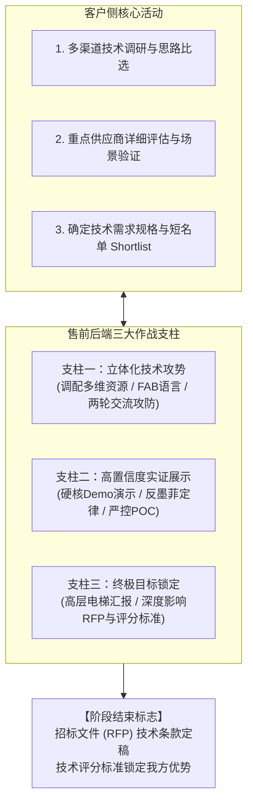

# 第27讲：技术评估阶段概述与攻势构建

> **【本讲一句话心法】**：技术评估阶段是售前与竞争对手短兵相接的“白刃战”战场 —— 这一阶段的终极使命，是将前期确立的业务优势转化为不可逆的控标标准，锁定通往中标的唯一起跑线。

---

### 一、 场景痛点与认知破局

#### 1. 一线实战痛点
* **单点应付，疲于奔命**：客户一会儿要PPT、一会儿要演示、一会儿要开研讨会，售前疲于应付各种零散需求，却不知道自己在战役全局中处于何种态势；
* **陷入技术细节泥潭**：交流沦为被客户工程师拿着竞品参数表“按图索骥质询”，处于被动解释和防御挨打的局面；
* **辛苦忙活，临门丢标**：整个技术评估期做了无数次演示和方案，结果客户出的招标文件（RFP）通篇采纳了友商的控标参数，前功尽弃。

#### 2. 常见认知误区
* 误区一：“技术评估就是把客户提的所有技术问题全部回答清楚。”（真相：技术评估是**攻防对抗与规则制定**。如果只是被动答题，你永远只是答题人；真正的顶级售前在技术评估期是**出题人**。）
* 误区二：“只要我们的产品功能演示完美，客户自然就会选我们。”（真相：政企客户采购看重综合确定性 —— 包括方案架构、服务能力、POC实证与评分标准权重。）

#### 3. 核心认知破局
**技术评估阶段是销售全生命周期中“工作强度最大、技术资源投入最密集、竞争对抗最激烈”的攻坚期。** 客户通过多渠道比选形成最终需求和供应商短名单（Shortlist）。本阶段结束的标志是**技术需求最终版本定稿并移交采购部门**；售前的战略重心必须从“方案交流”升维为“深度控标（影响RFP与评分表）”。

---

### 二、 核心方法论：技术评估阶段作战全景图与三大支柱



#### 技术评估阶段售前后端核心能力演进表

| 评估子阶段 | 客户关注核心 | 售前核心战略战术 | 交付成果与标志物 |
| :--- | :--- | :--- | :--- |
| **前期：攻势构建与立势** | 方案宏观可行性、厂商实力与技术路线先进性。 | 调整售前资源计划，构建立体化攻势；采用 FAB 法则开展首轮技术交流。 | 《首轮技术交流方案》、《立体攻势人员协同表》。 |
| **中期：深度博弈与实证** | 落地确定性、竞品差异化对比、系统真实表现。 | 开展第二轮亮剑交流；硬核Demo展示；克制开展POC概念验证；展示专业服务兜底能力。 | 《针对性场景Demo脚本》、《POC测试用例与确认备忘录》。 |
| **后期：高层锁定与控标** | 投资决策审定、采购招标文件（RFP）与评分表编制。 | 实施“电梯汇报”争取一把手首肯；协助客户编写招标文件技术规范与评分细则。 | 《技术评估高层汇报材料》、《控标版RFP技术规范书与评分表建议稿》。 |

---

### 三、 售前实操标准动作（技术评估期通关四步 SOP）

* **Step 1：战前资源盘点与攻势升维**
  * 摒弃“单一售前包打天下”的陋习，根据项目关键性，向后方申请架构师、交付总监、甚至研发专家资源，构建立体化技术攻势。
* **Step 2：主导两轮技术交流的战略节奏**
  * 首轮交流“展示肌肉、保留底裤”，重在摸排情报与建立专业信任；次轮交流“亮剑出鞘、针对拆招”，全面固化我方独特的差异化优势（USP）。
* **Step 3：设计不可挑剔的“高置信度体验”**
  * 告别流水账式的低端功能演示，以客户核心业务流程为导向“捞干货、上硬菜”；对POC测试严把准入与退出门槛，防止被白嫖拖垮。
* **Step 4：收官冲刺 —— 锁定 RFP 控标条款**
  * 将前两阶段验证成功的技术长板，转化为招标文件中的“一票否决项”与“硬性技术加分项”，确保尚未开标已胜券在握。

---

### 四、 实战工具箱：技术评估阶段售前战备自查表

#### 1. 技术评估期作战要素核验 Checklist
* [ ] 是否已根据客户关注点，调配了除自己以外的第二梯队专家资源（如项目经理/研发）？
* [ ] 首轮技术交流是否严格遵守了“FAB利益陈述法则”，而非单向念PPT？
* [ ] 是否已摸清 2~3 家核心竞品在现网交流中的方案流派与主推卖点？
* [ ] 演示环境是否准备了本地离线容灾镜像与录屏兜底预案（防墨菲定律）？
* [ ] 客户提出的POC测试要求，是否已签订明确的《测试范围、标准与周期备忘录》？
* [ ] 我方的独家优势（USP）是否已转化为客户编写标书时采纳的硬性指标？

---

### 五、 真实标杆案例深度复盘

```
【项目背景】某大型中资跨国商业银行，启动海外多机构跨境资金清算平台技术选型，预算4000万。
【技术评估期博弈】：
  - 客户初选入围了3家供应商：欧美顶级老牌金融软件外企、国内信创巨头、以及讲师团队；
  - 客户组建了由科技部总工、业务清算处长、以及海外各分行IT代表组成的15人专家评审团，启动为期两个月的封闭技术评估。
【立体化技术攻坚】：
  1. 团队售前负责人迅速制定了《立体化技术攻势计划》：自己作为总牵头人统一对口总工，安排资深架构师对接海外分行代表，安排交付总监对接清算业务处；
  2. 首轮交流突出高可用架构，次轮交流突出跨境多币种结算与国产信创底层适配；
  3. 在长达两周的POC压测中，售前团队设置了严格的压测指标，以百万级并发TPS零丢包的实证彻底击败外企与国内对手；
  4. 最终协助客户起草了长达120页的招标文件技术规范书。
【战役成效】在随后发布的公开招标文件中，清算平台的分布式事务一致性与信创兼容性指标完全以该团队方案为蓝本，最终高分中标！
```

---

### 六、 血泪教训与避坑红线

> [!WARNING] **红线一：严禁陷入“技术傲慢与无休止争辩”。** 在技术评估会上，面对客户专家或竞品顾问的质疑，切忌在枝节技术参数上与对方争得面红耳赤。专业售前应以解决客户业务风险为导向，用数据和测试事实说话，绝不上纲上线。

> [!CAUTION] **红线二：警惕在评估期过早沦为“免费劳动力”。** 客户可能借技术评估之名，要求你免费为其编写现有老系统的排障报告、甚至代写业务代码。必须守住底线，聚焦在方案验证与控标上，不被无偿榨取。

---

### 七、 课后思考题与实战研讨指南

#### 思考题 1：为什么说技术评估阶段的终极衡量标准不是“客户夸赞方案好”，而是“深度影响了客户的招标文件（RFP）与评分标准”？
* **破题思路**：
  * 口头夸奖不具备法律效力，甚至可能是客户安抚落选者的客套话；在合规招投标程序中，唯有写进招标文件的刚性条款与评分表中的客观分值，才是决定最终胜负的法定依据。

#### 思考题 2：进入技术评估阶段后，售前在与销售协同推进时，工作重心应当如何分工？
* **破题思路**：
  * 售前担任“技术主攻手”：统筹技术交流、PPT演说、Demo演示、POC测试、以及技术规范书拟定；销售担任“政治雷达与商务保障”：负责摸排专家评审委员会名单、公关经济买家（EB）、调配跨部门资源与摸清预算动态。

#### 思考题 3：如果发现客户在技术评估阶段明显偏向某家关系型友商，售前应当采取什么策略破局？
* **破题思路**：
  * 推动客户开展“不可篡改的真实现网测试（POC）”或组织“高规格行业标杆现场考察”，用硬核的现场实测结果戳破关系型友商的虚假技术承诺，给客户内部支持者提供推翻既定倾向的客观事实武器。
