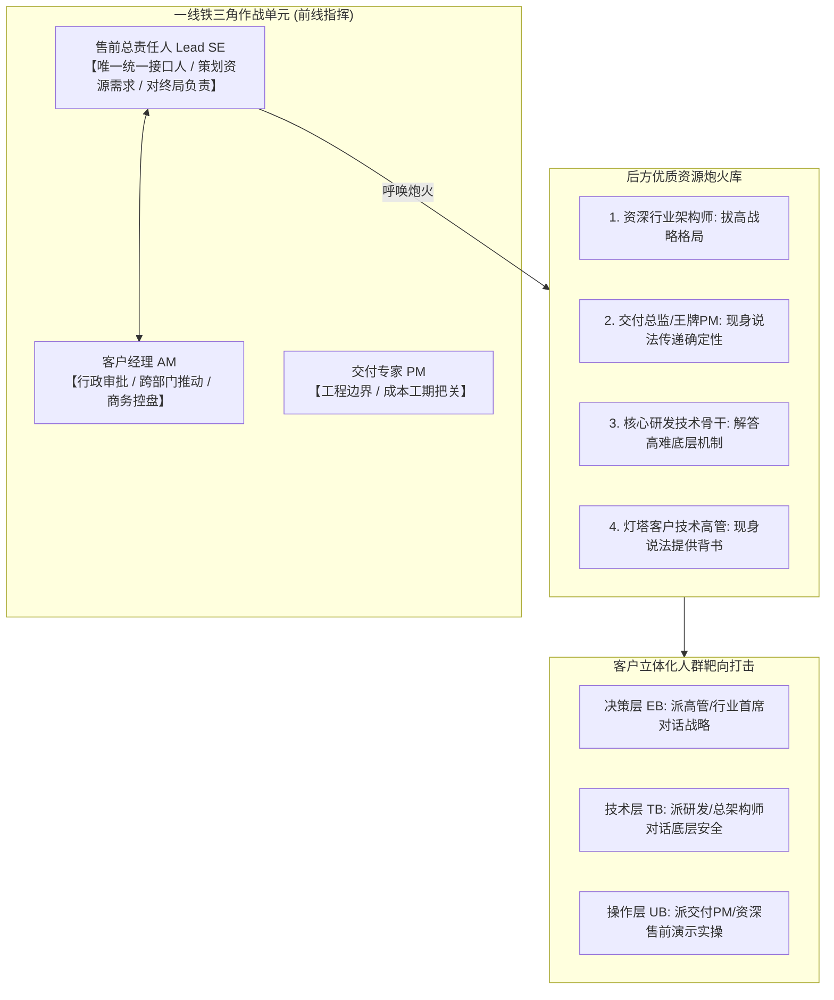

# 第28讲：动态调整售前计划：构建立体化技术攻势

> **【本讲一句话心法】**：重大项目绝不能单兵死扛 —— 售前要学会“打群架、呼唤炮火”，构建立体化技术攻势；一人掌控全局接口，多路专家轮番破局，方显大厂底蕴。

---

### 一、 场景痛点与认知破局

#### 1. 一线实战痛点
* **单兵作战，心力交瘁**：一个千万级大项目从头到尾只有一名售前在撑着，既要写几十万字方案，又要搭演示环境，还要应付高层汇报，一旦生病或时间冲突，整个项目瞬间停摆；
* **客户质疑公司实力单薄**：客户连续开几次会，发现乙方来来回回就这一个技术人员，讲的也是同样一套车轱辘话，客户心里打鼓：“这家公司到底行不行？是不是根本没有技术储备和交付团队？”
* **“打群架”变成“打酱油”**：去客户现场确实带了一堆同事，但大部分人坐在后面玩手机、打瞌睡，不仅无法形成合力，反让客户觉得乙方组织纪律涣散、极不专业。

#### 2. 常见认知误区
* 误区一：“请后方同事帮忙会显得自己能力不行。”（真相：**优秀的售前是战场的总导演与一线指挥官**。懂得调动后方顶级资源解决客户疑难，恰恰是售前具备大局观与高阶协调力的最高体现。）
* 误区二：“打立体战就是每次见客户都要呼啦啦去一大群人。”（真相：立体战不是一次性人多，而是**多兵种、多角色在不同时间节点，针对客户不同层级的人群进行分批次、针对性的精准打击**。）

#### 3. 核心认知破局
**借鉴华为“铁三角”与“让听得见炮声的人呼唤炮火”。** 售前在一线是战场指挥员。进入技术评估阶段后，必须根据竞争态势动态调整售前计划，把架构师、研发老兵、交付总监及灯塔客户资源编织成立体技术攻势网。

---

### 二、 核心方法论：立体化售前攻势矩阵与“铁三角”作战模型



#### 立体化资源匹配与任务分工表

| 客户当前核心疑虑 | 最匹配的后方支援资源 | 支援人员的角色定位与任务 | 达成的心理打击效果 |
| :--- | :--- | :--- | :--- |
| **质疑方案架构的先进性与未来演进** | 公司首席架构师 / 解决方案部总监 | 以行业顶级专家身份，与客户总工对话行业未来趋势与顶层设计。 | 确立绝对技术制高点，消除客户对技术路线落后的担忧。 |
| **质疑系统是否真能落地、害怕实施烂尾** | 同类型成功案例的王牌项目经理（PM） | 现身说法，详细展示过往类似项目的实施计划表、排障记录与上线日志。 | 传递极致工程落地确定性，证明我司有打硬仗的成熟队伍。 |
| **对某一极端性能指标（如高并发）存疑** | 产品底层核心研发负责人 | 现场拆解底层内核源码调度机制与多核优化压测数据。 | 权威终结技术质疑，彻底击碎竞品的非专业攻击。 |
| **对厂商的商业信誉与持续服务能力存疑** | 已上线老客户的技术负责人（灯塔客户） | 安排目标客户前往灯塔客户现场参观交流，或邀请老客户在研讨会上分享。 | 第三方中立背书，远胜乙方自身千言万语的自我吹嘘。 |

---

### 三、 售前实操标准动作（调动与接待后方专家 SOP）

* **Step 1：坚持“单一责任人制（Single Point of Contact）”**
  * 无论请多少高阶专家支援，**必须由一位固定售前担任项目唯一总负责人**；负责统一对接销售、记录全部交流纪要、把控总体进度，防止多头对接导致信息混乱。
* **Step 2：发送规范的《资源申请与协同确认邮件》**
  * 提前至少 3~5 天与支援专家口头沟通确认意向；
  * 发送正式邮件（抄送双方主管及销售），明确：**交流目标、客户参会人员名单、专家具体发言主题、时间地点与建议准备材料**。
* **Step 3：会前召开“对齐走查会（Briefing Session）”**
  * 组织 15 分钟会前会：向专家通报客户政治背景、客户关注焦点与敏感禁忌，共同走查其演讲PPT，确保专家发言严格契合本次战术目标。
* **Step 4：做好极致的“差旅接待与人脉投资”**
  * 专家外地出差时，协助推荐舒适酒店与交通建议；专家到达后，本地团队予以热情接待并体验当地特色；
  * **【会后核心动作】**：交流结束后，必须向支援专家及其直接主管发送正式致谢邮件，详述其在客户面前展现的高超专业表现与带来的实质突破，让专家在内部组织内“既有面子又有里子”。

---

### 四、 实战工具箱：售前支援专家协同申请邮件模板

```markdown
主题：【资源协同申请】关于邀请架构部[张专家]支援[某银行核心改造项目]技术交流的申请

张专家、李总（架构部主管），您好！

为推进[某银行新一代核心系统改造]千万级重点战役（目前处于技术评估攻坚期），客户科技部总工对方案中“跨数据中心多活容灾”机制提出了深度技术审查要求。

为彻底打消客户顾虑并树立技术壁垒，特申请架构部[张专家]于[X月X日]前往客户现场进行为期半天的专项深度技术交流：
1. 拜访对象：银行科技部总工程师、容灾中心主任等共5人；
2. 核心任务：就《分布式多活底层一致性算法及秒级切换机制》做40分钟专题深度阐述，并解答专家质询；
3. 行程安排：建议乘坐[X次航班]，我们已安排本地销售在现场接待并做好会务保障。

相关客户背景资料与我方现有方案详见附件。万分感谢架构部领导与张专家的大力支持！

申请人：一线售前负责人 [小李]（抄送：销售经理张哥、售前部主管王总）
```

---

### 五、 真实标杆案例深度复盘

```
【标杆典范】外企某地方办事处的“神奇好口碑”与资源聚合效应。
【背景】某知名科技外企在全国有十余个区域办事处。总部的资深架构师和产品专家们普遍极度抵触出差，唯独对“西南办事处”的项目格外偏爱，只要该办事处提申请，专家们争先恐后抢着去支持。
【背后的人性化细节】：
  1. 西南办的售前与销售深谙“立体攻势与人脉经营”之道：
  2. 专家一旦确认行程，办室内专人协助安排性价比极高的协议行政客房，并由专车在机场接机，车内备好矿泉水与特色小吃；
  3. 当晚售前负责人陪同专家品尝当地特色美食，既热情客气又适度分寸，绝不强加工作压力；
  4. 现场技术交流前，售前已把所有演示网络、投影设备调试完毕，专家只需专注讲好其核心章节；
  5. 离开后，西南办第一时间发送全员感谢信，在全司范围内大力表彰该专家的技术支撑成效。
【战役成效】西南办事处无论遇到多难啃的骨头，永远能在一线呼唤到全司最顶级的技术炮火，该办事处的重点大单赢单率常年稳居全司第一！
```

---

### 六、 血泪教训与避坑红线

> [!WARNING]
> **红线一：严禁让高级专家在客户现场“裸奔发言”。** 绝不可未经事先对齐，就把后方专家直接推到客户会议室开讲。若专家不清楚客户现网背景或说漏了某些内部短板，会直接给整个项目造成毁灭性打击。

> [!CAUTION]
> **红线二：警惕“用完即弃”的功利心态。** 很多人请同事帮忙时低三下四，同事帮完忙回去后连一句微信问候都没有，更别提写表扬信。这种人只要请过一次，以后在公司内部再也调动不了任何资源。

---

### 七、 课后思考题与实战研讨指南

#### 思考题 1：如果你的公司规模较小，技术团队总共就三四个人，如何向大客户展现“立体化大厂攻势”？
* **破题思路**：
  * 借鉴“小公司大智慧”：一人多面、分工明确。三个人分别印制不同专业抬头的名片（如：顶层架构专家、交付技术总监、产品研发负责人）；在不同的会议节点分别以不同专长身份进场交流，展现出精锐分工的专业气象。

#### 思考题 2：为什么说“售前负责策划资源需求，销售负责推动行政审批调配”是最高效的跨部门协作模式？
* **破题思路**：
  * 售前最清楚技术短板卡在哪个环节、需要什么专长的专家补位；而销售在公司内部拥有更强的商务资源调配权与协调领导意志的杠杆。二者结合，能最大限度减少内部推诿阻力。

#### 思考题 3：当后方支援专家在客户现场由于不了解前情，说了一句与你前期承诺“相互矛盾”的话，售前应当如何机智圆场？
* **破题思路**：
  * 决不当场驳斥专家；售前立刻接过话筒做“场景化限定补充”：“张专家刚才从通用分布式理论层面阐述了业界常规做法；而针对咱们贵行特定的非标网络环境，我们前期与王科长研讨时定制了一套特定的优化逻辑，刚好融合了张专家的框架，具体体现在……”既保住了专家权威，又理顺了方案口径。
