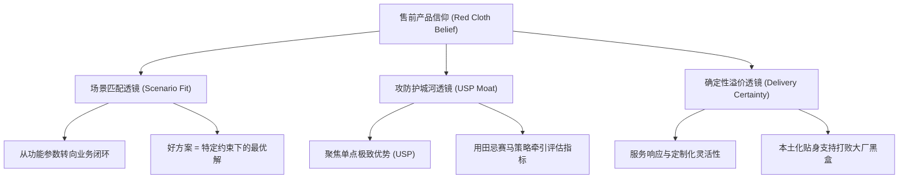
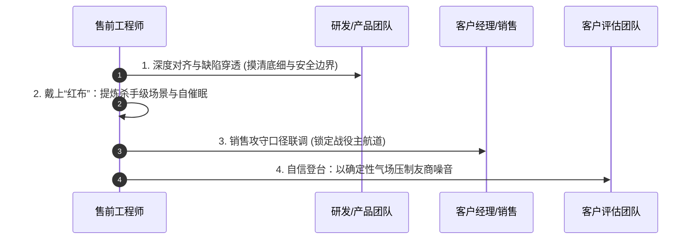

# 第29讲：售前心态建设：对自家产品建立“红布信仰”

> **【本讲一句话心法】**  
> 售前若不能蒙上一块红布坚信自家的产品与方案，就绝不可能在残酷的技术战场上点燃客户的信心；没有完美的产品，只有深信不疑并精准匹配场景的攻防大师。

---

## 一、 场景痛点与认知破局

在技术评估阶段的开端，许多从研发转岗或初入行的售前工程师，往往会陷入一种致命的心态困境——**“产品自卑与内耗综合征”**：

```
                ┌────────────────────────────────────────────────────────┐
                │             售前内耗的恶性死循环 (Vicious Cycle)           │
                └────────────────────────────────────────────────────────┘
                                           │
                                           ▼
       ┌─────────────────┐       ┌─────────────────┐       ┌─────────────────┐
       │   过度知晓缺陷   │ ───►  │   台下未战先怯   │ ───►  │   台上面露心虚   │
       │ 熟悉内部Bug/迟钝│       │ 觉得不如友商成熟│       │ 眼神游移语气闪烁│
       └─────────────────┘       └─────────────────┘       └─────────────────┘
                                                                    │
                                                                    ▼
       ┌─────────────────┐       ┌─────────────────┐       ┌─────────────────┐
       │   项目丢单出局   │ ◄───  │   质疑公司产品   │ ◄───  │   客户敏锐察觉   │
       │ 陷入新一轮恶性循环│       │ 抱怨研发体系不给力│     │ 对产品方案丧失信心│
       └─────────────────┘       └─────────────────┘       └─────────────────┘
```

### 1. 售前常见的四大心态硬伤
* **“知底者自卑”**：因为天天和研发、测试、运维打交道，售前最清楚自家产品的系统缺陷、性能瓶颈、遗留Bug和交付延期记录。反观竞争对手，看到的都是光鲜亮丽的宣传彩页和官宣案例，误以为友商产品“完美无瑕”。
* **“唯功能论与唯参数论”**：执迷于功能清单的逐条打勾比拼。一旦发现某个非核心参数比竞品低了10%，就觉得在客户面前抬不起头、无法下笔写方案。
* **“未战先降的心理投射”**：在向客户汇报前，心里已经在打退堂鼓：“这个并发量我们肯定抗不住”、“客户要是问起分布式事务一致性，我怎么圆？”这种潜意识里的心虚，会直接通过肢体语言、微表情、飘忽的眼神和迟疑的语调投射给客户。
* **“事后怨妇心态”**：丢单后习惯性甩锅：“研发太拉胯”、“产品成熟度太差”、“价格定太高”，从不反思自己在技术评估阶段是否建立了足够强悍的价值防线。

### 2. 认知破局：“一块红布”的心态哲学
摇滚歌手崔健在经典歌曲《一块红布》中唱道：  
> *“那天是你用一块红布，蒙住了双眼也蒙住了天，你问我看见了什么，我说我看见了幸福。”*

作为一名专业售前，走向客户技术战场的那一刻，**你必须亲手给自己戴上这块“红布”**：
* **红布不是盲目自欺，而是战术聚焦**：红布蒙住的是对自身次要缺陷的纠结与内耗，聚焦的是自家方案在特定业务场景下的核心价值、独特卖点（USP）以及对客户业务的深度赋能。
* **信心是商业博弈的隐形筹码**：销售与售前卖的不仅仅是代码或硬件盒子，而是一种**“确定性与信任感”**。如果连方案的缔造者与讲解者都充满怀疑，身负决策风险的客户凭什么押注数百万乃至数千万的预算给你？
* **完美的产品根本不存在**：世界上没有任何一家IT巨头的产品是零缺陷的。企业采购的本质不是选“无懈可击的技术神作”，而是选**“在可承受的约束与风险下，能最高性价比解决核心痛点的战略伙伴”**。

---

## 二、 核心方法论与原理拆解

### 1. 售前产品信仰构建的三维透镜模型

要建立坚不可摧的“红布信仰”，不能靠空洞的口号打鸡血，必须依赖结构化的认知重构：



#### ① 场景匹配透镜（从“功能先进性”到“场景契合度”）
* **技术平庸不等于方案失效**：一个只有70分成熟度的自研系统，如果能完美适配客户内部的老旧ERP与非标审批流，其业务价值远胜于一个拥有99分架构但必须强迫客户重构业务流程的国际大厂标准套件。
* **售前的核心手艺是“扬长避短”**：用自身的业务理解力，将客户的技术评估关注点从“友商擅长的通用参数指标”引导至“我方擅长的特定业务深水区场景”。

#### ② 攻防护城河透镜（围绕USP建立坚固信仰）
* 哪怕产品有100个小Bug，只要在**“核心业务连续性保障”**或**“敏捷响应规则定制”**这一个点上具备无可替代的独特卖点（USP），你就拥有了赢单的核心支点。
* 售前的红布信仰，正是建立在对自己亲手提炼、验证并为客户量身打造的USP之上。

#### ③ 确定性溢价透镜（软件只是底座，人与服务才是终极保险）
* 客户购买企业级B2B方案，买的是长达3~5年的系统生命周期与服务保障。
* 售前展现出的专业素养、技术诚意、敬业精神以及背后的技术支持响应速度，本身就是产品方案不可分割的最高价值部分。

---

## 三、 售前实操标准动作（SOP / 打法步骤）

在技术评估阶段开启前，售前团队必须完成以下4步心理与技术准备动作：



### 步骤1：深入研发腹地，摸清底线，化“未知恐惧”为“确定边界”
* 主动与研发架构师、产品经理进行闭门复盘，不回避缺陷，列出当前版本的《技术能力边界红线表》（真实并发上限、不支持的边缘协议、易错场景）。
* 明确规避策略与临时Workaround方案。**对缺陷了然于胸，心里才不会慌乱；有了兜底方案，在台上才能泰然处之。**

### 步骤2：戴上“红布”，执行“自发光心理催眠”
* 整理我方产品的“高光资产包”：行业标杆案例、核心客户表扬信、第三方性能权威认证、过往重大攻坚战役总结。
* 站在客户利益角度反复自问：“为什么选用我们的方案客户绝对不会犯错？”直到自己从心底被完全说服。

### 步骤3：与销售协同，统一“攻防统一口径”
* 与销售严格对齐交流话术，确保技术评估的聚焦点始终锁定在我方的USP阵地。
* 明确规定技术交流中的“技术底裤边界”：哪些是绝不能在技术评估首轮暴露的软肋，哪些是通过售前话术与服务承诺进行包装的次要短板。

### 步骤4：以充沛的笃定气场征服技术评估现场
* 登台前完成深呼吸与身姿挺拔调整，眼神直视客户首席技术官或核心评委。
* 在交流过程中，对自身优势特性报以100%的自豪与激情，对客体短板以从容专业的“演进路线与工程补偿策略”轻巧带过，不留任何犹疑破绽。

---

## 四、 实战工具箱、话术与Checklist

### 1. 售前心理建设与短板重构话术矩阵

| 客户/友商攻击的潜在软肋 | 传统心虚式回答（大忌） | 戴上“红布”的高维重构回答（最佳实践） |
| :--- | :--- | :--- |
| **质疑产品成立时间短、版本号低** | “额……我们确实是近两年才做的新产品，功能还在迭代，有些地方确实不成熟。” | “正因为我们采用的是全新云原生与微服务架构，没有任何历史包袱，能够以极高的敏捷度贴身响应贵司未来3年的数字化创新需求；而传统友商老旧单体系统的改造成本极高。” |
| **质疑分布式高可用指标略逊于友商** | “友商测出来是5万TPS，我们目前压测只能到3.5万，可能确实稍微低了一点。” | “在政企核心业务场景下，盲目追求实验室脱机压测的极端峰值没有工程意义。贵司实际最高业务并发峰值在8000左右，我们的方案不仅留足了4倍安全裕量，更将核心资源倾斜在‘零数据丢失的双活防脑裂一致性’上，这才是真正保障系统不发生重大生产事故的核心关键。” |
| **质疑某非核心边缘功能缺失** | “这个功能我们确实暂时还没做出来，研发排期还在下半年。” | “贵司提的这个点非常前沿。根据我们服务的头部标杆客户实践，该功能在实际业务中利用率不足5%，盲目引入反而会增加系统运维复杂度。我们目前提供了标准开放OpenAPI，如贵司确实需要，我们可在交付期以轻量插件方式敏捷提供。” |

### 2. 售前战前心理与装备 Checklist

> [!TIP]
> 每次重大技术交流前30分钟，在洗手间镜子前或休息室逐条自检：
> - [ ] **心理红布确认**：我是否已经将注意力从“产品缺陷”彻底切换到“客户场景赋能与我方独特卖点”？
> - [ ] **高光案例脑暴**：我脑海中是否已经备妥2个以上与客户高度相似的成功上线标杆案例？
> - [ ] **底线风险兜底**：如果客户问到我方最脆弱的系统指标，我是否已经备好了“合理解释+替代补偿方案”？
> - [ ] **生理状态校准**：肩膀是否下沉放松？背部是否挺直？是否喝了一口温水润喉？
> - [ ] **气场锚定**：我是来帮助客户解决痛点、实现商业成功的专业顾问，而不是来接受审判的被测人员！

---

## 五、 真实标杆案例深度复盘

### 【案例背景】城商行核心报表系统选型：国产初创软件逆袭国际巨头

* **情景 (Situation)**：某城商行进行监管核心报表与数据中台升级选型。参与竞争的是国际老牌软件巨头I公司（产品极其成熟，全球市场份额第一）与国内一家成立仅3年的软件创业团队A公司。
* **冲突 (Task)**：在首轮技术交流前，A公司的初创售前团队极其自卑。研发内部测试表明，A公司产品的后台配置界面偶发UI卡死，复杂报表计算在超大集群下的跑批速度比I公司慢12%。几名技术售前在准备技术交流胶片时唉声叹气，甚至在讨论“要不要提前跟客户交代产品的这些不足”。
* **行动 (Action)**：
  1. **售前总监的“红布动员”**：售前总监紧急叫停这种自我否定的情绪，在白板上写下两行大字：“I公司卖的是10年前的老引擎，我们卖的是本土化的救火队与零门槛开发体验！”
  2. **锁定核心USP**：国内金融监管政策（如人行、银保监）变化极其频繁，通常只给银行留7~10天的报表改造窗口。I公司的底层规则引擎封闭在国外总部，改一条逻辑需要提工单排期三个月；而A公司独创了“可视化低代码规则编排”，业务人员当天就能自助修改发布。
  3. **重新编排技术评估打法**：技术交流完全避开脱机裸跑吞吐量的机械比拼，全程现场演示：“假设明天银保监下发最新绿色信贷报表要求，银行IT团队如何用10分钟完成逻辑上线并跑出校验数据”。
  4. **笃定的气场展现**：售前主讲人戴上“红布”，以极其自豪的口吻向银行科技部总经理和业务处长展示这套敏捷响应机制。
* **结果 (Result)**：现场原本对国产初创软件抱有怀疑的银行业务领导和架构师全体起立鼓掌。客户最终拍板：“我们要的就是能跟着监管随时快速变的活系统，不是要一个跑得快但改不动的黑盒子死系统！”A公司以绝对优势赢下该千万级标杆项目。

---

## 六、 血泪教训与避坑红线

> [!WARNING]
> **红线 1：严禁在客户面前背刺自家研发与产品团队**  
> 有些售前为了向客户展示所谓的“客观中立”，或者被客户问得下不来台时，脱口而出：“我们研发确实做得很烂”、“我也跟产品经理提过好多次了，他们就是不改”。这种言论在客户听来不仅不会带来好感，反而会瞬间判定该供应商内部管理混乱、团队缺乏凝聚力，立即判定出局！

> [!CAUTION]
> **红线 2：严禁“过度红布”演变为虚假承诺与欺诈欺骗**  
> 戴上红布是指在心理上聚焦优势、建立对方案的笃定信仰，**绝不等于无底线吹嘘根本不存在的功能**！如果把“完全不支持”说成“开箱即用”，把“并发几百”吹成“几万无压力”，一旦进入POC测试或项目交付阶段，必将引发灾难性的法律纠纷与企业信誉崩塌。

---

## 七、 课后思考题与实战研讨指南

### 思考题 1
当你明知自家产品的某个技术模块存在明显的架构短板（如友商支持实时流式计算，而我方目前主要依赖分钟级微批处理），在客户即将发起首轮技术交流时，你应如何运用“红布思维”与“FAB法则”重新包装这一技术现状？

> **【实战研讨指引】**  
> 切忌直接隐瞒或说谎，也不可心虚承认“我们不如竞品”。  
> 应从**业务场景合理性与架构稳健性**切入：深度剖析客户实际业务对“绝对强实时”是否存在真实强诉求（多数管理报表与决策看板分钟级即可满足）；随后着重强调微批处理在**容错恢复、数据精确一次处理（Exactly-Once）、计算资源成本消耗低**方面的极致工程优势。把“实时性稍逊”重构为“高性价比与极致系统稳定性的工程理性取舍”。

### 思考题 2
在技术交流现场，如果客户技术骨干当场拿出友商的白皮书参数与你的方案针锋相对，试图在某个细节参数上压制你，你的心理状态和第一句应对口径应该是什么？

> **【实战研讨指引】**  
> **心理状态**：坚决保持冷静与微笑，绝不出现慌张、眼神游移或恼羞成怒。  
> **第一句应对口径**：“王工您这个问题提得非常敏锐且专业，友商在这个参数上确实下了很多功夫。不过，正如我们在业界大型系统落地中总结的工程经验——**脱离具体业务负载曲线的孤立参数指标往往隐藏着巨大的隐形成本**。请允许我用2分钟为您拆解，当这套系统运行在贵司每天9点到10点的真实业务洪峰下，我们是如何通过XX闭环机制，为您带来更具确定性的保障……”（将战场从客场拉回主场）。
