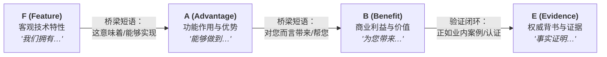
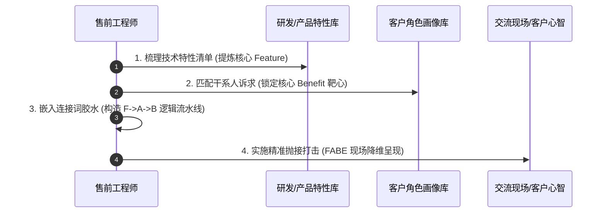

# 第30讲：售前语言习惯：FAB利益陈述法则

> **【本讲一句话心法】**  
> 客户永远不会为你的先进技术本身买单，他们只为技术能给他们带来的业务价值与个人利益买单；丢掉满嘴晦涩的Feature，熟练运用FAB利益桥梁，是售前从“技术极客”蜕变为“商业顾问”的质变分水岭。

---

## 一、 场景痛点与认知破局

在技术评估的交流现场，很多工程师背景出身的售前工程师常常陷入**“自嗨式技术宣讲”**的陷阱：

```
                    ┌────────────────────────────────────────────────────────┐
                    │            售前沟通的“鸡同鸭讲”困境 (Communication Gap)  │
                    └────────────────────────────────────────────────────────┘
                                               │
                        ┌──────────────────────┴──────────────────────┐
                        ▼                                             ▼
             【售前视角：满嘴技术参数】                    【客户视角：满脑子灵魂三问】
             * "我们底层采用Raft共识算法"                  * "这玩意儿能帮我降低成本吗？"
             * "我们支持PB级向量数据索引"                  * "这能让我少挨领导批评吗？"
             * "吞吐量支持每秒10万级TPS"                   * "它到底能让我的业务提升多少？"
                        │                                             │
                        └──────────────────────┬──────────────────────┘
                                               ▼
                              【最终结局：陷入“So What?”窘境】
                              客户礼貌微笑，频频点头，会后彻底遗忘
```

### 1. 传统技术售前的三大语言通病
* **通病 1：只讲 F（Feature 特性），不讲 B（Benefit 利益）**  
  一开讲就是芯片型号、微服务治理、低延迟总线、高可用冗余。售前讲得吐沫横飞，客户业务部门领导听得昏昏欲睡。客户心里的真实台词是：“你说的这些高大上名词很厉害，但这跟我今年的考核指标有什么关系？”
* **通病 2：把 A（Advantage 优势）误当成 B（Benefit 利益）**  
  售前常说：“我们这个系统的并发处理速度比上一代提升了3倍，性能业界领先！”售前以为这是价值，但实际上这依然只是产品维度的“优势（A）”。如果客户每天的业务量根本跑不满上一代的并发上限，这种提升对客户而言就是“毫无意义的算力浪费”。
* **通病 3：缺乏“利益转换桥梁（Bridge Phrases）”**  
  无法把冷冰冰的技术指标翻译成有温度的商业语言，缺乏将技术规格自然推演为管理收益、财务回报或合规安全防线的逻辑链条。

### 2. 认知破局：FAB利益陈述法则的底层逻辑
FAB模型最早由营销大师总结，但在B2B企业级售前领域，它是重构沟通语言、穿透客户心智的最强杀器：
* **F (Feature - 属性/特性/特征)**：客观事实、技术规格、产品功能、系统架构、材料与工艺。（回答：*这是什么？它有什么？*）
* **A (Advantage - 作用/优势)**：该特性所起到的功能作用，或者相比于其他方式所展现出的高效表现。（回答：*它能干什么？它比别人好在哪里？*）
* **B (Benefit - 利益/价值/回报)**：该优势给客户特定的业务场景、管理层、一线员工或决策者个人带来的核心价值与收益。（回答：*对我有什么用？能帮我赚多少钱、省多少事、免去什么风险？*）

---

## 二、 核心方法论与原理拆解

### 1. FABE 全链路价值传导模型

在高端企业级售前实战中，我们通常将 FAB 升级为更加严密的 **FABE 闭环链条**（增加 E: Evidence 证据/佐证）：



#### ① Feature（特性）：严谨、客观、可度量
* 必须是不可辩驳的客观技术事实，不掺杂主观修饰词。
* *反例*：“我们的系统性能天下第一”（主观吹嘘）。
* *正例*：“我们的数据库采用跨城三中心五节点分布式多活架构”。

#### ② Advantage（优势）：功能映射与性能表现
* 紧跟在特性之后，解释这个客观事实在技术运行机制上能产生什么直接功效。
* *正例*：“这意味着当任意一个城市的数据中心遭遇地震或断电时，系统可以在30秒内实现无损自动故障倒换，RPO=0，RTO<30s”。

#### ③ Benefit（利益）：业务赋能与痛点消除
* 利益必须因人而异、对号入座（高管关心战略与财务，业务主管关心效率与考核，IT主管关心稳定与合规）。
* *正例*：“这对贵行而言，不仅能100%满足人民银行和银保监会对于核心交易系统重大灾备的严苛监管合规要求，彻底免除通报扣分风险；更能在极端灾难发生时，保障全行上千家网点的对公转账业务零中断，直接守护贵行数十亿的核心资金流安全。”

#### ④ Evidence（证据）：铁证如山，打消疑虑
* 提供客户深信不疑的客观佐证（行业头部案例、信通院认证评测报告、第三方压测数据、客户感谢信）。
* *正例*：“这套双活架构已经在某国有大行生产环境连续无故障运行超过1200天，在此附上工信部信创卓越金融案例证书与权威测评报告。”

---

## 三、 售前实操标准动作（SOP / 打法步骤）

想要在日常技术交流、方案撰写和PPT演讲中肌肉记忆般地运用FAB，需遵循以下4步重构SOP：



### 步骤1：梳理核心技术特性清单（Feature提纯）
* 严禁将无关紧要的技术细枝末节全盘端出。
* 从产品成百上千个功能中，仅筛选出能支撑项目核心USP的**3~5个关键特性（Feature）**。

### 步骤2：匹配客户干系人诉求（Benefit定制）
* 根据在需求阶段摸排出的决策链角色，将同一项 Feature 翻译成面向不同受众的差异化 Benefit：
  * **对企业一把手/CXO**：谈降本增效、ROI投资回报率、业务创新、商业合规与声誉安全；
  * **对中层业务部门总监**：谈考核KPI达标、流程协同提效、跨部门冲突减少、少背黑锅；
  * **对一线技术工程师/运维人员**：谈操作简便、界面友好、自动化巡检、半夜不被电话叫醒告警。

### 步骤3：嵌入“连接词胶水”（Bridge Phrases 训练）
* 售前在开口前，必须在脑海中强制启动以下句式模板：
  * **从 F 到 A 的连接词**：*“这项技术规格意味着……”、“它所实现的作用是……”、“这使系统能够……”*
  * **从 A 到 B 的连接词**：*“而这对您/贵司最直接的价值在于……”、“这能帮您彻底解决……的痛点”、“因此能够让各位领导在……方面高枕无忧”*

### 步骤4：实施“FABE闭环打击”
* 遵循“特性亮出 -> 优势展开 -> 利益升华 -> 证据定盘”的标准叙事弧线，完成每一页PPT或每一个方案要点的陈述。

---

## 四、 实战工具箱、话术与Checklist

### 1. 售前常用 FABE 转换对照速查表

| 技术模块 | F (Feature 客观特性) | A (Advantage 功能优势) | B (Benefit 客户利益) | E (Evidence 权威佐证) |
| :--- | :--- | :--- | :--- | :--- |
| **云原生安全网关** | 采用自研零信任双向国密SSL加解密引擎 | 流量解密与防护检查时，CPU开销降低60%，单节点吞吐突破40Gbps | **业务系统无需升级旧服务器硬件，直接为贵司节省近百万扩容预算；同时全面达成等级保护2.0四级合规标准** | 公安部三所网络安全等保合规评测报告与某省政务云落地实测数据 |
| **低代码流程编排** | 支持可视化拖拽与拖拽式脚本逻辑实时热加载 | 业务流程变更无需重新打包代码、无需停机重启即可秒级生效 | **将贵司新产品上线及规则调整周期从2周缩短至2小时，抢在同城竞争对手之前锁定市场先机** | 某头部股份制银行零售业务部真实运营效率对比数据 |
| **智能运维平台 (AIOps)** | 内置基于深度学习的时序指标异常检测与根因定位算法 | 发生系统告警时，可在15秒内从海量指标中自动定位故障根因节点 | **杜绝重大宕机事故，一线IT运维团队夜间紧急告警呼叫减少85%，让各位技术骨干从繁重救火中彻底解放** | 某大型电信运营商核心计费系统3年无故障运行证明函 |

### 2. 售前语言去黑话化 Checklist

> [!TIP]
> 在完成技术交流PPT或文稿后，用以下三项原则进行自查：
> - [ ] **“So What?” 自检**：读完每一段技术描述后，立即以客户身份自问一句“So What?（那又怎样？）”，如果发现文稿中没有紧跟解答，必须立即补上 Benefit！
> - [ ] **去晦涩黑话**：通篇是否充斥只有自己研发团队懂的代号、缩写和内部术语？是否已经全部转化为通俗易懂的行业标准术语与业务语言？
> - [ ] **受众对位检查**：明天的交流主要听众是谁？如果是业务副总裁，文稿中是否充斥了过量的底层内核接口讲解？是否已调整为战略与ROI驱动？

---

## 五、 真实标杆案例深度复盘

### 【案例背景】某制造龙头智能供应链MES系统招标汇报

* **情景 (Situation)**：某全球前三的动力电池制造龙头企业计划斥资1500万升级全球生产基地MES制造执行系统。入围决赛圈的分别是传统工业软件巨头S公司与国内工业互联网新锐D公司。
* **冲突 (Task)**：在首轮技术交流中，传统外企S公司的资深售前登台，展示了长达120页的技术胶片，详尽介绍了其底层采用了SOA服务架构、符合ISA-95工业标准、支持700余种工业通信协议。然而台下的制造运营副总裁和各车间厂长听得哈欠连天，神情冷漠。
* **行动 (Action)**：
  1. **D公司售前的角色感知**：D公司的售前在调研阶段就已经摸清，这家动力电池巨头当前最大的痛点不是“协议支持不够”，而是**“产线良品率因工艺配方微调滞后导致每月废品损失超过500万元”**。
  2. **精准采用FABE陈述**：
     * **Feature**：“我们的系统在边缘侧部署了毫米级边缘计算视觉推理模块，能够实时采集电芯极耳焊接的高清视频流；”
     * **Advantage**：“这意味着系统不再依赖事后人工抽检，而是在焊接完成的0.1秒内完成在线微米级缺陷识别；”
     * **Benefit**：“**对张总和各位厂长而言，这能直接将电芯焊接的缺陷误流出率降低99.2%，每月为单个超级工厂直接挽回原材料废品损失超过320万元，年化直接降本达3800万以上；**”
     * **Evidence**：“该算法与边缘模块已在宁德某标杆电芯产线稳定运行14个月，良品率提升数据经过第三方权威审计，这是审计认证报告。”
* **结果 (Result)**：制造运营副总裁当场打断交流，拉着身边的生产总监说：“这就是我们找了半年的方案，这才是真正懂我们生产痛点的专家！”最终D公司以技术评分第一名毫无悬念赢下单子，合同金额甚至溢价15%。

---

## 六、 血泪教训与避坑红线

> [!WARNING]
> **红线 1：严禁空喊“伪Benefit”，让利益沦为没有逻辑支撑的画饼**  
> 有些售前虽然学会了讲 Benefit，但给出的利益完全是空中楼阁，缺乏 F 和 A 的底层支撑。例如张口就说：“采用我们的AI平台，能让贵司营收翻倍”。这种无凭无据的狂妄断言，不仅无法赢得客户信任，反而会让具备专业判断力的客户高管感到你在忽悠欺骗，瞬间丧失信任度。

> [!CAUTION]
> **红线 2：严禁对纯技术极客客户完全摒弃 Feature**  
> FAB 法则是价值引导工具，绝不意味着技术评估阶段可以完全不讲技术细节。如果客户的技术架构师或安全专员明确要求深入核对底层数据结构、加密算法实现和API调用协议时，售前必须展现出扎实过硬的 Feature 功底，切忌用大而化之的商业利益套话顾左右而言他！

---

## 七、 课后思考题与实战研讨指南

### 思考题 1
请挑选你当前负责的核心产品中最重要的一个技术功能特性，分别针对以下三类不同的客户听众，运用 FAB 法则编写三段定制化的陈述话术：
1. 客户企业财务总监（CFO）；
2. 业务部门业务主管（如电商运营总监）；
3. 信息技术部运维组长。

> **【实战研讨指引】**  
> 以“**全自动多云多活容灾切换**”为例：  
> * **给 CFO**：F（基于算法的自动化资源动态调度）-> A（无需为备用中心常年采购昂贵的1:1物理冗余硬件，按需租用云端弹性资源）-> **B（每年直接削减重资产IT投入折旧与能耗机房租赁成本达40%以上，大幅优化公司现金流与财务报表）**。  
> * **给运营总监**：F（分钟级故障自愈网关）-> A（遭遇网络抖动或机房事故时交易无缝秒级迁移）-> **B（确保大促双十一期间核心卖场零秒停机，杜绝用户下单流失，保障GMV指标超额达成）**。  
> * **给运维组长**：F（全链路自动根因排查与一键止血）-> A（告警发生后系统自动生成处置脚本）-> **B（节假日和深夜无需通宵值守，彻底告别提心吊胆的应急救火，保障运维团队工作生活平衡）**。

### 思考题 2
在技术交流过程中，当你讲完一个自认为非常有价值的 Feature 后，客户现场负责人反问：“这个功能听起来挺酷，但我们目前用传统人工方式也能搞定，为什么要花钱上你们这个？”你应如何运用 FABE 进行有力破局？

> **【实战研讨指引】**  
> 运用**“人工隐性成本与风险对比”**升华 Benefit：  
> 1. 先肯定客户：“王总，您说得非常实在，人工方式在业务起步期的确最具灵活性。”（共情接纳）  
> 2. 揭示人工模式的致命瓶颈与隐形成本（引出 A）：“但是，人工操作存在两大难以避免的隐患：一是**人的疲劳度与情绪波动**，根据行业统计，连续操作4小时后失误率飙升至18%；二是**人员流动带来的经验流失**。”  
> 3. 升华我方方案的不可替代利益（降维 B+E）：“而我们的系统（F）实现了规则固化与自动化执行（A），**这意味着将贵司最宝贵的业务专家的核心经验变成了企业级数字资产，哪怕核心骨干离职，业务操作依然如钟表般精密运转，综合人效提升3倍以上（B）**。某某同城头部企业在上一季度引入后，单季度综合人力成本即下降了35%（E）。”
