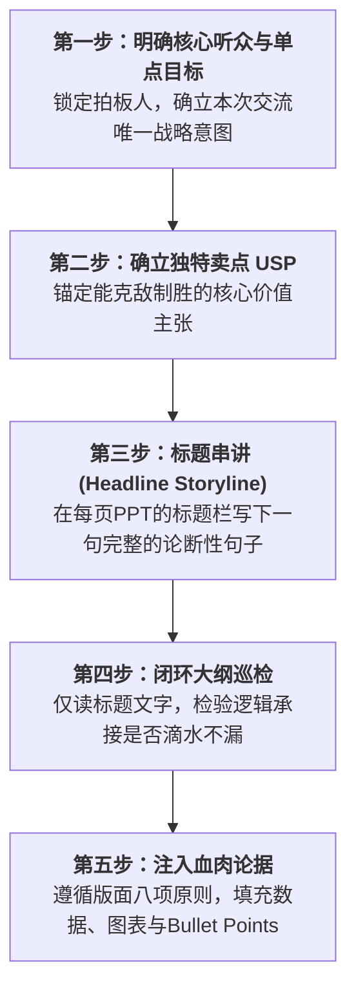
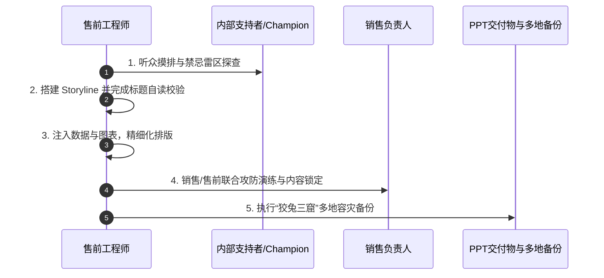

# 第31讲：技术交流杀手级PPT的设计逻辑与内容编排

> **【本讲一句话心法】**  
> 一份杀手级PPT绝不是公司产品手册的粗暴搬运，而是围绕关键决策者精心编织的叙事武器；先定USP，再串Storyline，最后注入血肉，才能让客户在严密的心流逻辑中被彻底折服。

---

## 一、 场景痛点与认知破局

在技术评估阶段，PPT（胶片）是售前最核心的作战武器。然而，市场上超过80%的售前PPT都存在严重的质量与定位偏差：

```
                ┌────────────────────────────────────────────────────────┐
                │          低效售前PPT的三大典型怪现状 (Antipatterns)       │
                └────────────────────────────────────────────────────────┘
                                           │
         ┌─────────────────────────────────┼─────────────────────────────────┐
         ▼                                 ▼                                 ▼
   【一份PPT包打天下】               【Word搬家与大字报】              【茶壶煮饺子倒不出】
   * 无论见谁都用总部标准版          * 密密麻麻把白皮书复制进胶片      * 收集了上百页材料满腹经纶
   * 仅改封面客户名与Logo            * 或者满屏大字配巨幅产品图        * 没有故事线(Storyline)
   * 沦为毫无价值的“舟车劳顿”        * 缺乏结构，客户抓不住核心重点    * 逻辑跳跃，客户如坠云雾
```

### 1. 售前PPT制作的四大硬伤
* **硬伤 1：“一份标准PPT包打天下”的惰性思想**  
  有些售前总抱怨：“公司产品就这些功能，研发又没加新模块，我改什么PPT？”无论去见银行CIO、医院信息科长还是制造厂长，都拿同一套PPT宣讲，最多改个客户抬头。这种做法在客户看来毫无诚意，连“苦劳”都算不上，充其量只是“舟车劳顿”。
* **硬伤 2：“Word文档搬家”与“信息过载”**  
  把大段大段的技术规格、操作手册直接截图或粘贴到PPT中，字号密密麻麻，行距逼仄狭窄。客户在台下看不过来，售前在台上念得口干舌燥，完全沦为“念稿机器人”。
* **硬伤 3：“满屏大字报+巨幅概念图”的形式主义**  
  从某些消费级发布会学来不良风气，一页PPT只有“微服务治理”五个特大字和一张抽象的大脑架构图。在严肃的企业级B2B技术选型中，这种胶片空洞无物、缺乏论据支撑，立刻会被专家评委打上“PPT皮包公司、华而不实”的标签。
* **硬伤 4：缺乏 Storyline（故事线）的拼盘拼接**  
  手头有几十套不同项目留下的材料，东拼一页架构、西凑一页功能，整套PPT就像一盘散沙，缺乏前后呼应的因果逻辑链。

### 2. 认知破局：群体沟通中的“关键少数原则”
在售前参与的群体性技术交流中，**你的目标绝不是说服会议室里的所有人，甚至不一定要说服大部分人，而是要击穿那个最关键的人（拍板者或核心技术决策者）！**
* **以核心听众为锚**：先搞清楚今天这间屋子里谁是具有一票否决权或关键影响力的核心人物。如果存在不可控的敌对刺头，战前就应协同销售想办法将其排除在参会名单之外。
* **先有USP，后找材料**：千万不要手里有什么材料就凑什么PPT，而必须先针对核心听众的痛点确立本次交流的**核心杀手级卖点（USP）**，然后再像磁铁吸附铁屑一样，精准搜集能支撑该USP的论据与材料。

---

## 二、 核心方法论与原理拆解

### 1. 国际大厂经典的“标题串讲法”（Storyline 故事线构建）

如何确保一份PPT具备水银泻地般的说服力？外企顶级售前导师传承的精髓打法是**“大纲标题串讲法”**：



#### “标题串讲法”的标准实操准则
* **标题必须是“完整观点的论断句”，严禁使用无意义的词组**：
  * *劣质标题*：“系统架构”、“产品特点”、“安全机制”（毫无信息量，无法传达立场）。
  * *卓越标题*：“采用跨城三中心双活架构，确保遭遇极端灾难时核心业务零中断”。
* **大纲视图连贯性检验**：将PPT切换到“大纲视图”，只读所有页面的标题。如果只读这些标题就能构成一篇条理清晰、环环相扣的高质量演讲稿，那么你的 Storyline 就大功告成了！

### 2. 经典示范：给“莎士比亚卖钢笔”的11页 Storyline

在第23讲SPIN方法中，我们探讨过如何激发需求。如果将给大文豪莎士比亚推销自来水钢笔转化为一份11页技术交流PPT，其标题故事线设计堪称经典范本：


这份大纲层层递进、逻辑严丝合缝，莎士比亚在听完第11页后没有任何拒绝的理由。这就是顶级 Storyline 的杀伤力！

---

## 三、 售前实操标准动作（SOP / 打法步骤）

制作一份击穿客户心智的技术交流PPT，必须经过以下五步标准工序：



### 步骤1：深入探查听众构成与环境底细
* 向销售和客户内部支持者 Champion 摸清参会人员清单：谁拍板？谁懂技术？谁可能暗挺友商？
* 明确参会领导最关心的痛点焦点（是成本、工期、合规还是技术自主可控）。

### 步骤2：运用标题串讲法，极速搭建骨架
* 新建空白PPT，不急于找模板贴图。
* 在每页上方标题处，写下本次交流的因果递进逻辑句（建议总页数控制在20~30页以内，精讲部分不超过15页）。
* 自行闭门默读三遍，打磨文字顺畅度。

### 步骤3：遵循八大原则，注入血肉内容
* 严格按照排版规范将干货注入页面（参见第四节）。
* 准备附录（Appendix/Backup Slides）：将非核心技术参数、详尽算法推导、备用测试报告置于主讲正文之后，遇提问时再调出。

### 步骤4：与销售做联合对齐与演练
* 召集销售逐页过堂，重点解释为何提炼该 USP，以及该排布如何打压友商。
* 必要时，邀请内部支持者 Champion 提前私下预览关键胶片，听取微调意见。

### 步骤5：启动“狡兔三窟”多地容灾备份机制
* 现场硬件故障是墨菲定律的高发区。必须在出发前完成四重物理备份：
  1. 发送一份到自己**公司企业邮箱**；
  2. 拷贝一份到随身携带的**实体U盘**；
  3. 发送一份到自己的**私人邮箱/微信收藏**；
  4. 提前发送一份给**同行销售的电脑与手机**。

---

## 四、 实战工具箱、话术与Checklist

### 1. 售前PPT版面设计八大黄金原则

```
  ┌────────────────────────────────────────────────────────────────────────┐
  │                   售前杀手级 PPT 排版八大黄金法则                        │
  └────────────────────────────────────────────────────────────────────────┘
    1. 【要点表述】 拒绝对齐大段散文，使用 Bullet Points，动宾短语或名词+数据。
    2. 【数据图表】 能用图不用表，能用表不用字；图表必须配有清晰标题与图例。
    3. 【表格精炼】 表格内容严禁堆砌长篇大论，仅保留横纵对比的关键差异项。
    4. 【关联配图】 配图必须与业务强相关且高清晰，严禁无关网络烂图或抽象网格。
    5. 【呼吸留白】 页面留白率保持在30%以上，拒绝铺满；写不下宁可多拆一页。
    6. 【色彩克制】 全篇主色系不超过3种，遵循主色调(企业蓝/科技灰)+辅助色。
    7. 【禁用花哨】 坚决禁用页面切换动画，严禁文字逐字弹跳飞入。
    8. 【黄金收尾】 胶片前有“交流提纲/Agenda”，后有“核心价值总结/Summary”。
```

### 2. 售前PPT九大避坑禁忌

| 禁忌行为 | 负面后果 | 正确纠偏做法 |
| :--- | :--- | :--- |
| **1. Word文档大段复制** | 客户产生视觉疲劳，售前沦为念稿人 | 断句提炼为2~3个核心 Bullet，突出加粗关键词 |
| **2. 正文无节制过长(>60页)** | 交流超时，核心内容被严重压缩，客户失去耐心 | 正文控制在20~25页以内，边缘细节统统放入 Backup 附录 |
| **3. 满篇特大字配空洞截图** | 缺乏技术说服力，被专家视作外包皮包公司 | 大字标题下必须有具体架构分层、机制逻辑与量化数据支撑 |
| **4. 使用低清模糊或带水印图片** | 显得极度不专业、粗制滥造、缺乏诚意 | 使用矢量架构图（Visio/SVG），严禁截图带第三方水印 |
| **5. 配色五颜六色花里胡哨** | 视觉杂乱，扰乱重点信息传达 | 严格遵照我司或客户企业VI，一页内主题色不超过3种 |
| **6. 采用外部文件超链接** | 换台电脑演示时链接失效，现场翻车极其尴尬 | 视频、音频、附件一律直接嵌入PPT本地内部 |
| **7. 设定幻灯片自动计时播放** | 客户中间一旦提问打断，幻灯片自己乱跳失控 | 永远保持手动翻页，掌控演示节奏的主动权 |
| **8. 滥用炫目转场与飞入特效** | 显得幼稚轻浮，严重分散专业听众对内容的关注 | 全部转场特效一律设为“无”或“淡入” |
| **9. 视以上建议为死板教条** | 丧失临场敏捷应变能力 | **一切以“最好地支撑故事线、最快打动关键决策者”为最高准绳** |

---

## 五、 真实标杆案例深度复盘

### 【案例背景】某省级电网调度云平台交流：两份PPT的生死决战

* **情景 (Situation)**：某省电力调度中心启动云原生微服务中台升级。老牌电力系统集成商H公司与新兴云原生厂商Y公司展开技术交锋。
* **冲突 (Task)**：H公司的资深售前准备了整整150页的胶片，内容从电网历史、公司资质、通用技术架构到各种协议规范应有尽有。然而在汇报过程中，副总工程师听了15分钟便频频看表，随后借故离场，现场只留下几个记笔记的技术员。
* **行动 (Action)**：
  1. **Y公司售前的战前刺探**：Y公司售前通过销售了解到，这位副总工程师最痛心的隐患是**“上一代调度系统在遭遇局部雷暴电网跳闸时，告警风暴曾瞬间冲垮监控消息队列，导致调度员双眼发黑瘫痪10分钟”**。
  2. **量身定制 18页杀手级 Storyline**：
     * **前3页**：直击电网极端天气下的告警风暴痛点，以震撼的数据展示每秒数十万条高频告警如何形成内存雪崩；
     * **中间8页（核心USP）**：全景拆解Y公司独创的“背压流控+自适应告警降噪算法”，以动态架构动图清晰呈现系统如何在极端洪峰下对次要指标精准限流、核心跳闸信号零延迟送达；
     * **后5页（FAB利益兑现）**：呈现某相邻省电力公司抗击超强台风时的真实运行曲线，证明该机制保障了调度室零盲区；
     * **最后2页**：高维总结，打出“不仅是云原生底座，更是电网安全终极防火墙”的鲜明标签。
  3. **容灾备份万无一失**：主讲电脑在接入电网老旧会议室投影时出现接口接触不良，售前在30秒内从容拔下U盘插入销售准备好的备用电脑，无缝继续播放。
* **结果 (Result)**：副总工程师全程全神贯注听完，在总结环节激动地对调度处长说：“这是我近两年来听过的最接地气、最切中要害的技术交流，后面的技术规范就照着Y公司的思路来写！”

---

## 六、 血泪教训与避坑红线

> [!WARNING]
> **红线 1：严禁带着未经验证的“半成品”或他人旧胶片直接上场**  
> 永远不要侥幸拿同事或总部写好的胶片直接开讲。如果PPT中的每一句话你没有亲自推敲过逻辑，没有在心里默讲过一遍，客户稍微在某个架构图的局部模块追问一句，你就会在台上语塞出丑，当场葬送前期建立的全部专业信任！

> [!CAUTION]
> **红线 2：严禁忽略投影设备与屏幕比例的适配测试**  
> 很多售前用自己轻薄本的 16:9 高清屏做完胶片，到了客户老旧会议室才发现投影仪是十年前的 4:3 比例，且只支持 VGA 接口。胶片被严重拉伸变形、字体边缘模糊甚至两边内容被截断。**重要交流前必须自备 HDMI-to-VGA 转接头，并提前确认投影比例！**

---

## 七、 课后思考题与实战研讨指南

### 思考题 1
为什么在企业级B2B大单技术交流中，“一份标准PPT包打天下”注定会被淘汰？在面对“公司标准产品功能固定”与“不同客户个性化诉求”的矛盾时，售前如何在定制化成本与标准化复用之间取得最佳平衡？

> **【实战研讨指引】**  
> * **淘汰原因**：客户购买的不是静态的产品特性，而是自身业务痛点的确定性解法。标准PPT视角在“我有什么”，定制PPT视角在“客户要什么”。  
> * **平衡策略（“积木拼装法”）**：建立公司级高水准的“模块化售前武器库”（包括行业背景模块、核心USP模块、技术底座模块、标杆案例库）。针对特定客户，**保持70%核心技术与案例底座标准化，定制30%的Storyline前端（客户痛点画像、业务流程对齐、定制化价值总结）**。既保证交付效率，又实现深度定制的穿透力。

### 思考题 2
请找出一份你过往或同事撰写的技术交流PPT，尝试将其标题全部提取出来，执行“标题串讲法”检验。你发现了哪些逻辑断层或空洞标题？你将如何对这些标题进行论断化重构？

> **【实战研讨指引】**  
> 检查大纲中是否存在“系统功能”、“平台架构”、“安全保障”等**名词型标题**。  
> 尝试全部改为**“动宾短语+量化结果/业务价值”**的强论断句。例如：将《数据集成平台架构》重构为《通过零代码全异构数据总线，将跨部门数据打通周期从数月压缩至小时级》，对比两者的心理说服力与气场差异。
