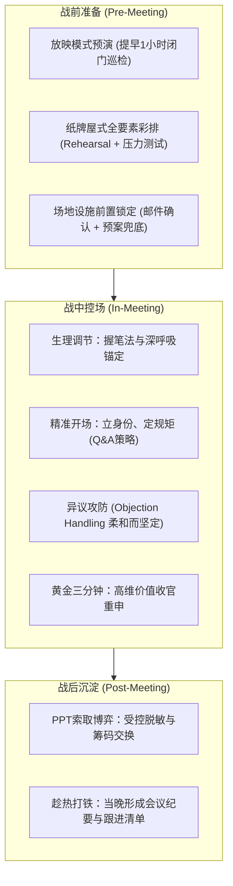
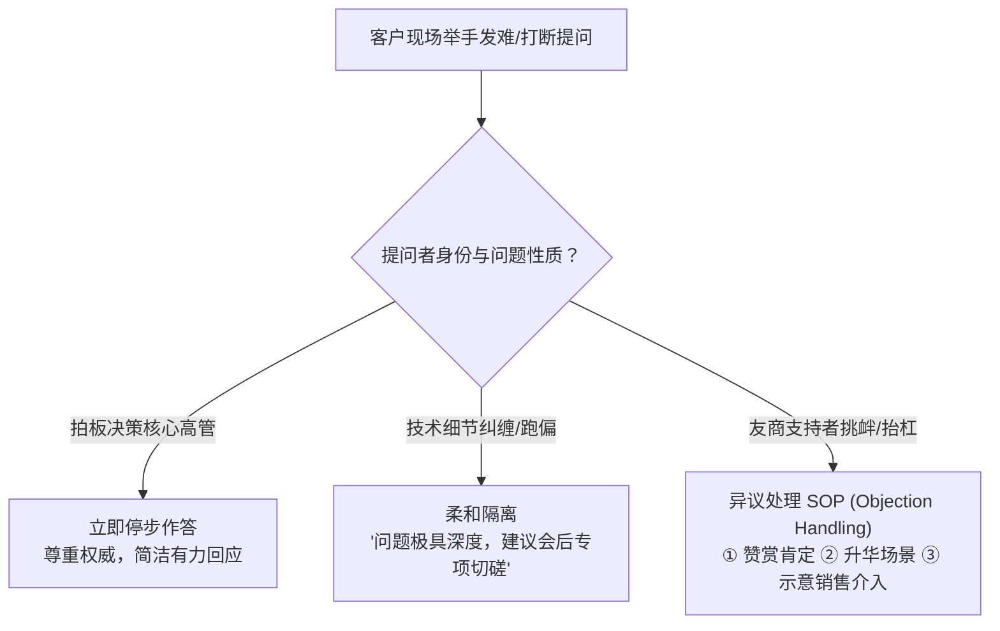
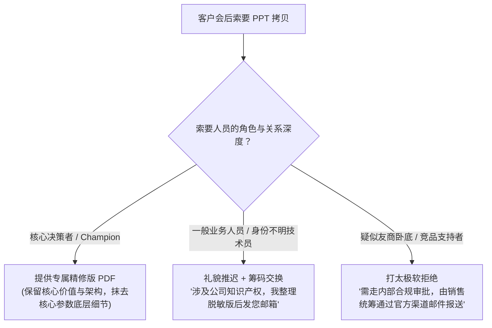

# 第32讲：售前高维演讲与临场控场技巧

> **【本讲一句话心法】**  
> 一场高水平的技术交流，抵得上售前写十份技术方案、销售陪喝五次大酒；演讲不是机械念稿，而是用气场、节奏与异议攻防掌控全场心流的商业舞台剧。

---

## 一、 场景痛点与认知破局

在技术评估阶段，PPT制作完成只是完成了剧本编写，真正的考验在于**技术交流现场的实战演绎**。很多售前在这一步频频栽跟头：

```
                ┌────────────────────────────────────────────────────────┐
                │          技术交流现场的四大临场灾难 (Live Pitfalls)        │
                └────────────────────────────────────────────────────────┘
                                           │
         ┌───────────────────┬─────────────┴─────┬───────────────────┐
         ▼                   ▼                   ▼                   ▼
   【生理性恐慌】       【设施连环踩坑】    【被挑衅打断带偏】   【草草收尾无所适从】
   * 突发紧张脑子空白  * 无投影/没电源/没椅子 * 友商支持者尖锐发难  * 讲完松口气仓促散场
   * 满头大汗手脚僵硬  * 当着客户面改PPT   * 节奏被打乱超时严重  * 客户要拷贝PPT手足无措
   * 眼神飘忽不敢对视  * 观感粗糙极度扣分  * 陷入技术抬杠死胡同  * 丧失重申USP黄金窗口
```

### 1. 售前临场演讲的四大通病
* **通病 1：台下未练功，临场“现眼包”**  
  以为技术方案自己写的就不需要排练。到了现场，由于没有提前用放映模式播放，格式错乱、动画缺失、文字遮挡全部暴露；更有甚者在客户陆续入场时还在现场手忙脚乱改PPT，既无法专注，又给客户留下“临时抱佛脚、极度不重视”的恶劣印象。
* **通病 2：突发性恐慌与脑中一片空白**  
  站上讲台面对一排严肃的客户领导和技术专家，心跳骤增、手心冒汗、双腿发抖，准备好的台词忘得一干二净，彻底陷入“失语状态”。
* **通病 3：被刺头提问打乱阵脚，陷入“抬杠泥潭”**  
  演讲中途被客户或暗挺友商的“刺头”打断质问，售前要么被问得哑口无言、阵脚大乱，要么血气方刚在现场跟客户激烈争辩，将交流会硬生生变成了“辩论擂台”，导致会议彻底失控。
* **通病 4：虎头蛇尾，缺乏临门一脚的“价值总结”**  
  好不容易把几十页PPT念完，如释重负地说一句“我今天就讲这么多，谢谢大家”，随即仓促坐下。一场长达一两个小时的交流，客户听完后脑子里全是碎图片，售前未能抓住最后的黄金窗口把核心优势再次钉入客户心智。

### 2. 认知破局：向美剧《纸牌屋》学高规格演练
美剧《纸牌屋》中有个极其震撼的细节：主人公弗兰克·安德伍德即便已贵为美国总统，在面对大型集会演说前，依然会带着核心幕僚在白宫办公室里一次又一次进行严苛彩排，**小到一个用词、一个手势、甚至一个停顿的语气，都要被反复推敲与纠正**。
* 连大国首脑都需要如此刻苦地排练，企业级软件大单动辄数百万上千万，售前有什么理由不进行极限演练？
* **一次震撼人心的现场技术交流，其商业杀伤力足以抵得上写十份技术方案，甚至顶得上销售陪喝五次大酒！**

---

## 二、 核心方法论与原理拆解

### 1. 售前技术演讲全周期控制模型（Pre-In-Post Model）

卓越的控场能力不是与生俱来的天赋，而是依靠一整套严谨的工程化标准流程保障：



---

## 三、 售前实操标准动作（SOP / 打法步骤）

### 步骤1：严密的台下演练与“纸牌屋式”Rehearsal
* **提前1小时“放映模式”大巡检**：
  * 必须在正式交流前至少1小时，在完全安静的独立空间将PPT以全屏放映模式仔细过一遍；
  * 新增或修改的内容必须**“出声朗读”**，感知语言的韵律与气息；
  * 预留1小时是为了从容修正错别字与动画问题，**坚决杜绝在客户会议室现场改PPT**。
* **联合销售与专家的压力彩排（Rehearsal）**：
  * 重大汇报前组织至少1~2次全真模拟彩排；
  * 邀请同事进行角色扮演（Role Play）：一人扮演挑剔的处长，一人扮演揪住参数不放的技术极客，一人扮演暗挺友商的搅局者；
  * 模拟被残酷打断的极端场景，打磨配合默契与应对口径。

### 步骤2：场地环境的前置锁定与“因陋就简”兜底
* **前置外发《交流环境确认清单》**：技术交流前1天，由售前拟定并由销售发送正式邮件给客户接口人，明确交流议程、参会人员建议，以及**投影仪接口（HDMI/VGA）、网络环境、电源插座及音响设备需求**。
* **因陋就简的装备兜底**：
  * 永远不要迷信客户会议室的条件！随时准备应对“没有投影”、“没有插座”甚至“客户没有预定会议室只能在沙发边站着讲”的极端情况；
  * **随身武器包必备**：便携式微型投影仪、多功能转接头（Type-C转HDMI/VGA）、全彩打印的纸质装订讲义（备足参会领导人手一份）。

### 步骤3：现场心率校准与“握笔锚定法”
* 提前30分钟到达现场调试设备，熟悉讲台与走动动线；
* **生理自救四步法**：
  1. 认知重构：意识到“总统和CEO上台也会心跳加速，这是身体为爆发能量而分泌的肾上腺素，是好事”；
  2. 缓慢深腹式呼吸：吸气4秒，屏息4秒，呼气6秒，连续3组迅速降低交感神经兴奋；
  3. **“握笔锚定法”**：手中紧握一支深色签字笔或翻页激光笔。在感到手抖心虚时，用力捏紧笔身，将无处安放的紧张能量通过指尖肌肉群发泄出去；
  4. 进入开场白轨道：一旦讲出事先背得滚瓜烂熟的开场问候语，大脑进入肌肉记忆轨道，紧张感将在2分钟内烟消云散。

### 步骤4：提问环节（Q&A）的攻防掌控策略



* **开场设定规则（预防失控）**：若参会人员超10人、逻辑极严密、或预感有友商暗桩，开场即明确：“各位领导专家，由于本次汇报方案系统性极强，前后逻辑环环相扣，为保证大家体验，我们设计了40分钟完整陈述，之后留出充分的30分钟供大家自由提问探讨。”
* **异议处理万能三步公式（Objection Handling）**：
  1. **第一步（情绪缓冲垫）**：“王工您这个问题提得非常敏锐且专业，直接切中了分布式高可用的要害！”（杜绝直接反驳，先接纳对方）；
  2. **第二步（重新定义边界与升华）**：“在理论极限压测下确实如您所说，但在贵司特定的生产业务约束下，我们的工程取舍是为了优先保障交易不丢……”；
  3. **第三步（战略拖延或销售接棒）**：“这个问题涉及到底层驱动架构，如果深入展开可能需要40分钟。今天先不耽误各位领导时间，会后我专门到您工位带上源代码和评测报告向您单独请教汇报，您看可以吗？”

### 步骤5：两到五分钟的高维价值闭环收官
* 讲完正文后，**严禁直接说“讲完了”**！
* 翻到专门准备的《总结与价值回顾》胶片，用洪亮笃定的语调执行总结：  
  *“各位领导、各位专家，今天向大家汇报的核心可以凝练为三句话：第一，我们为贵司打造了XX秒级业务响应底座；第二，通过XX独特专利机制，彻底杜绝了数据丢失风险；第三，我们本地化的专属原厂专家团队，将为本项目的成功上线提供100%的保驾护航。感谢各位领导的时间，接下来进入提问探讨环节！”*

---

## 四、 实战工具箱、话术与Checklist

### 1. 经典博弈：客户会后索要 PPT 拷贝的应对决策树

技术交流结束后，往往会有客户人员（甚至可能是友商的眼线）走过来问：“张工，今天讲得太好了，PPT能拷给我一份吗？”



#### 实用应对口径库
* **话术 A（标准得体版）**：“李主任，非常感谢您的认可！因为我们今天汇报的胶片中包含了几项正在申请的专利架构以及部分标杆客户的内部敏感数据，我今晚回酒店把涉密数据进行合规脱敏，明天上午转成PDF正式版，通过邮件发送到您的企业邮箱，您看可以吗？”
* **话术 B（交换深聊机会版）**：“张工，PPT没问题！不过这里面很多架构图脱离了背景讲解容易引起误解。正好这周三下午我在附近，我带上完整的纸质设计方案到您办公室，针对您关心的第三章节我们再做个深度拆解，顺便把资料当面给您，您看周三方便吗？”

### 2. 售前演讲实战行装与战备 Checklist

> [!TIP]
> 奔赴交流现场前，背包内必须清点的“售前保命七件套”：
> - [ ] **电脑充电器与备用扩展坞**（必须支持HDMI与VGA双输出）；
> - [ ] **翻页激光笔**（检查电池电量，备用7号电池1对）；
> - [ ] **高可靠物理U盘**（存放免安装PDF版胶片及关键视频）；
> - [ ] **深色签字笔与高档笔记本**（演讲握笔防紧张，提问环节记录领导要点）；
> - [ ] **润喉糖与便携水杯**（防止登台咽喉干痒失声）；
> - [ ] **全彩打印装订版讲义（3~5份）**（关键领导专属，防止投影断电）；
> - [ ] **销售攻防暗号约定**（眼神与手势示意，明确谁唱红脸谁唱白脸）。

---

## 五、 真实标杆案例深度复盘

### 【案例背景】某千亿跨国集团全球技术交流：临场翻盘的教科书级控场

* **情景 (Situation)**：某跨国快消集团启动全球供应链控制塔技术选型。国内头部软件厂商S公司受邀赴上海总部进行为期半天的首轮技术交流。参会者包括全球技术副总裁（美籍）、中国区CIO、供应链运营总经理及多位外籍架构师。
* **冲突 (Task)**：
  1. 突发硬件事故：进入会议室后，客户的大屏视频会议系统与S公司售前团队的笔记本发生严重的EDID握手协议冲突，屏幕疯狂闪烁，无法正常投屏；
  2. 现场陷入尴尬冷场，外籍架构师面露不屑，看表准备离场。
* **行动 (Action)**：
  1. **临危不乱的体态控制**：主讲售前老陈没有露出一丝慌乱。他一边微笑着示意副售前排查接口，一边从公文包中取出早已精心装订成册的5本中英文对照彩色汇报报告，双手递交到副总裁与CIO面前；
  2. **脱稿白板高维演说**：老陈拿起白板笔，大步走到会议室玻璃白板前，用流利的英文从容开场：“*Gentlemen, while technology is negotiating with cables, let’s focus on what really matters to your global supply chain.*（先生们，在技术设备还在和线缆谈判的同时，让我们先聚焦真正关乎各位全球供应链的核心命题。）”
  3. **手绘架构击穿心智**：老陈行云流水地在白板上徒手画出全球24个时区跨区域库存协同的核心数据流拓扑图，并运用FAB法则直击跨国关税与缺货率痛点；
  4. **巧妙化解友商暗桩刁难**：当某位偏向友商的架构师抛出极端并发同步难题时，老陈微笑着在白板上画出“双向向量时钟与冲突合并算法”，有理有据地回应：“这是一个经典难题，也是我们在某国际头部物流客户落地时攻克的核心专利，请看这个状态机推导……”
* **结果 (Result)**：投屏设备修好时，全场听众早已被老陈在白板前的强悍专业气场所征服。全球副总裁当场竖起大拇指：“*This is the most impressive technical presentation I’ve ever seen in China!*”S公司顺理成章成为技术评估第一名入围者。

---

## 六、 血泪教训与避坑红线

> [!WARNING]
> **红线 1：严禁与现场参会客户当面发生情绪化争吵对呛**  
> 哪怕对方是竞争对手安插的铁杆支持者，哪怕对方的问题带着明显的挑衅和偏见，也绝不可在公开会议室发怒对骂。售前是来做生意的，不是来逞口舌之快的！公开顶撞客户不仅会让中立评委感到你缺乏职业素养，更会直接将这笔数百万的项目机会彻底断送。

> [!CAUTION]
> **红线 2：严禁对未听清或没听懂的问题信口开河、强行胡编**  
> 遇到复杂的行业专有名词或刁钻的技术问题，如果没听清，坦诚请教：“王总，为确保准确理解您的意思，您刚才提到的业务链路是指A系统到B系统的那段批处理吗？”强行不懂装懂胡说八道，一旦被行家里手当场戳穿，前期积累的所有信任将瞬间归零。

---

## 七、 课后思考题与实战研讨指南

### 思考题 1
在一次关键的项目交流开场前10分钟，你突然发现自己心跳加速、手心出汗、准备好的开场词完全想不起来，此时你将采取哪三套具体的生理与心理应对动作，使自己在最短时间内恢复冷静并进入演讲状态？

> **【实战研讨指引】**  
> 1. **肌肉与骨骼重构**：迅速离开人群去洗手间，用冷水洗手，做5次“吸4秒-呼6秒”的深腹式呼吸，双肩下沉，脊柱挺拔，对镜子做一次自信微笑（生理状态反向作用于中枢神经）；  
> 2. **触觉锚定借力**：重返现场后，拿出一支有分量感的金属签字笔紧紧握住，通过掌心压力转移焦虑感；  
> 3. **降维启动法**：放弃背诵复杂的开篇长篇大论，仅默念最简单、最不易出错的第一句问候语（“尊敬的各位领导大家下午好，非常荣幸来到贵司……”），依靠熟练肌肉记忆平稳起步，利用语言惯性自然带入正题。

### 思考题 2
技术交流结束后，一位在现场频繁提出挑战性问题、且你高度怀疑他是友商支持者的技术主管，私下找你索要PPT源文件。作为现场售前负责人，你将如何既得体不失礼貌、又滴水不漏地保护我方核心商业机密？

> **【实战研讨指引】**  
> 坚决贯彻**“不撕破脸、不给源文件、转换沟通主场”**三原则：  
> 1. **面子上给足尊重**：“王工，今天交流中您提的几个问题真的太专业了，能看出来您是真正的底层行家！”（情绪抚慰）；  
> 2. **搬出公司合规挡箭牌**：“关于胶片，因为里面涉及到多项未公开专利和客户商密，公司合规政策严禁直接拷贝源文件。”（制度免责）；  
> 3. **提供折中方案并试探意图**：“不过针对您今天重点探讨的那个算法模块，我单独抽出一份脱敏的技术白皮书PDF，稍后由销售同事正式发至您的邮箱。如果方便，下周我和销售再专程请您喝杯咖啡，专门针对这个模块向您请教深入探讨！”（通过销售跟进，反向刺探其底细）。
