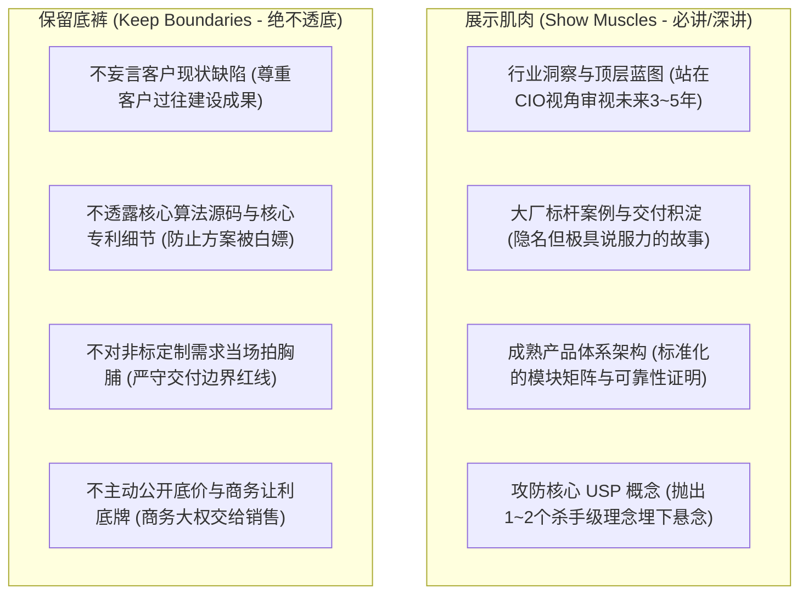
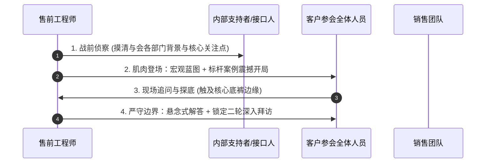

# 第33讲：首轮技术交流：“展示能力肌肉，保留技术底裤”

> **【本讲一句话心法】**  
> 首轮交流是一场高阶相亲与武力威慑，核心是向客户证明“我有解决大问题的顶级能力”，同时严守技术底线；既要亮出肌肉让客户肃然起敬，又要保留底裤以防过早裸奔与被友商摸透底牌。

---

## 一、 场景痛点与认知破局

在销售流程正式迈入技术评估阶段后，**“首轮技术交流”**通常是客户组织各业务部门、技术部门与多方供应商展开的第一次正式“集体相亲会”。在这场关键战役中，很多售前工程师往往会走入两个极端：

```
                ┌────────────────────────────────────────────────────────┐
                │          首轮技术交流的两大极端误区 (Two Extremes)         │
                └────────────────────────────────────────────────────────┘
                                           │
         ┌─────────────────────────────────┴─────────────────────────────────┐
         ▼                                                                   ▼
   【极端一：过分保守如白开水】                                        【极端二：过度亢奋全盘裸奔】
   * 照本宣科读通用PPT产品手册                                         * 恨不得把全部代码与底层设计抖尽
   * 不敢展现任何前瞻性技术锋芒                                         * 妄下断言批评客户现有架构一无是处
   * 客户听完毫无印象，直接被边缘化                                     * 核心商业机密被客户拿去给友商当靶子
```

### 1. 售前在首轮交流中的四大致命失误
* **失误 1：喧宾夺主，妄断客户痛点激怒“老员工”**  
  在客户还没正式向你吐露心声之前，售前就在首轮交流的PPT上大写特写“贵司现有系统架构的三大落后缺陷”。现场负责维护现有系统长达十年的老技术骨干瞬间被激怒，把这视作对其过往职业成果的否定，从首轮开始就将你列为头号公敌。
* **失误 2：用力过猛，全盘倾倒“技术底裤”**  
  有些售前为了证明自己实力，在首轮交流就把公司最核心的未公开算法、接口底层实现、甚至是定制化交付底线交代得一干二净。客户拿到你的底层方案后，转头就发给关系更好的友商：“你看人家这个架构多好，你们能照着做吗？价格还要比他们低20%！”
* **失误 3：空洞套路，沦为白开水**  
  拿出公司通用的几十页产品手册念了一遍，没有一句话切中客户所在的行业特性，客户听完只觉得这家供应商平庸无奇，完全无法建立专业信任。
* **失误 4：轻诺寡信，盲目许诺**  
  在客户一线技术人员随口问及“能不能支持某个偏门协议”时，为了撑面子当场拍胸脯“没问题、完全支持”，直接给自己埋下了后续交付无法兑现的巨大雷区。

### 2. 认知破局：首轮交流的本质定位
首轮技术交流的战略定位是：**“建立可信度、展示肌肉、埋设USP悬念、探查客户底细”**：
* **首轮是“侦察战”而非“决胜战”**：你的核心任务是让客户觉得“这家公司非常专业、底蕴深厚、值得进一步深入接触”，同时观察台下各部门听众的微表情和真实态度。
* **“展示能力肌肉”**：通过标杆案例的厚重感、对行业宏观演进趋势的高维认知、以及成体系的顶层架构设计，展现出碾压友商的专业格局。
* **“保留技术底裤”**：严守核心商业秘密与定制化底牌，不轻易公开不可逆的技术细节与商务边界，为第二轮深入交流、POC测试和招标博弈保留充足的王牌与谈判筹码。

---

## 二、 核心方法论与原理拆解

### 1. 首轮交流“肌肉与底裤”攻防矩阵

首轮技术交流必须严格界定“什么该讲、什么坚决不讲”，建立清晰的攻防边界：



#### ① 肌肉展示策略：高维框架压制
* 讲行业痛点而非具体系统Bug：从宏观监管合规、市场竞争新常态、业务敏捷性切入，让高层领导频频点头；
* 案例讲故事而非报流水账：选择同行业头部标杆案例，重点讲述当时遇到了怎样的极端业务挑战、如何化险为夷，传递“我们经历过大风大浪”的确定性。

#### ② 底裤防守策略：悬念式留白
* 当客户追问非常底层的实现细节时，售前应展现自信而有边界的职业风度：“张总，底层这一块我们有专门的专利状态机设计，在后续针对技术团队的专项交流或POC验证中，我们可以带上原型向各位做深入拆解。”
* 既证明自己胸有成竹，又顺理成章锁定了下一次深度约见的机会。

---

## 三、 售前实操标准动作（SOP / 打法步骤）

首轮技术交流应遵循以下四个严密标准动作：



### 步骤1：战前精准侦察与人员画像
* 提前摸清参会人员构成：业务部来了谁？科技部来了谁？采购部是否列席？现有旧系统的原厂或维护团队是否有人在场？
* 明确主讲基调：多谈价值与理念，少谈细枝末节的配置项。

### 步骤2：高维开场，亮出能力肌肉
* **前10分钟（行业与趋势）**：宏观定调，分享行业数字化转型的最佳实践路径，拉齐认知高度；
* **中间20分钟（整体架构与USP悬念）**：展示我方标准蓝图，重点抛出核心USP（如“全异步事件驱动总线”），解释其带来的业务利益，但点到为止；
* **后15分钟（标杆案例震撼复盘）**：生动拆解某行业头部企业的实施过程，展现公司庞大的实施专家团队与兜底能力。

### 步骤3：应对试探，守住底裤防线
* 遇到客户工程师试图深挖源代码、配置脚本或底层容灾算法逻辑时，运用“认可价值 + 原理说明 + 悬念留白”公式应对；
* 严禁在白板上把核心逻辑推演到可直接抄袭实现的工程颗粒度。

### 步骤4：借势锁定下一轮深度交流动作
* 交流结束前，售前主动向客户牵头领导提议：“李总，今天的首轮交流主要向各位汇报了整体蓝图。针对刚才各位业务专家关心的核算逻辑，以及科技团队关心的接口适配，我们建议在下周分两个专题小组展开深度研讨。”
* 顺水推舟，将单次群体交流裂变为多个定向深耕的战役支线。

---

## 四、 实战工具箱、话术与Checklist

### 1. 首轮交流攻防应对话术库

| 场景与客户挑战 | 错误回答（露底裤/得罪人） | 专业回答（展示肌肉+保留底裤） |
| :--- | :--- | :--- |
| **客户问：你们看我们现在的旧系统，是不是毛病特别多？** | “确实，你们这个架构太落后了，数据库单点严重，早该全部推倒重做了。”（直接得罪旧系统负责人） | “贵司现有的系统支撑了过去五年业务的高速增长，功不可没，架构底座非常扎实。随着贵司业务规模迈向新量级，主要是在峰值弹性与跨部门敏捷协同上遇到了行业普遍的升级瓶颈，这是业务爆发后的幸福烦恼。” |
| **客户工程师追问核心底层算法逻辑与配置规则** | 当场在白板上把全部参数、表结构和核心实现公式画出来（方案被抄走给友商） | “王工果然是一眼切中内核的行家！我们在这个模块采用了专有的多路复用调度专利，其调度开销比开源方案降低了70%。关于具体的核心状态机推导，我们专门准备了一份架构白皮书，下周我单独拜访您，向您详细呈报并请教！” |
| **客户问：我们有个很特殊的定制需求，下个月上线能做吗？** | “没问题，我们研发实力强，加班加点绝对能在下个月给你们做出来！”（盲目承诺，埋雷） | “这个业务场景非常体现贵司的业务特色。我们标准平台本身具备很强的低代码扩展性，理论上完全能够通过插件承接。会后我们需要跟贵司业务团队把需求字段再过一遍，评估一个严谨稳妥的工程工期，确保上线万无一失。” |

### 2. 首轮交流材料巡检 Checklist

> [!TIP]
> 首轮交流PPT出厂前严格自查：
> - [ ] **去贬低性言论**：PPT中是否存在任何“批判客户现有系统落后/缺陷”的负面字眼？
> - [ ] **脱敏保护**：标杆案例中的客户机密信息（系统拓扑、核心参数、涉密名称）是否已彻底脱敏？
> - [ ] **技术留白**：是否保留了足够支撑第二轮专项交流与POC验证的“王牌包袱”？
> - [ ] **肌肉厚度**：是否展现了权威认证、标杆客户数量、知识产权专利等硬核背书？

---

## 五、 真实标杆案例深度复盘

### 【案例背景】某省级农信社信贷中台重构：首轮交流的绝地控局

* **情景 (Situation)**：某省级农村信用社启动全省分布式新一代信贷中台规划。省信联社邀请包括国内顶尖金融科技公司T公司在内的三家厂商进行首轮技术交流。
* **冲突 (Task)**：现场气氛极其微妙：台上坐着信联社副主任和科技部总经理，台下坐着负责开发维护现有系统15年的本地集成商技术人员。竞争对手A公司在上午的首轮交流中，大谈“现有信贷系统是上世纪产物、Bug频出、代码像意大利面条”，引发台下本地技术骨干强烈反感，提问环节被本地工程师围攻“不切实际、脱离农村信贷实际业务”，狼狈离场。
* **行动 (Action)**：
  1. **T公司售前的极致情商**：下午登台，T公司售前第一页胶片就是“向深耕全省农信十五年的IT前辈致敬”，高度评价现有系统为全省数千个乡镇网点信贷立下的赫赫战功，台下老骨干神色瞬间由戒备转为温和；
  2. **高维肌肉展示**：紧接着，售前拿出T公司在全国6家万亿级省农信中台建设的实践全景图，重点展示在面临普惠金融“秒批秒贷”新浪潮时，如何在**保留现有核心账务系统稳定的前提下，以旁路外挂方式构建高弹性信贷中台**；
  3. **严防技术泄密**：当本地集成商工程师追问“信贷风控引擎如何与核心系统做两阶段提交”时，售前展示了高层时序图，点明“异步补偿与最终一致性”的设计思想，但对具体状态机回滚代码微笑着表示：“该引擎为国家发明专利，后续交流我们将提供脱敏规范文档供各位专家内审评估”；
  4. **锁定下一程**：售前主动提议在下周就“涉农信贷特色风控规则配置”为业务部门做专题沙龙。
* **结果 (Result)**：全场反响热烈，科技部总经理评价：“T公司既懂金融IT的敬畏之心，又具备顶级的国家队架构实力！”T公司顺利成为唯一主导后续技术规范编制的战略候选人。

---

## 六、 血泪教训与避坑红线

> [!WARNING]
> **红线 1：严禁直接照搬交付阶段的系统详细设计说明书（LLD）做首轮交流**  
> 首轮交流严禁直接把包含详细数据库表结构、接口具体字段名、部署脚本配置的交付文档当胶片讲。这不仅会导致听众在琐碎细节中迷失方向，更是将公司核心研发资产拱手送人，极易被友商免费白嫖抄袭。

> [!CAUTION]
> **红线 2：严禁对客户技术人员的尖锐试探露出轻蔑或嘲笑表情**  
> 哪怕客户一线人员提出的问题非常外行甚至存在常识错误，也绝不能流露出“这你都不懂”的傲慢神态。不尊重一线技术人员的售前，必将在后续的技术评估细节中遭到最隐蔽、最致命的狙击报复！

---

## 七、 课后思考题与实战研讨指南

### 思考题 1
在首轮技术交流中，既要让客户充分感受到公司的深厚底蕴与技术实力（展示肌肉），又要守住核心底牌防止方案被剽窃（保留底裤），你认为把握这一“分寸感”的黄金分割点究竟在哪里？

> **【实战研讨指引】**  
> 黄金分割点在于：**“宏观架构讲透‘Why’（为什么这么设计）与‘What’（做成了什么样、达到了什么业务收益），而在微观工程细节上克制讲述‘How’（具体由哪些专有算法与核心代码实现）”**。  
> 让客户对方案的先进性、合理性与业务价值深信不疑，但若想落地实现，离开我方的产品与原厂团队就寸步难行。

### 思考题 2
如果在首轮交流现场，你发现台下坐着一位神情严肃、频频皱眉的客户老技术架构师，经了解他正是现有旧系统的核心缔造者。在交流过程中，你将如何通过话术设计与眼神互动，迅速化解其抵触心理，将其转化为中立甚至支持的力量？

> **【实战研讨指引】**  
> 1. **公开给予历史贡献最高敬意**：在阐述演进历程时，主动强调“现有架构在当年技术条件下做到了极高水准的业务支撑，其业务抽象与数据沉淀是本项目最宝贵的财富”；  
> 2. **眼神真诚对视并频频请教**：“正如李首席架构师当年沉淀的核心业务模型，我们在新方案中全面继承并封装了这一核心逻辑……”；  
> 3. **将方案定义为“赋能与解放”，而非“推倒重来”**：强调新方案不是为了推翻他的心血，而是为了将架构师团队从日益繁重的琐碎运维中解放出来，共同参与更有业务前瞻性的大平台建设。
