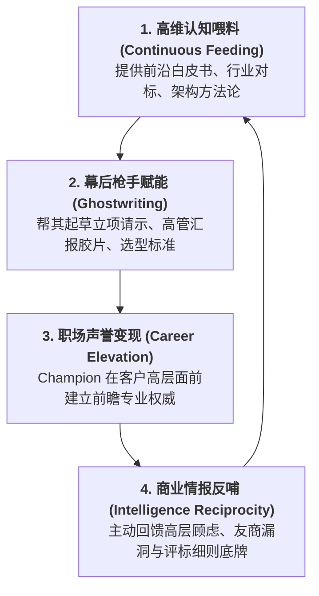
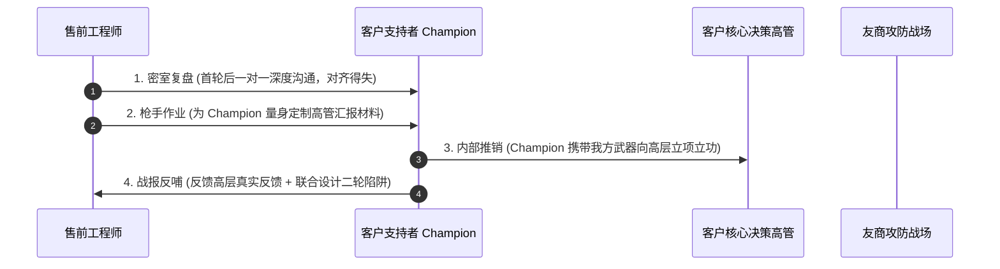

# 第34讲：持续增进与客户内部支持者 Champion 的情报互换

> **【本讲一句话心法】**  
> Champion 绝不是售前单向索取情报的“工具人”，而是战场上休戚与共的“技术同盟军”；持续用高维认知为他赋能立功，以极高情商保护他的政治安全，才能在技术评估深水区构筑固若金汤的赢单联盟。

---

## 一、 场景痛点与认知破局

在需求建立阶段，优秀的销售与售前团队往往已经物色并发展了客户内部的初步支持者（Champion）。然而，一旦进入充满刀光剑影的**技术评估阶段**，许多售前工程师却在与 Champion 的相处中犯下严重战术错误：

```
                ┌────────────────────────────────────────────────────────┐
                │          售前维护 Champion 关系的四大典型误区             │
                └────────────────────────────────────────────────────────┘
                                           │
         ┌───────────────────┬─────────────┴─────┬───────────────────┐
         ▼                   ▼                   ▼                   ▼
   【单向索取工具人】   【大意疏忽断联系】   【过早暴露害死盟友】 【技术傲慢伤及自尊】
   * 只打听消息不给支持 * 以为稳了便不再沟通 * 现场眉来眼去过分亲密 * 纠正Champion技术瑕疵
   * 客户心生警惕与反感 * 被友商趁虚而入策反 * 导致Champion被围攻孤立* 盟友拂袖而去转投竞品
```

### 1. 售前维护支持者关系的四大硬伤
* **硬伤 1：把 Champion 当成单向白嫖情报的“打听工具”**  
  一打电话就追问：“李处，高层领导怎么评价我们？”、“友商到底报了多少钱？”从不考虑自己能为 Champion 提供什么实质性帮助。长此以往，Champion 会觉得自己被当作商业间谍利用，产生强烈的心理戒备与疏离感。
* **硬伤 2：“过河拆桥式”的大意冷落**  
  首轮交流结束后，售前误以为大局已定，便不再主动与 Champion 保持高频联动。而竞争对手的售前与销售却在此期间发动密集攻势，为 Champion 提供详尽材料与贴身公关，导致原本倾向我方的支持者在关键时刻被友商成功策反。
* **硬伤 3：公开场合缺乏政治保护意识，害惨盟友**  
  在各部门集中开会或多方交流现场，售前在台下与 Champion 勾肩搭背、谈笑风生，甚至张口就是“李哥、老李”。这直接向全场宣布“李处是这家的托儿”，引发其他派系中层和友商支持者的强烈警惕与集中政治攻击，导致 Champion 为了避嫌只能在后续评审中故意压低我方分数。
* **硬伤 4：专业傲慢，当众打脸 Champion**  
  当 Champion 在公开场合发表了某些不够专业的技术观点时，售前本能地在众人面前予以反驳纠正。Champion 颜面扫地、威信全无，友谊的小船当场倾覆。

### 2. 认知破局：双向奔赴的“技术合伙人”生态
在企业级B2B重大战役中，**售前与 Champion 的关系本质上是“利益共同体与技术合伙人”**：
* **“赋能他，助他立功”是第一原则**：Champion 在体制内或大企业中支持你，冒着巨大的职业与政治风险。售前必须成为 Champion 的“外部智囊团”与“幕后枪手”，源源不断为其输送行业顶层洞见、高质量汇报胶片与立项论据，让他在他的领导面前大放异彩、稳固晋升！
* **情报互换是“高价值对等交易”**：售前提供行业最佳实践、友商技术陷阱解密与工程落地避坑指南；Champion 回馈客户内部真实政治动向、高层隐秘顾虑与评分细则演变。
* **像保护特工一样保护盟友**：台上公事公办演对手戏，台下密室推演谋全局。

---

## 二、 核心方法论与原理拆解

### 1. 售前与 Champion 价值赋能飞轮模型

优秀的售前团队应通过“持续喂料 -> 助其立功 -> 深度绑定 -> 获取底牌”构建自强化的信任飞轮：



#### ① 售前向 Champion 输送的核心资产（“喂料”）
* **宏观视野与立项炮弹**：国家部委最新监管政策解读、同行业领头羊数字化转型白皮书、行业前沿评测报告；
* **友商方案“避坑内幕”**：梳理友商老版本在其他客户处发生的重大宕机惨痛教训，将其客观封装为《新一代系统选型必须规避的五大工程隐患》，供 Champion 借刀杀人；
* **定制化向上汇报胶片**：直接替 Champion 做好向 CIO、总经理汇报的 PPT（排版精美、逻辑清晰），Champion 只需要签上自己的名字就能向大领导交出一份满分答卷。

#### ② Champion 向售前反哺的核心情报
* **高层未公开的隐秘诉求**：大领导真正拍板的顾虑点究竟是预算超标、还是担心工期延误影响献礼节点；
* **评委会专家真实倾向画像**：哪位评审专家是中立的、哪位专家被友商深度公关、哪位专家看重理论体系；
* **友商战术与技术漏洞曝光**：友商在上一轮私下交流中承诺了什么、友商方案在客户内部引起了哪些技术质疑。

---

## 三、 售前实操标准动作（SOP / 打法步骤）

在技术评估纵深推进过程中，售前应执行以下四步密友维护 SOP：



### 步骤1：首轮交流后的“密室一对一复盘”
* 交流结束后24小时内，协同销售单独约 Champion 喝茶或私下深聊（切勿在客户办公区公开大摇大摆）；
* 态度极其谦逊，主动请教：“李处，今天向各位领导汇报，我们有哪些地方没讲透？各位领导私下有什么真实评价？”
* 认真倾听并逐条记录其指出的瑕疵，让 Champion 充分感受到他的指导地位与权威感。

### 步骤2：执行“幕后枪手作业”，助其职场立功
* 主动提出分担 Champion 的行政与方案压力：“李处，您这几天是不是要向张总汇报技术评估小结？我们手头正好有一套现成对比框架，我今晚把对比表格和PPT框架理出来，供您参考审阅！”
* 熬夜制作出一套无论格式、文字、深度都无可挑剔的汇报材料，**所有版权和署名全部留白，由 Champion 自由包装为他自己的工作成果**。

### 步骤3：公开场合的“暗线演戏与政治保护”
* 在后续所有公开会议中，严格恪守“公事公办”礼仪：
  * 称呼职务（“李主任”），严禁透露任何私下约见的细节；
  * **战术性演戏（红白脸配合）**：事先与 Champion 商定，在交流提问环节，由 Champion 主动举手抛出一个**“看似严苛挑刺、实则我方早已准备好绝妙答案”**的专业难题。售前在台上沉着破解，既让全场看到 Champion 审核极其严格、绝无偏袒，又在众人面前完美秀了一把我方实力！

### 步骤4：协同设计“第二轮交流靶向与友商陷阱”
* 结合 Champion 透露的友商方案缺陷，售前与 Champion 共同商定下一轮技术交流的主题；
* 引导 Champion 在内部起草《下一阶段技术选型对比核心指标草案》，悄悄将我方的核心 USP 写入其中，将友商的固有缺陷定义为“存在重大工程风险的观察项”。

---

## 四、 实战工具箱、话术与Checklist

### 1. 售前与 Champion 深度对话话术库

| 交流场景 | 错误沟通（粗暴白嫖/得罪盟友） | 专业高情商沟通（赋能+保护+共赢） |
| :--- | :--- | :--- |
| **首轮交流后打听高层对我们的看法** | “李哥，今天张总听完到底怎么说啊？对我们评价好不好？友商讲了啥？” | “李主任，今天交流多亏了您前期的协调！张总在现场提的那两个战略问题格局特别大。我们想根据张总的关注点，把方案再做一个深度的场景细化。以您的敏锐把握，张总目前在推进这个项目中，最担心踩雷的深层顾虑大概是什么？” |
| **Champion 提出一个不切实际的技术要求** | “李处，您这个想法完全脱离技术实际了，业内根本没人这么干，分布式系统不可能这么设计。” | “李处，您站在全局业务运营角度提的这个思路太超前了，极具穿透力！从纯技术底层看，业界一般为了兼顾极端高并发，会采用XX补偿方案来平衡。为了帮您在科技部领导面前把这个创新亮点立得更稳，我们建议把这块设计成两阶段实施……” |
| **主动为 Champion 向上汇报打掩护** | “李哥，这篇给你们CIO汇报的PPT是我写的，您记得在领导面前多提提我们啊！” | “李处，知道您最近在陪领导抓立项方案，工作量特别大。我整理了一份《业内标杆架构选型对标参考》，把宏观趋势和风险点都理顺了，纯Word和PPT格式发您，您直接按您的思路裁剪使用即可，希望能给您的汇报省点案头时间！” |

### 2. Champion 隐蔽性保护与关系健康度 Checklist

> [!TIP]
> 每周对支持者同盟进行一次健康度巡检：
> - [ ] **信息平衡度检查**：本周我是向他索取的信息多，还是为他输出的高价值专业资料多？（必须保持输出 > 输入）
> - [ ] **保密纪律检查**：我或销售是否曾在客户公司内部任何非私密场合直呼其小名或私下谈话内容？
> - [ ] **政治雷区排查**：Champion 在客户部门内部是否正面临政治对手（友商支持者）的非议或排挤？
> - [ ] **高层对位检查**：Champion 的层级是否足够高？如果他只是中层骨干，我们是否通过他向上成功挂钩了经济决策者（Sponsor）？

---

## 五、 真实标杆案例深度复盘

### 【案例背景】某千亿快消巨头全渠道数字化中台战役

* **情景 (Situation)**：某千亿级快消巨头启动全渠道营销中台与私域数据资产管理系统招标，预算超2000万元。IT规划部高级经理老赵是我方销售团队在早期发展的重要业务支持者（Champion），但他为人低调、谨慎，极度在意外界评价。
* **冲突 (Task)**：竞争对手K公司（国际大厂）的销售手段极其凶猛，动用高层关系直接压制客户CIO，同时在客户内部散布谣言，暗示老赵与我方走得很近，企图将老赵从项目选型工作组中边缘化。老赵一度感到压力巨大，开始刻意回避我方的电话和微信。
* **行动 (Action)**：
  1. **主动后退，全面转入地下暗线**：售前总监与销售果断停止前往老赵办公室，严禁销售在客户公共区域与老赵打照面，微信沟通全部采用纯学术探讨用语；
  2. **高维专业喂料，助其绝地反击**：售前团队了解到，CIO虽然受到K公司高层施压，但CIO本人最大的政治底线是**“绝不能在即将到来的双十一大促中发生全网订单积压事故”**。售前团队连续奋战三个通宵，为老赵编写了一份长达40页的《超万级并发下全渠道库存锁定的双重扣减架构避坑白皮书》，深入剖析了K公司历史架构在应对瞬时突发高并发时的内存死锁通病；
  3. **枪手赋能，高层封神**：老赵将这份材料内化后，在集团数字化战略专题研讨会上，以极其专业的数据和架构图，向CIO与集团执行总裁做了长达半小时的深度技术风险报告。老赵当场指出：“如果采购了不具备本地化高可用削峰能力的传统架构，双十一当晚我们将面临瘫痪风险！”CIO听后大惊失色，当场表扬老赵“是全集团真正懂技术敬畏之心的技术定海神针”，并正式任命老赵为技术评标专家组组长；
  4. **公开场合严密演戏**：在随后的第二轮技术答辩中，老赵在台上神情冷峻，当众对我方架构连环发难提出三个苛刻问题，我方售前从容应对、逐一完美化解，令全场评委交口称赞。
* **结果 (Result)**：最终技术评标，老赵不仅光明正大地为我方打出全场最高分，连原本倾向友商的CIO也全力支持我方。我方以技术总分第一绝对优势拿下该千亿快消标杆大单。

---

## 六、 血泪教训与避坑红线

> [!WARNING]
> **红线 1：严禁跳过销售私自与 Champion 搞地下“技术勾兑”**  
> 售前与 Champion 的每一次私下接触、材料交换，都必须提前与销售客户经理（Account Manager）100%信息同步！绝不能背着销售私自给客户承诺、私自传递敏感文档。一旦售前的动作打乱了销售的全局政治博弈节奏，必将引发团队内讧与项目翻车。

> [!CAUTION]
> **红线 2：严禁对未验证立场的“假支持者”倾倒核心商密**  
> 有些客户人员表面对你极度热情、称兄道弟，实则是友商或其他派系安插的“双面间谍”或“套话者”。在确认其为你真正的 Champion 之前（即他是否愿意为你承担政治风险、是否愿意提供排他性独家情报），严禁将核心方案底牌与友商攻击材料轻易交出！

---

## 七、 课后思考题与实战研讨指南

### 思考题 1
当你发现你精心培养的 Champion 最近突然对你变得态度冷淡、微信回复简短、多次推脱线下交流时，这背后通常预示着客户内部发生了哪些重大变故？作为现场售前负责人，你该如何协同销售安全破局？

> **【实战研讨指引】**  
> * **背后三大潜在变故**：  
>   1. **政治压力过大**：他在内部受到上级或友商支持者的严厉警告甚至调查，必须避嫌；  
>   2. **利益立场动摇**：竞争对手开出了更具诱惑力的筹码，或其高层强行拍板了友商方案，他感到大势已去无法挽回；  
>   3. **感知价值失衡**：觉得我方只索取不付出，或者我方在公开场合某些失误让他颜面受损。  
> * **协同破局动作**：  
>   * 切忌频繁电话轰炸逼问！  
>   * 协同销售通过其他侧翼渠道（如其他友好技术骨干、采购接口人）摸清真相；  
>   * 以“纯学术/纯交付支持”名义，由售前高层出面发送一封极具价值且没有任何商业压迫感的专业资料，给予其空间与安全感；  
>   * 评估是否需要启动备选“次级支持者（Secondary Champion）”战略。

### 思考题 2
请构思一个实战场景：在公开的技术交流会上，你与你的 Champion 应当如何通过“事先串通好的提问与回答（演双簧）”，既向在场的其他中立领导树立 Champion 大公无私、极其专业的形象，又借机彻底砸碎友商的核心卖点？

> **【实战研讨指引】**  
> * **场景设计（打友商死穴）**：友商主打“低价但缺乏大规模分布式经验”。  
> * **Champion 提问**：“张工，刚才听了你们的架构，理论上很完美。但我作为咱们集团核心系统的负责人，我最担心的就是数据一致性。如果遇到机房断电或跨城网络专线抖动，你们怎么证明你们的分布式系统不会出现账目错乱？请不要讲空洞概念，直接说具体工程补偿机制！”（看似严厉发难，实则为我方递话筒）；  
> * **售前从容作答**：“李主任这个问题问得极具穿透力，显然是真正长期在一线管高可用系统的专家！这也是很多同行在PPT上不敢碰的深水区……”随后顺理成章亮出三中心双活专利与银行业无损切换压测证明，**顺带揭露业界某些低价传统单体系统在断电时必丢数据的硬伤**；  
> * **效果**：中立领导频频点头赞同，Champion 在领导面前树立了严谨负责的形象，友商方案的核心短板被无形中判了死刑。
