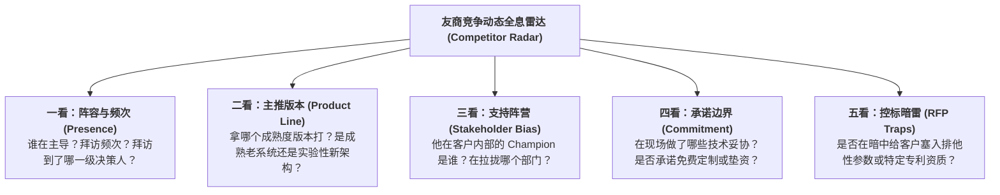
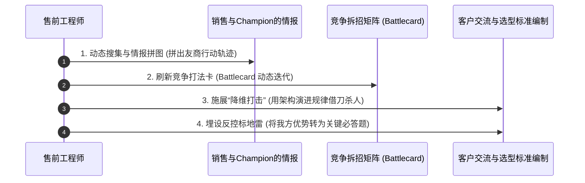

# 第35讲：友商与竞争对手态势实时跟踪与动态拆招

> **【本讲一句话心法】**  
> 顶级售前从不公开指名道姓诋毁友商，而是在暗战中把对手的一举一动纳入全天候雷达监控；以无形化有形，借客户之手、设前瞻标准，将友商的固有死穴提前锁定在技术评估的绞刑架上。

---

## 一、 场景痛点与认知破局

在技术评估的深水区，商业竞争往往进入白热化阶段。然而，许多技术售前在面对竞争对手（友商）时，普遍存在两大认知硬伤与战术软肋：

```
                ┌────────────────────────────────────────────────────────┐
                │          面对友商竞争的两大致命失误 (Critical Errors)      │
                └────────────────────────────────────────────────────────┘
                                           │
         ┌─────────────────────────────────┴─────────────────────────────────┐
         ▼                                                                   ▼
   【硬伤一：闭门造车，信息盲人】                                      【硬伤二：低维攻击，破口大骂】
   * 两耳不闻窗外事，只管讲自家方案                                     * 在客户会议上指名道姓攻击友商是垃圾
   * 对友商拜访频度、主推版本一无所知                                   * 显得心胸狭隘、极度不专业、缺乏涵养
   * 直到标书发布才发现被友商全盘控标                                   * 客户反感：“既然他们这么烂，为何我们还请来？”
```

### 1. 售前在竞争态势跟踪中的四大漏洞
* **漏洞 1：“两耳不闻友商事”的盲目自信**  
  以为只要自己的技术方案写得好、PPT讲得溜就能赢单。殊不知友商可能每周三次登门拜访CIO、已经为客户免费驻场搭建了测试环境、甚至已经协助客户起草好了包含数十项专有参数的技术规范初稿。
* **漏洞 2：低情商的指名道姓式诋毁**  
  在技术交流现场，一旦客户提到竞品X，售前立刻开启嘲讽模式：“X公司的产品都是外包贴牌的，代码烂得很，经常宕机，傻子才买他们的！”这种攻击在客户听来极其刺耳——因为邀请X公司参会的往往正是台下的某位部门领导。**贬低对手，本质上是在当众羞辱客户选型班子的智商！**
* **漏洞 3：静态刻板印象，缺乏动态敌情侦察**  
  用两年前对友商产品的记忆来评估当前战局。殊不知友商在半年前已经发布了全新微服务版本，全面修补了旧缺陷，售前在客户面前攻击的所谓“友商死穴”当场被客户拿出的最新实测报告打脸。
* **漏洞 4：缺乏反侦察意识，自身底牌尽露**  
  在客户公共会议室随意丢弃交流胶片草稿，或者在电梯间大声讨论我方定价底线和系统弱点，被尾随的友商销售或客户内部线人听得一清二楚。

### 2. 认知破局：竞争跟踪的“雷达与暗战法则”
企业级大单竞争是一场不对称的信息战：
* **“全天候动态雷达”是生存底线**：你必须时刻掌握友商谁在带队、见了谁、说了什么、承诺了什么、遇到了什么阻力。知己知彼，才能在方案中精准拆招。
* **“杀人不见血”的高维竞争艺术**：绝不提友商的名字，而是将竞争对手的技术路线客观归类为“业内第一代传统集中式架构”，用“行业客观技术演进规律与痛点教训”去降维打击对手，借客户专家之手去判定对手出局！

---

## 二、 核心方法论与原理拆解

### 1. 友商动态竞争情报“五看”雷达模型

在技术评估期间，售前必须与销售团队构建针对每一个入围友商的“全息敌情监控卡”：



#### ① 看阵容与接触点（Presence & High-Level Touch）
* 友商派出的售前是行业老手还是初出茅庐的新人？友商的副总裁或研发总经理是否专程飞来拜访过客户CIO？
* 如果友商高层频频出动，说明其已进入高层决策公关期，我方必须立即推动高层对等互访（Executive Sponsorship）。

#### ② 看主推架构与版本号（Architecture & Version）
* 查明友商是在推其久经考验但架构老旧的旧旗舰，还是在推刚研发出来但案例稀少的下一代云原生产品。
* **对手推旧款**：打其“技术架构老化、面临停服与高额升级成本”；
* **对手推新款**：打其“未经大规模商业生产验证、稳定性存在巨大未知风险”。

#### ③ 看利益同盟与派系（Political Alignment）
* 友商如果是业务部门力挺的，科技部往往对其心存忌惮；如果友商是科技运维组推荐的，业务部门往往嫌其操作繁琐。摸清同盟，才能精准联合反制派系。

---

## 三、 售前实操标准动作（SOP / 打法步骤）

在技术评估全程，售前应按照以下四步实施动态拆招与反制：



### 步骤1：日常多源情报交叉印证（拼图作业）
* **观察客户会议室垃圾桶与白板痕迹**：友商开完会擦拭不彻底的白板架构图、遗留的会议日程单往往包含核心线索；
* **通过 Champion 侧面核实**：“李处，听说昨天有同行来汇报分布式流批一体，客户科技部对这种新兴架构的整体评价如何？”
* **从客户提问的反常变化反推友商动作**：如果客户突然在交流中打破常规，频繁纠结某个冷僻的技术认证或底层通信协议，90%是友商刚刚在私下向客户“递了刀子、埋了雷”。

### 步骤2：每周刷新《作战打法卡（Battlecard）》
* 与销售每周进行半小时“战情推演会”，针对主要友商形成攻防共识：
  * **友商当前主打的卖点是什么？** -> 我方如何证明该卖点在客户场景下是“伪需求”或“过渡方案”；
  * **友商正试图放大我方的哪项短板？** -> 我方已备好怎样的工程补偿依据与成熟证据；
  * **友商的致命死穴是什么？** -> 如何引导客户将其列为重点考察项。

### 步骤3：在交流中施展“高级暗战话术”
* 坚持**“三不原则”**：不提竞品企业名、不指责竞品人员、不搞人身攻击；
* 采用**“代际演进与架构代差理论”**降维打击对手：
  * 将友商的技术路线定义为“第一代集中式/外挂式方案”，客观分析其在5年前的历史功绩，随后深刻揭示其在当今海量高并发与敏捷业务下的不可逆缺陷；
  * 将我方方案定义为“经过实战验证的现代云原生架构”，形成自然降维。

### 步骤4：借客户之手，为友商精准设套
* 协助客户或内部支持者编制技术测试用例（POC）与考评打分项时，设计几道**“友商根本答不上来、或一做测试必当场露馅”**的杀手级必考题：
  * 例如：针对某宣称支持双活但底层依赖单存储的友商，在测试标准中明确写入：“在模拟机房断电时，必须在现场拔掉存储主控光纤，验证系统是否能在0秒内无损切换且数据完全一致”。

---

## 四、 实战工具箱、话术与Checklist

### 1. 售前高级竞品拆招与防御话术库

| 客户现场发难/提到友商 | 拙劣应对（诋毁对手/得罪客户） | 顶级售前拆招话术（尊重+降维+借刀） |
| :--- | :--- | :--- |
| **客户问：友商X公司说他们的系统成熟度最高，全国有上千家客户，你们怎么比？** | “X公司那都是十年前的老掉牙系统了，早就被市场淘汰了，那些客户都是历史包袱！” | “X公司是业内令人尊敬的前辈，在信息化建设初期确实做出了很大贡献。不过正如很多选择从X公司迁移到我司架构的标杆银行所总结的——**过去的成功往往会成为今天创新的包袱**。传统的单体强耦合架构由于代码过于庞杂，导致今天改一个业务参数就需要长达两周的编译回归。而贵司未来三年的核心战略是业务敏捷创新，需要的是轻量化、微服务化的现代解法。” |
| **客户问：友商Y公司报价比你们低30%，而且承诺很多定制免费做，你们能跟吗？** | “便宜没好货！他们就是来搅局的，到最后肯定做不出来烂尾，你们别被骗了！” | “在项目初期看到这样的价格差异，任何决策领导都会非常关注，这完全可以理解。不过从软件工程的全生命周期成本（TCO）来看，低价中标往往意味着供应商必须在交付期大幅缩减资深专家人月，或者通过后期海量的需求变更进行隐性加价。我们今天的报价，包含了原厂核心架构团队全程驻场与严格的SLA承诺，**我们希望交付给贵司的是一个确定的标杆政绩，而不是一个充满不确定性与扯皮风险的半成品**。” |

### 2. 友商态势跟踪与反控标 Checklist

> [!TIP]
> 进入技术评估深水区，每周完成以下自检：
> - [ ] **友商参会档案**：我们是否掌握了所有入围友商在客户处的交流场次、主题与核心参会人？
> - [ ] **客户关注偏移度**：客户近期提出的技术问题，是否呈现出偏向某一友商技术专利特征的趋势？
> - [ ] **控标暗雷拆除**：我们是否已经全面排查并协助客户删除了友商试图塞入立项报告中的“排他性资质”与“专有硬件参数”？
> - [ ] **反制地雷布设**：我们是否已经成功将我方的 1~2 个核心 USP 转化为客户技术选型的“关键考察维度”？

---

## 五、 真实标杆案例深度复盘

### 【案例背景】某千亿高端装备制造企业工业大数据平台选型暗战

* **情景 (Situation)**：某千亿级工程机械集团规划建设工业互联网大数据平台，预算1200万。入围最后角逐的是两家企业：国际工业软件老牌巨头G公司与国内大数据独角兽D公司。
* **冲突 (Task)**：G公司品牌极其响亮，深得集团副总裁兼总工程师的青睐。G公司的售前极其狡猾，在私下交流中向总工程师灌输了大量“工业软件必须经过百年工业机理模型沉淀”的概念，并试图在技术规范中写入一项排他性参数——“必须原生内置西方某工业协议族的专有解析解析库”。
* **行动 (Action)**：
  1. **雷达预警与情报破译**：D公司的售前在与车间数据技术负责人的交流中，敏锐捕捉到总工突然开始纠结这项偏门协议。售前当夜拉取G公司的专利库，瞬间破译这是G公司试图实施的“控标暗锁”；
  2. **不露声色的降维拆招**：D公司售前没有直接去总工办公室告状，而是在随后的专题交流中，邀请了国内某同行业领军主机厂的大数据首席科学家联合出席；
  3. **用真实工业教训敲响警钟**：首席科学家在现场用详实的数据分享了当年盲目引入G公司封闭协议库的惨痛教训：“由于该库属于国外核心黑盒，国内企业无法自主编写扩展脚本，当车间引入国产新型数控机床时，设备数据完全无法接入，导致数百万投资沦为数据孤岛”；
  4. **布设致命反制测试用例**：D公司售前顺水推舟，向客户专家组建议：“为检验各家平台面对未来新型机床的真实自适应能力，建议在技术评估测试中加入一项考评：**由客户现场随机指定一台非标传感器，要求两家厂商在4小时内通过低代码规则引擎完成在线逆向协议解析并入库**”。
* **结果 (Result)**：在随后的现场测试中，D公司的开放式规则引擎在1小时内轻松搞定；而依赖国外总部封装库的G公司工程师当场抓瞎、手足无措。总工程师彻底改变了对G公司的盲目迷信，D公司凭借开放自主可控的核心优势全票斩获该重大项目。

---

## 六、 血泪教训与避坑红线

> [!WARNING]
> **红线 1：严禁由售前或销售口中直接散布针对友商高管或团队的“人身攻击与恶意造谣”**  
> 哪怕得知友商存在某些负面舆情，也必须克制。通过道听途说的非官方负面谣言攻击友商，极易引火烧身，甚至招致法务诉讼。更重要的是，在客户决策层看来，这种作风不仅缺乏大企业风范，更暴露了自身在技术实力上的虚弱。

> [!CAUTION]
> **红线 2：严禁对友商的降价倾销采取盲目的“杀敌一千自损八百”式跟降**  
> 当友商在技术评估落败、企图通过恶性腰斩低价搅局时，售前绝不能慌了手脚、逼迫自家公司盲目跟降打价格战。正确的做法是协助销售，向客户高层坚决打透“低价烂尾全周期成本风险”，用确定性的服务承诺和标杆质量牢牢守住合理的商业毛利空间！

---

## 七、 课后思考题与实战研讨指南

### 思考题 1
在技术交流现场，如果一位与友商关系极其密切的客户专家突然发难：“据我所知，隔壁省的项目上个月刚把你们的系统换掉了，换成了XX公司的系统，原因说是你们性能根本不达标，这事你们怎么解释？”作为当场的主讲售前，你该如何滴水不漏地化解这颗致命炸弹？

> **【实战研讨指引】**  
> 1. **情绪波澜不惊，坚决不慌乱**：微笑直视提问专家，展现坦荡气度；  
> 2. **厘清事实与边界，果断纠偏**：“非常感谢李专家对业内动态的密切关注！关于隔壁省项目，市场上确实有一些同行出于竞争目的做了一些片面的信息传播。真实情况是：隔壁省一期由我司建设的核心交易平台连续四年零故障，上个月进行的是边缘商城业务的局部测试，我司核心集群至今仍稳定承载其全省70%的算力”；  
> 3. **升华到客户当下的核心关切**：“针对您非常在意的极限性能与稳定性指标，我们非常愿意用贵司实际的脱敏业务负载进行实地打靶压测，用真实的数据和事实向各位领导交出最放心的答卷！”

### 思考题 2
当你在技术评估中期发现，客户起草的《技术选型评分标准初稿》中，有两项关键加分项几乎是专门为主要友商量身定做的（友商独有资质或非通用软硬件绑定），作为主攻售前，你应采取怎样的“迂回破局”策略来安全拆除这些控标暗雷？

> **【实战研讨指引】**  
> 1. **借助合规与法律风险施压**：通过 Champion 或采购监督部门，提出“该指标具备明显的排他性与唯一指向性，涉嫌违反国家《反不正当竞争法》及政府采购公开公正原则，未来一旦被外部投诉可能面临立项流标及合规审计通报风险”；  
> 2. **业务价值降维替代**：向业务决策层论证该排他性指标与本项目的核心业务目标毫无实质关联，纯属增加不必要的预算开支；  
> 3. **对等置换方案**：提出将该单一专有指标修改为“支持开放行业通用标准/支持至少三种主流架构适配”，打破排他垄断，同时将我方的核心优势项包装为对等的加分项进行平衡博弈。
