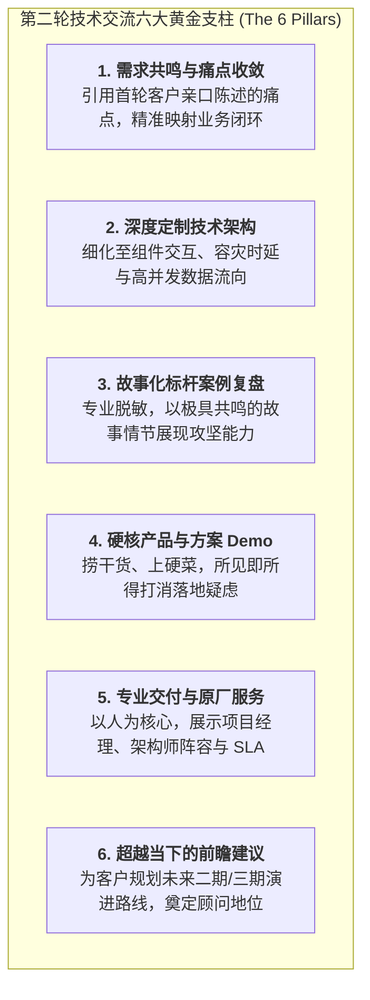
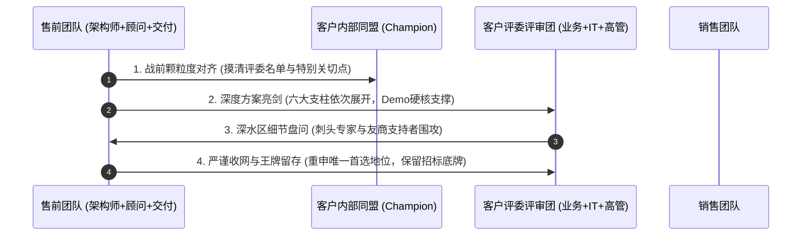
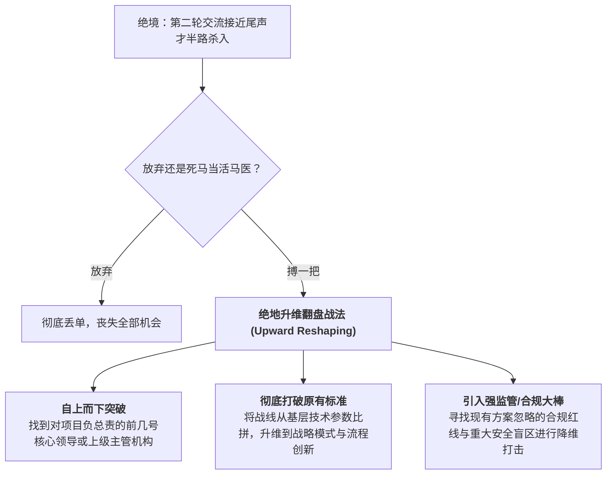

# 第36讲：第二轮技术交流：“亮剑锋芒，但不求一剑封喉”

> **【本讲一句话心法】**  
> 第二轮交流是技术评估的高潮与定盘之战，必须放开手脚亮出核心技术剑芒与深度定制方案，彻底拉开与平庸竞品的代差；但高手博弈从不妄图在现场一剑封喉，手里永远要保留几张王牌，静待招投标与商务决胜时刻的一击必杀。

---

## 一、 场景痛点与认知破局

在企业级项目的采购流程中，**“第二轮技术交流”**通常是客户在招标前组织的最大规模、最深颗粒度、也是参与干系人最齐全的“大决战式交流”。绝大多数项目在经历两轮正式技术交流后，客户内部对于供应商的选型梯队与技术偏好就已基本定型。

然而，面对这场至关重要的攻坚战，很多售前工程师往往拿捏不好分寸与火候：

```
                ┌────────────────────────────────────────────────────────┐
                │          第二轮技术交流的两大典型偏航 (Off-Course)         │
                └────────────────────────────────────────────────────────┘
                                           │
         ┌─────────────────────────────────┴─────────────────────────────────┐
         ▼                                                                   ▼
   【偏航一：依然保守，错失良机】                                      【偏航二：急躁冒进，企图一剑封喉】
   * 依然停留在概念与宏观蓝图层面                                       * 恨不得当场逼客户表态拍板我方入选
   * 客户追问落地细节时支支吾吾不敢展开                                 * 底牌与商业底线一次性全部亮光
   * 客户大失所望：“怎么第二轮还是空架子？”                             * 引发客户防御心理，后续招标沦为待宰羔羊
```

### 1. 售前在二轮交流中的典型误区
* **误区 1：延续首轮保守作风，导致方案“颗粒度过粗”**  
  以为首轮“保留底裤”的策略要一直贯彻到底。在第二轮客户急需了解具体接口规范、数据流向、容灾切换时延和定制化实施路径时，售前依然拿着概念PPT泛泛而谈，导致客户技术评委得出结论：“这家公司只会画大饼，根本没有深度工程落地能力”，直接打入冷宫。
* **误区 2：贪功心切，企图在现场“一剑封喉”**  
  在台上气势凌人，急于在技术评估现场把竞争对手置于死地，甚至逼着客户领导当场表态“我们的方案是不是最好的”。这种做法不仅让客户领导感到被绑架和不适，更会过早将所有技术、商务与服务底牌消耗殆尽，使得后续的招投标与商务谈判陷入无牌可打的被动窘境。
* **误区 3：案例讲述呆板且泄露前序客户商业机密**  
  在介绍以往成功案例时，要么照本宣科读配置单，毫无生动性；要么不知轻重地将前任标杆客户的内部敏感数据、系统拓扑甚至真实名称大白于天下。台下的客户领导看在眼里、心生顾虑：“今天你们这么抖露别人的机密，明天中了我们的标，是不是也会把我们的核心数据拿到外面到处宣扬？”

### 2. 认知破局：“亮剑锋芒，引而不发”的博弈哲学
第二轮技术交流的战略定位是：**“大展宏图、深度对齐、树立不可动摇的技术首选地位，同时保留战略悬念”**：
* **“亮剑锋芒”**：第一轮保守是探路，第二轮必须全面放开手脚！把针对客户真实业务场景量身定制的深水区架构、硬核Demo演示、高水准交付服务承诺统统搬上台面，让客户切身感受到“唯有这套方案能完美承接我们的业务未来”。
* **“不求一剑封喉”**：手握王炸，引而不发。商业决策从来不是单一技术维度的冲动消费，客户还需要经历内部政治平衡、预算审核、商务博弈与招投标流程。留有余地，给客户高层留出内部消化的空间，手中扣住两三张杀手锏（如专项优化算法、原厂专属售后增值保障），留待招标答辩与商务谈判关键时刻一锤定音！

---

## 二、 核心方法论与原理拆解

### 1. 第二轮技术交流六大黄金内容支柱

一场能彻底征服客户全阶层干系人的第二轮技术交流，必须具备六大黄金模块支撑：



#### ① 需求共鸣与痛点收敛（从“我猜你想”到“如你所言”）
* 为什么在首轮坚决不妄断客户痛点，而二轮可以大讲特讲？
* 因为在首轮交流及会后调研中，客户各部门已经通过文字或口头明确表达了他们的实际挑战。在二轮交流中，**直接引用客户的原话与实际业务数据**展开推导，不仅零风险，更能瞬间引发客户强烈的被理解感与心理共鸣！

#### ② 故事化标杆案例复盘（专业脱敏与故事法则）
* **脱敏表述的专业严谨性**：绝不直接暴露敏感名称，而是采用标准规范表述，如“一家全国排名前三的股份制商业银行”、“一家总部位于深圳的全球500强高端制造龙头”。这样既能精准匹配行业对标体量，又让台下客户深刻感受到你对客户商业秘密的敬畏与严谨职业操守。
* **讲惊心动魄的故事而非报流水账**：采用冲突-行动-结果结构，重点讲述当时遇到了怎样的业务危机、遇到了怎样的技术极限、团队如何通宵攻坚、最终为客户挽回了多少经济损失。

#### ③ 专家阵容立体化支援（兵种协同）
* 二轮技术交流绝不是单兵作战，必须协同立体化兵力：
  * **资深架构师**：主讲底层高可用与性能基线；
  * **业务咨询顾问**：主讲业务流程再造与考核指标拆解；
  * **原厂交付总监/项目经理**：亲自登台讲解落地工期与风控保障；
  * **必要时研发科学家站台**：为前沿算法提供不可动摇的背书。

---

## 三、 售前实操标准动作（SOP / 打法步骤）

第二轮技术交流应遵循以下四个标准化打法步骤：



### 步骤1：战前颗粒度对齐与沙盘推演
* 协同销售与 Champion 确认参会评委名单、专业背景与阵营分布；
* 预先设计评委可能抛出的极端技术难题（如网络分裂时的一致性、老旧接口协议的兼容性），准备《高难度Q&A应答卡》；
* 检查Demo演示环境网络与容灾方案，确保万无一失（参见第37、38讲）。

### 步骤2：登台亮剑，全景铺开定制方案
* 按照“客户需求回顾 -> 深度方案拆解 -> 现场Demo验证 -> 标杆案例共鸣 -> 交付团队与SLA -> 演进路线建议”的标准动线流畅推进；
* 每一处技术选型都紧扣客户业务痛点，彻底打破友商通用的拼盘方案。

### 步骤3：从容化解深水区围攻，不骄不躁
* 面对偏向友商的技术专家提出的极具挑战性的细节挑刺，严格遵守“柔和而坚定”的原则，由对应的专业兵种（架构师或交付专家）有理有据地给出权威工程解答；
* 绝不在台上面红耳赤地与客户技术员争吵，展现大厂团队的胸襟与格局。

### 步骤4：战略留白，保留决战王牌
* 交流结束前，售前总监或主讲人做高维价值总结，确立我方在技术成熟度与场景契合度上的第一身位；
* **战略悬念留存**：关于更深度的性能专项调优参数、核心业务迁移过渡的兜底预案，售前明确表示：“这些方案我们已在多个同体量项目中沉淀为标准化作业指导书，我们将在正式招投标与签约后的启动阶段，由原厂技术专家委员会针对贵司做一对一闭环落地。”

---

## 四、 实战工具箱、话术与Checklist

### 1. 二轮交流深水区应对话术库

| 场景与客户挑战 | 错误应对（露底牌/企图封喉） | 顶级售前拆招话术（亮剑锋芒+战略留白） |
| :--- | :--- | :--- |
| **客户领导问：你们跟友商比到底好在哪里？今天能不能给我们一句准话？** | “我们方方面面都比他们好！他们的方案根本不能用，您今天就定我们，绝对没错！”（给领导施压，自大狂妄） | “张总，经过两轮深入沟通，我们最大的底气在于：**友商提供的是一套通用的标准系统，而我们为您呈现的是一套真正穿透贵司业务场景的落地工程**。从刚才演示的这套实时熔断机制您能看到，我们把贵司最在意的资金安全风险从源头切断了。我们有绝对的信心和诚意成为贵司未来五年的战略伙伴，也尊重贵司后续严谨的选型流程！” |
| **客户技术专家揪住某复杂老接口对接追问具体代码实现细节** | 慌不择路现场写代码，或者把交付底牌全部交光（过早过度承诺） | “王工，您关注的这个核心老旧接口在业内确实是公认的技术硬骨头。我们在某大型股份制银行落地时曾专门开发过‘旁路协议自适应网关’，这是当时的架构设计原理（亮剑展示拓扑图）。针对贵司的实际网络隔离环境，我们交付团队已经储备了三种兼容适配方案，待后续进入项目实施阶段，我们的资深中间件架构师将进场与您一起完成最终的代码级联调，请您完全放心！” |

### 2. 半路杀入项目“死马当活马医”的升维翻盘策略

在售前生涯中，经常会遇到一种极其被动的绝境：**当你的销售得知项目机会时，客户的第二轮技术交流已经接近尾声，友商早已先入为主、甚至已经协助客户起草好了技术规范。** 此时应该怎么办？



#### 升维翻盘实战打法：
* **从“技术先进性”升维到“业务与管理模式创新”**：基层的项目组往往沉迷于哪个系统跑得快、界面好看，售前应协助销售对位高层一把手，大谈“流程再造、组织协同与商业闭环”，证明友商的方案充其量只是在旧马车上装轮子，而我方提供的是动车组；
* **挥舞“合规与安全”终极尚方宝剑**：在金融、政务、国央企等强监管行业，深入挖掘现有方案在数据安全、信创自主可控、监管报送方面的致命硬伤，从合规合法的高度直接迫使客户推翻原有的不合规技术路线，重开技术评估大门！

---

## 五、 真实标杆案例深度复盘

### 【案例背景】某千亿汽车集团智能网联车联网云平台第二轮决战

* **情景 (Situation)**：国内某千亿级自主品牌车企规划建设千万级网联车辆上云大数据平台。在第一轮交流后，国际老牌云厂商A公司与国内自研分布式平台厂商T公司共同入围第二轮正式技术交流。
* **冲突 (Task)**：A公司凭借庞大的品牌声誉，在第二轮交流中派出外籍专家，摆出傲慢姿态，试图当场逼迫客户CIO拍板采用其全球通用标准套件，并暗示“不选A公司就是不符合国际接轨标准”。车企的研发副总和车联网总监对此极为反感，但苦于A公司的技术底座确实稳固。
* **行动 (Action)**：
  1. **充分放开手脚，全流程针对性定制**：T公司的售前团队登台后，绝口不提空洞标准，直接亮出根据车企近半年公开路测数据制作的《高并发实时车况数据流清洗架构图》；
  2. **上硬菜：现场压测Demo直击核心痛点**：车联网总监最头疼的是“车辆过隧道断网重连后的海量数据补发雪崩”。T公司售前直接在现场搭建了弱网模拟环境，当场演示万级虚拟车辆断网重连后，T公司的背压流控机制如何让系统平稳消化峰值且零内存溢出；
  3. **服务能力以人为本**：T公司展示了专属于该车企的“原厂驻场专家天团”（包括2位前华为车载OS专家、1位国家大数据重点实验室博士），并承诺“交付团队核心骨干在项目上线前零轮换”；
  4. **引而不发，保留商务弹性**：在交流总结中，面对CIO关于整体报价和二期扩展的询问，售前总监微笑着表示：“技术底座今天已经向各位领导完整汇报，针对二期车路协同的延伸方案，我们在后续招投标的技术应答中留存了专属的演进彩蛋，期待在最终评标现场向各位领导揭晓！”
* **结果 (Result)**：车企高层与技术骨干全票起立称赞。A公司因傲慢和缺乏定制诚意被彻底抛弃，T公司顺利成为唯一主导标书编制的战略级供应商。

---

## 六、 血泪教训与避坑红线

> [!WARNING]
> **红线 1：严禁在第二轮技术交流当场掀起公开的价格战或泄露商务底价**  
> 第二轮技术交流的属性是技术与方案的终极审定，绝对不是商务谈判桌！如果售前在技术交流现场为了讨好客户领导，私自许诺“我们价格可以打五折”、“软件免费送”，不仅会彻底破坏公司严谨的商业规则，更会让客户认定你的方案水分巨大、极不值钱，直接丧失高端品牌溢价空间。

> [!CAUTION]
> **红线 2：严禁因过度兴奋而在白板上绘制客户可完全自主闭环的代码级架构**  
> 亮剑是指证明我方有顶尖能力，绝不等于充当免费的设计院或开源导师！如果在白板上把分布式调度算法的核心逻辑推导写得一清二楚，某些缺乏职业道德的客户甚至会拿这套设计直接组织自己的外包团队自研，导致整个商业项目直接化为乌有。

---

## 七、 课后思考题与实战研讨指南

### 思考题 1
为什么说“第二轮技术交流亮剑但不求一剑封喉”是深谙大客户采购规律的顶级成熟表现？如果过早把客户逼到墙角要求表态，可能会引发客户决策层哪些意想不到的反弹与风险？

> **【实战研讨指引】**  
> * **避免决策者防御与反感**：B2B采购涉及复杂的多方利益平衡与合规采购审查，没有哪位高管愿意在公开会议上被单一供应商架在火上烤。逼迫表态会触发其官僚自保本能，反而会为了证明公正而刻意提防我方；  
> * **防止友商狗急跳墙**：过早高调宣布封喉，极易促使竞争对手结盟反扑，甚至诱发对手动用行政公关、违规举报或恶性腰斩低价将水搅浑；  
> * **保留商务谈判溢价筹码**：永远把一两张关键技术底牌（如免费性能优化工具包、高阶专属原厂维保）留到商务谈判和讲标环节，作为抵御客户强行砍价的强力置换筹码。

### 思考题 2
假设你所在的团队因为前期商务线索滞后，在客户第二轮技术交流即将收尾时才紧急介入。你发现客户内部已经基本内定了老牌友商的集中式方案，作为救火售前专家，你将如何为销售设计一套“自上而下、升维打破原有标准”的逆风翻盘作战方案？

> **【实战研讨指引】**  
> 1. **切断客场单兵作战**：坚决不去客户基层技术部门做常规补课式交流，因为基层早已被友商深度洗脑且存在沉没成本；  
> 2. **拉动高层战略对话**：协同销售高层直接拜访客户主管副总裁或CIO，将主题设定为《从信息化支撑走向业务数字化重构：同行千亿标杆的教训与启示》；  
> 3. **升维立靶，打穿死穴**：  
>    * 不谈产品参数，重点谈“友商集中式方案无法支撑未来3年全渠道业务爆发的容量瓶颈与技术断代风险”；  
>    * 引入信创自主可控、数据安全法等不可抗拒的外部监管红线；  
>    * 向高层诚恳进言：“为确保集团数千万重大投资的百年大计，建议在招标前增加一场‘极限生产业务洪峰打靶测试’，以真实数据说话”；  
> 4. **通过高层强推测试，重塑选型裁判权**。
