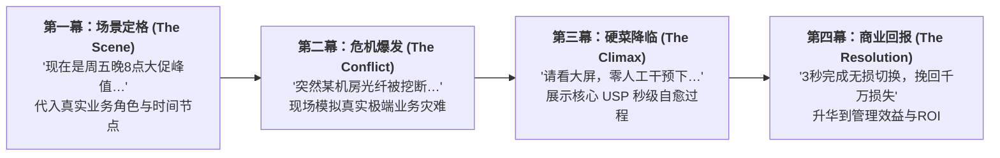
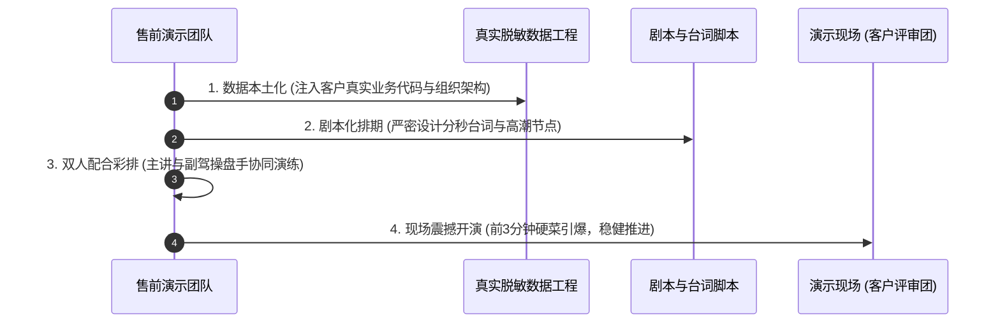

# 第37讲：产品与方案演示（Demo）：“捞干货、上硬菜”

> **【本讲一句话心法】**  
> PPT讲得再天花乱坠也只是“画饼”，唯有真实的产品演示才是端上桌的“面条”；拒绝平庸的菜单巡礼与增删改查，前三分钟端出杀手级硬菜直击业务咽喉，所见即所得才能彻底击碎客户的怀疑壁垒。

---

## 一、 场景痛点与认知破局

在经历了两轮PPT技术交流之后，客户评审团队往往已经进入**“视觉疲劳与认知麻木期”**。再高大上的架构图、再华丽的胶片，在客户眼里都只是厂商单方面的吹嘘。此时，客户最渴望看到的是**产品演示（Demo）**——“别光说不练，把你们的真家伙拉出来溜溜！”

然而，绝大多数售前在进行产品Demo时，表现堪称灾难：

```
                ┌────────────────────────────────────────────────────────┐
                │          售前演示 Demo 的四大典型灾难 (Demo Fails)         │
                └────────────────────────────────────────────────────────┘
                                           │
         ┌───────────────────┬─────────────┴─────┬───────────────────┐
         ▼                   ▼                   ▼                   ▼
   【温水煮青蛙式巡礼】 【默认测试数据假大空】 【平庸无奇增删改查】 【毫无铺垫直接跳屏】
   * 慢吞吞从登录界面点起 * 满屏张三/李四/test1 * 全程演示新增/修改/删除* 鼠标狂甩窗口乱切
   * 逐个菜单点击报菜名 * 缺乏真实业务厚重感 * 核心技术壁垒全无体现 * 客户眼花缭乱不知所云
   * 客户听了3分钟就打瞌睡* 客户认为这是外包小软件* 沦为廉价表单系统展示 * 错失最关键高潮共鸣
```

### 1. 售前产品演示的四大硬伤
* **硬伤 1：温水煮青蛙式的“菜单大巡礼”**  
  一开讲就说：“各位领导，这是系统主页，左边有系统管理、用户管理、角色权限、日志审计……”从左上角第一个菜单开始逐项向下点。讲了15分钟还没进入正题，台下有决策权的高管早就低头刷手机或借故离场。
* **硬伤 2：使用荒谬的假数据与外行术语**  
  在政企或高端制造客户面前，演示系统里充斥着“test001”、“张三”、“测试部门”、“商品A”这类极其粗糙的研发默认数据。客户看在眼里，瞬间觉得这套系统极其简陋、缺乏严肃商业沉淀。
* **硬伤 3：把演示降级为“表单CRUD增删改查”**  
  整场演示都在展示“如何新建一条记录、如何修改一个字段、如何点击保存”。客户花了上千万预算，不是为了买一套Excel网页版录入工具！这种平庸演示直接将自身拉低到初级外包软件的档次。
* **硬伤 4：缺乏场景代入感与故事线**  
  售前沉浸在自己飞快的鼠标点击中，页面窗口疯狂切换，嘴里念念有词：“点这里，再点这里，你看这个出来了”。台下客户完全跟不上节奏，不知道这个操作到底模拟了哪位员工、解决了哪个业务环节的问题。

### 2. 认知破局：“捞干货、上硬菜”的黄金法则
卓越的售前演示不是“功能操作说明书”，而是一场**“精心编排的商业大片首映礼”**：
* **什么是“干货”？**  
  干货就是**“直击客户当前最痛业务场景的闭环解法”**。不讲基础表单，直接切入核心业务枢纽（如跨部门协同审批断点、海量数据秒级穿透分析、异常故障自动化阻断）。
* **什么是“硬菜”？**  
  硬菜就是**“我方独有、友商做不到或做起来极繁琐的杀手级 USP 功能”**。在最短时间内，用最震撼的可视化与交互效果，把技术代差硬生生砸进客户的心智！
* **“高潮前置”法则**：别把好东西留到最后！客户高管通常只给你前5分钟的注意力。开局3分钟内必须端出第一道硬菜，瞬间抓住全场眼球！

---

## 二、 核心方法论与原理拆解

### 1. 售前杀手级 Demo 的“黄金叙事闭环”模型

一个能够击穿客户心智的演示Demo，必须遵循电影剧本式的四幕结构：



#### ① 第一幕：角色与场景锚定（Who & When）
* 明确当前演示是站在客户内部哪个具体角色（如“生产调度中心张主任”、“风险控制部李专员”）的操作视角；
* 设定具有时间紧迫感的业务场景，迅速拉近心理距离。

#### ② 第二幕：冲突与危机引入（Pain & Conflict）
* 在演示环境中人为制造一个业务异常、极端峰值或合规警报，直击客户平时最提心吊胆的现实痛点。

#### ③ 第三幕：端上硬菜，展现自愈与智能（The Climax - USP）
* 鼠标停住！不要胡乱晃动，引导全场目光聚焦核心控制台；
* 展现系统独创的算法机制或自动化链路，如何在几秒钟内化险为夷；
* 这就是友商绝对不敢在现场做、唯有我方能完成的“硬菜”。

#### ④ 第四幕：商业价值量化收官（Business Value）
* 将刚才的操作成果直接映射到业务报表与决策大屏，展示量化业务回报（工期缩短80%、漏斗转化提升25%）。

---

## 三、 售前实操标准动作（SOP / 打法步骤）

打造一场无懈可击的产品Demo，必须经历以下四步流水线：



### 步骤1：数据本土化工程（换掉所有“张三李四”）
* **导入客户真实业务元数据**：
  * 将演示系统中的组织架构、厂区名称、网点编号、业务产品线名称，全部替换为客户现行的真实体系；
  * 数据必须具备合理的业务逻辑与历史跨度（如真实的订单量曲线、符合季节性波动的销售数据）；
* 客户看到屏幕的第一眼就会产生亲切感：“这就是为我们量身打造的系统！”

### 步骤2：编写精确到秒的《Demo演示脚本》
* 脚本必须包含三栏：**时间轴（分钟）**、**操作动作（点哪里/输什么）**、**口播台词（FABE核心价值点）**；
* 严格剔除所有无效的空等（如长达2分钟的离线跑批），提前准备好跑批完成后的成品态页面，现场直接切屏展现最终结果。

### 步骤3：推行“双人机长驾驶制”（Pilot & Copilot）
* 真正重大的产品演示，严禁单人一边手忙脚乱敲键盘一边气喘吁吁解说！
* **主讲人（Captain/售前专家）**：站立在讲台中央，面向客户高管，眼神交流、主导演讲气场与逻辑推进；
* **操作员（Copilot/副售前或产品经理）**：坐在侧席，专注操作笔记本电脑，严格根据主讲人的语速与口令精准点击页面，鼠标平滑移动、适时放大高亮核心指标。

### 步骤4：高潮前置，先声夺人
* 开场第1分钟：跳过登录页，开机即全景驾驶舱大屏；
* 开场第3分钟：直接启动最震撼的硬菜（如动态知识图谱实时推演、分布式故障一键注入测试）；
* 彻底征服高管后，再根据技术评委的兴趣，逐步拆解底层的配置引擎与规则编排。

---

## 四、 实战工具箱、话术与Checklist

### 1. 售前演示“硬菜化”改造对照表

| 传统平庸演示（烂菜/渣男式演示） | 改造后的杀手级硬菜演示（捞干货/上硬菜） | 客户心智震撼点 |
| :--- | :--- | :--- |
| 从登录页输入 admin/123456，演示如何进入用户列表新增一个操作员。 | 直接展示“零信任生物识别与动态权限引擎”：当异地非法设备接入时，系统如何在0.1秒内触发风控阻断并短信警报。 | 安全合规与顶级防黑客入侵能力。 |
| 演示如何点击“报表统计”，等待1分钟后导出一张包含50条记录的Excel表格。 | 演示“百亿级实时时序穿透”：在大屏上随机圈选任意时间段，系统在300毫秒内完成数十亿条数据的多维切片与热力图渲染。 | 大数据底座极致性能与算力碾压。 |
| 演示“工单系统”：点击新建工单，手动选择处理人张三，点击提交。 | 演示“AI智能调度大脑”：模拟突发30起并发报警，算法引擎在3秒内根据全国各工程师技能矩阵、地理距离与拥堵路况，全自动完成最优工单派发路线规划。 | 人工智能真正解决核心调度效率瓶颈。 |

### 2. Demo 现场演练核心 Checklist

> [!TIP]
> 登台演示前10分钟，操作员（Copilot）必须逐项确认的“硬菜检查单”：
> - [ ] **浏览器环境纯净度**：所有无关书签栏隐藏、历史搜索记录清空、下载管理栏关闭、屏蔽所有即时通讯软件（微信/钉钉）弹窗！
> - [ ] **账号权限就绪**：演示账号是否已预先登录？Token是否设置为不过期（防止演示中途弹回登录页）？
> - [ ] **数据与缓存预热**：核心页面的静态资源与初始数据是否已在本地缓存预热，确保点击瞬间毫秒级秒开？
> - [ ] **分辨率与缩放锁定**：屏幕缩放比例是否调至125%或150%，确保后排评委能够清晰看清所有字号？
> - [ ] **快捷键与双屏同步**：演示模式是否设置为“复制屏幕”，主讲与操作员视线是否保持无缝对齐？

---

## 五、 真实标杆案例深度复盘

### 【案例背景】某国家级物流中枢智能调度中台比选

* **情景 (Situation)**：某拥有数十万辆干线货车的国家级物流集团启动智能运力调度中台选型，项目标的超3000万元。入围决选的是具有外资背景的老牌供应链软件公司S公司与国内本土自研智能运筹决策厂商C公司。
* **冲突 (Task)**：在方案评审阶段，S公司售前洋洋洒洒讲了两个半小时PPT，随后安排了整整一个小时的Demo演示。然而S公司的Demo完全是老旧ERP界面的翻版，操作员在无数个层级菜单中反复跳转，全场领导与调度专家看得哈欠连天，副总裁多次低头看表。
* **行动 (Action)**：
  1. **C公司售前的战略逆袭**：C公司售前团队深知，集团副总裁最痛心的隐患是**“每逢春运或恶劣雨雪天气，全国干线跨省运力出现大面积瘫痪，调度员靠手工打电话调车导致空驶率飙升，每天损失数百万”**；
  2. **开场直接端上暴风雪硬菜**：
     * **开场第60秒**：C公司副驾操作员在大屏上投射出全国干线货运实时动态拓扑图，数十万辆虚拟车辆在屏幕上如繁星点点实时移动；
     * **开场第120秒（制造危机）**：售前主讲人手持激光笔宣布：“各位领导，现在我们模拟全国遭遇50年一遇特大暴雪，京港澳高速全线封闭！”操作员在控制台一键注入“暴雪封路事件”；
     * **开场第180秒（硬菜爆破）**：大屏瞬间亮起红色告警，紧接着，C公司自研的分布式运筹引擎在8秒钟内，全自动完成华北至华南3800趟在途班车的动态路径智能重规划，大屏幕上绿色的替代迂回线路行云流水般自动铺开，并在右侧实时测算出“油耗仅增加2.1%，整体履约延误控制在4小时以内”；
  3. **现场让客户亲手试驾**：售前主动把无线鼠标递给台下的调度处长：“王处，您现场随便指定封掉哪条省道，看看我们的大脑多久能算完！”调度处长现场盲测，系统再次秒级完美重算。
* **结果 (Result)**：副总裁直接站起身来大力鼓掌：“这才是真正具备实战杀伤力的智能大脑！比那些摆弄报表的系统强太多了！”C公司当场锁定技术评审第一名，并最终全票中标。

---

## 六、 血泪教训与避坑红线

> [!WARNING]
> **红线 1：严禁让客户在一旁无聊地等待系统“漫长的沙漏转圈”**  
> 很多复杂业务涉及大量后台运算（如MRP运算、海量对账、模型训练）。如果让台下几十位高管盯着屏幕上的“Loading…正在计算中”干等两分钟，交流氛围会瞬间降至冰点。必须采用“影视预制件法”：前端点击触发计算后，主讲人一句话说明原理，随即无缝切入预先跑好的计算结果页面！

> [!CAUTION]
> **红线 2：严禁现场演示未经彻底验证的半成品实验功能**  
> 有些售前为了吹嘘创新，把研发昨晚刚推上测试分支、连自测都没做完的实验模块拿来给客户演示。只要稍有异常报错、出现红色控制台报错堆栈（500 Internal Server Error），客户就会瞬间对整个系统的基本成熟度产生毁灭性怀疑！

---

## 七、 课后思考题与实战研讨指南

### 思考题 1
当你负责演示的一款企业级软件产品，其界面UI相对传统老旧、视觉冲击力不如主打华丽大屏的新兴友商时，你应如何运用“捞干货、上硬菜”的打法，扬长避短，将客户的关注焦点彻底锁定在我方的深度业务价值与复杂逻辑处理能力上？

> **【实战研讨指引】**  
> 1. **开场抢先确立价值标准**：“各位领导，好看的皮囊千篇一律，可靠的灵魂万里挑一。企业级核心生产系统不是给消费者看的娱乐App，而是每天承载数百亿资金流的重器，它的核心价值在于底层逻辑的极致严密与零差错”；  
> 2. **上最硬的硬菜（极限业务穿透）**：避开泛泛的仪表盘，直接演示极度复杂的边缘业务场景（如跨币种超长账期复杂返利结算、跨十个部门的多级条件嵌套回溯）；  
> 3. **反衬友商华而不实**：通过实操证明，友商虽然界面绚丽，但面对这种真实复杂的工业级业务逻辑根本无法配置落地，反显我方的厚重与扎实。

### 思考题 2
在“双人机长制”演示中，主讲人（Pilot）与操作员（Copilot）之间应当建立怎样的无声默契与沟通暗号，以确保演示节奏水乳交融、如同一人？

> **【实战研讨指引】**  
> 1. **语速与停顿暗号**：主讲人每当讲出特定的核心关键词（如“请大家看右下角的实时状态变化”）时，操作员鼠标必须提前半秒悬停在该区域，并用激光红圈或放大镜功能高亮；  
> 2. **突发卡顿的眼神对齐**：若操作员遇到网络微抖、页面加载稍慢，必须立即给主讲人一个轻微手势；主讲人立即顺畅展开背景案例讲解（展开说30秒），绝不在台上陷入尴尬冷场；待操作员完成页面加载后，主讲人再自然转回屏幕，浑然天成。
