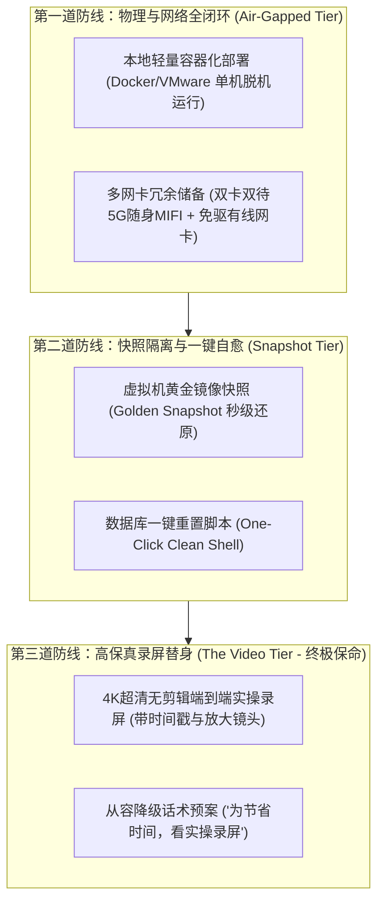
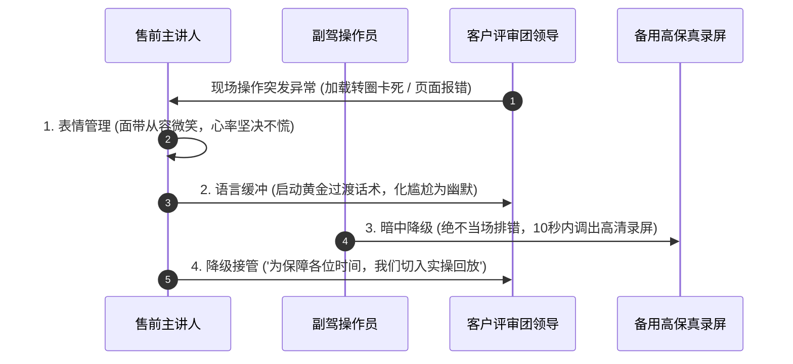

# 第38讲：破解演示“墨菲定律”：Demo现场翻车排查与兜底容灾

> **【本讲一句话心法】**  
> 凡是可能出错的演示，就一定会以最惨烈的方式在最重要的客户面前出错；真正的演示大师从不心存侥幸，而是通过全闭环离线环境、快照重置与高保真录屏替身构筑三道钢铁防线，将墨菲定律彻底锁死在笼子里。

---

## 一、 场景痛点与认知破局

在所有售前实战场景中，**“现场产品演示（Demo）翻车”**堪称售前职业生涯中最具毁灭性、最让人头皮发麻的噩梦：

```
                ┌────────────────────────────────────────────────────────┐
                │          演示现场“墨菲定律”的连环暴击 (The Murphy's Law)   │
                └────────────────────────────────────────────────────────┘
                                           │
         ┌───────────────────┬─────────────┴─────┬───────────────────┐
         ▼                   ▼                   ▼                   ▼
   【客户现场断网】     【云端服务突然宕机】  【数据库连接超时】   【浏览器白屏崩溃】
   * 客户会议室屏蔽4G  * 依赖的SaaS端维护更新 * 演示数据被同事修改   * 突发500红色报错
   * 现场WiFi连不上外网 * 第三方依赖接口超时  * 脏数据触发系统死锁   * 内存泄露界面卡死
         │                   │                   │                   │
         └───────────────────┴─────────────┬─────┴───────────────────┘
                                           ▼
                           【现场惨状：毁灭性信任塌方】
                 售前满头大汗手忙脚乱，现场开终端查日志排查半小时
                 台下客户领导相视苦笑，私下评价：“这破系统根本没法用”
```

### 1. 现场演示掉链子的三大诱因
* **诱因 1：盲目迷信客户现场网络环境**  
  以为客户会议室肯定有高速WiFi，或者自己手机热点肯定能用。殊不知大型银行、国央企、涉密机关的会议室往往配备了全频段无线电屏蔽仪，或者客户访客WiFi严格封禁了非标准端口（如8080、9000、SSH），导致云端演示环境根本无法连通。
* **诱因 2：云端多人共用演示环境的“踩踏悲剧”**  
  演示环境部署在公司公用公网服务器上。正好在你在客户现场演示的同时，另一位异地同事在环境里导入了一批测试脏数据，或者公司研发在后台悄悄重启了微服务网关，导致正在向客户展示的页面瞬间弹窗报错。
* **诱因 3：缺乏降级兜底方案，临场当众“修电脑”**  
  一旦出现报错，缺乏经验的售前立刻慌了手脚，当着满屋子高管的面打开F12控制台，甚至打开终端命令行看Java报错堆栈、试图现场SSH上去改配置。在非技术背景的业务决策者看来，这一幕极其灾难——**他们不会理解这是网络波动，只会直接判定你的产品极其不成熟、充满Bug！**

### 2. 认知破局：墨菲定律的不可避免与容灾防御
* **墨菲定律（Murphy's Law）是真实存在的客观规律**：*“如果事情有变坏的可能，不管这种可能性有多小，它总会发生。”* 在公司办公室自测过100遍顺畅的流程，到了客户现场，由于硬件转接头松动、屏幕分辨率缩放、网络握手延迟等微小变量的扰动，系统崩溃是大概率事件。
* **成熟售前的标志是“具备多层容灾防空网”**：顶级售前绝不祈求运气，而是把每一次现场演示都预设为“系统必崩、网络必断、电脑必挂”的极限生存挑战，提前在本地部署好三道坚不可摧的冗余防线！

---

## 二、 核心方法论与原理拆解

### 1. 演示抗毁性三道钢铁防线模型（The 3-Tier Defense System）

为彻底战胜墨菲定律，售前团队必须构筑“本地全闭环、快照可逆、替身录屏”三道递进式防御工事：



#### ① 第一道防线：物理与网络全闭环（能单机绝不上公网）
* **脱机单机环境是王道**：核心演示业务系统必须经过轻量化裁剪，打包进本地笔记本的 Docker 容器或独立虚拟机（VMware/VirtualBox）中。无论外界是否断网、无论公网服务器是否宕机，单机本地回路（localhost/127.0.0.1）均可100%流畅运行！
* **网络多路冗余**：随身携带5G随身MIFI（与手机卡分属不同运营商，如电信+移动），并备齐USB免驱有线网线转接头。

#### ② 第二道防线：状态快照与一键自愈（数据防污染）
* **锁定“黄金初始态”**：在演示前一天晚上，将系统调试至最完美状态，导入所有规范业务数据，并在虚拟机或数据库层面打下 `Golden_Demo_Snapshot` 快照。
* **防呆重置指令**：编写一键 Shell 脚本（如 `sh reset_demo.sh`），在3秒内清空所有脏数据，恢复纯净初始态，杜绝连续多次演示导致的状态污染与死锁。

#### ③ 第三道防线：终极替身——高保真无剪辑实操录屏（The Golden Video）
* **保命录屏不是普通宣传片**：必须是在真实开发/测试环境中录制的、**连续完整、无剪辑、鼠标轨迹真实、带关键输入过程与时间戳**的高保真无损实操录屏。
* **极端情况下的从容降级**：一旦现场遭遇本地电脑蓝屏、断电或不可抗力导致系统无法启动，售前微笑着以极高情商切换录屏，将事故化解于无形。

---

## 三、 售前实操标准动作（SOP / 打法步骤）

在演示现场遭遇突发系统卡死或报错时，现场售前必须严格执行以下四步“自救与降级 SOP”：



### 步骤1：极致的表情与情绪管理（扑克脸法则）
* 哪怕屏幕上弹出了巨大的红色“500 Error”，主讲售前的脸上**绝不能露出惊恐、倒吸凉气或懊恼的神态**！
* 保持身姿挺拔、面带专业微笑，给客户的第一心理暗示是：“这只是一个预期中的微小状态，一切尽在掌握”。

### 步骤2：启动“语言缓冲垫”，杜绝现场冷场
* 严禁全场陷入长达几十秒的死寂！主讲人必须立即开口，将客户目光从报错屏幕吸引到自己身上：
  * *话术范例*：“各位领导，刚才这个毫秒级状态，恰恰体现了真实分布式生产环境下网络重试机制的严密性……”或者轻巧化解：“看来现场的投影网络比我们预期的还要严苛，正好触发了系统的安全熔断。”

### 步骤3：暗中操作，坚决杜绝现场排错查日志
* 副驾操作员（Copilot）在30秒内尝试一次轻度刷新或本地快照重置；
* **铁律红线**：如果重置后依然无法恢复，**严禁打开命令行查日志、严禁现场改配置文件、严禁给研发打电话求救！**
* 操作员在后台静默打开预先准备好的高保真录屏文件，全屏暂停在出问题的这一步界面。

### 步骤4：优雅执行“录屏降级切换”
* 主讲人顺理成章接过话头：“各位领导的时间非常宝贵，为了不浪费大家的会议时间，我们直接切换至我们在标准测试实验室中录制的端到端全真无损实操流程，请大家看大屏幕……”
* 录屏播放过程中，主讲人继续手持翻页笔，配合视频进度进行精彩的FABE价值讲解，客户不仅不会责怪，反而会对你的严谨准备与沉着风度肃然起敬！

---

## 四、 实战工具箱、话术与Checklist

### 1. 现场翻车危机降级话术速查表

| 突发事故场景 | 绝对禁止的灾难反应 | 专业高情商降级话术（反败为胜） |
| :--- | :--- | :--- |
| **页面持续转圈，网络请求超时卡死** | “哎呀，怎么卡住了？王工你快看看是不是网络断了？你们会议室WiFi密码是多少？” | “各位领导，目前这个模块正在向远端节点同步数万条跨区域账目。由于目前连接的是现场无线临时热点，上行带宽受到了一定限制。为了不耽误各位领导的宝贵时间，我们直接切入预先录制的高清实操演示，向大家展示同步完成后的秒级账务对账大屏！” |
| **突发系统弹窗报错（如 NullPointerException）** | “卧槽怎么报错了？研发昨晚明明说修好了啊！对不起各位领导，我看一下后台日志。” | “大家请看，这正是系统内置的异常边界保护机制——当捕获到非标非法输入时，底层会强制阻断并生成核心审计工单，杜绝非法脏数据污染底层数据库。关于后续的完整审批闭环，我们切换到备用验证视图为大家继续呈现。” |
| **笔记本电脑突发黑屏/蓝屏重启** | 呆立当场、手忙脚乱狂按开机键、满头大汗、不知所措。 | （微笑着离开电脑台，走到白板前）“看来我的电脑也承受不住刚才海量算力的澎湃激情，选择自我保护性重启了！正好借这个机会，我用一分钟在白板上为大家徒手拆解刚才那个算法的底层状态机流向……”（同时副驾迅速换上备用电脑接管）。 |

### 2. 墨菲定律终结者战前巡检 Checklist

> [!TIP]
> 每次重大 Demo 进场前2小时，必须严格核对的“防翻车十道保险”：
> - [ ] **脱机单机闭环**：本地 Docker/虚拟机镜像是否已在“断开所有网络（拔掉网线+关闭WiFi）”状态下完整跑通全流程？
> - [ ] **保命录屏就绪**：高清晰4K录屏文件是否已拷贝在笔记本桌面，且播放器进度条与全屏快捷键测试正常？
> - [ ] **双网卡物理备用**：5G随身MIFI电量是否为100%？手机热点是否已预先配对？
> - [ ] **电源性能模式**：笔记本是否已接通电源插座？电源管理是否已设置为“高性能模式”，并关闭“自动休眠/屏幕息屏”？
> - [ ] **演示快照还原**：虚拟机或数据库快照是否已在出发前恢复至最纯净的 Golden State？
> - [ ] **投屏分辨率锁定**：是否已在主讲电脑上将桌面分辨率固定为通用的 1920x1080，避免投屏时窗口变形错位？
> - [ ] **双机热备准备**：副驾操作员的备用电脑是否也同步配置了完全相同的本地运行环境？

---

## 五、 真实标杆案例深度复盘

### 【案例背景】某千亿能源巨头智慧电厂实时监控平台现场演示翻车自救

* **情景 (Situation)**：某千亿级能源央企启动智慧电厂集控大数据平台选型。国内工业互联网领军企业D公司受邀赴北京总部，向集团副总裁、总工程师及十位电厂厂长进行现场产品演示。
* **冲突 (Task)**：
  1. 恶劣环境限制：集团核心会议室位于地下二层机房旁，不仅没有任何外网WiFi，手机信号更是完全被金属屏蔽墙阻断（零格信号）；
  2. 突发硬件冲击：在演示前10分钟，由于会场老旧插座电压瞬间大幅抖动，D公司售前的主力演示工作站电源适配器当场烧毁冒烟，电脑瞬间断电关机！
* **行动 (Action)**：
  1. **零延迟启动双机热备**：面对冒烟的适配器，主讲售前老胡神色自若，微笑着向总工程师致歉：“总工，看来我们今天带来的方案能量太充沛，直接测出了贵司会议室排插的过载保护阈值！”同时，副驾售前在15秒内从背包中取出备用的MacBook，迅速插入HDMI投影接口；
  2. **脱机闭环从容启动**：备用机中预先部署了轻量化Docker环境与十万级模拟机组传感器时序数据，完全不依赖任何外部网络；
  3. **突发报错时的教科书级录屏降级**：
     * 在演示到第15分钟“汽轮机叶片震动智能预测算法”时，由于备用机内存较小，本地Java进程遭遇 OOM（内存溢出）导致浏览器卡死；
     * 副驾售前没有试图去重启Docker，而是在5秒内以快捷键全屏切换出预先录制的《汽轮机异常预测端到端实操无损录屏》；
     * 老胡行云流水地接过解说：“各位厂长请看，这是我们在某大型超超临界发电机组上进行的实测过程，请注意看右下角这个黄色异常时序点……”老胡手持翻页笔，精确卡点解说录屏中的每一步数据跳动，全场领导聚精会神，完全没有意识到刚才发生了本地内存溢出；
  4. **白板推演彻底锁定胜局**：录屏播放完毕后，老胡走向白板，用5分钟将算法的核心差分方程画在白板上，彻底打消了专家对技术真实性的疑虑。
* **结果 (Result)**：总工程师在会后总结时高度评价：“D公司不仅技术底蕴极深，团队的应急素养与专业心理素质更是令人惊叹，把系统交给这样的铁军我们心里踏实！”D公司最终力压对手顺利斩获该千万级大单。

---

## 六、 血泪教训与避坑红线

> [!WARNING]
> **红线 1：严禁在客户现场借用客户的内部电脑临时部署或配置演示系统**  
> 永远不要相信“到了现场再借客户电脑装环境”的荒唐想法！客户电脑通常安装了极其严苛的内网杀毒软件、终端监控（如EDR、天擎），不仅会拦截各种端口和脚本，甚至会将演示软件直接误报为病毒并上报违规，直接在客户内部引发严重的安全合规事故！

> [!CAUTION]
> **红线 2：严禁现场给公司研发或技术支持打外放电话求救**  
> 在演示翻车时，最愚蠢的行为就是在客户全场注视下，打开手机免提打电话给研发：“喂张工，这个页面怎么500报错了啊？快帮我看看数据库！”台下的客户会瞬间对你的方案彻底绝望——连自己人都搞不明白的半成品，谁敢买来当核心生产系统？

---

## 七、 课后思考题与实战研讨指南

### 思考题 1
为什么在企业级售前演示中，“高保真无剪辑实操录屏”被誉为破解墨菲定律的“终极核武器”？制作一份合格的保命演示录屏，必须满足哪四项硬性技术标准？

> **【实战研讨指引】**  
> * **战略价值**：录屏彻底切断了对网络、外部算力、数据库连接、甚至硬件稳定性的依赖，将不确定性降为零；在发生不可抗力时，能保住交流节奏，守住专业底线。  
> * **四项硬性标准**：  
>   1. **全链路真实无剪辑**：严禁出现跳帧、花哨转场或特效包装，必须还原真实鼠标移动轨迹、输入速度与界面自然加载（真实感第一）；  
>   2. **4K/1080P超清无损分辨率**：在大屏幕上播放时字体锐利，绝不模糊；  
>   3. **清晰关键节点时间戳**：标注出各个功能场景的精确分秒（便于现场根据客户提问精准跳播拖动）；  
>   4. **关键细节高亮放大**：在展示核心指标、参数变动时有平滑的局部放大，方便后排评委清晰审阅。

### 思考题 2
如果在演示现场，客户一位极其懂底层技术的主管识破了你由于环境卡死而切换了录屏，并在现场当面指出：“张工，你现在放的是录好的视频吧？能不能现在在真实系统里现场点给我看？”面对这一突发尖锐挑战，你该如何以最高的情商与技术自信从容化解？

> **【实战研讨指引】**  
> 1. **坦荡承认，以真诚化解戒备**：“李处真是好眼力，目光如炬！确实，刚才因为现场网络环境触发了连接重试，为了保证在座十多位领导宝贵的时间不被网络缓冲耽误，我们主动切换到了上周在全真测试集群下录制的端到端验证过程”；  
> 2. **迎难而上，展现铁军底气**：“不过您完全不用担心系统真实性！正好此时我们的本地脱机镜像已经完成自愈重启。李处，请您现场移步或者指定任意一组非标业务参数，我现在立即在真实系统里为您现场跑一遍，接受您的严苛检验！”；  
> 3. **将危机转化为展示系统自愈与售前实力的绝佳舞台**。
