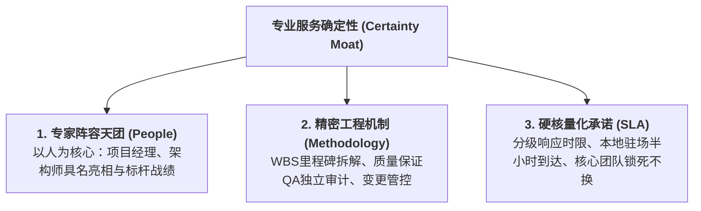
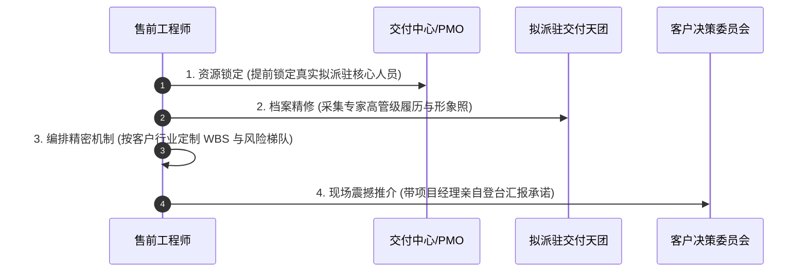

# 第39讲：专业服务与交付能力包装：“以人为核心”传递确定性

> **【本讲一句话心法】**  
> 在企业级项目中，软件与硬件从来只是半成品，决定成败与客户信心的终极要素是交付服务；抛弃空洞的套话承诺，以顶级专家阵容为核心、以精密交付机制为骨架，才能为客户构筑不可动摇的确定性。

---

## 一、 场景痛点与认知破局

在企业级 IT 市场中，绝大多数项目（包括方案咨询、大型定制开发、复杂系统集成、数据治理与运维运营）都属于**“强人力属性的非标工程”**。然而，绝大多数售前工程师在准备技术评估材料时，却常常陷入严重的**“重产品轻服务盲区”**：

```
                ┌────────────────────────────────────────────────────────┐
                │          服务能力展示的四大致命误区 (Service Blindspots)   │
                └────────────────────────────────────────────────────────┘
                                           │
         ┌───────────────────┬─────────────┴─────┬───────────────────┐
         ▼                   ▼                   ▼                   ▼
   【95%讲产品5%凑服务】 【千篇一律套话模板】 【只谈组织不谈活人】 【避谈外包转包黑盒】
   * 讲了90页产品架构  * "7x24小时响应"       * PPT上放个空洞组织树 * 客户最怕中标后被层层转包
   * 服务只留最后两页  * "终身保修终身维护"   * 全是抽象部门名     * 害怕派刚毕业的外包实习生
   * 客户认为毫无诚意  * 毫无可操作性与约束力 * 没有活生生专家的背书 * 沦为烂尾工程的不安深渊
```

### 1. 客户采购大型方案时的最大隐秘恐惧
在技术评估中后期，客户技术与业务领导最提心吊胆的其实不是功能缺少一个按钮，而是**“项目烂尾与交付翻车”**：
* **“画饼大师与草台班子割裂”**：很多乙方售前在交流时讲得天花乱坠、专业得体，一旦中标签约，售前撤场，进场交付的却是一群从外包市场临时抓壮丁拼凑的初级程序员。连基本的业务名词都听不懂，项目进度一拖再拖，最终变成半瘫痪的烂尾工程。
* **“承诺很丰满，响应像蜗牛”**：合同前承诺“随叫随到”，系统上线一旦出Bug，打电话找不到人，提工单三天才回复，故障排查拖延数周，导致客户业务主管在领导面前挨批评、甚至丢掉乌纱帽。
* **“核心骨干走马灯式轮换”**：项目刚做两个月，熟悉业务的项目经理和架构师突然离职或被抽调去其他大项目，新来的人员重新踩坑，客户沦为乙方的“新人培训基地”。

### 2. 认知破局：“以人为核心”的确定性溢价
* **技术方案买的是“预期”，服务交付买的是“确定性”**：硬件和标准软件包在出厂时只是“毛坯房”，唯有依靠高水平的专业交付团队，才能将其精装修为客户真正能住进去的“业务豪宅”。
* **人是服务的唯一载体**：抛弃那些冰冷的组织机构代码！客户要看的不是“XX售后服务部”这几个字，而是**究竟是谁、叫什么名字、长什么样、操盘过什么标杆大仗、具备什么权威认证、是否愿意亲自驻场在现场流血流汗！**

---

## 二、 核心方法论与原理拆解

### 1. 专业交付服务“确定性铁三角”模型

在技术评估交流中，包装交付服务能力必须遵循“专家天团、精密体系、硬核SLA”三维铁三角：



#### ① 专家阵容天团（具名化、场景化、标杆化）
* 拒绝抽象岗位描述，直接亮出拟派驻该项目的核心铁三角履历：
  * **项目总监 / 资深项目经理（PMP/PRINCE2）**：具有10年以上同行业同规模项目管理操盘经验，必须列出其主持过的2~3个业界知名大项目的真实名称与实施规模；
  * **首席系统架构师（TOGAF）**：深谙高并发与客户底层遗留系统的技术老兵，主导过行业顶级灾备或中台迁移；
  * **资深业务咨询顾问**：懂客户业务语言，甚至曾在同类标杆企业业务部门任职过，能无缝充当业务与IT的翻译官。

#### ② 精密工程机制（让客户看到交付的钟表级严密性）
* 展示标准实施方法论（如基于 CMMI5 / DevOps 的双轨敏捷交付流水线）；
* 呈现详尽的项目 WBS（工作分解结构）甘特图：从环境准备、接口联调、数据清洗、灰度割接到双轨并行运行；
* 亮出“变更控制委员会（CCB）”与“三级风险升级响应机制”，让客户确信发生分歧时有法可依。

#### ③ 硬核 SLA 量化承诺（打破空洞套话）
* 制定 P1 至 P4 四级故障分类与毫秒级响应承诺；
* 关键条约锁定：**“合同核心团队成员在项目初验通过前承诺零轮换；若因不可抗力离职，必须提前1个月以同等或更高资质人员无缝交接，并承担相应的商务违约责任”**。

---

## 三、 售前实操标准动作（SOP / 打法步骤）

在技术交流材料编排中，售前应执行以下四步标准化服务包装打法：



### 步骤1：战前真实锁定与“拒当假承诺”
* 与公司交付VP或PMO负责人召开专项协调会，根据项目规模与战略重要性，白纸黑字锁定拟派驻的项目经理与核心架构师；
* 坚决杜绝“售前拿名嘴架构师挂名骗标、中标后换实习生”的恶劣行径。

### 步骤2：人物画像精细化包装（明星化档案）
* 收集核心人员的高清商务形象照（西装革履、神采奕奕）；
* 提炼每位专家的“核心标签”与“高光战绩”：
  * *范例*：“王牌项目经理老李：15年金融IT老兵，曾操盘全国首个某股份制银行核心系统不停机秒级割接，获中国人民银行科技发展奖二等奖”。

### 步骤3：定制化实施路线图与保障蓝图编制
* 结合客户实际业务周期（如财年结算、电商大促、年中报表），避开客户业务洪峰，量身编制项目实施里程碑；
* 规划双轨试运行（Parallel Run）与业务回滚兜底预案，彻底打消业务主管的上线恐慌。

### 步骤4：关键交流中带“项目经理亲临现场答辩”
* 在第二轮技术交流或高层汇报中，**直接把拟派驻的项目经理带到客户现场！**
* 由项目经理亲自上台讲解后半段的服务交付方案，并由其亲口向客户领导立下军令状：“各位领导，如果贵司信任我们，我将带领驻场团队从下周一开始与贵司并肩作战，我本人对项目的按时上线负终身责任！”这一动作的商业杀伤力足以秒杀任何竞品的空洞胶片！

---

## 四、 实战工具箱、话术与Checklist

### 1. 售前交付服务能力展示对比与话术库

| 章节维度 | 传统平庸展示（扣分项） | 顶级专业包装（加分溢价项） | 客户心智说服点 |
| :--- | :--- | :--- | :--- |
| **团队介绍** | 放一张通用的公司组织架构图，罗列“项目经理1人、开发5人、测试2人”。 | 放出核心团队三名骨干的商务形象照、姓名、从业年限、权威国际认证（PMP/CISSP/TOGAF）及主导过的同行业前三大标杆案例。 | 客户感觉“来的是一支正规精锐部队，而不是临时拼凑的游击队”。 |
| **响应时效** | 简短写一句：“提供7x24小时电话与网络支持，提供终身免费升级维护”。 | 细化为《P1~P4分级保障矩阵》：P1级致命故障10分钟响应、30分钟原厂专家抵达现场、2小时内提供应急Workaround恢复业务运行，否则按小时扣减维保款。 | 权责极其对等、量化可考核，客户安全感拉满。 |
| **人员防流失** | 完全不提人员更替，或者被客户追问时支支吾吾：“一般情况下人员是稳定的”。 | 主动设立《关键人员锁定与稳定性红线条款》：核心架构师与PM在上线前签署专职承诺书，若非客户认可的不可抗力离职，乙方自愿扣罚合同额5%作为补偿。 | 展现压倒性的诚意，彻底粉碎客户对“外包转包、人员跑路”的疑虑。 |

### 2. 专业交付服务包装 Checklist

> [!TIP]
> 检查交流胶片中交付服务章节的“确定性指标”：
> - [ ] **具名化审视**：胶片中是否出现了至少两名核心骨干的真实姓名、履历与照片？
> - [ ] **标杆对标**：拟派专家的过往操盘案例是否与当前客户的业务体量同级或更高级？
> - [ ] **本地化半径**：是否明确了本地技术支持中心的物理距离（如“距离贵司仅3公里，常驻15名资深工程师”）？
> - [ ] **回滚保障**：实施方案中是否明确了系统割接失败时的“一键回滚与无损退回”方案？
> - [ ] **知识转移**：是否包含了成体系的《客户IT团队赋能与知识转移培养计划》（从扶上马到送一程）？

---

## 五、 真实标杆案例深度复盘

### 【案例背景】某千亿省级公用事业集团核心收费中台选型大对决

* **情景 (Situation)**：某省水务及能源公用事业集团启动全省数千万户居民核心计量与收费中台升级，总预算超2500万元。入围最终决选的是国内两大软件集团——综合实力雄厚的央企背景集成商Z公司与垂直领域龙头Y公司。
* **冲突 (Task)**：在产品功能评估上，两家企业得分平分秋色，均能较好满足业务需求。此时，决定胜负的焦点完全转移到了**“实施与交付保障”**上。客户科技部副总私下透露：“前年上的某系统因为乙方项目经理中途换了三次，直接烂尾了八个月，被集团领导在全省通报批评。这次谁能证明交付不出事，谁就是赢家！”
* **行动 (Action)**：
  1. **Z公司的致命失误**：Z公司售前依然按照惯性思维，在交付章节照搬了标准PPT模板，只放了一张抽象的“矩阵式项目管理图”，通篇都是“以客户为中心、全力以赴”的空话。面对客户副总关于“具体谁带队来现场”的询问时，售前含糊表示“中标后公司会统一指派资深骨干”；
  2. **Y公司的王炸服务攻势**：
     * **全明星团队现场亮相**：Y公司在交流现场直接邀请了拟派驻的项目总经理老马出席。老马不仅在现场做了自我介绍，更展示了其此前成功主导两家相邻省水务集团同类系统割接的验收报告与客户感谢信；
     * **推出“防烂尾六道防线”**：Y公司递交了一份独立的《全生命周期工程风控白皮书》，明确了全省分批割接的平滑过渡机制，详尽设计了应急离线收费方案；
     * **签下法律级承诺书**：Y公司副总裁当场向客户递交了盖有公司公章的《核心团队锁定承诺书》，承诺老马及核心架构师若在项目初验前非因健康原因离职，Y公司将直接按日赔偿违约金。
* **结果 (Result)**：评审团全票将服务与实施维度的最高分打给了Y公司。客户副总评价：“Y公司的方案让我们看到了活生生的人和钢铁般的纪律，我们晚上终于能睡个踏实觉了！”Y公司以综合第一名顺利拿下该千万级大单。

---

## 六、 血泪教训与避坑红线

> [!WARNING]
> **红线 1：严禁在售前胶片中假借“大牛架构师”挂羊头卖狗肉**  
> 有些不讲武德的团队，在售前交流PPT中把公司唯一的顶级总架构师简历放上去，向客户承诺由其挂帅；然而一旦中标，大牛甚至连项目现场的大门都没迈进过一步，全派实习生进场。这种欺诈行为一旦被客户揭穿，客户会直接扣押项目款、发起违约索赔，并在整个行业圈子里将该供应商彻底拉黑！

> [!CAUTION]
> **红线 2：严禁对超出工程可行性的交付工期“盲目迎合”**  
> 客户经常提出不切实际的极限工期（如正常需要半年的工程要求一个月上线献礼）。平庸售前为了讨好客户拍胸脯说“能搞定”，结果上线时Bug海量爆发引发系统瘫痪。专业售前应在服务方案中展示严密的“多阶段灰度敏捷交付策略”——第一阶段保证核心可用，次要模块平滑迭代，用科学的工程规律化解政治工期危机。

---

## 七、 课后思考题与实战研讨指南

### 思考题 1
为什么在企业级非标软件项目中，空洞承诺“7x24小时响应，终身免费维护”不仅无法赢得客户信任，反而会让具备丰富采购经验的客户专家感到极度不专业、甚至心生反感？

> **【实战研讨指引】**  
> * **违反商业与经济学常识**：天下没有免费的午餐，任何高质量的商业技术服务都伴随着高昂的人力与算力成本。“终身免费”往往意味着“终身不负责”，属于标准的廉价营销套话；  
> * **缺乏可操作性与责任约束**：未定义什么是响应（电话接通算响应还是故障解决算响应）、未定义响应级别、未定义违约赔偿机制；  
> * **展现专业严谨性**：成熟客户更尊重**“权责清晰、分级严密、有偿且有硬性违约考核的专业SLA机制”**，这才是商业契约精神的体现。

### 思考题 2
请为你当前主攻的一个重点项目，设计一份能让客户高层眼前一亮的《核心交付团队人物看板（Profile）》。除了常规的工作年限与学历，你将挖掘哪些最具商业杀伤力的维度与细节来彻底打消客户的烂尾焦虑？

> **【实战研讨指引】**  
> * **高光战斗勋章（Battle Badges）**：突出其主导过的与客户体量、技术复杂度最接近的标杆大项目（如“曾操盘XX千亿集团核心计费重构”）；  
> * **权威行业资质背书**：列举国家软考系统分析师、PMP、国际顶级云厂商认证架构师等硬核证书编号；  
> * **极限危机处理经历（Crisis Management）**：一两句话提炼其在过往项目中化险为夷的传奇战绩（如“曾在某重大电力事故中带领团队在2小时内完成百台集群无损拉起”）；  
> * **贴身服务承诺宣言**：由专家本人亲笔签名的个人服务承诺语与驻场声明。
