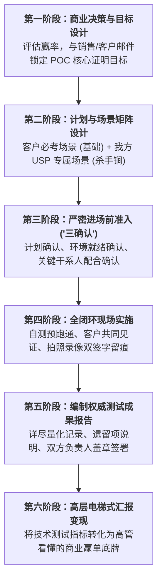

# 第40讲：概念验证（POC）测试控制：克制进场、设定边界、锁定标准

> **【本讲一句话心法】**  
> POC从来不是免费的技术苦力大奉送，而是高成本、高消耗的商业绞肉机；“不要着急进场”重要的话说三遍，唯有克制决策、书面锁死测试环境与验收标准，才能避免沦为陪标打酱油的炮灰。

---

## 一、 场景痛点与认知破局

在技术评估阶段，**概念验证（POC - Proof of Concept）**往往是客户检验供应商真实成色的“试金石”，也是所有乙方售前团队面临的最残酷考验。一次大型企业级项目的POC（如金融级核心账务压测、工业级大数据全量接入、大规模5G专网实测），乙方动辄需要投入数名资深架构师驻场数周甚至数月，消耗的硬件、算力与人力成本高达数十万乃至上百万元！

然而，在面对客户提出的 POC 需求时，许多团队却陷入了严重的**“盲目冲动与被动泥潭”**：

```
                ┌────────────────────────────────────────────────────────┐
                │             POC 沦为“商业绞肉机”的恶性循环                 │
                └────────────────────────────────────────────────────────┘
                                           │
         ┌───────────────────┬─────────────┴─────┬───────────────────┐
         ▼                   ▼                   ▼                   ▼
   【低赢率陪标瞎折腾】 【销售无脑催促进场】 【环境未备干等扯皮】 【标准不清无疾而终】
   * 明知机会渺茫仍去测 * "客户催了赶紧进场" * 到了现场没网络没数据 * 测完一个月没人验收
   * 投入上百万打水漂   * 缺乏准备仓促进场   * 连椅子插座都要抢   * 客户转头把数据给友商
   * 团队士气消耗殆尽   * 售前疲于奔命成炮灰 * 进度延误还被销售甩锅* 沦为免费打工陪跑靶子
```

### 1. 售前在 POC 阶段的四大血泪教训
* **教训 1：打酱油项目的“鸡肋两难”**  
  在前期客户评估与销售计划中，明明发现客户关系薄弱、客户早已内定友商。但销售总抱着“万一碰碰运气中了呢”的侥幸心理，客户随口一句“你们也来搭个环境测一下吧”，销售就逼着售前全力以赴。进场意味着巨大消耗，弃赛意味着彻底出局，最终陷入进退两难的尴尬绝境。
* **教训 2：急躁冒进，不备而战（“不要着急进场！”）**  
  销售为了迎合客户，把“无条件服从客户任何苛刻的进场时间”当成展现诚意。售前连测试用例都没写完、软件安装包都没自测通过，就被催着飞到客户现场。结果到了客户机房，现场各种依赖缺失、配置报错，当场狼狈不堪。
* **教训 3：现场基础环境缺失，售前被迫“肉身填坑”**  
  到了客户现场才发现：客户承诺的服务器还没上架、防火墙端口没开、测试脱敏数据根本没有审批下来。售前团队每天早起去客户会议室“抢插座、抢椅子”，在现场干等两周，项目严重超时，销售却在后方抱怨“售前测试太慢”。
* **教训 4：没有明确的“通过标准”，最终无疾而终**  
  进场前没有签署白纸黑字的测试用例与量化评分表。测完了100项指标，友商也测完了，客户没有组织正式打卡签字。最终客户高层凭一句主观印象就定了友商，所有的技术汗水全部付诸东流。

### 2. 认知破局：POC的“战略克制与契约本质”
* **POC是高价值的“商业特种作战”**：绝不能随叫随到！每次POC启动必须经过公司销售与售前管理层的严密经济评审。赢率不足40%的项目，坚决不打！
* **“不要着急进场！不要着急进场！不要着急进场！”**：重要的话说三遍！进场前必须把所有边界、环境与责任在邮件中锁死。兵马未动，粮草先行；没有粮草，绝不拔营！
* **田忌赛马：植入我方专属 USP 场景**：POC绝不能仅仅被动应答客户给出的通用测试题（削水果测试），必须主动植入能体现我方杀手级优势的专属硬核场景（剔骨剁肉测试），牢牢掌控裁判权！

---

## 二、 核心方法论与原理拆解

### 1. 售前 POC 闭环生命周期六阶模型

卓越的 POC 管理必须遵循严密的六阶段全流程管控：



---

## 三、 售前实操标准动作（SOP / 打法步骤）

### 步骤1：严密的战前评审（Go / No-Go 决策）
* 售前工程师必须主动参与 POC 评审会，基于前期 6看尽调与干系人矩阵，给出明确专业结论：
  * **明确表达立场**：支持还是反对？原因是什么（客户真实意图、竞争格局、技术可行性）？
  * **测算资源账本**：需要多少人天、几台样机、多少算力费用？
* 坚持**“要么不做，要做就必须打赢”**原则。

### 步骤2：场景设计——“不仅要削水果，更要剁肉剔骨”
* **场景契合度（Scenario Fit）**：
  * 深入客户真实业务骨架。客户如果是批发零售，测试场景必须是促销高并发拆单，而不是通用报表查询；
* **植入我方杀手级场景（USP Injection）**：
  * 在客户原本的测试清单外，主动向客户建议增加 2~3 个高维极端场景（如“模拟机房双光纤被挖断后的秒级自动倒换”、“百亿级冷热数据动态混合压缩”）；
  * 这几个场景必须是我方能轻松搞定、而主要友商绝对做不到的死穴，直接拉开代差！

### 步骤3：进场前铁律——严密落实“三确认”原则
在踏入客户大门之前，必须通过正式邮件完成以下**三项前置锁定**：

```
  ┌────────────────────────────────────────────────────────────────────────┐
  │                 进场前“三确认”生死防线 (The 3 Confirmations)            │
  └────────────────────────────────────────────────────────────────────────┘
    1. 【测试计划确认】 客户测试组长必须以邮件形式，正式批准我方提交的测试用例清单与时间表。
    2. 【环境就绪确认】 客户正式书面确认：测试所需的服务器、网络拓扑、存储与测试数据已全部准备就绪。
    3. 【专人配合确认】 客户业务及IT部门正式指定对口人员姓名，承诺测试期间全程现场协同打卡。
```

> [!IMPORTANT]
> 若上述三项确认没有收到客户正式回复，**坚决按兵不动、延迟进场！** 任何来自销售的口头催促，售前必须用邮件礼貌回复：“为确保向客户呈现最高水准的测试结果、避免在现场造成不必要的人力空耗，我们正等待客户环境就绪邮件，请销售协助推动确认。”

### 步骤4：现场实施——“先跑通、后见证、留痕迹”
* **先自测跑通**：进场搭建好环境后，售前团队严禁立刻叫客户来看！必须自己关门在本地把所有测试用例连跑两遍，确认零报错、数据完全吻合；
* **客户共同见证**：正式测试时，必须邀请客户指定的测试责任人在场，由其亲自点击或站在一旁监督；
* **三维留痕**：每测完一项，当场在纸质测试表上让客户打勾签字，同时**对关键测试大屏、日志输出进行高清拍照或录像**，彻底封死事后扯皮抵赖的空间。

---

## 四、 实战工具箱、话术与Checklist

### 1. 应对销售催促进场的专业沟通话术库

| 场景与冲突 | 软弱应对（当炮灰） | 专业高段位沟通（立规矩+防甩锅） |
| :--- | :--- | :--- |
| **销售催促：“客户说明天必须进场，你赶紧买票去，哪怕先去露个脸也行！”** | 委曲求全答应，到了现场干坐两周，最后被客户嫌弃进度慢。 | “张哥，我非常理解你急于向客户展现诚意的心情。但打仗讲究兵马未动粮草先行。现在客户连测试虚拟机的IP地址和数据脱敏流程都没走完，我们现在跑过去只能在会议室干坐着等，反而会让客户觉得我们团队不专业、缺乏严谨规划。我今晚先把《环境准备检查表》发你，麻烦你明天一早催客户接口人敲定，只要对方邮件一回，我立刻带团队第一趟高铁杀过去，保证漂漂亮亮超额完成测试！” |
| **现场环境未就绪，销售抱怨售前效率低** | 自己默默在现场通宵帮客户修网络、装操作系统，累死还挨骂。 | 立即撰写正式《现场测试受阻情况备忘邮件》，发送给销售并抄送双方项目主管：“截至今日上午10点，由于客户机房网络端口尚未开通、测试数据尚未下发，现场测试被迫顺延。为避免后续上线工期滞后，请销售协调客户网络科王科长尽快予以技术支持。”（白纸黑字划分责任）。 |

### 2. POC 进场准入与现场实施 Checklist

> [!TIP]
> 奔赴 POC 战场的“七死八活自检表”：
> - [ ] **决策卡位**：该项目的赢单概率是否大于40%？公司管理层是否正式批准了POC资源配额？
> - [ ] **书面盖章/确认**：测试用例、验收标准是否已通过邮件获得客户负责人正式批复？
> - [ ] **杀手锏植入**：测试用例中是否已成功植入至少2个代表我方 USP 的专属硬核场景？
> - [ ] **环境验证**：是否已提前远程连通现场环境（Ping/SSH/端口扫描测试通过）？
> - [ ] **现场留痕工具**：是否携带了纸质版装订测试签认单、高像素拍照手机、测温测速工具？
> - [ ] **退出机制**：如果客户未按约定提供配合，是否设定了明确的“中止测试与撤场红线”？

---

## 五、 真实标杆案例深度复盘

### 【案例背景】某万亿城商行分布式核心交易数据库 POC 极限战役

* **情景 (Situation)**：某万亿资产城商行启动新一代分布式核心数据库升级，项目总标的超4000万元。入围 POC 的有三家厂商：老牌数据库巨头 O 公司、互联网云大厂 A 公司、以及自研信创数据库黑马 T 公司。
* **冲突 (Task)**：银行科技部要求三家厂商在两周内完成 200 项严苛的金融级功能与极限性能测试。A 公司为了抢表现，销售接到通知的第二天就逼着售前和研发团队进场。然而由于银行机房尚未配置专有万兆光纤，A 公司工程师在现场干等了五天，并在仓促联调中遭遇网络震荡，测试数据频繁错乱，被银行专家严厉通报批评。
* **行动 (Action)**：
  1. **克制进场，严格坚守“三确认”**：T 公司的售前总监老周顶住销售的催促，在进场前向银行科技部发送了极其详尽的《POC环境准入与依赖配置清单》，明确要求必须具备独立物理隔离网络与真实脱敏账单数据。直到银行科技主管副总正式邮件确认环境就绪后，老周才率精锐架构师团队进场；
  2. **专属 USP 场景反客为主**：
     * 银行给出的原本测试项大多是通用的读写性能压测（削水果）；
     * 老周主动向银行主管提议：“作为核心交易库，最重要的不是晴天跑多快，而是雨天能否保命！建议增加**‘多节点网络脑裂+主控机房强行拔电’**两项极端容灾测试（剁肉剔骨）”；
  3. **严密自测与见证留痕**：
     * T 公司团队进场后，前两天通宵闭门自测，将两项极端拔电用例连续跑通三次；
     * 正式测试当天，老周特意邀请银行总架构师与主管副行长亲自到场见证。老周亲自伸手，当着副行长的面强行拔掉核心节点的双路电源插头！大屏幕上只见备用节点在 2.1 秒内无缝自动选举接管，全行对公账户零数据丢失、零事务中断；
  4. **现场三维签字归档**：副行长与专家当场在测试报告上签字确认，老周团队全程录像留存。
* **结果 (Result)**：在此后的测试中，依赖集中式共享存储的 O 公司与准备不足的 A 公司在拔电测试中均出现数据不一致报错。T 公司以 200 项测试 100% 通过、独占容灾第一名的无可挑剔战绩，直接锁定了银行后续标书的全部核心技术评分，最终毫无争议地拿下该 4000 万超级标杆大单！

---

## 六、 血泪教训与避坑红线

> [!WARNING]
> **红线 1：严禁在客户未承诺明确采购计划与技术标准前盲目做“免费白嫖型 POC”**  
> 市场上有些客户根本没有真实预算或采购立项，只是为了向上级交差、或者为了帮自己的内部研发团队摸清行业技术路径，便以“POC”为借口广邀供应商免费驻场打工。售前若不进行商机真实性穿透，盲目进场测几个月，最终只能收获一句“感谢参与，我们决定继续观察”，数百万资源打了水漂！

> [!CAUTION]
> **红线 2：严禁现场由售前技术人员单方面口头向客户宣布测试通过**  
> 永远不要相信“客户现场人员口头说了一声‘挺好挺好’就算测完了”！只要没有白纸黑字的签字盖章、没有拍照录像留痕，竞争对手就可以在会后造谣你“性能作弊”、“未完成核心项”。没有物理证据的 POC 测试，等于从来没有测试过！

---

## 七、 课后思考题与实战研讨指南

### 思考题 1
为什么说“不要着急进场”是售前在 POC 阶段最核心的职业保命信条？如果销售以“客户关系紧张、不去就是不给客户面子”为由，强令售前在客户环境未就绪时立即进场，作为现场售前负责人，你将如何既顾全大局、又有效抵御盲目进场的系统性风险？

> **【实战研讨指引】**  
> * **保命信条原理**：进场是不可逆的成本支出，一旦未准备好就进场，不仅测试效率极低，更会将所有的技术缺陷与管理混乱赤裸裸暴露在客户显微镜下，直接葬送前期建立的信任；  
> * **破局策略**：  
>   1. **先礼后兵，分批进场**：先由资深售前一人以“前置技术调研与环境勘测专家”名义单兵到场，协助客户勘测机房，既给足了销售和客户面子，又坚决不带大部队进场；  
>   2. **利用勘测出具书面报告**：进场勘测半天后，正式出具《机房环境就绪前置差距报告》，以专业客观的数据证明环境确实尚未达到上电测试标准，将“被动延误”升华为“乙方高度严谨负责的工程风控行为”；  
>   3. **顺理成章倒逼客户完善环境**，待环境彻底就绪后再调大部队精准进场。

### 思考题 2
在 POC 场景设计中，如何巧妙地在客户原本的标准用例清单中，植入 2 个能够充分展现我方独特卖点（USP）、同时又精准打在主要竞争对手技术软肋上的“杀手级测试用例”？请结合你所在行业给出一个具体的设计方案。

> **【实战研讨指引】**  
> 以**“企业级 API 微服务网关选型”**为例：  
> * **友商软肋**：友商采用开源传统架构二次开发，内存开销大，在长连接与超大请求体并发时极易发生垃圾回收（GC）顿挫卡死；  
> * **我方 USP**：我方采用自研 Rust/C++ 内存零拷贝引擎，极端并发下延迟极度平稳；  
> * **设计的杀手级用例**：  
>   * **用例 1（混合极端压测）**：“在系统承载 5 万并发基础心跳长连接的同时，突发注入 1000 个 10MB 以上的大报文文件传输，连续压测 2 小时，考察 P99 响应时延抖动是否小于 10ms”；  
>   * **用例 2（抗抖动热加载）**：“在万级高并发请求持续打入的峰值过程中，在线动态全量下发 500 条复杂安全拦截规则，检验系统是否能在零丢包、零连接重置的情况下完成规则热加载”；  
> * **效果**：友商在此极限用例下必然频繁触发 Full GC 甚至内存溢出崩溃，而我方平稳通关，直接一战封神！
