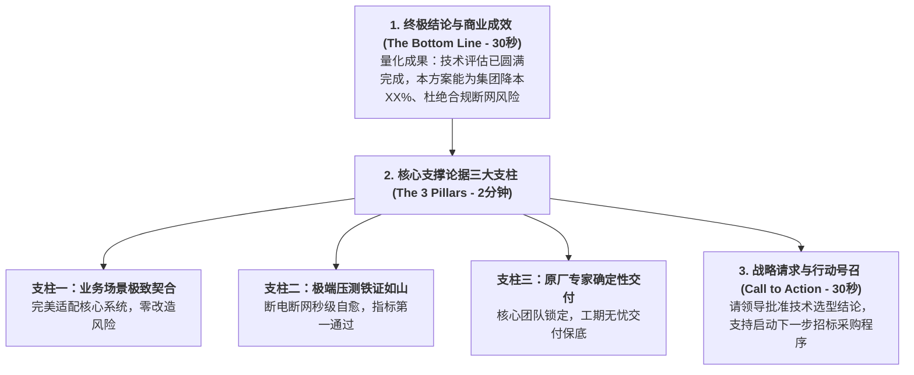
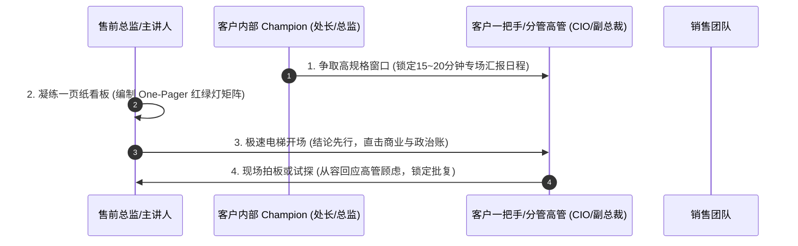

# 第41讲：技术评估结果高层汇报：“电梯汇报”争取一把手首肯

> **【本讲一句话心法】**  
> 无论技术测试的数据多么漂亮，真正拥有决策与签字权的一把手永远只在顶楼；学会用3分钟电梯法则直击商业成效与风控底线，用一页纸决策看板把底层的技术胜利转化为高层的战略首肯。

---

## 一、 场景痛点与认知破局

在经历长达数周甚至数月的技术评估、架构剖析与残酷的 POC 测试后，技术层面的验证工作已基本告一段落。然而，许多售前工程师在迈入**“技术评估结果高层汇报”**这一关键门槛时，却常常遭遇惨烈的“滑铁卢”：

```
                ┌────────────────────────────────────────────────────────┐
                │          高层汇报的三大致命灾难 (Executive Misalignment)  │
                └────────────────────────────────────────────────────────┘
                                           │
         ┌───────────────────┬─────────────┴─────┬───────────────────┐
         ▼                   ▼                   ▼                   ▼
   【沉迷参数架构细节】 【缺乏商业价值翻译】 【被无情打断轰下台】 【错失立项临门一脚】
   * 面对大老板讲吞吐量 * 不谈ROI/不谈合规政绩* 领导听了2分钟直接皱眉 * 辛辛苦苦技术测试
   * 讲内核微服务治理  * 领导心想“这关我何事”* “别说这些，说结论！” * 最终未获高层首肯
   * 领导听得哈欠连天  * 决策者毫无获得感   * 售前手足无措当场石化 * 项目停滞甚至流产
```

### 1. 售前向高管汇报的四大硬伤
* **硬伤 1：角色错位，把大老板当系统管理员**  
  一进大领导办公室，掏出厚达50页的胶片，从第一页的分布式存储时序图开始讲起。企业一把手（董事长、行长、总裁、分管副总裁）每天处理的是成百上千项战略、财务、合规与人事大事，根本没有精力去听冷冰冰的底层技术堆栈。
* **硬伤 2：缺乏商业洞察，不会计算“经济账与政治账”**  
  整篇汇报全是“TPS提升了40%”、“延迟降低了5毫秒”。高层真正关心的是：“**这套系统能不能帮我节省上千万预算？能不能帮我抢占新市场？会不会引发监管处罚？能不能成为今年向集团汇报的标杆政绩？**”售前无法将技术参数翻译为商业价值，导致汇报空洞无力。
* **硬伤 3：缺乏抗打断能力，被催问“直接说结论”后方寸大乱**  
  高层领导时间极度紧张，经常在售前刚讲了2分钟就打断：“不要讲过程，直接告诉我结论是什么！我们要选哪家？为什么？”习惯了顺叙铺垫的售前瞬间脑中一片空白，支支吾吾不知所措。
* **硬伤 4：缺乏明确的行动号召（Call to Action）**  
  好不容易讲完了，领导问：“所以呢，你们需要我批什么？”售前回答：“我们就是来汇报一下测试结果。”白白浪费了借高层气场推进立项与采购招标的绝佳窗口期！

### 2. 认知破局：“电梯汇报（Elevator Pitch）”的极简法则
在商业咨询与顶级投行中，有一个著名的概念叫做**“电梯汇报”**——*假设你在电梯间偶遇集团最高决策者，电梯从1楼升到30楼只有短短60秒，你必须在这极短的时间内，把最核心的结论、价值与诉求清晰输入到领导心智中！*
* **结论先行（Bottom Line First）**：先说核心结论与商业收益，绝不搞铺垫式长篇大论；
* **三点支撑（The Rule of Three）**：大老板的大脑只能记住三件事，只讲最能支撑该结论的三个顶层论据；
* **一页纸决策看板（One-Pager Dashboard）**：拒绝几十页PPT，只用一张红绿灯对比图击穿决策防线！

---

## 二、 核心方法论与原理拆解

### 1. 面向高层决策者的“电梯汇报金字塔”架构

向企业一把手汇报技术评估成果，必须颠覆传统的技术推演逻辑，采用**倒金字塔商业叙事模型**：



#### ① 第一层：终极结论与商业价值（30秒开局定音）
* 一句话直达核心：“尊敬的王总，我们历时三周的全真技术评估已圆满收官。测试证明，通过采用XX信创分布式架构，不仅能**100%达成银保监对于核心业务连续性的监管合规要求**，更可在未来三年为集团**直接节省近1200万元的软硬件扩容预算**。”

#### ② 第二层：三大硬核论据（2分钟化解顾虑）
* **论据一（场景）**：直击业务痛点，不推翻现有资产，保护前期投资；
* **论据二（性能与安全）**：引用权威测试见证，突出在极端拔电断网测试中的唯一性胜出；
* **论据三（团队与服务）**：展示原厂团队的终身责任承诺，彻底打消领导对烂尾的恐惧。

#### ③ 第三层：行动号召（Call to Action - 锁定胜利）
* 明确提出推进诉求：“基于上述经过科技部与业务处联合签字的严密成果，我们恳请王总支持将该方案作为下一阶段公开招标的核心技术基线，正式批准启动采购流程！”

---

## 三、 售前实操标准动作（SOP / 打法步骤）

高层汇报必须执行以下四步标准化作战流程：



### 步骤1：协同 Champion 锁定高规格专属汇报时间
* 由 Champion 出面，向分管高层正式呈报：“王总，科技部与业务部针对核心平台的底层选型技术测试已全部完成，结果至关重要且对集团后续三年IT架构影响深远，申请向您单独做一次15分钟的闭门汇报。”
* 汇报前，先与 Champion 严格对齐高管近期的脾气、关注重点与时间宽裕度。

### 步骤2：制作极致的“一页纸决策看板（One-Pager）”
* **坚决放弃厚重PPT**：正文只保留**1页全景决策图**，后附3页关键测试签字证明复印件（作为Backup备查）；
* 采用**“红绿灯矩阵（Harvey Balls / Traffic Lights）”**：
  * 将所有参测厂商在“核心业务支撑度”、“监管合规达成率”、“极限容灾自愈力”、“三年总体拥有成本TCO”四个战略维度进行红黄绿色彩对比；
  * 我方全绿碾压，竞品在核心项上呈现刺眼的红灯与黄灯，视觉冲击力一目了然！

### 步骤3：执行“3分钟电梯开场白”
* 哪怕领导预留了20分钟，售前也必须做好“领导第3分钟就可能被紧急电话叫走”的心理准备；
* 进门不寒暄、直接开讲金字塔顶层结论，用充沛的气场和确定性征服领导心智。

### 步骤4：借高层首肯，直接敲定下一步采购节点
* 汇报尾声，协同现场的销售或 Champion，向领导顺势提请批复：“王总，如果科技部与业务部对这个技术结论没有异议，下周我们就正式将需求提交集团采购中心了？”
* 只要高管当场点头说“可以，抓紧推进吧”，整个技术评估阶段即宣布斩获战略性大捷！

---

## 四、 实战工具箱、话术与Checklist

### 1. 高层汇报专用“一页纸红绿灯决策看板”模板

```
========================================================================================
【项目高层决策看板】新一代核心交易平台技术评估综合成效总结报告
汇报对象：集团主管副总裁 王总          牵头部门：科技部、运营管理部联合工作组
========================================================================================
【核心结论】
经过为期21天全真业务打靶测试，【我司方案】在业务适配度、监管合规、极端容灾及总投资回报上
全面达到集团战略预期，综合考评排名第一（综合得分98.5，友商A：82.0，友商B：71.5），
具备支撑集团未来五年业务三倍增长的确定性工程能力。建议全面作为采购立项基线。
========================================================================================
【多方综合评估红绿灯矩阵】（🟢 完全达标/领先  🟡 存在妥协风险  🔴 严重不达标/缺失）

 评估考察维度            业务战略价值衡量指标               我司自研方案    老牌友商A     新兴友商B
 ---------------------------------------------------------------------------------------
 1. 监管合规与信创自主   100%满足工信部与人行信创合规评测      🟢 独占通过     🔴 依赖封闭内核 🟡 资质不全
 2. 极端故障容灾保命     机房断电无损倒换（RPO=0，RTO<3s）     🟢 2.1秒自愈    🔴 需人工干预   🟡 丢单数据
 3. 业务敏捷创新支撑     新业务产品发布周期压缩至4小时内       🟢 动态热加载   🟡 需停机2周   🟢 满足
 4. 三年全生命周期TCO    相比传统架构直接降本（软硬件与能耗）  🟢 节省1200万   🔴 超预算40%   🟡 价格低但交付存疑
 5. 原厂落地交付保障     核心团队零轮换，本地30分钟SLA响应     🟢 签署承诺函   🟡 外包实施    🔴 本地无团队
========================================================================================
【恳请高层决策建议】
由科技部会同采购部，以本报告技术成果为输入基准，于本月底前启动正式采购招标程序。
========================================================================================
```

### 2. 高层汇报战前 Checklist

> [!TIP]
> 敲响大老板办公室大门前5分钟自检：
> - [ ] **时间预期压缩**：如果领导突然说“我只有3分钟，马上要开会”，我是否能在180秒内完整讲完“结论+三大支柱+诉求”？
> - [ ] **去技术黑话**：通篇是否删除了诸如“Raft、B+Tree、GC暂停、RPC序列化”等技术词汇？是否全部替换为“连续性、预算、政绩、合规”？
> - [ ] **纸质签批准备**：是否携带了包含科技部总监签字的正式纸质版测试汇总单？
> - [ ] **销售动作对齐**：高层首肯后，销售是否已备好下一步《立项采购请示件》以衔接？

---

## 五、 真实标杆案例深度复盘

### 【案例背景】某特大型钢铁集团智能炼钢控制系统高层汇报逆风定盘

* **情景 (Situation)**：某特大型钢铁集团启动转炉智能炼钢与数据中台改造。入围技术评估的是老牌工业自动化巨头S公司与国内本土自研智能制造厂商H公司。在长达一个月的车间测试中，H公司依靠扎实的算法工程师驻场，在命中率上略微领先S公司。
* **冲突 (Task)**：集团董事长工作极其繁忙，素以严厉著称，对纯IT技术名词极度反感。此前S公司的资深售前登门向董事长汇报，讲了5分钟算法神经网络模型，董事长直接挥手打断：“你们讲的这些我听不懂，也不想听，找车间主任去谈！”S公司售前被当场轰出办公室。
* **行动 (Action)**：
  1. **H公司售前总监的极简破局**：H公司售前团队深知董事长最关心的考核指标是**“国家双碳减排指标考核与吨钢成本降低”**；
  2. **30秒结论先行**：售前总监老孙走进董事长办公室，没有打开投影仪，而是双手呈上一份装订精美的单页纸看板，站立开场：“董事长好！用30秒向您报告核心成果：**在刚刚结束的车间打靶测试中，我们的系统已经实现了每一炉钢水冶炼时间缩短60秒、吨钢耐材消耗降低1.8公斤，年化直接为集团净利润增加4800万元，同时全面达成国家二级能效减排硬指标**”；
  3. **三大硬核支柱化解顾虑**：董事长原本低垂的眉头瞬间舒展，抬起头问：“怎么证明你们能做到？”老孙行云流水给出三点回答：
     * **第一（实测）**：这是上周二在三炼钢车间当着车间主任和总工程师的面连续跑了50炉的签字数据；
     * **第二（自主）**：全自研核心机理模型，不依赖任何国外传感器接口，完全杜绝卡脖子风险；
     * **第三（承诺）**：如果达不到年化4800万收益，尾款自愿全免；
  4. **现场锁定决策**：“董事长，总工和车间主任已经全票签字推荐。如果得到您的支持，我们下周启动招投标，争取在下个月完成全线投产，抢在年中给市里交出一份双碳智能制造标杆答卷！”
* **结果 (Result)**：董事长用力一拍桌子：“好！算得清清楚楚，要的就是这种真金白银的效果！下周一让采购部立即走招标流程，抓紧上线！”H公司借此高层汇报一锤定音，以压倒性优势锁定胜局。

---

## 六、 血泪教训与避坑红线

> [!WARNING]
> **红线 1：严禁在高层汇报中当众抱怨客户中层团队“不配合”**  
> 有些售前情商极低，在高管面前告状：“王总，这次测试我们本来能测得更好，主要是你们网络科李科长一直不给我们开权限，拖了我们好几天。”这种言论是大忌！不仅会瞬间激怒李科长及其所属派系，更会让大领导认为你情商低下、缺乏大局观与跨部门协同能力，彻底断送合作可能。

> [!CAUTION]
> **红线 2：严禁对大领导的战略追问信口胡诌、当面撒谎**  
> 企业一把手往往具有极强的人性洞察力与行业大局观。如果领导突然问及某个宏观投资或友商底牌，如果确实不知情，坦诚回应：“王总，关于这个维度我们回去做一次专项核实，今晚下班前给您呈报专题说明。”切忌自作聪明信口开河，一旦被大老板识破，将彻底丧失商业信用！

---

## 七、 课后思考题与实战研讨指南

### 思考题 1
请挑选你目前负责的一个核心技术方案，尝试将其原本长达数十页的技术成果汇报，压缩为一段不超过 180 秒的“高层电梯汇报演讲词”。请严格按照“核心结论与商业价值 -> 三大论据支柱 -> 明确行动号召”的金字塔模型进行实战撰写。

> **【实战研讨指引】**  
> * **结构模板**：  
>   * *0~30秒（结论）*：“尊敬的XX领导，本次XX平台技术评估圆满结束。测试证明，该方案能帮助贵司在XX业务上达成XX量化成果，并规避XX重大合规风险”；  
>   * *30~120秒（三支柱）*：“之所以推荐该方案，基于三点硬核事实：第一，业务零侵入；第二，极端压测第一；第三，原厂铁军终身兜底”；  
>   * *120~180秒（行动号召）*：“中层联合评审已全票签字通过，恳请领导今天正式批复进入采购招标，确保我们在XX献礼节点前顺利上线！”

### 思考题 2
在高层汇报现场，如果大领导听完你的核心结论后，突然反问一句极为刁钻的话：“既然你们的技术这么好，为什么同城的某某竞争对手没有用你们的，而是选了XX友商？”面对这种直击灵魂的信任挑战，你该如何既不诋毁友商、又让大领导深信你的选择才是最明智的？

> **【实战研讨指引】**  
> 1. **从战略定位与选型时机切入**：“王总，您提的某某友商非常具有代表性！他们采购XX系统是在三年前，当时市场上尚未出现微服务分布式解法，他们是在特定历史条件下做了符合当时情况的选择”；  
> 2. **揭示后发优势与代际红利**：“但根据我们了解到的真实情况，该同行由于当时选了集中式老架构，目前正在承受每年数百万的昂贵维保费，且改不动新业务。贵司今天选型，正好拥有了**‘后发技术红利优势’**，直接跨越了他们踩过的历史大坑，以更低的成本拥抱了下一代架构”；  
> 3. **将领导的顾虑转化为战略眼光的自豪感**。
