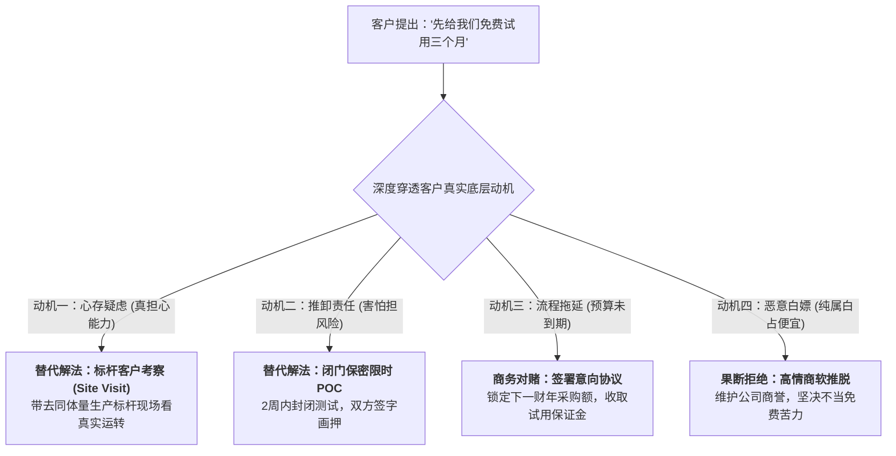
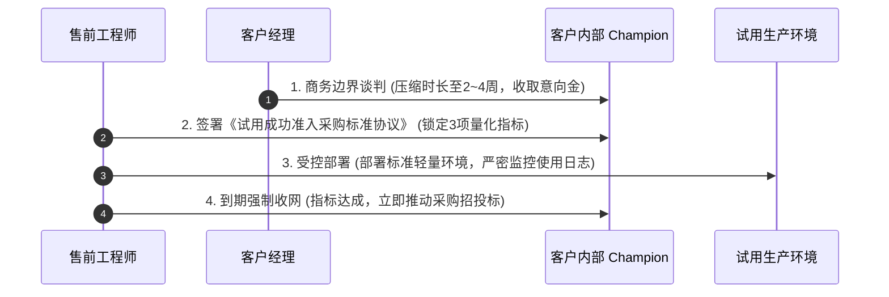

# 第42讲：警惕客户“试用陷阱”：识别白嫖风险与应对策略

> **【本讲一句话心法】**  
> 免费往往是商业关系中最昂贵的毒药；客户轻飘飘一句“先放一套免费试用三个月”，背后藏着的往往是白嫖、拖延、甩锅与变数；牢记“能考察不POC，能POC绝不试用”，给试用戴上指标与协议的紧箍咒，才能牢牢守住商业底线。

---

## 一、 场景痛点与认知破局

在技术评估的中后期，很多销售与售前团队经常会遇到客户抛出的这样一句话：  
> *“张工、王经理，你们的方案听起来挺不错的。要不这样吧，你们先在我们这里免费部署一套，让我们业务部门‘试用’三个月，如果大家用得顺手，我们年底就正式立项采购！”*

听到这句话，初出茅庐的销售往往兴奋不已，以为大单唾手可得，甚至催促售前赶紧去装软件。然而，在资深售前老兵眼里，**这绝非商业胜利的曙光，而是一个极度危险的“试用陷阱”！**

```
                ┌────────────────────────────────────────────────────────┐
                │             客户“试用陷阱”的四大致命深坑                   │
                └────────────────────────────────────────────────────────┘
                                           │
         ┌───────────────────┬─────────────┴─────┬───────────────────┐
         ▼                   ▼                   ▼                   ▼
   【无沉没成本零重视】 【恶劣环境引发死锁】 【白嫖特定短期任务】 【夜长梦多变故频生】
   * 没花钱没人真正用   * 临时装在老旧旧电脑 * 用试用版做完审计核算* 3个月内领导换届/政策变
   * 业务人员零配合     * 频发卡顿偶发Bug    * 任务结束直接卸载不买* 友商趁虚而入逆风翻盘
   * 软件被闲置3个月    * 客户反咬“系统不行” * 乙方沦为免费外包苦力* 项目无限拖延最终泡汤
```

### 1. 免费试用的四大致命陷阱
* **陷阱 1：无沉没成本导致“软件闲置死”**  
  人性与商业规律证明：**没有付出代价的东西，没有人会真正珍惜！** 客户没有支付任何定金，也没有为此投入考核指标。软件装上去之后，业务部门根本懒得花精力去学、去录数据。三个月后你去回访，软件落了一层灰，客户淡淡地说一句：“大家反映好像没什么用，以后再说吧。”
* **陷阱 2：非标非正式环境下的“偶发Bug反咬”**  
  试用通常没有正式的硬件预算，客户往往随手指一台机房角落里的二手PC或破旧虚机让你装。内存小、网络抖、依赖缺。系统跑起来频繁卡顿死机。客户不会反思是自己的环境太烂，只会认定你的软件“稳定性差、经常崩溃”，把莫须有的罪名扣在你头上。
* **陷阱 3：白嫖特定短期业务任务**  
  某些客户内部恰好遇到了某次突击审计、年中数据大汇总、或者某个临时的边缘项目。由于不想花预算立项，便借“试用”之名白嫖供应商的系统和现场技术支持。等为期两周的任务一结束，业务目的达成，客户立刻过河拆桥、卸载软件。
* **陷阱 4：战线无限拉长，给友商留足翻盘窗口**  
  在漫长的三个月试用期内，充满了不可控的黑天鹅：客户分管领导可能调走、采购预算可能被集团削减、主要友商可能发动恶性降价攻势反扑。**商业销售的铁律是“兵贵神速”，战线拉得越长，死掉的概率越大！**

### 2. 认知破局：“试用”的本质与替代逻辑
* **试用绝不是常态化售前动作**：企业级软件不是App Store里的手机游戏，不能随意“下载试玩”。任何系统的部署都伴随着企业业务流程的改造与数据的导入，必须严肃对待。
* **层层替代黄金法则**：  
  $$\text{能标杆实地考察，绝不现场测试；能短期限时POC，坚决不开放免费试用！}$$
* **必须戴上“商业紧箍咒”**：如果客户因为特殊体制或内部审批原因必须走试用流程，售前与销售必须为其套上严密的时间锁、指标锁与商业意向锁！

---

## 二、 核心方法论与原理拆解

### 1. 客户试用诉求的“四级动机穿透”模型

面对客户提出的试用要求，售前必须与销售配合，进行动机深度穿透：



#### ① 真实顾虑型（真的担心系统无法承接特定业务）
* 客户中层非常务实，只是被以前烂尾的项目吓怕了。
* **最佳对策**：绝不搞三个月试用，而是**组织一场高质量的标杆客户现场考察（Site Visit）**。带客户去同行老大哥的监控中心，让老大哥的CIO当面给一句肯定话，比试用三个月强一百倍！

#### ② 避险推责型（不想自己承担选型政治风险）
* 领导不想背锅，试图把责任推给一线员工“看一线业务喜不喜欢”。
* **最佳对策**：将松散的试用收敛为**“1~2周内的指标化概念验证（POC）”**，由双方白纸黑字划定考核边界。

#### ③ 预算空档型（真认可方案，但今年预算已用尽）
* 客户希望先用起来，等明年初再补合同走采购流程。
* **最佳对策**：可以支持，但必须要求客户主管高层签署正式的**《采购意向对赌框架协议》**，并收取一定的意向金或试用服务费。

#### ④ 恶意白嫖型（利用多家厂商免费打工）
* 没有任何预算立项计划，纯粹为了借鸡生蛋。
* **最佳对策**：果断借公司合规法务之口礼貌拒绝，止损出场。

---

## 三、 售前实操标准动作（SOP / 打法步骤）

如果经综合研判，客户确有明确采购意向且必须走试用，售前团队必须执行以下四步“戴紧箍咒”标准动作：



### 步骤1：严厉压缩试用周期与收取商务承诺
* 坚决打破客户“试用3个月”的不合理要求，坚决砍到**“2周至最长不超过1个月”**；
* 协同销售推进商务对赌：
  * 要求客户象征性支付试用服务费（中标后可全额抵扣货款）；
  * 或者由客户关键决策人签署《产品试用与优先采购备忘录（MOU）》。

### 步骤2：白纸黑字签署《试用成功与采购转化标准（Success Criteria）》
* 严禁“泛泛试用”！进场前必须让客户在《试用验收标准书》上签字：
  * 明确且仅明确**2~3个可量化的业务验收指标**（如：并发响应时间小于2秒、报表自动生成时间从4小时缩短至10分钟）；
  * **锁定转化承诺条款**：双方白纸黑字约定——*“一旦在试用期内达成上述三项量化指标，客户方即视为产品完全满足业务要求，必须在试用期结束后30天内正式启动采购招标流程”*。

### 步骤3：受控部署与后台使用心跳监控
* 部署严格受控的试用版本：
  * **植入 License 授权时间锁**：到期自动锁死系统或降级为演示模式，杜绝客户长期赖着用；
  * **功能模块裁剪**：只开放核心验证模块，保留高阶进阶功能与核心运维接口（留后手）；
* 售前在后台密切监控客户真实登录频次与操作日志。如果发现连续3天无人登录，立即触发预警机制并找销售介入。

### 步骤4：到期强制收网与“断粮战术”
* 试用期截止前3天，售前正式出具《试用期技术指标达成确认报告》，约请客户签字验收；
* 达成标准后，立即通知客户：*“系统试用授权即将到期并自动锁定，为保障贵司业务连续性，请贵司尽快启动后续采购流程以换取正式商业授权”*。用系统停机风险倒逼采购流程提速！

---

## 四、 实战工具箱、话术与Checklist

### 1. 拒绝或约束客户免费试用的高情商话术库

| 场景与客户提出诉求 | 软弱应对（被白嫖/被拖死） | 高段位专业话术（化解陷阱+树立门槛） |
| :--- | :--- | :--- |
| **客户领导说：“你们先免费装一套试用三个月，好用我们肯定买！”** | “好的领导，我们明天就派人来装，您随便试用！”（完全被动，沦为玩具） | “王总，非常感谢您对我们产品的信任！作为一家严肃的企业级基础架构软件供应商，我们非常希望尽快为贵司创造价值。不过根据我们服务数百家标杆企业的经验，**没有业务考核指标与严密配套资源的松散试用，往往会沦为‘各部门谁也不管的闲置玩具’，最后既浪费了贵司宝贵的时间，也无法体现系统的真实实力**。为了对贵司的重大投资负责，我们建议采取业界成熟的做法：要么下周我们安排专车带各位领导去同城某标杆客户现场实地考察真实生产运转；要么我们约定两周封闭式POC打靶，双方白纸黑字锁定三项指标，测完即行定案，您看如何？” |
| **客户非要试用不可，试图无限期拖延** | 一味顺从，任由客户拖上半年，最终项目泡汤。 | “李处，试用完全没问题，我们全力支持！但因为公司对核心商用知识产权有严格的审计要求，我们需要走一份正式的《限时试用备忘录》。我们为您申请最高规格的4周专属试用授权。同时我们约定三条核心检验指标，只要这三条指标测通了，请李处帮我们在采购部正式立项上推一把，这样我们也好向公司争取最大的商务折扣倾斜，您看行吗？” |

### 2. 试用准入前置核查 Checklist

> [!TIP]
> 批准客户试用申请前，销售与售前必须双签字确认的自检单：
> - [ ] **采购预算确认**：该项目是否已在客户财务或IT预算池中有明确编号与额度？
> - [ ] **决策人支持度**：提出试用的人是否是拍板决策人（Economic Buyer）？还是仅仅是个无权拍板的中层技术员？
> - [ ] **时间锁机制**：试用安装包是否已写入不可篡改的硬性到期时间戳（License Expire Date）？
> - [ ] **成功标准签字**：双方是否已白纸黑字签署了不超过3项核心指标的《试用转采购准入协议》？
> - [ ] **退出与拆机方案**：如果试用未达预期或客户反悔，是否备有完整的系统下线与硬件回收预案？

---

## 五、 真实标杆案例深度复盘

### 【案例背景】某大型医药集团自动化营销CRM系统“反白嫖”攻坚战

* **情景 (Situation)**：某全国排名前五的大型医药集团规划采购全集团药店零售会员自动化营销与CRM平台，预算约600万元。入围决选的是国内头部SaaS厂商M公司与另一家垂直软件厂商Q公司。
* **冲突 (Task)**：医药集团的信息中心主任和运营总监突然向两家厂商提出：“由于我们零售门店业务线极其复杂，各省分公司管理差异大，我们希望两家供应商各自挑选一个省份的零售门店，免费试用运行半年，半年后看哪个省的会员复购率提升多，我们就买谁。”
* **行动 (Action)**：
  1. **Q公司的盲目跳坑**：Q公司为了抢单，销售一口答应。随后派驻了3名工程师在一个偏远省份驻场长达半年。然而由于药店店员没有业绩激励，根本不愿使用新系统，半年下来数据极度稀疏，Q公司耗费了数十万人力成本，最终由于客户运营总监换人，试用无疾而终；
  2. **M公司售前的清醒破局**：
     * **揭露试用陷阱，提出高维替代方案**：M公司售前总监老常联合销售拜访信息中心主任，直言不讳地指出：“主任，依靠缺乏考核的一线药店免费试用半年，不仅会打乱各省正常业务，更会因为执行力参差不齐得出错误的选型结论”；
     * **锁定“收费付费概念验证与对赌框架”**：M公司提出，不搞漫长的半年试用，而是挑选集团业务最标准的广东省分公司，开展为期**30天的‘春季数字营销打靶攻坚月’**；
     * **签订严密商业协议**：客户支付20万元的专业技术服务费（中标后全额冲抵合同款）；M公司承诺在30天内跑通3套精准自动化召回策略；双方约定核心指标——**“只要试点门店的慢病会员月度复购率提升15%以上，集团必须在30天内正式签署全集团商业采购合同”**；
  3. **受控执行与完美兑现**：M公司售前与咨询顾问团队全力以赴，通过精细化人群标签规则设计，在第25天帮助试点门店实现了复购率提升22%的傲人战绩。
* **结果 (Result)**：M公司拿着白纸黑字的对赌数据，直接在集团总裁办公会上获得全票通过，顺利斩获全集团600万采购大单；而深陷泥潭的Q公司此时还在另一个省份苦苦挣扎。

---

## 六、 血泪教训与避坑红线

> [!WARNING]
> **红线 1：严禁给客户部署未设置任何授权时效限制的“全功能正式版安装包”**  
> 有些售前图省事，直接拿研发给的永久授权正式版安装包给客户装上当“试用”。客户拿到了永久版，等于提前免费实现了全部业务诉求，后续再也没有任何动力给乙方结款和采购。这种行为在公司内部属于严重的失职与商业违规！

> [!CAUTION]
> **红线 2：严禁在客户试用期间提供“无底线的保姆式免费运维”**  
> 试用期间，售前的职责是指导客户核心骨干熟悉系统机制，而不是替客户干日常脏活累活！如果售前天天驻场帮客户导数据、录单据，客户会误以为这些日常运维都是理所应当的。一旦项目真正上线，客户就会在服务边界上无限索取，将交付团队拖入巨大的亏损泥潭。

---

## 七、 课后思考题与实战研讨指南

### 思考题 1
在企业级B2B销售中，为什么说“能带客户做标杆实地考察（Site Visit），就坚决不要在客户现场搞免费试用”？一场高水准的标杆客户实地考察，其心理说服机制究竟胜在何处？

> **【实战研讨指引】**  
> * **眼见为实的真实生产震撼**：试用环境永远是简陋的、数据是不全的；而标杆客户现场是真实数万人每天在使用、真实跑着数百亿资产的“全开工生产态”，其气场和成熟度具有不可辩驳的震撼力；  
> * **同行背书打破信任戒备**：客户防备供应商的自吹自擂，但极度信任同行业同级别同行（如某大行CIO对另一家银行CIO）。老大哥一句“这套系统我们用了三年，很稳，放心上吧”，胜过乙方售前做十次试用；  
> * **零交付成本与不可复制性**：标杆考察只需要半天时间，几乎不消耗现场研发实施资源，速战速决，大幅压缩销售周期。

### 思考题 2
如果客户高层领导明确表示：“我们单位有制度死规定，没有实际试用过的软件一律不得进入采购招标立项池”，面对这一无法回避的硬性规定，你将如何协同销售，为这次试用设计一套“包含准入门槛、指标对赌与自动退出机制”的严密闭环方案？

> **【实战研讨指引】**  
> 1. **顺应体制，拔高规格**：起草正式《集团数字化转型试点技术准入协议》，体现严肃性与制度合规；  
> 2. **锁定极限周期与最小颗粒度业务**：将试用范围严格限定在一个部门、一个特定场景，周期死卡在3周；  
> 3. **设立三条高可信量化指标**：如数据处理正确率100%、并发承载无故障、操作效率提升30%；  
> 4. **绑定后续采购绿色通道**：在协议中写入“试用达标后，该方案即作为唯一的立项技术基线提交采购委员会”；  
> 5. **License硬锁定**：3周后自动熔断停服，倒逼客户必须在系统停服前迅速走完采购评审。
