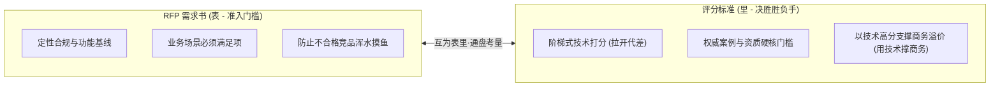
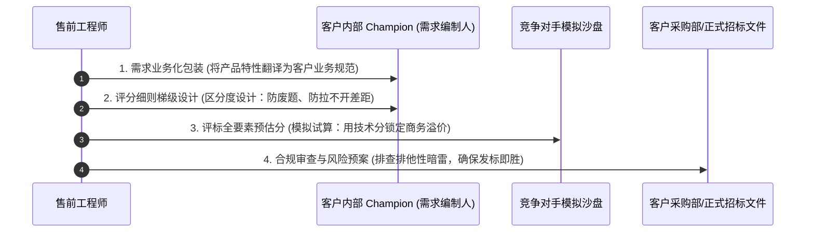

# 第43讲：终极售前目标：深度影响与把控客户 RFP 内容与评分标准设计

> **【本讲一句话心法】**  
> 技术评估阶段的一切铺垫与交锋，终极落脚点只有一个——将我方核心优势转化为客户招标文件（RFP）的刚性条目与评分细则；让规则为胜者立法，用不可动摇的技术分代差撑起高额的商务溢价，这才是顶级售前的无上王道。

---

## 一、 场景痛点与认知破局

在企业级项目的漫长推进中，**“技术评估阶段何时正式结束？”**  
答案非常明确：**当客户需求部门将最终版本的《项目技术需求书（RFP）》与《评标评分标准细则》正式签字盖章、提交给商务采购部门的那一刻，技术评估阶段宣告终结，项目正式进入招投标与采购执行阶段！**

然而，很多新手售前工程师往往缺乏全局终局思维，在临门一脚前频频犯错：

```
                ┌────────────────────────────────────────────────────────┐
                │          技术评估终局阶段的三大致命偏航 (Fatal Deviations)  │
                └────────────────────────────────────────────────────────┘
                                           │
         ┌───────────────────┬─────────────┴─────┬───────────────────┐
         ▼                   ▼                   ▼                   ▼
   【技术自嗨不管标书】 【生搬硬套产品彩页】 【只顾需求不顾打分】 【陷入违法道德焦虑】
   * 测完了就以为大功告成* 企图把产品参数全贴上* 标书写了我方优势     * 误以为影响标书违法
   * 发标时发现被友商控标* 漏洞百出被其他厂商投诉* 但打分表只占5分毫无区分* 不敢提建议被动挨打
   * 前期几个月心血全废 * 客户采购部直接驳回重写* 最终被友商低价反杀   * 拱手让出裁判立法权
```

### 1. 售前在临门一脚时的四大盲区
* **盲区 1：缺乏终局把控，前期优势在标书中“全盘流失”**  
  有些售前在前期交流和POC中表现极佳，但交流一结束就坐等客户发标。结果客户内部在起草招标文件时，找了一家关系更近的集成商帮忙代笔。标书发出来一看，全是竞争对手的专有参数和排他性条款，前期积累的全部技术优势瞬间化为乌有。
* **盲区 2：粗暴复制粘贴产品手册，引发“排他性投诉与流标”**  
  恨不得让客户把自家的产品规格白皮书逐字逐句粘贴进招标文件。这种做法极其拙劣——由于缺乏业务合理性包装，不仅具有强烈的排他性漏洞，极易招致其他友商的官方合规投诉，甚至导致项目流标重来。
* **盲区 3：只控需求（RFP），忽视评分标准（Scoring Matrix）**  
  只关注技术需求书里有没有写我方的功能，却完全忽略了评标打分表的设计。结果发标后发现：技术需求大家都是“打勾满足”，而技术分总共才占30分，商务价格分占了70分！友商依靠粗暴腰斩低价，在总分上轻而易举反超我方。
* **盲区 4：陷入不必要的“道德与法律洁癖”**  
  某些技术出身的售前误以为“协助客户起草技术需求和评分标准属于暗箱操作和违法行为”。这种认知是极其幼稚的。合法的专业引导与非法的串标围标有着天壤之别！

### 2. 认知破局：深度影响 RFP 的合法性与顾问价值
* **概念厘清（RFI、RFP、RFQ）**：
  * **RFI (Request for Information - 请求提供信息)**：前期技术交流调研阶段，客户向多家供应商广泛征集产品资料与行业趋势；
  * **RFP (Request for Proposal - 请求提供建议方案)**：正式招标采购的核心文件（即“招标文件/技术需求书”），要求供应商提供明确的书面技术与服务应答；
  * **RFQ (Request for Quotation - 请求提供报价)**：标准硬件或耗材采购，只比价格，无需复杂技术应答。
* **合法性认知辩证：专业售前是在为“项目成功”立法！**  
  * **什么是违法？** 商业贿赂、私下利益输送、围标串标、暴力胁迫是严重的违法犯罪行为，坚决不可触碰！
  * **什么是专业价值？** 绝大多数客户的项目负责人一生可能只经历一两次大型IT系统采购，极度缺乏选型与风控经验。如果完全任由低级采购规则摆布，往往会导致“劣币驱逐良币”，让毫无交付能力的皮包公司低价中标，最终项目彻底烂尾！
  * **售前的神圣使命**：通过采信客观的技术交流成果，**协助客户制定严谨、科学、具备防烂尾能力的采购技术门槛与评分标准**，既确保客户采购到真正高水准的供应商、保证项目成功，又合理锁定自身的商业胜局。这如同国家立法前广泛征求专业机构与公众意见一样，是完全正当合法的商业顾问行为！

---

## 二、 核心方法论与原理拆解

### 1. RFP 与评分标准“互为表里”的双螺旋模型

RFP（技术需求书）与评分标准（Scoring Matrix）是决定项目胜负的一体两面：



#### ① RFP 负责设立“刚性准入门槛”（淘汰平庸）
* 在技术需求中，将核心架构原则（如分布式高可用、自主可控、零信任安全）定义为基础必达项，将低水平的外包团队与平庸产品阻挡在及格线之外。

#### ② 评分标准负责拉开“技术分代差”（锁定赢单与溢价）
* **“用技术撑商务”的核心铁律**：如果我方的技术方案比竞品好，我们就不应该打价格战，而应该卖出合理的高溢价！
* 通过在技术评分标准中设计合理的阶梯分值（例如我方能拿到 48 分满分，主要友商只能拿 35 分，拉开 13 分的不可逆技术差距），即使友商在商务价格上比我们低 20%，我方的综合总分依然稳坐第一中标！

---

## 三、 售前实操标准动作（SOP / 打法步骤）

在技术评估收尾冲刺阶段，售前应执行以下四步标准化控标与标准设计打法：



### 步骤1：需求的“业务化与场景化翻译”（去产品化痕迹）
* 严禁把公司的产品型号、私有专有名词直接写进标书；
* **高阶翻译法**：把产品技术优势翻译为**“业务目标与工程质量约束”**：
  * *劣质写法*：“必须支持我司专有的 SuperSync-v3.0 协议”（极易被认定为排他性控标而废除）；
  * *卓越写法*：“在跨数据中心专线出现高达 20% 网络丢包的极端环境下，系统必须具备无损断点续传机制，保障核心交易对账数据零丢失，并提供工信部或国家级权威测评机构出具的检验报告佐证”。

### 步骤2：评分标准的“黄金区分度设计”（Distinction Design）
设计评分项时，必须严格遵守**“考试区分度法则”**：

```
  ┌────────────────────────────────────────────────────────────────────────┐
  │                 评分标准“三不陷阱”与黄金区分度原则                      │
  └────────────────────────────────────────────────────────────────────────┘
    1. 【坚决杜绝“全都满足”】 如果一项技术打分所有友商都能轻松拿满分，此项等于废项，毫无意义！
    2. 【坚决杜绝“全不满足”】 如果出了一道超难试题，结果市场上没有任何厂商能做出来，
                             该项同样沦为无效死题，白白浪费了宝贵的评分权重！
    3. 【必须追求“梯级断层”】 唯有我方能拿满分、主要竞争对手各具瑕疵只能拿到及格分，
                             次要搅局者彻底拿零分！
```

### 步骤3：编制《全要素评标模拟试算表》（用技术撑商务）
* 售前与销售必须闭门推演，列出入围短名单中每一家主要友商（竞品A、竞品B、竞品C）；
* 根据拟定的评分标准，对各家在**商务分、技术分、服务分、价格分**进行逐项沙盘试算；
* **测算安全边界**：确保在极端价格战情况下（如友商报出底价），我方凭借领先的技术得分依然能够稳操胜券。

### 步骤4：协助 Champion 顺利通过合规内审
* 检查所有技术条目，确保没有侵犯《政府采购法》与《反不正当竞争法》的硬性红线；
* 为 Champion 备好《技术指标设置必要性合规说明》，一旦采购部门或外部专家质疑某些高门槛指标时，Champion 能从容拿出“保障核心业务安全、避免重大生产事故”的权威业务依据予以捍卫。

---

## 四、 实战工具箱、话术与Checklist

### 1. 评分细则实战设计范例矩阵（防作弊与高区分度）

| 考察维度 | 平庸设计（易被作弊/无区分度） | 顶级专业设计（防挂靠/防虚构/高区分度） |
| :--- | :--- | :--- |
| **行业标杆案例** | 具有同行业成功案例，每个得2分，最高10分。（友商拿边缘小项目甚至外包合同滥竽充数） | 投标方需具备近三年内资产规模排名前30名的全国性大型银行同类核心系统生产级落地案例：**必须提供盖有双方公章的合同首页、服务范围页、签字盖章页复印件，并提供客户方项目负责人座机联系方式备查**。满足上述条件的，每个案例得2分，累计最高10分；无法提供有效证明的不计分。 |
| **项目经理与团队资质** | 拟派项目经理具备高级工程师或PMP证书得5分。（友商在市场上临时租借证书挂靠） | 拟派项目经理需具备PMP认证及系统分析师高级证书，且**必须提供投标截止日前连续6个月在投标方本单位依法缴纳社保的官方证明记录**；评标现场需参加专家视频面试答辩，答辩不通过者此项不得分。 |
| **技术架构与性能** | 系统支持双活容灾，满足得5分，不满足得0分。（友商在标书里虚假打勾“完全满足”） | 系统需具备跨城三中心双活零数据丢失能力（RPO=0）：**需提供国家权威第三方测评机构（如中国信通院、公安部三所）出具的带有CMA/CNAS认证标识的检测报告复印件，报告需明确标明“具备网络分裂下自动选主与零数据丢失”测试结论**，满足得5分，仅提供承诺函未附报告得1分。 |

### 2. 售前 RFP 与评分标准推演 Checklist

> [!TIP]
> 需求书与评分标准定稿前，必须逐项核对的“终局沙盘自检表”：
> - [ ] **独占性与普遍性平衡**：核心优势项是否具备“行业合理性包装”，杜绝赤裸裸的品牌专有参数？
> - [ ] **得分差距测算**：技术评审总分中，我方预估得分是否领先第二名至少 8~12 分以上？
> - [ ] **价格防穿透测算**：在友商报价比我方低 25% 的极端情况下，我方的综合总分是否依然位列第一？
> - [ ] **证明材料物理防伪**：案例、人员、资质是否全部要求“盖章原件/官方社保/第三方CMA报告”，堵死对手PS造假空间？
> - [ ] **Champion 答辩预案**：当采购部门组织外部专家对招标文件做合规初审时，Champion 手头是否备齐了答辩解释备忘录？

---

## 五、 真实标杆案例深度复盘

### 【案例背景】某万亿级省农信新一代移动金融平台招标文件决胜战

* **情景 (Situation)**：某省农村信用社联合社启动全省手机银行与移动金融中台重构，预算1800万元。入围技术评估的是国内两大移动金融方案商——技术实力雄厚且前期深入推进的T公司与主打低价跑量集成的L公司。
* **冲突 (Task)**：在技术评估收尾阶段，省信联社科技部业务科小李（我方 Champion）负责起草最终的招标文件（RFP）与评分细则。竞争对手L公司的销售动用了外围商务关系，企图将技术分压缩至40分，将价格分拉大至60分，企图依靠腰斩低价暴力翻盘。
* **行动 (Action)**：
  1. **深度赋能 Champion，算清“政治风险账”**：T公司的售前总监老谭敏锐察觉这一危机，协同销售紧急与小李闭门推演。老谭拿出一份《全国近三年金融移动App因客户端安全漏洞被通报下架案例分析》，诚恳向小李建言：“李科，手机银行直接面向全省千万老百姓，一旦因为低价选型引入了缺乏国密安全防护的系统被央行通报，这是要问责免职的政治红线！技术权重大于一切！”
  2. **协助设计高区分度评分细则**：
     * **安全资质门槛**：在技术分中专门设立8分“国家金融科技认证中心（CFTC）移动客户端安全最高等级认证证书”，T公司独家拥有该认证；
     * **高并发压测权威报告**：要求提供权威第三方出具的单集群承载超5万TPS的实测检测报告（得6分，无报告但承诺仅得1分），L公司无法提供；
     * **核心专家社保锁死**：核心开发人员需提供全职社保证明，堵死L公司外包借人的空子；
  3. **沙盘精密测算“技术撑商务”**：经过测算，在100分满分中（技术60分，商务价格40分），T公司的技术得分稳定在58分，而L公司由于缺乏核心报告和认证，技术得分仅能拿41分（T公司净领先17分！）；
  4. **经受住采购专家合规审查**：在采购评审会上，外部专家曾对安全资质提出疑问，小李胸有成竹地拿出央行最新发布的《移动金融客户端安全管理规范》，证明该指标是落实国家金融安全的刚性要求，专家全票赞成通过。
* **结果 (Result)**：开标当天，L公司果然报出了惊人的900万骨折底价，价格分拿了满分40分；而T公司报价1680万，价格分仅得21分。然而在技术评分中，T公司以58分对41分的压倒性优势实现降维碾压！**最终总分：T公司 79分，L公司 77分**。T公司以2分优势险胜，成功以高溢价斩获该千万级大单！

---

## 六、 血泪教训与避坑红线

> [!WARNING]
> **红线 1：严禁直接将我方软件的专有代码命名或内部研发代号塞进客户需求书**  
> 曾经有极度低级且不专业的售前，将自家产品特有的数据库视图名或接口函数原型直接贴进客户的招标文件里。发标当天即被竞争对手抓个正着，直接向省纪委和采购监督部门实名举报“定向泄密与量身定做”，导致项目被紧急叫停立案调查，该供应商被全省禁标三年！

> [!CAUTION]
> **红线 2：严禁只算技术账、不算价格分，导致“技术赢了总分输了”**  
> 很多售前技术思维严重，自以为技术分领先5分就万事大吉，完全不去研究价格评分公式（是按最低价基准法、还是平均价基准法）。如果价格分权重过高（如占50%以上）且采用最低价为基准价，友商一旦降价50%，就会在价格分上瞬间甩开你20分以上，直接击穿你的技术微弱优势！售前必须与销售通盘协同，力保技术分权重不低于50%~60%！

---

## 七、 课后思考题与实战研讨指南

### 思考题 1
为什么说“深度影响与协助客户起草 RFP 和评分标准”不仅是售前赢得项目的终极杀手锏，更是帮助客户防范项目烂尾的核心顾问价值所在？请从客户采购管理的实际痛点进行深度剖析。

> **【实战研讨指引】**  
> * **破解“信息不对称”困局**：客户对行业前沿技术趋势和潜在工程大坑缺乏专业判断力，容易被表面光鲜的PPT蒙蔽；售前协助编制的标准充当了“专业安全网”；  
> * **抵御“劣币驱逐良币”的低价陷阱**：在政府采购和国企招标机制下，若没有严密的刚性技术门槛，缺乏交付底线的投机型供应商极易依靠超低价中标，最终必然导致工期延误、质量崩溃、烂尾扯皮；  
> * **为客户提供政治与免责保护**：详尽合规的技术论证与第三方权威报告要求，为客户决策者提供了经得起审计与纪检考验的坚实防火墙。

### 思考题 2
假设你正在协助客户 Champion 起草一份关于核心数据中台的技术评分标准。你方最大的优势是“拥有同行业前三大金融集团的实施案例”且“具备国密算法全链路改造能力”，而主要友商的特点是“低价但缺乏大型金融案例”。你将如何为 Champion 设计一套既合法合规、又具备极高区分度的打分条款？

> **【实战研讨指引】**  
> 1. **标杆案例维度（以规模与真实性控标）**：  
>    * 设定门槛：必须为“全国性股份制银行或资产破万亿城商行”；  
>    * 设定凭证：要求提供盖章合同原件复印件，合同内容必须明确包含“核心业务数据中台”，且提供上线验收报告或真实客户好评公函；单个案例3分，累计最高9分；（打压友商的虚假与小微案例）；  
> 2. **国密安全认证维度（以监管大棒控标）**：  
>    * 紧扣国家金融信创大纲，要求“数据中台存储与传输必须通过国家密码管理局商用密码检测中心（商密测评）二级以上认证”，满足得6分，未通过得0分；（直接封死友商在该模块拿分可能）；  
> 3. **将上述两项合计拉开12~15分差距**，彻底粉碎友商依靠低价翻盘的企图。
