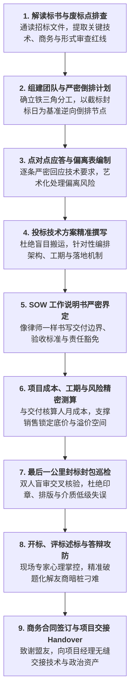

# 第44讲：招投标与商务采购阶段概述

> **【本讲一句话心法】**  
> 招投标不是枯燥乏味的文字排版与繁琐盖章，而是法律框架下的终极大决战；前期所有的技术评估与关系布局，都必须在这个合规的竞技场上转化为沉甸甸的法律契约与赢单筹码。

---

## 一、 场景痛点与认知破局

当技术评估阶段宣告结束、客户需求部门将立项文件移交给采购部门时，很多售前工程师往往会产生一种危险的**“松懈与角色脱节心理”**：

```
                ┌────────────────────────────────────────────────────────┐
                │          售前在招投标阶段的三大认知误区 (Misconceptions)   │
                └────────────────────────────────────────────────────────┘
                                           │
         ┌───────────────────┬─────────────┴─────┬───────────────────┐
         ▼                   ▼                   ▼                   ▼
   【大功告成以为解放】 【视招投标为商务行政】 【废标红线一无所知】 【忽视交付合同连带】
   * 以为技术交流完就赢了 * 认为标书只是凑字排版 * 标书格式错误当场废标 * 点对点乱承诺完全满足
   * 甩给销售和商务不管 * 随意复制粘贴旧方案   * 保证金盖章漏项直接出局* 中标后项目无法交付
   * 现场开标被对手逆风翻盘* 评分断崖式下滑痛失好局* 几个月技术心血瞬间归零* 沦为法务赔偿灾难深渊
```

### 1. 售前在招投标阶段的四大致命盲区
* **盲区 1：“半场开香槟”，误以为技术选型定了就万事大吉**  
  在技术评估中客户认可度极高，售前便以为胜券在握，把招投标当成走过场。殊不知在政企与国央企采购规则下，招投标具有一票否决的法律效力。竞争对手随时可能利用商务资质、价格算法、甚至是标书中的微小合规漏洞，在评标现场完成致命绝杀！
* **盲区 2：把投标工作降级为“低端文印行政拼盘”**  
  将写技术标书视作无聊的搬砖劳动。为了省事，把过往项目的旧方案不加辨别地“复制粘贴”，甚至保留了其他客户的抬头与竞争对手的缩写，在严谨的评标专家眼里直接被判定为毫无诚意的垃圾标书，技术分断崖式跌入谷底。
* **盲区 3：缺乏合规敬畏，踩踏“一票否决式废标红线”**  
  招投标是一场受到《招标投标法》与《政府采购法》严格约束的法定程序。哪怕技术方案写得再完美，只要出现一次公章漏盖、营业执照过期、投标保证金迟到1分钟、或者密封条未按规定签字，就会被依法直接宣布**“废标”**，前期所有团队数月的努力瞬间归零！
* **盲区 4：脱离交付实际，盲目承诺给交付“挖天坑”**  
  为了在技术评分上拿满分，售前在技术应答中不负责任地承诺各种不切实际的极限工期、定制开发与SLA要求。殊不知投标书一经签署即具有法律要约效力，中标后将直接转化为合同约束，给后续的项目交付经理和公司法务埋下了巨额赔付的定时炸弹。

### 2. 认知破局：招投标阶段的本质与售前核心定位
* **招投标是“合法合规的决胜终局”**：商业博弈不仅需要技术实力，更需要将实力严谨地折叠进符合法定采购程序的“法律文件”中。
* **售前在招投标阶段的三大核心角色**：
  * **合规总把关人（Compliance Officer）**：逐字逐句审读招标文件，建立“废标红线雷达”，确保我方投标文件在形式与实质上100%零瑕疵；
  * **价值转化架构师（Value Transformer）**：将前期沉淀的独特卖点（USP）、业务理解与高维方案，精准转化为评标专家在封闭打分环境下能“一目了然、迅速打出满分”的得分点；
  * **商业利益捍卫者（Risk Protector）**：像律师一样严密界定SOW工作说明书与点对点偏离，在争取技术高分的同时，牢牢守住公司交付成本与法律边界。

---

## 二、 核心方法论与原理拆解

### 1. 售前招投标全生命周期九步战役蓝图

从客户发布招标文件到最终合同落地，售前必须贯穿全周期的九大标准战役动作：



---

## 三、 售前实操标准动作（SOP / 打法步骤）

在招投标全周期中，售前工程师必须严守以下四项标准作业准则：

### 准则1：拿到标书第一小时，执行“红线筛查”
* 招标文件挂网或发售的第一时间，售前必须在3小时内通读全本，重点聚焦：
  * **资格与资质门槛（Qualification）**：我方及联合体资质是否100%满足？是否存在排他性暗雷？
  * **时间截点（Deadlines）**：答疑澄清截止时间、保证金缴纳截止时间、递交标书截止时间；
  * **废标条款清单（Disqualification Clauses）**：标书中带有“★”、“必须”、“实质性响应”的所有条目，单独汇总成《一票否决红线清单》。

### 准则2：召开投标启动会（Kick-off Meeting），明确各方职责
* 绝不单兵作战！由销售、售前、商务、交付负责人共同召开启动会；
* 确立“投标项目经理”，颁布统一的排期表与撰写规范模板。

### 准则3：推行“得分点导向撰写”（Score-Driven Writing）
* 评标专家的心理是：在短短几小时内要审阅数千页标书，极度疲惫；
* 标书编排必须做到**“逐条对应、标题加粗、结论前置、图文并茂”**，让专家不需要翻找即可在3秒内找到评分采分点。

### 准则4：跨部门交付评审，严防“售前吹牛交付流泪”
* 技术标书初稿完成后，必须交由拟派驻的交付项目经理或工程总监进行闭门评审；
* 针对非标定制、极端工期、接口责任分工等敏感内容白纸黑字确认，严防不可抗力违约。

---

## 四、 实战工具箱、话术与Checklist

### 1. 招投标阶段售前核心工作职责分解表

| 阶段 | 核心任务 | 交付成果 / 产出物 | 责任人 | 配合人 |
| :--- | :--- | :--- | :--- | :--- |
| **发标启动期** | 招标文件研读、资格预审、排他性风险识别 | 《标书关键信息摘要与废标点清单》 | 售前主导 | 销售、商务 |
| **编制推进期** | 倒排进度管理、技术方案撰写、点对点应答 | 《技术标书正文》、《技术规格偏离表》 | 售前主导 | 交付、产品研发 |
| **商务测算期** | SOW编制、人月工作量核算、第三方硬件询价 | 《项目SOW说明书》、《成本预算测算单》 | 售前与交付 | 采购、商务 |
| **封标冲刺期** | 标书清样检查、排版装订、签字盖章、电子上传 | 《密封投标正副本》、《投标CA电子标包》 | 商务主导 | 售前、销售 |
| **述标决胜期** | 讲标PPT准备、答辩演练、现场述标与澄清 | 《述标汇报胶片》、《现场澄清说明函》 | 售前主导 | 销售、项目经理 |

### 2. 招投标启动期全局巡检 Checklist

> [!TIP]
> 拿到招标文件24小时内，售前负责人必须逐项清点的“全局自检单”：
> - [ ] **招标形式识别**：本项目是公开招标、邀请招标、竞争性磋商、还是单一来源？
> - [ ] **评分权重穿透**：综合评分法中，技术分、商务分、价格分的具体占比是多少？
> - [ ] **质疑窗口期**：若发现招标文件存在严重排他性违规倾向，法定的书面答疑/异议截止时间是哪一天？
> - [ ] **电子招投标平台适配**：该项目是线下纸质标还是线上电子标？我司CA数字证书（国密Ukey）是否在有效期内？驱动环境是否正常？

---

## 五、 真实标杆案例深度复盘

### 【案例背景】某千亿省级智慧政务大数据云平台：从技术领先到标书绝地反击

* **情景 (Situation)**：某省大数据局启动总投资近4000万元的智慧政务云底座招标。国内两家云巨头T公司与A公司展开最后角逐。在长达三个月的前期技术评估与POC中，T公司售前团队表现极其卓越，技术指标全面领先。
* **冲突 (Task)**：招标文件正式挂网后，T公司的销售与售前团队盲目乐观，以为胜局已定。售前将技术标书甩给两位刚毕业一年的助理编写，自己则去支持其他项目。截标前一天，售前总监老魏在抽检标书时赫然发现三大致命险情：
  1. 商务资质中要求的“国家信息安全服务二级认证”，标书中误贴成了已过期的旧证书；
  2. 点对点应答中，助理为了省事，在涉及“全省各委办局数据归集清洗”这一高风险定制条款下，轻率打勾了“完全满足”，却未界定任何接口开发责任边界；
  3. 价格分由于友商暗中串联了超低价倾销，原本预估的技术领先优势面临被价格分完全抹平的巨大风险。
* **行动 (Action)**：
  1. **紧急启动48小时战役响应**：老魏立即召集销售总监、法务与交付负责人成立战时应急小组，连夜冻结原稿；
  2. **全面自救与资质补正**：动用公司加急审批通道，在凌晨协调总部法务将最新换发的信息安全认证原件彩色扫描件调出，替换废止旧件；
  3. **重构点对点应答与SOW防火墙**：老魏通宵重新操刀，在保留“完全满足”的前提下，精准附带了长达300字的严密责任边界说明，明确“各委办局源系统接口改造费用由原系统承建方承担，我方提供标准RESTful规范接入”；
  4. **优化技术方案排版提升采分点视觉度**：针对评分标准中的每一项评分细则，技术标书正文第一级大纲完全按评分细则编号一一对应，用加粗和色块将资质、报告、架构亮点做成“指引便签”。
* **结果 (Result)**：评标现场，盲抽的五位省级专家在短短两小时封闭评审中，一致对T公司层次清晰、论据扎实的技术标书打出了全场最高的96.5分（比A公司高出整整12分）。正是这12分的技术代差，彻底抵御住了A公司的低价冲击，T公司最终以总分第一毫无争议摘得标杆大单。

---

## 六、 血泪教训与避坑红线

> [!WARNING]
> **红线 1：严禁“一人全包”式投标作战**  
> 招投标工作涉及技术架构、商务资质、财务报表、法务条款、印刷封装等海量专业工序。售前绝不可充当逞英雄的“独行侠”，试图一人包揽所有工作。这种模式不仅会彻底累垮售前，更会因为精力涣散在某一合规细节上百密一疏，直接酿成废标惨案！

> [!CAUTION]
> **红线 2：严禁对标书中的“★/实质性条款”存在侥幸心理**  
> 任何带有星号（★）或被明确定义为“实质性响应”的技术参数与商务条款，均属于法律层面的刚性底线。哪怕有一条未按要求提供证明、或者表述含糊，评标委员会均有权依法直接裁定“投标无效（废标）”，没有任何商量或补正余地！

---

## 七、 课后思考题与实战研讨指南

### 思考题 1
为什么在企业级招投标中，很多在前期技术评估中表现卓越的优秀方案商，反而常常在最后的开标评标现场被原本处于劣势的竞争对手逆风翻盘？这背后暴露了售前团队在项目运作中的哪些系统性短板？

> **【实战研讨指引】**  
> * **短板一：合规敬畏不足**：技术人员重逻辑轻形式，容易在公章、骑缝章、法定代表人授权书等形式要件上踩雷废标；  
> * **短板二：评标专家心理感知偏差**：现场评标专家大多是随机盲抽的外部学者或工程师，完全不了解前期两轮交流的背景。竞品针对评分标准制作的标书若更条理清晰、易于打分，专家就会给竞品打高分；  
> * **短板三：价格分防线崩溃**：前期未做好模拟估分，技术分优势不足以覆盖竞品的低价策略。

### 思考题 2
作为主攻售前，在拿到客户正式发布的招标文件后，你应该在最初的24小时内按怎样的先后次序处理手头的信息，以确保整个团队不盲目、不混乱地高效进入战斗状态？

> **【实战研讨指引】**  
> 1. **第一优先级：排查时间线与红线**（开标截止日、答疑截止日、保证金截点、形式废标条款）；  
> 2. **第二优先级：对照评分标准测算初始自评分**（技术、商务各能拿多少，与主要竞品对比缺什么资质与报告）；  
> 3. **第三优先级：拟定答疑澄清函**（针对排他性暗雷或歧义条款在法定时限内提交质疑）；  
> 4. **第四优先级：输出投标分工表与倒排计划日历**，召开投标启动会分发任务。
