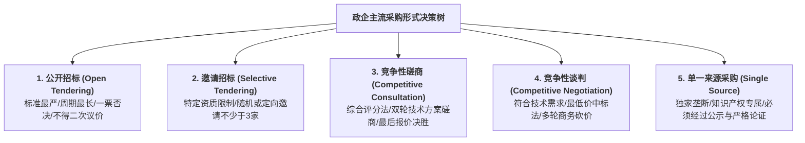
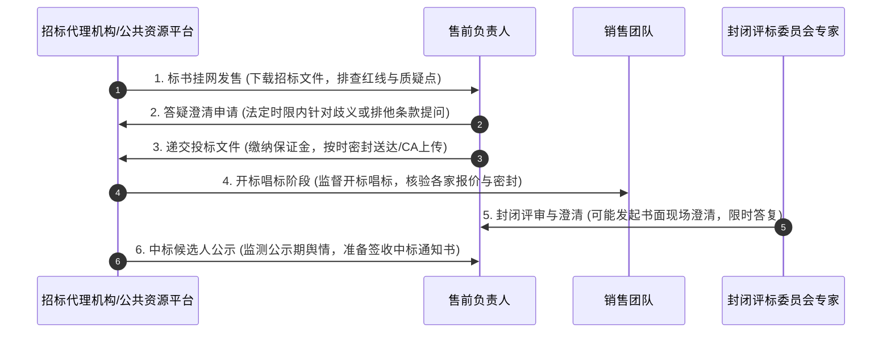

# 第45讲：政企客户常规招投标管理体系与采购流程解密

> **【本讲一句话心法】**  
> 不懂规则的玩家注定沦为棋盘上的弃子；穿透政企采购的法定程序、审批机制与专家评审心理，才能在严密森严的制度高墙内精准卡位、进退自如。

---

## 一、 场景痛点与认知破局

在面对政府机关、事业单位、大型金融机构与国有央企等体制内大客户时，许多售前工程师往往表现出严重的**“体制盲与流程盲”**：

```
                ┌────────────────────────────────────────────────────────┐
                │          售前面临政企采购体制的四大困局 (Systemic Traps)   │
                └────────────────────────────────────────────────────────┘
                                           │
         ┌───────────────────┬─────────────┴─────┬───────────────────┐
         ▼                   ▼                   ▼                   ▼
   【分不清法律采购形式】 【对法定刚性节点迟钝】 【看不懂专家抽选暗战】 【错失法定质疑期】
   * 招标/磋商/谈判混淆 * 错过答疑/打款截点   * 以为内部支持者能包办 * 发现友商排他暗雷
   * 适用规则判断错误   * 迟到1秒钟拒收标书   * 评标现场全是外部盲抽 * 不懂如何合法投诉质疑
   * 战略战术全盘脱节   * 当场流标导致项目延期 * 专家给分断崖式下滑   * 只能眼睁睁看友商控标
```

### 1. 售前在政企采购中的四大认知盲区
* **盲区 1：混淆《招投标法》与《政府采购法》，分不清采购形式**  
  将公开招标、竞争性磋商、竞争性谈判与单一来源采购等同视之。殊不知不同采购方式的打分规则、谈判轮次、报价规则与法律约束完全不同。用公开招标的死板打法去打竞争性磋商，或者在公开招标中试图和客户“私下二次谈判价格”，直接触犯法律红线。
* **盲区 2：对法定程序的“刚性不可逆性”缺乏敬畏**  
  在商业企业中，很多流程可以靠领导一句话打招呼通融；但在政企法定招投标中，**程序合法高于一切**！投标保证金必须在截标前到账、电子标必须在规定分秒前上传成功、纸质标书哪怕晚送达一秒钟，招标代理机构均依法坚决拒收。
* **盲区 3：过度迷信内部支持者，忽略“外部专家盲抽机制”**  
  以为在客户内部搞定了业务处长和科技总监就万事大吉。殊不知在正式评标现场，依据法定回避原则，评标委员会中通常有三分之二以上的专家是**开标前半小时从省市专家库中电脑随机盲抽的外部专家**！内部支持者根本无法一手遮天，外部专家完全只看标书本身的质量与证明材料打分。
* **盲区 4：丧失法定救济权，错失答疑质疑黄金窗口**  
  当发现招标文件挂网后存在明显的倾向性排他条款时，售前要么在私下向客户抱怨发牢骚，要么犹豫不决。直到截标前夕才想起来提出异议，此时早已超过法定的答疑质疑截止时限，依法不予受理，白白丧失合法的破局反制机会。

### 2. 认知破局：政企招投标的双法体系与底层逻辑
* **两大法律基石**：
  * **《中华人民共和国招标投标法》**：主要适用于工程建设、勘察设计、以及与工程建设密切相关的重大货物与设备采购；
  * **《中华人民共和国政府采购法》**：主要适用于各级国家机关、事业单位和团体组织，使用财政性资金采购集中采购目录以内的、或采购限额标准以上的货物、工程和服务。
* **政企采购的终极核心关切是“合规避责与审计安全”**：客户采购部门和领导的首要诉求不仅是“把项目做成”，更是“**经得起未来审计局、纪检监察和巡视组的翻旧账倒查**”。售前必须深刻理解这一体制心理，用合规的武器武装自己的方案。

---

## 二、 核心方法论与原理拆解

### 1. 政企主流采购方式全景特征对比矩阵

根据资金性质与项目复杂度，政企采购主要分为五种法定采购形式：



| 采购形式 | 适用场景与项目特征 | 评审与打分规则 | 售前核心应对策略 |
| :--- | :--- | :--- | :--- |
| **公开招标** | 达到法定招标数额标准（如工程服务类超数百万）、规格标准明确的大型项目。 | 综合评分法或最低评标价法；**现场开标后严禁任何实质性技术或价格改动**。 | 标书严格逐字响应，杜绝任何形式偏离；技术分与资质分必须做到零扣分。 |
| **竞争性磋商** | 政府购买服务、技术复杂或性质特殊不能确定详细规格的软件中台与信息化项目。 | **综合评分法**；专家与供应商逐个进行技术与商务磋商，提交**最后报价（二报价）**。 | 首轮技术方案亮出先进性，磋商环节根据专家意见敏捷调整，二报价锁定胜局。 |
| **竞争性谈判** | 招标后没有供应商投标、或技术复杂紧急无法计算总价的项目。 | **最低评标价法**；在满足技术与商务实质性要求的前提下，比拼最后多轮报价。 | 将技术做成标准合规通过项，核心把控成本核算，支撑销售进行刺刀见红的价格博弈。 |
| **单一来源采购** | 只能从唯一供应商处采购、或必须保证原有项目一致性/服务配套（如二期续建）。 | 专业论证后进行**一对一商务价格谈判**，通常需向社会公开公示5个工作日。 | 协助客户撰写无可辩驳的《单一来源采购论证报告》，并在公示期防范友商投诉。 |

### 2. 评标委员会的运作机制与专家心理画像

政企评标委员会的组建与打分受到严格的法定规约限制：
* **专家人数与构成**：评标委员会成员人数必须为**5人以上单数**（大型重点项目为7人或9人）。其中，经济、技术等方面的外部专家不得少于成员总数的三分之二（业主代表通常仅占1~2人）；
* **盲抽与封闭评审**：开标前数小时由省市公共资源交易中心或财政专家库随机拨号盲抽，专家入场后手机全部上交屏蔽，处于与外界完全失联的物理封闭空间；
* **专家的四大核心心理特征**：
  * **时间紧、任务重**：通常只给2~4小时审阅多家供应商数千页的厚重标书，极度缺乏耐心；
  * **第一印象决定基调**：排版整洁、装订精美、彩图清晰的标书天然具有加分效应；
  * **“采分点雷达”驱动**：专家是拿着评分表逐项找证据给分，找不到相关说明就直接扣分；
  * **避责免责优先**：对于带有“★”的实质性条款核对极其苛刻，宁可多废标也不愿承担审计连带责任。

---

## 三、 售前实操标准动作（SOP / 打法步骤）

政企招投标全流程六大刚性节点及售前标准作业动线如下：



### 步骤1：标书挂网发售期（排查与报名）
* 密切关注省级公共资源交易平台或中国招标投标公共服务平台；
* **报名与购买文件**：确认我方主体资格与联合体要求，第一时间完成企业身份绑定与招标文件下载；
* 检查数字证书（CA锁）有效期与系统插件兼容性。

### 步骤2：答疑澄清窗口期（暗战反制黄金期）
* 法定规则：供应商若对招标文件有疑问，必须在**招标文件发布之日起特定时限内（通常为发标后3~7天内，且距截标至少15天前）**以书面形式提出；
* **售前实操打法**：
  * 若发现友商植入的排他性参数，起草专业、客观、有法可依的《质疑与澄清申请函》；
  * 借合规与反不正当竞争大棒，迫使招标代理发布《补充公告（澄清文件）》修改参数。

### 步骤3：截标封标与保证金缴纳期（铁律红线）
* **保证金底线**：必须通过企业基本账户以银行电汇或银行保函方式提交，务必在截标前1天完成到账确认，并取得回执贴入标书；
* **时间红线**：线上电子标必须提前半天完成哈希加密与上传，防止截标前网络拥堵；线下纸质标必须提前1小时抵达开标现场。

### 步骤4：开标唱标期（情报收集）
* 售前配合销售出席开标仪式，认真核对各家投标人的企业名称、投标报价、工期承诺与质保期；
* 详细记录竞争对手的报价与人员配置，为评标沙盘推演提供一手数据。

### 步骤5：评标封闭评审期（书面澄清应答）
* 售前必须在开标现场附近或保持通讯工具畅通待命；
* 若评标委员会对标书中的某些表述提出书面质疑，售前必须在**规定时限内（通常仅给30~60分钟）**起草严谨、得体、不超出原标书实质性范围的《书面澄清说明》，经授权签字后加盖公章提交。

### 步骤6：中标候选人公示期（法定期限防守）
* 依法在公共资源网公示前三名中标候选人，法定公示期通常为**3个工作日**；
* 紧密监控竞争对手是否有恶意投诉或异议动作；公示期满无异议，由招标人正式签发《中标通知书》。

---

## 四、 实战工具箱、话术与Checklist

### 1. 招标文件答疑澄清函模板（破除友商控标暗雷）

```
========================================================================================
                      关于【项目名称】招标文件的澄清与质疑申请函
致：【招标代理机构全称】 / 【招标人全称】

我公司在认真研读贵司发布的【项目名称】（项目编号：XXXXXX）招标文件后，本着公平竞争、
科学选型及确保项目高质量交付的原则，特对招标文件中的个别条款提出以下疑问与建议：

【疑问事项一】
招标文件第三章《技术规格要求》第 4.2.1 条要求：“核心网关必须内置 XX 专有通信协议”。
【事实与法律依据】
经查，该专有通信协议为业内某单一厂商拥有的私有封装协议，非国家推荐性标准或行业通用标准。
依据《中华人民共和国招标投标法实施条例》第三十二条规定：“招标人不得以特定行政区域或者
特定行业的业绩、奖项，或者以特定专利、商标、品牌、原产地或者供应商等方式排斥或者限制潜在投标人”。
该条款具有明显的唯一指向性与排他性，限制了充分竞争。
【修改建议】
建议将该条款修改为：“核心网关需支持通用 MQTT、HTTP/2 或兼容业内主流标准工业通信协议”，
以保障更多具备先进技术能力的优秀厂商参与竞争，为招标人争取更优的性价比方案。

特此申请，期盼贵司审慎评估并予以澄清答复。

                                                    投标人：【我司全称】（加盖公章）
                                                    法定代表人或授权代表签字：XXX
                                                    日期：2026年XX月XX日
========================================================================================
```

### 2. 政企投标全流程关键节点控制 Checklist

> [!TIP]
> 售前项目负责人从发标到开标必须贴身追踪的“时间节点甘特检查单”：
> - [ ] **答疑提问截止点**：是否已在规定日期的 17:00 前将书面问题盖章送达/平台上传？
> - [ ] **澄清答疑获取点**：是否每天登录交易平台查阅招标人是否发布了《答疑纪要》或《变更澄清文件》？（如有，必须在标书中签署接收确认函）
> - [ ] **保证金到账锁死**：投标保证金是否已从公司基本户划出？是否已取得银行回执并与代理对账确认绑定？
> - [ ] **CA锁环境验证**：主副投标CA锁是否已插入测试机测试，证书是否在有效年检期内？
> - [ ] **现场澄清待命**：开标当天，主讲售前与授权委托人是否在会场周边待命，并备好空白加盖公章的澄清纸？

---

## 五、 真实标杆案例深度复盘

### 【案例背景】某省直机关数字档案中台招标：巧用答疑澄清绝地破局

* **情景 (Situation)**：某省直机关启动全省数字档案统一管理平台升级，预算850万元。该项目采用《政府采购法》下的公开招标方式。竞争对手J公司凭借早期介入，诱导客户需求经办人在招标文件中塞入了一项极具杀伤力的排他性条款：“投标产品需具备国家保密局涉密信息系统产品检测证书（甲级）并在该省设有专门的涉密档案实验室”。
* **冲突 (Task)**：J公司独占该项本地资质，而我司及其他主流厂商均未在本地设立独立实验室。若按原标书开标，J公司将轻松独占该项8分满分，并在资格审查中直接将其他厂商定义为不达标。
* **行动 (Action)**：
  1. **研读法规，精准识别法律破绽**：售前总监老沈通读标书后，立即协同法务查阅《政府采购货物和服务招标投标管理办法》（财政部87号令），确认第十七条明确规定：“采购人、采购代理机构不得将投标人的注册资本、资产总额、营业收入、从业人员、利润、纳税额等规模条件或者设立分支机构作为资格要求或者评审因素”；
  2. **在法定黄金期递交专业澄清函**：老沈在标书发售后的第3天（法定期限内），由销售高层代表公司，正式向省级招投标监督办和招标代理机构递交了一份逻辑严密、措辞极其谦逊专业的《招标文件法律合规澄清申请函》，不仅列举了财政部法规依据，更指出“若按原条款执行，极易引发后续供应商法律异议和流标审计风险”；
  3. **联合其他中立友商形成合力**：老沈通过合规渠道，将该条款违规的事实告知了另外两家入围的知名央企集成商，另外两家厂商也同步向代理机构递交了同类内容的异议函；
  4. **招标代理被迫发布变更公告**：面对多方依法依规的书面质疑，采购人与代理机构为了规避违纪审计风险，在开标前16天正式发布《澄清修改补充公告》，依法删除了“必须在本地设立实验室”的不合理限制，并将涉密证书调整为行业通用安全等级保护三级认证。
* **结果 (Result)**：排他暗雷被彻底依法拆除。在随后的公平竞争中，我司凭借扎实的技术标书和优异的行业案例斩获技术评分第一名，以总分领先优势顺利中标。

---

## 六、 血泪教训与避坑红线

> [!WARNING]
> **红线 1：严禁在答疑澄清函中使用威胁、嘲讽或人身攻击的措辞**  
> 哪怕发现招标文件明显偏向友商，起草答疑文件时也必须保持克制、专业与客观，通篇引用法规条文与技术国家标准。如果措辞激化矛盾、给客户领导扣帽子，会直接激怒招标人，即便招标人被迫修改了参数，也会在后续的评标现场组织专家对你的标书实施全方位的恶意刁难！

> [!CAUTION]
> **红线 2：严禁忽略《澄清答疑纪要》导致的“版本脱节废标”**  
> 招标人在答疑期发布澄清修改文件后，往往会附带新的《投标报价表格式》或修改了某些技术指标。售前必须立刻下载最新变更，并在最终标书中严格替换。如果售前依然使用发售时的第一版旧标书格式制作，评标委员会将直接依据“未对招标文件修改做出实质性响应”裁定废标！

---

## 七、 课后思考题与实战研讨指南

### 思考题 1
在政企公开招标中，为什么说“评标委员会外部专家的盲抽机制”决定了技术标书的排版与呈现必须具备极高的“易读性与采分直观度”？如果你是专家，在一上午要审阅五套上千页标书的极度疲惫状态下，什么样的标书会让你毫不犹豫打出高分？

> **【实战研讨指引】**  
> * **评审困境**：专家面对海量文字，没有时间精读长篇大论，核心动作是“按图索骥找得分依据”；  
> * **高分标书特征**：  
>   1. **大纲结构与评分表完全一一镜像对齐**（评分表第1条对应标书第1章）；  
>   2. **关键资质与佐证材料做成“彩色高亮标签附录”**，并在正文中明确标注索引页码；  
>   3. **结论与指标前置加粗**，多用表格和高精拓扑图展示架构，一目了然；  
>   4. 绝无错别字、排版齐整、视觉极其舒适。

### 思考题 2
当你在招标文件中发现了一项明显有利于主要竞争对手的专有技术指标时，你应该如何把握“通过正式答疑推动修改”与“避免打草惊蛇让客户产生反感”之间的微妙平衡？

> **【实战研讨指引】**  
> 1. **私下与 Champion 快速预沟通**：先私下请教内部支持者：“李处，招标文件中这条参数似乎指向了友商的私有专利，这是采购部门要求的还是外部顾问拟定的？如果外部提出质疑，会不会影响整体上线工期？”摸清背景；  
> 2. **由 Champion 内部吹风**：如果 Champion 意识到该指标存在被审计风险，通常会主动借内部初审之手推动代理机构自行修正，达到“不战而屈人之兵”的最佳效果；  
> 3. **若内部无法修正，再走官方合规通道**：严格在法定期限内，站在“维护国家法规权威、防范项目招投标被举报流标”的公心角度提交书面申请。
