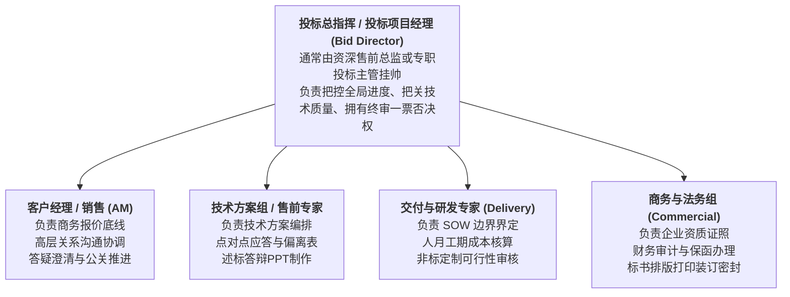
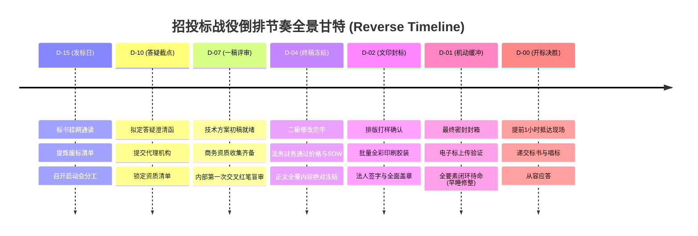

# 第46讲：建立高效投标团队与严密倒排投标计划：不能是你一个人在战斗

> **【本讲一句话心法】**  
> 招投标不是售前工程师一人的孤勇者苦修，而是一场公司级兵种协同的立体化特种战；以截标时刻为零点逆向倒排铁律节点，留足48小时机动缓冲，才能彻底告别通宵赶标的狼狈溃败。

---

## 一、 场景痛点与认知破局

在投标冲刺阶段，很多IT与软件企业的售前工程师常常陷入一种极度疲惫甚至绝望的**“保姆式孤立无援”**境地：

```
                ┌────────────────────────────────────────────────────────┐
                │          售前投标“孤军奋战”的惨烈写照 (The Lone Wolf)       │
                └────────────────────────────────────────────────────────┘
                                           │
         ┌───────────────────┬─────────────┴─────┬───────────────────┐
         ▼                   ▼                   ▼                   ▼
   【销售甩手当掌柜】   【售前一人扛下所有】 【四处求人通宵拼凑】 【临门一脚悲剧翻车】
   * "标书下来了你写吧" * 既要写核心技术方案 * 找财务要报表/找HR要社保* 封标前1小时发现漏公章
   * 销售只等最后去开标 * 又要排查商务资质门槛* 连续通宵三天人仰马翻   * 打印机卡纸/胶装脱落
   * 缺乏公司级协同组织 * 还要贴发票催保证金 * 标书错误百出疲于奔命   * 现场直接被判定废标出局
```

### 1. 缺乏团队协同与计划管理的三大恶果
* **恶果 1：“售前成了全能杂役工”，核心方案严重缩水**  
  售前的大脑原本应该聚焦在“如何精细化设计技术架构”、“如何用FAB法则打穿技术打分点”上。然而因为缺乏专业分工，售前被迫将80%的精力浪费在收集资质证书、打电话催财务开银行保函、排版Word目录、甚至是手动贴印花税票上。最终导致技术核心方案草草拼凑，技术分严重失分。
* **恶果 2：“正向顺推计划”导致的最后一夜生死大逃亡**  
  很多团队习惯按“发标 -> 慢慢写 -> 差不多了再改 -> 最后一天封标”的正向思维推进。结果总是一拖再拖，到了开标前夜，所有人都发现方案还没定稿、商务资质还没盖章、排版还在乱跳。整组人通宵达旦通宵赶标，人在极度缺觉与大脑混沌状态下，出现公章漏盖、身份证复印件贴错、密封条贴反的概率高达90%！
* **恶果 3：责任推诿与团队内讧**  
  一旦投标失利或出现低级废标，销售怪售前写得慢、售前怪商务资质没给齐、财务怪通知太晚保函开不出来，整个作战团队迅速陷入互相甩锅的内部撕裂泥潭。

### 2. 认知破局：“兵种军团化”与“逆向倒排铁律”
* **“不能是你一个人在战斗！”**：一份数百页乃至上千页的合格投标文件，是一套严谨的“商业法律工程交付物”，必须由**售前、销售、商务、交付、法务与财务构成的特战小队共同完成**。售前是技术总导演，但绝不是搬砖苦力！
* **“倒排日历法（Reverse Scheduling）”是保命法则**：  
  永远不要从“今天”往后推算进度，而必须以**“截标封标的那一分那一秒（D-0）”为绝对基准点**，倒数计时扣减节点！并在正式截标前**强制预留 24~48 小时的“安全缓冲期（Buffer）”**。优秀的投标铁军在开标前一天下午早已封箱就绪，安然入眠！

---

## 二、 核心方法论与原理拆解

### 1. 企业级投标特战军团“五位一体”职责矩阵

大型战役级项目投标，必须组建由专职决策人挂帅的“五位一体”协同团队：



#### ① 角色定位与权责红线
* **投标项目经理（售前/总监）**：拥有项目投标的全权统筹权。有权向销售催进度、有权向后方调集研发资源、负责标书全卷逻辑一致性审核；
* **销售客户经理（AM）**：必须负责投标保证金的审批与出账、必须主导商务报价的最终签署、必须协调开标授权委托书及法人签字；
* **商务标书专员（Commercial Specialist）**：负责标书模板格式搭建、资质材料原件扫描件整理、排版编号、骑缝章与封签制作。严禁让售前代劳！

---

### 2. 招投标战役倒排日历金字塔（标准15天作战模板）

以截标开标日为 `D-0`，全流程倒排推进节奏规范如下：



---

## 三、 售前实操标准动作（SOP / 打法步骤）

在整个倒排推进过程中，售前团队必须恪守以下四步标准战术动作：

### 步骤1：发标日（D-15）召开《投标誓师与启动对齐会》
* 拿到招标文件第一天，由售前负责人主持召开不少于1小时的启动会；
* **输出唯一权威战表**：当场印发《项目投标责任分解与倒排排期表》，明确每一章节的撰写人、初审人、终审人与精确到小时的交付截点；
* 所有人当场在排期表上签字认领，杜绝推诿。

### 步骤2：D-7 关键里程碑——“红笔交叉盲审（Cross-Review）”
* 一稿完成后，严禁自看自改！必须执行**“红墨水交叉盲审机制”**：
  * 技术售前审阅商务组的资质与案例证明（查验案例名称是否完全吻合、证书编号是否有效）；
  * 商务专员审阅技术售前的标书排版与打分项索引（站在外行专家角度看采分点是否清晰好找）；
  * 交付项目经理审阅技术方案中的实施周期与工期承诺（查验是否存在无法落地的狂妄吹嘘）。

### 步骤3：D-4 终稿内容绝对冻结（Content Freeze）
* 截标前4天，必须执行**“内容绝对冻结法令”**！
* 此时严禁任何临时起意的“大幅修改架构”、“新增模块”。所有文字、图表、报价公式锁定，全面转入排版纠错与盖章流程；
* 启动公司法务、财务、交付三方联签通道，完成合同条款偏离与最终投标价格的合规审批。

### 步骤4：D-1 设立强制缓冲期，彻底告别通宵
* 截标前24小时（D-1），纸质标书必须全部完成印刷、装订、签字盖章与封箱贴封条；电子标书必须生成唯一的MD5/SHA哈希校验值并成功上传至交易平台；
* **全员强制休息**：当晚严禁通宵！主讲售前与授权代表必须保证充足睡眠，以饱满的精神状态、充沛的气场迎战次日的开标与述标答辩。

---

## 四、 实战工具箱、话术与Checklist

### 1. 项目投标团队全要素分工与倒排跟踪总表（Template）

```
========================================================================================================
【项目投标总控看板】某集团核心业务系统数字化中台升级项目投标倒排表
开标截标时间：2026年10月28日 09:30（D-0）           投标项目经理：老张（售前总监）
========================================================================================================
 序号   任务模块与工作内容               标准输出物 / 验收标准      主责人   配合人   最晚完成截点 状态
 -------------------------------------------------------------------------------------------------------
  1    招标文件通读与红线排查           《一票否决废标点清单》     老张     法务小李  D-14 12:00  ✅
  2    编写答疑澄清函并提交代理         《答疑澄清申请函盖章版》   老张     销售大陈  D-10 17:00  ✅
  3    商务资质/财务审计/保函办理       验资报告/银行保函原件      商务小刘 财务王姐  D-06 17:00  进行中
  4    点对点技术应答与偏离表编制       《技术点对点应答与偏离表》 老张     架构师阿强 D-07 18:00  进行中
  5    投标技术方案正文编排（第一稿）   《技术标书初稿》           架构师阿强 顾问老周  D-07 18:00  进行中
  6    SOW工期与人月成本测算确认        《项目成本预算表与SOW》    交付老刘 老张     D-05 12:00  未开始
  7    内部第一次红笔交叉盲审           《盲审修改意见红线表》     全员互审 老张主持  D-05 18:00  未开始
  8    法务/财务/高层价格审批终签       公司高层特批底价签批单     销售大陈 财务王姐  D-04 17:00  未开始
  9    技术与商务标书终稿内容绝对冻结   PDF冻结版终稿定稿          老张     商务小刘  D-04 20:00  未开始
 10    标书全彩打样、批量印刷与胶装     正本1份，副本5份，电子U盘 商务小刘 文印中心  D-02 18:00  未开始
 11    法人签字、公章、骑缝章盖印       全量盖章与签字完毕         商务小刘 销售大陈  D-02 21:00  未开始
 12    密封封签制作与全要素封箱         封装密封箱+盖密封章       商务小刘 老张监督  D-01 15:00  未开始
 13    电子招投标系统加密上传及解密测试 取得平台上传成功回执       商务小刘 老张     D-01 17:00  未开始
 14    现场开标与述标答辩准备           述标PPT+授权书+身份证原件  老张     销售大陈  D-00 08:30  未开始
========================================================================================================
```

### 2. 投标团队战备纪律与执行 Checklist

> [!TIP]
> 倒排计划推进过程中的“四大纪律八项注意”：
> - [ ] **单一版本控制**：所有撰写人严禁在本地微信群私自传发不同版本的Word文档！必须由商务专员统一在局域网版本管理库（SVN/企业网盘）中锁定唯一编号的主文档。
> - [ ] **法人代表授权书前置**：法定代表人身份证明书与授权委托书的原件，必须在 D-5 前完成签字盖章并扫描锁定，严禁拖到最后一刻找领导签字！
> - [ ] **备用公章与印泥储备**：现场开标人员的公文包中，必须携带公司介绍信、法人授权委托书原件至少3份备用，并备好红色印泥与黑色签字笔。
> - [ ] **防堵车机动路线**：开标当天由销售与售前至少两人同行送标，且需规划两条独立的行车路线，规避早高峰交通管制与意外事故。

---

## 五、 真实标杆案例深度复盘

### 【案例背景】某万亿级央企集团全球供应链数字大脑投标大攻坚

* **情景 (Situation)**：某万亿级装备制造央企启动全球供应链数字大脑与运筹中枢招标，标的额3200万元。从发标到开标仅有极其严苛的10天时间。参与角逐的国内头部厂商包括综合大厂F公司与自研工业软件领军企业U公司。
* **冲突 (Task)**：F公司的传统做法是售前包揽制。其售前小王接到标书后，连续在酒店房间熬夜7天写方案。到了开标前一天深夜，小王才把近千页的方案排版出来送去快印店。快印店机器突发过热断电导致打印延误至凌晨5点；在手忙脚乱的盖章封箱过程中，小王不慎将没有盖公章的商务报价表误装入正本密封箱内。
* **行动 (Action)**：
  1. **U公司的铁三角倒排机制**：U公司售前总监老成在拿到标书当天，立即在公司作战室成立了“6人专项投标特战营”：
     * 老成担任总指挥，指派2名资深架构师专职编写微服务与核心运筹算法；
     * 销售大李专职驻扎客户所在地，负责答疑与商务关系推进；
     * 商务主管小秦负责标书版式搭建、资质索取、与专业文印店包场对接；
     * 交付总监老高协同核算现场驻场人月与SOW红线；
  2. **严丝合缝的倒排时间锁**：
     * **D-7**：完成全部260项技术需求点对点初稿；
     * **D-4**：完成全量盲审，冻结正文；
     * **D-2**：下午4点整，小秦在文印店完成正本与5本副本的高清装订打样，老成逐页翻看核验公章、骑缝章与法人签字，确认100%无误；
     * **D-1**：全套标书在下午2点完成双层牛皮纸封装，加盖密封章，装入坚固铝合金拉杆箱内上锁；电子标同步在央企采购平台上传完成；
  3. **充沛状态迎战开标现场**：开标前夜，U公司团队全体正常进餐休息；第二天上午提前40分钟抵达开标会场。
* **结果 (Result)**：开标现场，F公司的标书在形式审查中，被评委会当场查出正本报价表漏盖公司公章，依据招标文件实质性条款直接裁定为**“无效投标（废标）”**，小王在现场痛哭流涕、懊悔莫及！而U公司的标书无论在装订规范、采分点呈现、技术深度上均堪称艺术品，最终以全场最高分毫无争议斩获该3200万超级大标！

---

## 六、 血泪教训与避坑红线

> [!WARNING]
> **红线 1：严禁在截标前最后24小时对核心架构与系统版本做颠覆性改动**  
> 在临近封标的最后一天，最忌讳研发或高层突然提出“我发现了一个新概念，我们把架构全部推倒重写”。这种盲目冲动会直接冲垮倒排计划，导致排版格式全面崩溃、前后章节矛盾重重、甚至因校对不及引发低级废标！终稿一旦冻结，必须坚决执行军令！

> [!CAUTION]
> **红线 2：严禁轻信街边未经保密审查的非正规文印小作坊**  
> 标书打印装订涉及核心商业机密与报价底线。严禁在开标现场附近随处找无资质的小打印店打印！一方面其设备老化容易在关键时刻卡纸坏机；另一方面小作坊电脑极易感染病毒导致电子标文件损坏，更有甚者会将未清理的标书打印底稿遗留在桌面，导致核心方案与商务底价被同行友商泄密窃取！

---

## 七、 课后思考题与实战研讨指南

### 思考题 1
为什么说“倒排计划中的 24~48 小时缓冲期（Buffer）是投标团队最重要的保命护城河”？在实际项目中，当销售或研发人员屡屡以各种理由拖延初稿提交、侵蚀这一缓冲期时，作为投标总指挥的售前负责人应当如何进行有效的战术干预与制度威慑？

> **【实战研讨指引】**  
> * **缓冲期的战略意义**：打印机故障、断网、公章外借、高层出差未签字、封签纸破损等墨菲定律通常集中爆发在最后24小时；缓冲期是用于消化意外的唯一冗余；  
> * **干预与威慑手段**：  
>   1. **启动倒排红黄牌预警制度**：提前在启动会上宣布，超期2小时黄牌通报部门VP，超期4小时直接上升至公司管委会；  
>   2. **设定缺省降级方案（Default Fallback）**：若研发未按时给出定制方案，直接采用公司标准化成熟方案切入，不予等待；  
>   3. **让拖延者承担签字责任**：若因某环节拖延导致侵蚀缓冲期，相关责任人必须签署《投标延误风险知悉承诺书》。

### 思考题 2
请结合你过往参与的一次投标经历，复盘当时团队在分工与时间把控上最严重的一个失误（如通宵赶工、排版错乱、资料缺失）。如果运用本讲学到的“五位一体分工”与“倒排日历甘特法”，你将如何重新设计该项目的推进节奏？

> **【实战研讨指引】**  
> * **典型失误剖析**：如“开标前夜通宵打印，发现某地税纳税证明未开出”；  
> * **重构节奏方案**：  
>   1. 将资质证照审查前置到 D-12（发标后48小时内）；  
>   2. 明确商务专员独立负责财务与资质闭环，不占用售前精力；  
>   3. 设立 D-4 内容冻结红线，确保所有盖章工作在 D-2 前全部于公司总部受控完成；  
>   4. 最终实现从容赴考。
