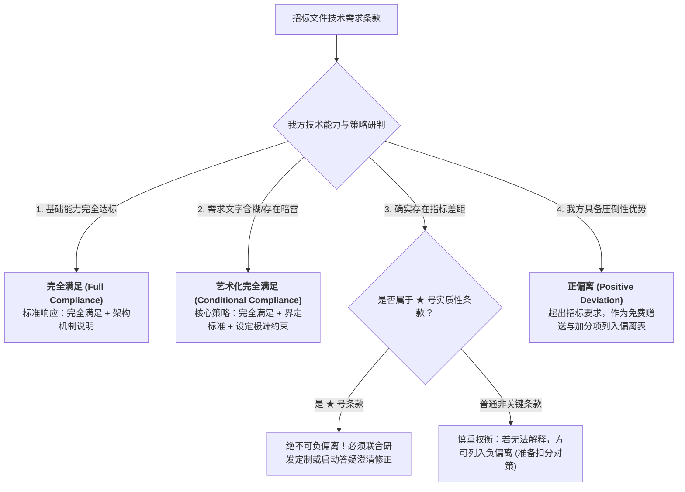

# 第47讲：点对点应答与偏离表编制：“完全满足”背后的风险与艺术

> **【本讲一句话心法】**  
> 一声轻率的“完全满足”，往往是项目交付炼狱的开端；顶级售前既不在偏离表里老实认输被无情扣分，也不在黑盒承诺中给交付埋雷，而是用严密的“带解释性完全满足”把定义权牢牢掌握在自己手中。

---

## 一、 场景痛点与认知破局

在所有投标文件组成部分中，**“技术点对点应答（Point-to-Point Response）”**与**“技术规格偏离表（Technical Deviation Table）”**通常是篇幅最长、最耗费精力、也是法律连带风险最高的核心文件。然而，许多售前工程师在面对数百项甚至上千项技术条款时，往往表现出极度的盲目与轻率：

```
                ┌────────────────────────────────────────────────────────┐
                │          点对点应答的两大极端灾难 (The Extremes)            │
                └────────────────────────────────────────────────────────┘
                                           │
         ┌─────────────────────────────────┴─────────────────────────────────┐
         ▼                                                                   ▼
   【极端一：老实认输，负偏离扣光】                                    【极端二：无脑打勾，一声叹息完全满足】
   * 面对稍微不符合的条款老实写“不满足”                               * 上千条复杂需求一律闭眼全选“完全满足”
   * 偏离表上密密麻麻列出十几条负偏离                                   * 中标后该应答直接转为法定合同验收附录
   * 评标专家按章办事，每条扣2分扣到出局                                * 客户拿着标书逐条卡验收，要求改产品底层
   * 沦为“死在诚实上的技术书呆子”                                       * 交付严重烂尾拖延数年，公司面临巨额索赔
```

### 1. 售前在技术应答中的两大致命误区
* **误区 1：“老实孩子吃大亏”——因负偏离惨遭扣分淘汰**  
  在当前的招投标商业环境中，评标委员会对于偏离表的评审机制往往极其机械而冰冷：**只要在偏离表中出现一条“负偏离（不满足或部分满足）”，专家就必须依据评分规则扣减1~3分，不管这个偏离对整体项目的实际影响有多微不足道！** 某些售前抱着极其教条的“技术诚实”，一五一十写了多处不满足，结果在技术偏离项上被扣光分数，直接丧失中标资格。
* **误区 2：“一声叹息的完全满足”——给交付团队挖下无底天坑**  
  为了保住技术分不被扣，很多售前抱着“先把单子拿下来再说，交付的事中标后再扯皮”的心态，在所有的技术需求后全部不加思索地填写“完全满足”。  
  **他们完全忽视了招投标的法律本质——技术点对点应答表在中标后，会直接被作为合同不可分割的法定附录！** 客户在项目终验时，会拿着这份标书逐条核对打勾。一旦发现某项关键底层特性是公司全球标准产品根本无法支持、需要投入数百万研发成本更改内核设计的，客户将坚决拒绝验收、扣押尾款，甚至依法向乙方索赔数倍合同额的违约金！

### 2. 认知破局：“点对点应答”的法律契约与攻防艺术
* **点对点应答的本质是“法定要约承诺”**：白纸黑字签下的每一句应答，都是具有法律强制执行力的契约约定，绝非售前个人随口说说的工作总结。
* **攻防艺术的核心哲学——“带解释的完全满足”**：  
  客户招标文件中很多看似简短的技术要求，往往文字含糊、定义模糊、甚至埋有陷阱。专业售前面对这种条款，**绝不轻易承认“不满足”而被扣分，也绝不赤裸裸写下毫无保护的“完全满足”，而是通过“先答完全满足，紧跟严密定义、补充说明与边界约束”，把技术解释权牢牢收拢在我方防御阵地内！**

---

## 二、 核心方法论与原理拆解

### 1. 技术偏离的三种形态与评标博弈法则

在编制《技术偏离表》时，必须透彻理解评标委员会的三种判定维度：



#### ① 负偏离（Negative Deviation）：尽一切可能消灭与隔离
* 负偏离是指投标响应低于招标文件要求。在正规评审中，负偏离直接对应扣分，累积超过一定项数甚至直接判定废标；
* 必须通过深入的技术方案包装与替代性补偿方案，将潜在的负偏离合规转化为“带约束的完全满足”。

#### ② 正偏离（Positive Deviation）：打造加分亮点与心理正能量
* 正偏离是指投标响应优于招标文件要求，且在本次投标报价中予以全额承诺交付（或作为增值赠送）；
* 很多招标文件在评分标准中明确设立了“正偏离加分项（每项加1~2分）”；
* 即使没有加分规则，列入数项高价值的正偏离，也能给疲惫的评标专家极大的专业好感，并为客户内部支持者提供强有力的加分辩护依据。

---

## 三、 售前实操标准动作（SOP / 打法步骤）

### 经典实战拆解：如何严谨应答“埋有大坑的含糊条款”？

我们以一个经典的工程与软件常见条款为例：  
> **招标文件原话**：*“要求供热核心控制设备稳定工作 10 年以上。”*

#### 1. 专业售前的“火眼金睛”识破暗雷：
* **暗雷一：什么叫“稳定工作”？** 客户没有定义指标。是只要通电就算稳定工作？还是水温必须达到多少度才算稳定工作？若不定义，未来客户随时可以借口“温度偶发下降”指责你未稳定工作；
* **暗雷二：“10年以上”到底是几年？** 包含10年整吗？从哪一天开始起算？是发货日、安装日还是终验日？如果不加约束，客户要求免费保修15年甚至20年，如何应对？

#### 2. “神级点对点应答”的标准工程范式：

```
  ┌────────────────────────────────────────────────────────────────────────┐
  │              “带解释性完全满足”的标准应答撰写范式                       │
  └────────────────────────────────────────────────────────────────────────┘
  【应答】：完全满足。

  【详细说明与实现方案】：
  1. 我司生产的 XX 型工业控制设备，严格遵循 ISO9001 质量管理体系与国家工业级制造标准，
     具备高可靠冗余设计，完全能够支持设备长期稳定运行。
  
  2. 【对稳定工作标准的科学定义】：
     基于工业通用规范，我方理解并承诺本设备“稳定工作”的技术判断标准为：
     ——在标准一个大气压及额定进水流量工况下，加热输出核心水温能够持续稳定维持在 90℃ 以上。
  
  3. 【对时间周期与服务边界的严密界定】：
     ——自该设备在客户现场【安装调试完成并签署初验合格单之日起 10 年内（含 10 年整）】，
       我方负责为该设备的稳定工作提供原厂级质量保障服务；
     ——若在此 10 年保障期内，确因设备自身制造质量缺陷导致无法稳定工作，我方将负责免费修复
       或更换零部件，并将故障期间对应的保障服务时长按两倍予以顺延补偿；
     ——【防扯皮极端底线设立】：为保障工程生命周期之确定性，累计顺延补偿服务期最长不超过 5 年。
```

#### 3. 这种应答的无上妙处：
* **专家打分端**：开篇第一句明明白白写着“完全满足”，格式审查完全合规，专家挑不出任何毛病，**技术分1分不扣！**
* **法务与交付端**：第二段和第三段用无可辩驳的工程科学语言，严谨锁死了技术指标定义（90℃）、起算节点（初验合格日）、以及最长顺延底线（不超过5年），**将潜在的交付无限期扯皮风险彻底扼杀在摇篮中！**

---

## 四、 实战工具箱、话术与Checklist

### 1. 技术点对点应答与偏离表编制规范矩阵

| 招标文件条款类型 | 错误应答方式（大忌） | 专业应答与偏离表处理方式（标准范式） | 战略收益 |
| :--- | :--- | :--- | :--- |
| **条款表述模糊**<br>（如：“界面操作需极其简便流畅”） | 仅写“完全满足”，不做任何展开。（中标后被客户主观挑刺刁难） | **应答**：完全满足。<br>**说明**：我方系统采用现代扁平化UI设计，关键高频业务操作实现3步以内触达，页面平均响应时间小于0.5秒，完全满足简便流畅之要求。 | 锁定客观指标，杜绝主观审美扯皮。 |
| **边缘参数稍逊**<br>（如：要求并发8000，我司标准版只支持6000） | 老实写“部分满足”，并在偏离表填入负偏离。（被专家扣除2分） | **应答**：完全满足。<br>**说明**：我司系统通过标准微服务横向扩展集群部署架构，单节点支持6000并发，通过配置双节点负载均衡即可轻松承载12000并发，性能余量达150%，完全满足并优于要求。 | 用工程架构补偿单体参数，化被动为主动。 |
| **我方独家优势**<br>（如：标书仅要求本地备份，我司支持同城双活） | 只写“完全满足”，白白浪费核心USP优势。 | **应答**：完全满足并优于要求（正偏离）。<br>**说明**：除提供本地热备外，我方承诺免费赠送同城数据中心异步数据镜像同步模块，RPO=0。**同步填入《技术正偏离表》申请加分！** | 打造标书高光亮点，赢取额外奖励加分。 |

### 2. 点对点应答终稿自检 Checklist

> [!TIP]
> 偏离表定稿前，必须逐条过堂的“防暴雷十条军规”：
> - [ ] **无一遗漏审查**：招标技术需求中的章节、段落、条目是否100%逐条对应编号？是否存在跳号或漏答？
> - [ ] **“★”号实质性条款零偏离**：所有带星号的关键条款，是否全部核对为“完全满足”且提供了对应的检测报告复印件？
> - [ ] **偏离表数量对齐**：点对点应答正文中写为“正偏离/负偏离”的项，其数量与编号是否与《技术规格偏离表》汇总表完全一致？
> - [ ] **承诺可行性审计**：所有写了“完全满足”的定制功能，拟派驻的项目经理是否已书面签字确认具备工程交付可行性？
> - [ ] **去绝对化词汇**：补充说明中是否剔除了“永久免费、无限次升级、终身随叫随到”等具有法律无限连带责任的字眼？

---

## 五、 真实标杆案例深度复盘

### 【案例背景】某千亿跨国车企全球供应链项目：一声“完全满足”赔付数千万

* **情景 (Situation)**：某全球知名软件巨头S公司参与国内某特大型合资汽车制造集团全球供应链协同系统竞标，合同总金额高达3500万元。技术需求书中包含长达180页、共计620条极为琐碎的业务细节需求。
* **冲突 (Task)**：S公司的投标售前团队在冲刺阶段为了抢进度，在点对点应答中对全部620项要求“全选复制了完全满足”，且未附带任何解释性说明。这套点对点应答表在中标后，一字不差地被作为《合同技术附件一》正式盖章签署。
* **交付灾难 (The Disaster)**：
  1. 系统上线试运行后，车企外籍总监对照《附件一》第 412 条“必须支持与德国总部某1990年代老旧专用总线协议的底层寄存器级直连”进行终验测试；
  2. S公司的现场交付团队彻底傻眼——该协议早在十年前就被S公司全球总部废止，若想重新支持，必须向全球研发总院申请修改全球标准产品内核，研发总院以“投入产出比不合理”直接拒绝；
  3. 车企总监雷霆大怒，指责S公司商业欺诈，依据合同条款坚决拒绝签署整体验收报告，并依法冻结了剩余2500万元全部未付尾款；
  4. 该项目陷入长达14个月的死局：S公司现场团队进退维谷，每天空耗巨额驻场成本；S公司内部产品部、服务部、销售部互相推诿甩锅，事件最终惊动了S公司大中华区总裁。
* **悲惨结局 (Result)**：车企最终启动国际仲裁，依据合同所附的点对点应答法律效力判定S公司违约。S公司被迫赔偿车企双倍合同定金，并承担第三方替代引进开发费用数千万元，该项目的投标售前总监被公司全球法务合规部直接开除。

---

## 六、 血泪教训与避坑红线

> [!WARNING]
> **红线 1：严禁由实习生或新入职员工“机械打勾”完成点对点应答**  
> 点对点应答绝不是单纯的文字录入排版工作！它是决定公司未来数年法律责任的死生之地。严禁把点对点工作随意甩给不了解系统架构底层边界的新人。每一条应答的背后都必须有资深架构师或交付专家的方案支撑！

> [!CAUTION]
> **红线 2：严禁在《技术偏离表》中玩弄“负偏离写成正偏离”的劣质小聪明**  
> 某些投机售前把明显达不到的参数（如招标要求支持1000个用户，我司只支持500个），狡辩为“500用户更安全轻量，属于正偏离”。评标专家由经验丰富的老工程师组成，这种低劣把戏会被专家当场视为弄虚作假、恶意侮辱专家智商，直接给予技术分全场最低分甚至按虚假应答废标！

---

## 七、 课后思考题与实战研讨指南

### 思考题 1
在实际招投标实战中，“带解释性完全满足”被誉为售前自保与赢单的最高艺术。请找出一项你当前产品中存在轻微短板或边界模糊的技术参数（如：某系统在高并发下的报表生成速度），尝试运用本讲给出的公式，写下一段既不被专家扣分、又能严密保护交付团队的经典应答话术。

> **【实战研讨指引】**  
> * **原需求**：“要求在大并发下实时生成全维度经营报表”。  
> * **我方短板**：实时计算超大历史跨度报表极度消耗算力，易导致系统卡死。  
> * **重构应答**：  
>   * 【应答】：完全满足。  
>   * 【说明】：我司系统采用“流批一体智能计算引擎”支持报表生成；我方对高并发下实时生成的工程判断标准为：针对当日及近30天内的核心经营数据，系统在5000并发洪峰下实现毫秒级即时聚合与大屏渲染；针对超过1年以上的海量历史跨度报表，系统自动采用异步预聚合与离线加速计算，在2分钟内完成高精推送并保障核心交易零延迟，完全满足高并发与经营报表之严苛要求。

### 思考题 2
在一些重大的系统集成或软件定制开发项目中，如果招标文件中确实出现了一项我方技术无论如何也无法实现、且客户内部支持者也无法协助修改的“硬伤需求”，此时你该如何在“冒死写完全满足”与“诚实写负偏离”之间进行理性的商业权衡与战术突围？

> **【实战研讨指引】**  
> 1. **核验是否为星号（★）废标项**：若是★号项，写负偏离等于直接送死废标；必须通过**引入具备该能力的合格第三方生态伙伴，以联合体或分包采购形式**在标书中进行联合集成，将缺陷抹平；  
> 2. **若为普通非★项**：绝不可盲目写完全满足！应诚实列入《技术规格偏离表》，但必须附带详尽的《替代补偿性工程方案说明》（说明我方采用何种替代方案能达到95%以上的同等业务效果）；  
> 3. **用其他维度的多项高价值“正偏离”**进行技术总分对冲，力保技术综合总分依然领先。
