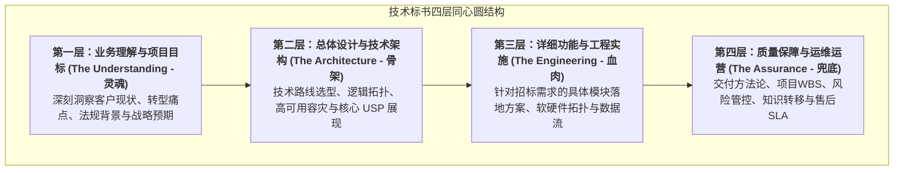
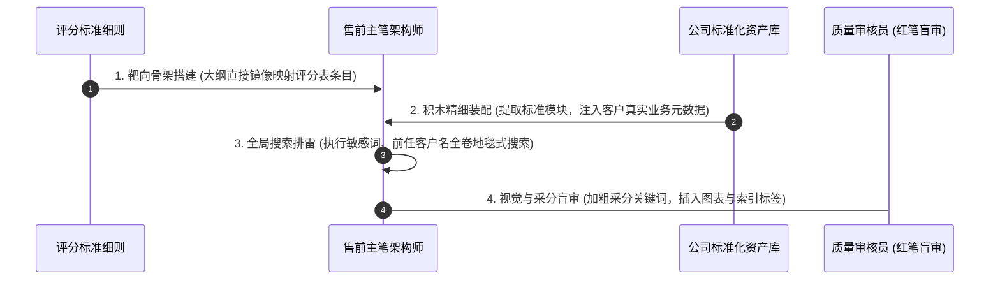

# 第48讲：投标技术方案撰写：警惕致命的“Copy-Paste”拼盘式失误

> **【本讲一句话心法】**  
> 标书是呈递给评标专家的唯一书面辩护词，绝不是旧方案的随意搬家与拼盘；一次粗暴的复制粘贴可能毁掉一字不差的技术全卷，唯有以采分点为骨架、全要素本土化重构，才能让技术方案在数百页中脱颖而出。

---

## 一、 场景痛点与认知破局

在招投标的高压冲刺阶段，技术方案的页数往往多达数百页甚至上千页。面对如此庞大的文字吞吐量与紧迫的交标截止日，绝大多数售前工程师最依赖的工具往往是电脑快捷键——`Ctrl+C` 与 `Ctrl+V`（复制与粘贴）。

然而，正是这种看似高效的**“Copy-Paste（复制粘贴）惰性”**，引发了招投标史上无数惨烈的自杀式翻车事件：

```
                ┌────────────────────────────────────────────────────────┐
                │          投标方案复制粘贴的四大致命惨祸 (Copy-Paste Traps)  │
                └────────────────────────────────────────────────────────┘
                                           │
         ┌───────────────────┬─────────────┴─────┬───────────────────┐
         ▼                   ▼                   ▼                   ▼
   【张冠李戴遗留旧名】 【逻辑割裂前后矛盾】 【通篇套话两层皮】   【未定义标签报错】
   * 投标A银行留下B银行名字* 前面写云原生微服务* 贴了上百页通用白皮书* 目录出现“错误未定义”
   * 甚至留下主要竞争对手* 后面部署写单体Tomcat* 没有一处切中客户业务* 专家翻到第一页直接皱眉
   * 专家认定粗制滥造扣分* 方案前后自相矛盾抽嘴巴* 被专家判定华而不实低分* 暴露临时拼凑拙劣马脚
```

### 1. 技术标书“拼盘式撰写”的四大恶性翻车
* **惨祸 1：张冠李戴，遗留前任客户名称甚至竞品代号**  
  将此前给“中国银行”编写的标书方案，复制给“工商银行”使用。由于漏查替换，正文第88页赫然写着“助力中国银行数字化腾飞”；更有甚者在架构图中直接保留了竞争对手某个专有组件的缩写。在极其严肃的评标专家眼里，这种失误会被瞬间判定为“态度极度不端、毫无职业道德、蔑视招标人”，技术分被直接打入最低档！
* **惨祸 2：东拼西凑，导致系统方案前后“精神分裂”**  
  技术方案由多位工程师分头拷贝：架构师拷贝了前沿的“双多活微服务容器架构”，实施工程师拷贝了五年前的老旧“单机集中式部署方案”，安全工程师拷贝了另一套“全外包安全方案”。整本技术标书前后章节逻辑严重打架、术语相互冲突，专家稍微翻阅几页就发现漏洞百出。
* **惨祸 3：通篇空洞白皮书，与招标需求“两层皮”**  
  为了把标书凑得很厚，售前从公司产品库中无节制拷贝了上百页通用产品手册、环境配置命令和代码示例。然而通篇没有一句话针对该客户特定的业务流程、历史痛点和特定约束做针对性分析。这种标书在老法师评委眼中就像“注水猪肉”，缺乏任何实质采分价值。
* **惨祸 4：格式排版崩溃，到处充斥“错误！未定义书签”**  
  在不同版本的Word文档之间反复拼接，导致样式模板彻底错乱。字体忽大忽小、行距忽宽忽窄，自动生成的目录中赫然充斥着多处红色的“**错误！未定义书签**”，评审专家一眼看去，如同在看粗制滥造的地摊读物。

### 2. 认知破局：标书撰写的“积木化重构与得分点靶向”
* **拒绝无脑搬运，推行“标准化积木+深度本土化”**：复用成熟的技术架构底座没有错，但**每一块积木必须经过客户业务语境的重新浸润与雕琢**！所有的组织架构、业务系统名称、数据流向必须与该客户的实际情况实现100%无缝咬合。
* **标书是“给评标专家开出的答卷”，必须“采分点靶向排布”**：专家不是来读文学小说的，而是在有限的2小时内，依据《评分细则表》逐项核对给分。标书的章节结构与叙事排布，必须与专家的打分卡形成绝对的镜像映射！

---

## 二、 核心方法论与原理拆解

### 1. 杀手级技术标书“四层同心圆”架构模型

一份高水准、能让专家闭着眼睛打出高分的技术标书，必须具备严谨的四层结构：



#### ① 第一层：业务理解（让专家看到诚意与深度）
* 严禁直接贴产品！必须先花20~30页篇幅，详尽剖析客户当前的信息化现状、面临的核心业务瓶颈、外部政策与监管合规要求，并梳理出本项目建设的指导思想与分期建设目标。
* 评委读完第一章，心中就会定下基调：“这家厂商是真正沉下心研究了我们的业务，不是来敷衍了事的。”

#### ② 第二层：总体设计（体现大厂技术格局）
* 给出系统的总体架构图、数据架构图、网络拓扑图与安全架构图；
* 重点阐述**“为什么选择这种架构”**，并将前期策划的核心 USP（独特卖点）作为核心章节重点推演。

#### ③ 第三层：详细功能（全面覆盖招标需求）
* 严格按照招标文件的技术需求章节逐条对应展开，提供深入、具体、可落地的业务逻辑流程图与交互时序图。

#### ④ 第四层：实施与保障（打消落地疑虑）
* 详细规划项目进度甘特图、里程碑交付成果物、人员进场计划、应急回滚机制与培训方案。

---

## 三、 售前实操标准动作（SOP / 打法步骤）

在撰写与组装技术标书时，售前团队必须遵循以下四步标准作业SOP：



### 步骤1：大纲直接镜像对齐《评分标准细则》
* 拿到评分表后，**直接将评分表中的大项和小项编号，复制为技术标书的二级和三级标题！**
  * *例如*：评分表第 2.1 项为“系统高可用与容灾设计方案（5分）”，标书对应章节标题直接定为：  
    `【2.1 系统高可用与容灾设计方案】（响应评分细则第2.1项，满分5分要求）`；
* 专家的目光在翻到这一章时，无需任何思索，直接在该栏打出满分！

### 步骤2：执行“全要素本土化清洗”（清洗掉一切旧客户痕迹）
* 在复用公司标准案例和产品模块时，必须执行“三项强制重写”：
  1. **系统名称重写**：将通用的“XX企业级平台”全部替换为本项目正式立项全称（如“XX集团智慧运营数字大脑系统”）；
  2. **业务流程重写**：将示例图中的角色替换为客户内部的真实处室与岗位名称；
  3. **数据规模重写**：将通用性能参数调整为完全适配客户当前真实体量与未来3年增长预期的合理规模。

### 步骤3：全卷地毯式“敏感词排雷”六大组合搜索
在技术标书最终定稿、转换为PDF之前，主笔售前必须在Word中按下 `Ctrl+F`，逐一执行以下六组**地毯式搜索排雷**：

```
  ┌────────────────────────────────────────────────────────────────────────┐
  │                 技术标书终稿敏感词地毯式搜索清单                       │
  └────────────────────────────────────────────────────────────────────────┘
    1. 【搜索前任客户简称】 搜索上一个类似项目客户的所有全称、简称、缩写、别名。
    2. 【搜索竞争对手代号】 搜索业内主流竞争对手的企业名称、主要产品线型号与品牌。
    3. 【搜索Word系统报错】 搜索“错误！”、“未定义书签”、“Error: Reference”。
    4. 【搜索通用占位符】   搜索“XX公司”、“XXX”、“【请在此处填写】”、“待定”。
    5. 【搜索旧年份与历史】 搜索过往年份（如“2023年”、“2024年”），防止出现时间穿越。
    6. 【搜索研发内部黑话】 搜索研发内部代号、Git仓库私有链接、localhost IP等。
```

### 步骤4：视觉强化工程（让得分点跃然纸上）
* **关键词加粗法则**：在每一段技术论述的第一句，将核心得分点（如“跨城三中心”、“国密二级”、“响应时间<1秒”）进行**加粗高亮显示**；
* **图文并茂法则**：严禁连续出现三页没有任何图表的纯文本大段落！必须每隔1~2页插入一张高清架构图、流程拓扑图或指标对比表格；
* 所有的图片必须具备独立的编号与标题（如“图 3-2 核心系统异地多活数据流转拓扑图”）。

---

## 四、 实战工具箱、话术与Checklist

### 1. 标书技术方案编制规范与版式速查表

| 版面维度 | 低端拼盘式标书（扣分项） | 专业大厂技术标书（加分项） |
| :--- | :--- | :--- |
| **封面与扉页** | 随便找的彩色Word模板，客户名称字体变形，日期手写。 | 遵循严谨的VI规范，深蓝或科技灰沉稳封面，项目全称居中，标明正本/副本，盖骑缝章。 |
| **目录呈现** | 只有单薄的一页目录，点开跳到错误页面，缺乏图表索引。 | 包含完整的三级目录，页码准确无误；大型标书额外附带《图表目录》与《专用术语表》。 |
| **架构图质量** | 模糊不清的截屏，甚至带着开发环境右下角的Windows激活水印。 | 矢量图（Visio/SVG）绘制，高清无噪点，配色符合全书主色调，文字清晰可读。 |
| **采分指引** | 隐藏在密密麻麻的文字堆里，专家找得分点找得头晕眼花。 | 开篇设立《技术方案采分点快速索引表》，明确指出评分细则每一项对应第几章、第几页。 |

### 2. 技术标书出厂前终极巡检 Checklist

> [!TIP]
> 标书送交打印装订前30分钟，必须由独立审核人逐项打勾的“防自杀检查单”：
> - [ ] **无旧客户痕迹**：全卷搜索上一家客户名称及其拼音缩写，结果是否确认为 0 处？
> - [ ] **目录完全更新**：是否已在 Word 中执行“全选 -> 更新整个目录”，目录页码是否与正文完全对应？
> - [ ] **页眉页脚一致**：所有奇偶数页的页眉上的项目名称是否完全正确？页码是否从正文第1页开始连续编号？
> - [ ] **无错漏图表**：是否存在空白图框、或者图片加载失败显示的“红色大叉”？
> - [ ] **★号条款对应**：标书中对带有“★”实质性技术条款的解答，是否单独设立小节并贴出了权威检测证明报告？

---

## 五、 真实标杆案例深度复盘

### 【案例背景】某特大型商业银行全行信创数据库千万级招标：两张架构图的生死局

* **情景 (Situation)**：某全国性股份制商业银行启动核心系统信创分布式数据库招标，预算2800万元。入围最终评标的包括老牌数据库厂商G公司与新兴自研数据库领军企业O公司。两家在前期技术评估中平分秋色。
* **冲突 (Task)**：在开标现场，五位来自人民银行清算中心及同业的顶级数据库评委进行封闭评标。当评委翻阅G公司的技术标书时，一位专家突然皱起眉头，指着第 142 页的“同城容灾切换逻辑图”说：“大家看，G公司这个拓扑图右上角的管理后台图标，怎么赫然写着‘某某省电力调度专用控制台’？而且文字说明里写着‘确保全省电网负荷平稳’？”
* **灾难曝光 (The Blunder)**：
  1. G公司的售前主笔为了图快，从半年前刚做完的国家电网项目中直接截取了一套容灾方案架构图，由于赶工期，连图中的电力行业术语和界面都没做替换修改；
  2. 评委们随即顺藤摸瓜仔细审查，又在第 210 页发现了多处“国网公司”的字样；
  3. 评委会当场达成共识：G公司对本行核心交易系统缺乏基本的严肃态度与商业尊重，技术标书存在严重的恶意拼凑与不负责任问题；
  4. 最终，评委会在“技术方案成熟度与针对性”这一单项上（满分30分），给G公司打出了全场最低的16分！
* **结果 (Result)**：而O公司的技术标书通篇以该银行真实的借记卡、信用卡业务交易流为切入点，每一张图都量身定制、逻辑严密，最终以29分的极高技术分降维碾压G公司，顺利以高溢价斩获该千万级大单。G公司因一次粗暴的复制粘贴，直接葬送了上千万人力投入与商业前景！

---

## 六、 血泪教训与避坑红线

> [!WARNING]
> **红线 1：严禁直接复用带有竞争对手公司名称、商标或专有专利代号的图表**  
> 有些售前为了展示方案的业界先进性，从网上或竞争对手的公开宣传资料中截图贴进标书，甚至保留了竞品的 Logo 或专有协议名称。这种失误在评标现场极其刺眼，会被专家直接判定为“本厂商不具备自研核心能力，纯属抄袭盗用他人成果”，直接取消技术评优资格！

> [!CAUTION]
> **红线 2：严禁技术方案中的硬件配置清单与商务报价清单“规格脱节”**  
> 技术标书的第三章详细规划了需要配置 16 台高性能GPU服务器，然而商务标书中的报价明细表中却只报了 8 台普通CPU服务器。这种“技术与商务前后矛盾”的重大脱节，会被评标委员会直接认定为“投标文件前后矛盾、未对招标文件做出实质性响应”，甚至引发恶意低价不平衡报价的合规质疑！

---

## 七、 课后思考题与实战研讨指南

### 思考题 1
为什么说“大纲结构与招标文件评分标准细则的完全镜像对齐”是大幅提高评标专家给分效率与好感度的最强法门？请以一项具体的“数据中台治理评分细则（满分10分）”为例，设计一段能让专家在30秒内清晰打出满分的章节大纲与版面呈现样式。

> **【实战研讨指引】**  
> * **专家痛点**：专家必须在评分表上写下打分理由与页码索引；标书若东一榔头西一棒槌，专家找不到就会直接扣分；  
> * **大纲镜像范例**：  
>   * `第 3.2 节 数据资产全生命周期治理方案（响应评分细则第 3.2 项，满分 10 分）`  
>     * `3.2.1 【采分点一：数据全链路自动化元数据采集】（得分点：对应细则标准1，满分3分）`  
>       * *正文*：加粗写出核心机制，附第三方评测认证页码索引；  
>     * `3.2.2 【采分点二：国密级动态脱敏与敏感数据分级】（得分点：对应细则标准2，满分3分）`  
>     * `3.2.3 【采分点三：PB级实时数据血缘拓扑推演】（得分点：对应细则标准3，满分4分）`  
> * **效果**：专家对照评分表直接勾选，30秒内满分到手！

### 思考题 2
在面临投标周期极短（如只有5天时间）、必须大量复用过往技术资产的极端压力下，你将如何组织团队建立一套快速“排雷与本土化重塑”机制，以确保既能高速产出上百页标书、又能绝对杜绝出现“张冠李戴”的致命低级失误？

> **【实战研讨指引】**  
> 1. **建立纯净的“去标识化母本库”**：严禁直接从上一个活项目Word中拷贝！必须从公司PMO维护的、已经将所有客户名称清洗为标准占位符（如 `{CLIENT_NAME}`）的母本库中提取；  
> 2. **实施宏命令/自动化变量注入**：利用脚本或Word高级替换功能，将母本变量一次性批量替换为当前客户全称与项目全称；  
> 3. **设立专职“排雷员（Sentry）”**：指定一名未参与方案写作的售前，专职负责执行本讲提到的“六大组合敏感词地毯式搜索”，排雷不通过严禁交付文印。
