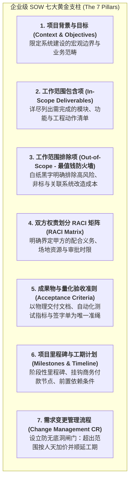
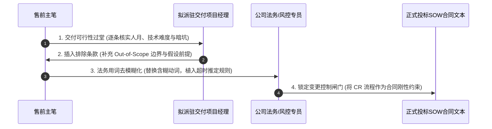

# 第49讲：SOW（工作说明书）撰写精要：像律师一样严密界定边界

> **【本讲一句话心法】**  
> 技术方案描绘的是星辰大海的“能力与预期”，而SOW界定的是寸土必争的“权责与边界”；像严谨的律师一样字斟句酌，把不包含内容与验收准则钉死在契约上，才是保护交付团队不被客户“无底洞需求”拖垮的终极防火墙。

---

## 一、 场景痛点与认知破局

在企业级商业合同与投标文件中，如果说技术方案解决的是客户“愿不愿买”的问题，那么**工作说明书（SOW - Statement of Work）**解决的则是中标后双方“如何履约、如何验收、如何算钱”的生死契约问题。

然而，绝大多数缺乏交付敬畏的售前工程师在撰写SOW时，往往表现出极度的随性与业余：

```
                ┌────────────────────────────────────────────────────────┐
                │          SOW 撰写随意引发的交付惨剧 (The SOW Catastrophe)  │
                └────────────────────────────────────────────────────────┘
                                           │
         ┌───────────────────┬─────────────┴─────┬───────────────────┐
         ▼                   ▼                   ▼                   ▼
   【大而化之缺乏边界】 【只有In没有Out】    【权责失衡乙方全包】 【验收准则主观抽象】
   * "负责全省数据打通" * 只写要做什么         * 甲方迟迟不给网络权限* "达到领导满意为止"
   * "协助进行历史治理" * 没写哪些坚决不做     * 接口改造甩锅给乙方  * 客户以不顺手为由拒付款
   * 范围无限膨胀扩大   * 客户免费索要海量定制 * 延误工期还被扣罚违约金* 交付团队天天通宵救火
```

### 1. 劣质 SOW 给交付带来的三大灭顶之灾
* **灾难 1：范围无限蔓延（Scope Creep），沦为“免费外包长工”**  
  售前在SOW中写下诸如“负责本系统与客户现有所有业务系统的无缝对接集成”。中标进场后，交付团队惊恐地发现客户内部有整整40套跨越20年历史的老旧系统，很多甚至连开发商都已经倒闭。客户指着SOW说：“你们写了负责所有系统对接，不接完就不给初验！”交付团队被迫在现场肉身填坑一年，成本超支数百万。
* **灾难 2：只有“包含内容（In-Scope）”，没有“排除内容（Out-of-Scope）”**  
  平庸售前以为列出工作清单就万事大吉，完全忽略了**“不包含内容才是SOW中最值钱的防火墙”**！没有明确排除“历史脏数据人工清洗”、没有排除“老旧接口改造成本”、没有排除“第三方硬件采购与机房布线”，导致客户理所当然地把所有脏活累活全扣在乙方头上。
* **灾难 3：验收标准抽象主观，客户借口无限期“卡付款”**  
  验收标准写成“系统运行稳定、用户体验优良、达到业务部门满意标准”。这种主观性极强的词汇赋予了客户无限的自由裁量权。客户只要不想付款，就可以随时挑刺“我觉得界面不够大气、这个按钮我觉得不顺手”，导致初验和终验遥遥无期，公司现金流被严重拖垮。

### 2. 认知破局：SOW的“法律契约属性与攻防平衡”
* **SOW是“合同中最硬核的法律要约”**：中标后，SOW会一字不差地直接作为商务合同的《附件一：技术与实施工作说明书》，具有不可撤销的法律强制执行力。
* **像律师一样严密书写（Draft Like a Lawyer）**：  
  严禁使用文学修饰词和情绪化套话！必须使用**定义严密、边界清晰、责任对称、量化可测、具备明确时间锁与违约救济条款**的工程法律语言。**界定清晰不是为了推卸责任，而是为了建立健康的商业边界，确保项目在双方互信的轨道上成功交付！**

---

## 二、 核心方法论与原理拆解

### 1. 卓越 SOW 的“七大黄金支柱”体系模型

一份能够经受住最严苛审计与法务考验的企业级SOW，必须由七大支柱严密咬合而成：



#### ① 第三支柱：排除内容（Out-of-Scope - 核心护城河）
* **必须设立专章明确列出《工作范围排除内容》**：
  * *例如*：明确写明“**本项目不包含**：① 甲方源系统数据库中历史脏数据的清洗、修复与补全；② 甲方现有第三方遗留系统的代码级接口改造费用；③ 操作系统、数据库及中间件的商业商用授权费用；④ 现场机房服务器机架安装及强弱电物理布线工程。”
* 这一专章能够直接为交付团队堵住未来90%的无底洞扯皮风险！

#### ② 第四支柱：甲方的配合义务（设定前置约束）
* 商业履约是双向奔赴。SOW必须明确写入甲方的法定配合义务：
  * 甲方必须在项目启动后 5 个工作日内提供合规的网络专线与测试环境；
  * 甲方必须指定具备最终决策权的业务接口人（业务PO）；
  * **逾期默示认可规则**：甲方在收到阶段成果物后，必须在 5 个工作日内出具书面评审意见；若逾期未出具书面异议，**依法视为甲方对该阶段成果物无保留验收合格**！

---

## 三、 售前实操标准动作（SOP / 打法步骤）

在起草与打磨SOW时，售前工程师必须执行以下四步“像律师一样审查”的标杆动作：



### 步骤1：与拟派驻项目经理闭门“过堂会审”
* SOW初稿完成后，售前必须把拟派驻的项目经理请到作战室，逐行过堂：
  * *售前自问*：“王工，如果让你按这份SOW去现场带队干，你觉得哪个地方会被客户掐住脖子？”
* 将项目经理提出的所有工程隐患与交付疑虑，全量转化为SOW中的假设前提（Assumptions）与排除项。

### 步骤2：执行“动词精确化手术”（消灭模糊黑话）
* 地毯式排查SOW中的一切含糊动词，执行**法务级替换**：
  * 严禁使用“**负责**全系统打通” -> 替换为“**提供标准 OpenAPI 接口规范文档与模拟器，并在甲方源系统改造完成后配合进行联调测试**”；
  * 严禁使用“**协助**进行业务梳理” -> 替换为“**组织不超过 3 场业务需求澄清工作坊，并输出《业务调研纪要》供甲方确认**”；
  * 严禁使用“**保证**性能优异” -> 替换为“**在符合附录A硬件基线的环境下，核心接口P99响应时延小于1.5秒**”。

### 步骤3：设定量化的“数量与频次天花板”
* 所有的非标服务必须设定刚性上限：
  * 接口对接写明“**对接不超过 5 个指定业务接口**（超出部分按标准人天变更另行计费）”；
  * 现场培训写明“**提供为期 2 天、累计不超过 16 课时的现场集中操作培训**（培训对象不超过30人）”；
  * 报表开发写明“**定制开发不超过 10 张核心标准财务报表**”。

### 步骤4：设立刚性的“需求变更控制闸门（Change Request）”
* 在SOW中明确专章约定变更控制流程：
  1. 任何超出In-Scope范围的新增、修改或业务流程重构，均属于范围变更；
  2. 范围变更必须由甲方发起正式书面《变更申请单（CR）》；
  3. 乙方在收到CR后3个工作日内评估工作量与费用增量；
  4. **经双方授权人签字并确认追加合同费用与顺延项目工期后，变更方可正式实施！**

---

## 四、 实战工具箱、话术与Checklist

### 1. SOW 核心条款法律化重构对照范式表

| 传统业余写法（引发灭顶之灾） | 像律师一样的专业写法（坚固防火墙） | 法律与商业保障价值 |
| :--- | :--- | :--- |
| “乙方负责完成系统与甲方旧ERP系统的历史数据迁移。” | “乙方负责提供标准数据导入模板与清洗校验规则工具。甲方负责在其内部组织力量完成源系统历史脏数据的排查与清洗，并按照乙方模板格式提供最终脱敏数据源。乙方负责将甲方确认后的合格数据执行脚本批量导入，单次导入上限不超过100万条，并共同验证总量吻合。” | 彻底免除乙方承担客户历史脏数据混乱、数据缺失、账目不平的无限连带责任。 |
| “乙方承诺项目上线后提供优质的驻场支持，直到系统平稳运行。” | “自系统完成终验之日起，乙方提供为期 30 个自然日（正常法定工作日 9:00-18:00）的现场初保支持（派驻初级工程师 1 人）。服务内容仅限于系统基础运行巡检与操作指导。初保期满后，现场服务自动终止，系统转入标准远程维保SLA支持模式。” | 明确驻场人数、时长、工作范围与退出机制，严防客户把高级架构师当成免费长工扣留半年。 |
| “阶段成果物经甲方审核同意后，进入下一阶段。” | “乙方提交阶段成果物（包括但不限于需求规格说明书、设计文档、系统测试报告）后，甲方应在 5 个工作日内组织评审并出具书面签认意见。若甲方逾期未出具书面异议，亦未签署签认单，自第 6 个工作日起，视为甲方已完全认可并验收通过该阶段成果物，乙方有权推进下一阶段实施并触发对应付款节点。” | 彻底打破客户故意拖延签字、逃避付款的官僚被动局面（设立逾期默示认可规则）。 |

### 2. SOW 出厂前终极法律巡检 Checklist

> [!TIP]
> 投标SOW盖章装订前，必须由售前负责人与法务逐条对齐的“护城河检查单”：
> - [ ] **Out-of-Scope 独立成章**：标书中是否有清晰、显眼的《工作范围不包含内容》专章？
> - [ ] **模糊动词归零**：全篇是否已彻底消灭了“负责到底、随叫随到、全面协助、直到满意”等模糊承诺？
> - [ ] **验收准则客观化**：每一项阶段验收是否都有明确对应的“物理签字单”或“量化指标数字”作为唯一判定基准？
> - [ ] **数量上限锁定**：接口数量、定制报表数量、培训场次、驻场人天是否全部标注了确切的阿拉伯数字上限？
> - [ ] **变更费用计价基准明确**：变更流程中是否明确约定了“新增人天费用标准（如 XX 元/人天）与工期顺延规则”？

---

## 五、 真实标杆案例深度复盘

### 【案例背景】某特大型钢铁集团智慧能耗监控中台：一份价值千万的 SOW

* **情景 (Situation)**：国内某千万吨级钢铁集团启动全厂智慧能耗与碳资产管理平台建设，中标标的额1600万元。由于钢铁厂跨越数十个分厂、拥有数百座老旧加热炉与燃气发电机组，现场工业现场极为恶劣复杂。
* **冲突 (Task)**：在项目推进到第6个月时，钢铁厂动力车间主任突然发难，要求乙方交付团队必须负责为全厂48座老旧转炉现场加装数千只进口高温高压物理流量传感器，并负责从车间到机房长达十几公里的光缆挖沟敷设工程。车间主任强硬表示：“你们标书里写了负责‘全厂能耗数据采集与监控’，没有传感器哪来的数据？不把传感器装完光缆拉好，一分钱中期款都别想拿！”
* **行动 (Action)**：
  1. **亮出钢铁般的 SOW 防火墙**：关键时刻，售前总监老常与项目经理拿出当初投标时一字未改、正式签入合同附录的《SOW 工作说明书》；
  2. **第 2.3 条【工作范围排除内容】一锤定音**：
     * 条款白纸黑字写明：  
       *“本项目工作范围严格限定于软件平台层及标准工业协议解析层。**本项目明确定性不包含以下内容**：  
       ① 工业现场一次仪表、传感器、执行机构等硬件设备的采购、物理安装与电气接线；  
       ② 车间现场强弱电管廊敷设、光纤铺设及土建开挖工程；  
       ③ 现有老旧 PLC/DCS 控制系统的内部逻辑梯形图修改与点位授权开放费用。  
       上述所有物理施工与硬件采购均由甲方自行负责或另行委托专业工程施工方完成，并由甲方负责在各分厂PLC网关处提供标准 Modbus/OPC-UA 以太网接口供乙方接入。”*；
  3. **出具变更报价函，反客为主**：老常从容向集团副总裁汇报：“李总，如果要我们承担现场传感器安装与拉光纤工程，完全没问题！我们依据合同第 7 条【变更控制管理机制】，已为您测算好了工程变更预算：需要追加工程与硬件费用 650 万元，工期顺延 4 个月。请领导批示签署变更单。”
* **结果 (Result)**：面对无可辩驳、条理如铁的合同法律文件，集团副总裁当场批评了车间主任的无理要求，责令动力车间自行协调内部机动处出资铺设光缆与传感器，并在3天内核准签署了乙方的中期付款单。正是售前在投标期编写的严密 SOW，为公司直接挽回了数百万元的惨重工程亏损！

---

## 六、 血泪教训与避坑红线

> [!WARNING]
> **红线 1：严禁为了讨好客户在 SOW 中签署“直到客户领导完全满意为止”的荒唐条款**  
> 在部分客户的格式合同或招标要求中，经常会出现“服务必须达到甲方各级主管领导满意为止”的恶霸条款。售前与销售必须坚决抵制，并启动答疑或偏离修改！“满意”是无休止的主观情绪，绝不是客观的工程标准。一旦签署此类条款，意味着将公司的交付生命线完全拱手送给客户个别领导的主观心情摆布！

> [!CAUTION]
> **红线 2：严禁对第三方系统接口联调做出“保单向成功”的绝对承诺**  
> 跨系统集成是交付中最容易扯皮的深水区。绝不可承诺“负责把第三方系统调通”。必须将责任界定为：“**乙方负责自身系统接口的开发与开放；第三方系统的接口开放、改造进度、网络连通性及数据准确性由甲方负责协调。若因第三方原因导致联调受阻，项目工期相应顺延，且不影响乙方对应阶段的验收付款**”。

---

## 七、 课后思考题与实战研讨指南

### 思考题 1
为什么在企业级软件工程中，“工作范围排除项（Out-of-Scope）”往往比“包含项（In-Scope）”更加具有商业与法律价值？请为你当前主攻的一个项目，列出至少五条最具“避坑与防损价值”的 Out-of-Scope 刚性条款。

> **【实战研讨指引】**  
> * **商业逻辑**：包含项解决的是“期望”，而排除项封死的是“风险”；客户的贪婪与需求发散是无边界的，唯有用排除项划定法律高压线；  
> * **五条核心排除项范例**：  
>   1. 排除源系统历史脏数据的人工校验、清洗与修复；  
>   2. 排除非合同指定第三方系统的接口改造与代码开发费用；  
>   3. 排除服务器、存储、安全设备及商业数据库操作系统的采购与维保；  
>   4. 排除因客户网络中断、机房停电引发的数据丢失及现场抢修责任；  
>   5. 排除超出约定场次与课时之外的额外定制化用户培训。

### 思考题 2
在SOW编制过程中，如果你遇到一位极为强势的客户采购主管，坚决要求删除你写入的“逾期未出具评审意见视为默认验收通过”这一默示认可条款，作为现场主笔售前，你应如何从“保障项目整体按期推进与风险对等”的角度，有理有据地与客户谈判并达成可接受的折中方案？

> **【实战研讨指引】**  
> 1. **诉诸项目共同利益（工期大局）**：“张主任，我们非常理解贵司对严谨验收的关切。但大型工程讲究环环相扣，如果某个阶段成果物无限期处于待评审状态，交付团队无法开展下一阶段工作，不仅数十名专家团队在现场会产生高昂的人力空耗，更会直接危及贵司集团定下的年底上线献礼节点”；  
> 2. **提供折中平衡条款（延长时限+书面预警通知）**：  
>    * 将时限从5个工作日放宽至10个工作日；  
>    * 增加“预警提示环节”：若第10个工作日甲方未确认，乙方需正式发送《验收确认催告函》；若收到催告函后5个工作日内甲方仍未提出书面修改意见，方正式视为默认通过；  
> 3. 既给足客户内部审批从容度，又守住了不被无限期拖延的程序底线。
