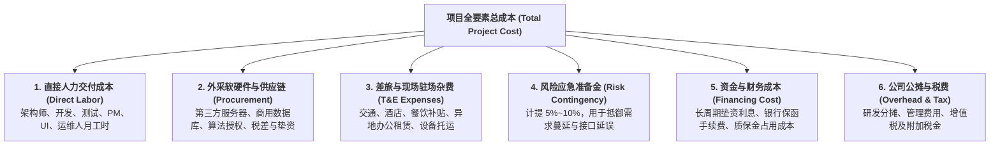
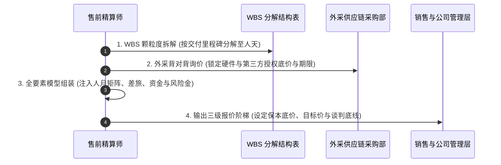

# 第50讲：项目成本、工期与风险精密测算

> **【本讲一句话心法】**  
> 涉及真金白银的数字，容不得半点拍脑袋的虚妄与冲动；不懂成本核算的售前是盲人骑瞎马，唯有以WBS为基准精算人月、锁死外采风险并计提应急准备金，才能在商业谈判与交付盈利之间筑起坚不可摧的利益护城河。

---

## 一、 场景痛点与认知破局

在招投标临近封标的商务测算阶段，**“项目成本、工期与报价核算”**往往是售前、销售与交付之间矛盾最集中爆发的深水区。许多技术出身的售前工程师由于缺乏严谨的财务概念与工程敬畏，往往表现出两大极端偏航：

```
                ┌────────────────────────────────────────────────────────┐
                │          成本测算的两大极端误区 (Cost Calculation Errors)  │
                └────────────────────────────────────────────────────────┘
                                           │
         ┌─────────────────────────────────┴─────────────────────────────────┐
         ▼                                                                   ▼
   【极端一：盲目乐观，中标即亏损】                                    【极端二：保守虚高，高价吓退客户】
   * 为了帮销售拿单恶意压缩人月预算                                     * 缺乏精细化拆解，层层注水加码
   * 漏算差旅驻场、垫资利息与外采税差                                   * 报出一个脱离市场行情的离谱天价
   * 中标后交付部门天天通宵仍严重超支                                   * 在价格分上被主要竞争对手全面碾压
   * 售前被扣上“为拿单乱放卫星”骂名                                     * 前期所有技术优势在商务阶段功亏一篑
```

### 1. 售前在成本测算中的四大典型硬伤
* **硬伤 1：拍脑袋估算，缺乏 WBS 工作分解支撑**  
  凭感觉说一句“这个系统大概找5个人干3个月就能搞定”。没有将业务拆解为模块、接口、测试用例和环境部署的具体人天，导致实际进场后发现需求复杂度是预估的3倍，工期一拖再拖，利润被彻底吞噬。
* **硬伤 2：漏算隐性成本，账面毛利沦为“虚假繁荣”**  
  只算了研发人员的月薪成本，完全漏算了：**外地长期驻场差旅费（机票酒店往往吃掉20%利润）、第三方软硬件外采进销税率差（13%进项与6%销项的税负摩擦）、长达1~3年的质保金资金占用利息、以及现场驻场办公网络租赁费**。公司看似签了千万大单，结账时却发现净利润为负！
* **硬伤 3：缺乏风险准备金意识，对不可抗力毫无抗体**  
  在测算中假设一切顺利、天气晴朗、客户极其配合、第三方系统毫无延迟。然而现实中只要客户中层人员换届、或者第三方接口联调耽误一个月，项目立刻由盈转亏。
* **硬伤 4：不懂得“用技术方案优化成本结构”**  
  成本降不下来就逼着销售降价格、或者逼着交付压低人员薪资。卓越的售前懂得通过**架构优化（如用开源可控组件替代昂贵商用中间件、用自动化低代码工具压缩手工报表人天）**，在源头上实现降本增效，为商务竞标拉开巨大的价格战弹性空间。

### 2. 认知破局：成本测算的商业战略本质
* **“涉及钱的事情都要慎之又慎”**：企业存在的第一法则是盈利与生存。投标报价不是数字游戏，售前测算出的每一个数字，都直接决定了公司真实资金的流出与交付兄弟们的生计。
* **售前在成本测算中的核心定位——“首席价值精算师”**：  
  售前绝不是销售降价逼单的橡皮图章，而是理性的刹车片与导航仪！**通过精密的 WBS 测算，给出真实的“项目成本底线（Floor Price）”；通过独特的 USP 价值包装，为销售争取最大的“商务溢价空间（Ceiling Price）”！**

---

## 二、 核心方法论与原理拆解

### 1. 企业级项目全要素成本构成模型（Total Cost Model）

一份严谨的企业级项目成本测算单，必须由六大要素板块精密构成：



#### ① 直接人力成本的阶梯矩阵核算（人月法）
* 拒绝按“平均人头”粗放计算！必须按**角色技能等级与内部结算单价矩阵**逐项精算：
  * **资深架构师 / 咨询专家**：负责顶层设计与疑难攻坚，单价高（如 4~6 万/人月），严格控制投入人月；
  * **中高级开发工程师 / 前端工程师**：负责业务主力开发，单价适中（如 2.5~3.5 万/人月）；
  * **测试工程师 / 实施支持人员**：负责流水线测试与现场配置，单价经济（如 1.5~2 万/人月）。

#### ② 风险应急准备金（Risk Contingency - 绝不可省的救命钱）
* 在软件与集成工程中，**“墨菲定律的发生概率是 100%”**；
* 必须根据项目风险等级（客户熟悉度、技术新颖度、第三方依赖复杂度），在净成本基础上**强制计提 5%~10% 的风险准备金**。这笔钱是留给项目经理在交付中化解突发危机的专用“安全气囊”，严禁在投标初期被销售随意砍掉！

---

## 三、 售前实操标准动作（SOP / 打法步骤）

实施精密成本测算，必须严格遵循以下四步标准作业流：



### 步骤1：基于 WBS（工作分解结构）的人天精算
* 将 SOW 确定的 In-Scope 范围拆解至二级甚至三级模块；
* 每一个功能点采用**“三点估算法（PERT）”**测算工时：
  $$\text{期望工时 } E = \frac{O (\text{最乐观工时}) + 4M (\text{最可能工时}) + P (\text{最悲观工时})}{6}$$
* 汇总得出各角色所需净人天，并按 21.75 天折算为标准人月。

### 步骤2：外采供应链的“背对背锁价”
* 涉及外购服务器、网络设备、商业软件授权的，严禁使用官网零售指导价！
* 协同公司采购部，向至少两家合格代理商发起**背对背真实项目询价（RFQ）**；
* 重点锁定：**供货周期、进项发票税率、付款账期、以及价格有效保护期（必须覆盖投标至项目开工的至少90天）**，防止中标后上游硬件涨价引发利润穿透。

### 步骤3：全成本模型组装与毛利率测算
* 在公司标准的《项目成本核算测算表（Cost Sheet）》中录入所有明细科目；
* 计算不同报价水平下的**内部毛利率（Gross Margin）**与**净利润率**；
* 重点核验是否满足公司管委会设定的毛利率底线红线（如软件自研项目毛利率不低于 45%，集成外采项目毛利率不低于 20%）。

### 步骤4：为销售定制“三级商务报价阶梯方案”
* 售前不应只扔给销售一个孤立的数字，而应提供战术报价区间：
  1. **冲高报价（Ceiling Price / 理想价）**：利用我方独特卖点（USP）与不可替代性，支撑高溢价，预留商务博弈与谈判首轮让利空间；
  2. **目标报价（Target Price / 稳健价）**：综合考量竞争对手态势与技术评分差距，在技术撑商务前提下的最优中标平衡价；
  3. **保本底价（Floor Price / 警戒红线）**：满足公司最低毛利要求的生死线，任何销售未经特批绝不可跌破此线！

---

## 四、 实战工具箱、话术与Checklist

### 1. 企业级项目全要素成本精密测算看板（Template）

```
========================================================================================================
【项目商务精算总表】某千亿制造集团数字中台项目成本与商务定价模型
编制人：资深售前老张                项目周期：8个月（实施6个月+初保2个月）         币种：人民币（元）
========================================================================================================
 一、直接人力成本核算 (WBS 人天汇总折算)
 岗位角色              职级单价(元/月)   需求分析   架构开发   系统测试   割接上线   合计人月   小计金额(元)
 -------------------------------------------------------------------------------------------------------
 首席架构师 / 顾问      50,000            1.5        2.0        0.5        0.5        4.5       225,000
 高级后端开发工程师    32,000            0.5        8.0        1.5        1.0       11.0       352,000
 前端与 UI 工程师       25,000            0.5        4.0        1.0        0.5        6.0       150,000
 资深测试工程师        22,000            0.0        2.0        3.0        1.0        6.0       132,000
 专职交付项目经理(PM)  35,000            1.0        3.0        1.5        1.5        7.0       245,000
 【人力成本直接小计】                                                              34.5 人月  1,104,000
 -------------------------------------------------------------------------------------------------------
 二、外采软硬件与第三方服务成本 (供应链锁定)
 外采科目              品牌/供应商       规格型号/授权数   含税进价(元)  税率   不含税成本(元) 备注
 -------------------------------------------------------------------------------------------------------
 高性能应用服务器      浪潮/指定代理     NF5280M6 (4台)     280,000      13%    247,787        背对背锁价90天
 分布式缓存商业授权    Redis Enterprise  8节点集群授权      150,000       6%    141,509        原厂特批折扣
 第三方接口适配外包    本地生态伙伴      老系统专有适配     120,000       6%    113,208        固定总价SOW
 【外采供应链小计】                                                                502,504
 -------------------------------------------------------------------------------------------------------
 三、异地现场差旅与实施驻场杂费 (T&E)
 费用科目              测算标准与基数                                            小计金额(元)
 -------------------------------------------------------------------------------------------------------
 往返城际交通(高铁/机) 核心骨干累计往返 40 人次 × 1,500 元/次                     60,000
 现场驻场住宿与酒店    平均 2 人常驻 × 180 天 × 350 元/天/间                       126,000
 现场综合餐饮与市内交通补贴 34.5 人月 × 21.75 天 × 100 元/天/人                     75,025
 【差旅驻场杂费小计】                                                              261,025
 -------------------------------------------------------------------------------------------------------
 四、风险准备金与财务资金成本
 准备金科目            计提比例 / 计算逻辑                                        小计金额(元)
 -------------------------------------------------------------------------------------------------------
 工程风险应急准备金    按上述三项直接净成本总和 (186.7万) × 8%                    149,362
 垫资资金与质保金成本  10%质保金占用2年(年化4%) + 6个月垫资利息                     68,000
 【风险与资金成本小计】                                                            217,362
 =======================================================================================================
 【项目内部全要素总成本 (Cost)】                                                   2,084,891 元
 =======================================================================================================
 五、三级商务报价建议与毛利率测算
 报价梯度              建议投标总报价(元)   税后净收入(元)    预估毛利额(元)  毛利率(GM)  战术定位
 -------------------------------------------------------------------------------------------------------
 冲高报价 (Ceiling)    3,800,000           3,584,906         1,500,015       41.8%       首轮试探/高溢价
 目标报价 (Target)     3,180,000           3,000,000           915,109       30.5%       核心决胜/技术撑价
 保本底价 (Floor)      2,550,000           2,405,660           320,769       13.3%       绝对生死红线
========================================================================================================
```

### 2. 售前成本评估防漏项 Checklist

> [!TIP]
> 成本测算单报送管理层审批前，售前负责人必须逐项清点的“十防漏自检单”：
> - [ ] **差旅费用是否计全**：异地项目是否已将车马费、住宿费、驻场差补全量核算？（切忌假设工程师天天自带干粮）
> - [ ] **质保期维保人月**：合同若要求提供“终验后免费质保 1~3 年”，是否已预留至少 0.5~1 个人月的售后维保储备？
> - [ ] **发票税率对齐**：软件服务（6%）与硬件货物（13%）是否已分别核算增值税抵扣？
> - [ ] **第三方价格保护期**：硬件及商业软件代理商给出的报价单，有效截止日期是否覆盖投标及签约周期？
> - [ ] **客户自备环境成本**：若方案依赖特定性能的服务器与带宽，是否在 SOW 中明确由客户自行采购？
> - [ ] **风险金刚性计提**：是否在成本表中独立保留了 5%~10% 的《风险应急准备金》，且未被销售抹零？

---

## 五、 真实标杆案例深度复盘

### 【案例背景】某千亿省级交投集团高速公路智慧视频监控项目：一次盲目漏算的灭顶之灾

* **情景 (Situation)**：某省高速公路集团启动全省数千公里路段智能视频分析与事件检测系统升级，招标控制价2200万元。国内某知名AI安防新锐厂商X公司参与竞标。
* **冲突 (Task)**：在投标冲刺阶段，X公司的销售为了确保在价格分上击败老牌传统安防巨头，强力施压年轻售前小林：“技术分大家差不多，价格谁低谁赢！你把成本算紧凑点，别加那些虚头巴脑的差旅和准备金，把人月压到极限！”
* **失控的测算 (The Fatal Mistake)**：
  1. 小林为了讨好销售，将原本交付部门评估的 80 个人月，生硬削减至 45 个人月；
  2. 小林完全不懂工程现实，在测算中**彻底漏算了全省14个高速路段分中心的现场差旅与工控机托运费**；
  3. 针对沿线老旧模拟摄像头的视频解码，小林假设所有路段协议标准统一，**漏算了第三方专有协议解析网关的采购费用（每台差价近万元，全省需上百台）**；
  4. 最终小林核算出的成本为 980 万元，销售据此报出了惊人的 1280 万元超低价，顺利以第一名低价中标。
* **惨痛暴雷 (The Catastrophe)**：
  * 中标进场后，交付团队发现全省老路段的视频格式五花八门，根本无法直接接入，必须紧急采购第三方专有硬件网关，直接多支出硬件采购款 180 万元；
  * 现场工程师在全省数十个收费站巡回驻场调试，差旅食宿费用高达 140 万元，超支无门；
  * 45个人月根本跑不完，交付团队被迫在现场延期奋战整整一年，最终实际消耗人力高达 95 个人月！
  * **最终财务审计结算**：该项目实际发生成本高达 **1520 万元**，相比中标合同款 1280 万元，公司**净亏损整整 240 万元**！
* **结局 (Result)**：不仅销售一分钱提成没拿到，项目经理被问责，售前小林更在公司年终复盘会上被高层点名严厉批评，直接被剥夺了大单投标测算资格。

---

## 六、 血泪教训与避坑红线

> [!WARNING]
> **红线 1：严禁为了配合销售拿单而在成本单中“人为虚报削减人月”**  
> 售前在成本核算中的天职是“讲真话、算真账”！如果销售为了追求业绩逼你把10个人月写成5个人月，售前必须坚守职业操守，给出真实评估并要求销售走特批亏损立项流程。盲目迎合销售做假账，最终项目亏损的脏水必然会泼在售前头上！

> [!CAUTION]
> **红线 2：严禁忽略“质保金与垫资利息”对项目资金链的隐形吸血**  
> 很多政企与国企项目付款条件极其苛刻：签约付30%、初验付30%、终验付30%，扣留10%质保金2年后付清。如果一个项目总周期长达3年，企业垫资成本与银行承兑汇票贴现利息可高达合同总额的 5%~8%！在测算中不计入资金成本，往往会导致项目账面盈利、现金流却彻底断裂！

---

## 七、 课后思考题与实战研讨指南

### 思考题 1
为什么在严谨的企业级软件工程中，“三点估算法（PERT）”比传统的“专家拍脑袋单点估算”能够大幅提升工作量预测的准确度？请运用 PERT 公式，为你近期负责的一个高难度核心算法模块（如分布式事务一致性引擎定制开发），测算出一个最科学的期望工时人天。

> **【实战研讨指引】**  
> * **原理优势**：单点估算容易受人性的过度乐观偏见影响；PERT引入了最悲观极端情况（权重1）与最可能情况（权重4），拉平了情绪波动，符合统计学分布；  
> * **实战测算**：  
>   * 最乐观工时（一切顺畅、接口无Bug）：$O = 10 \text{ 人天}$；  
>   * 最可能工时（正常遇坑、常规联调）：$M = 18 \text{ 人天}$；  
>   * 最悲观工时（第三方接口重大缺陷、架构微调）：$P = 35 \text{ 人天}$；  
>   * 期望工时：$E = \frac{10 + 4 \times 18 + 35}{6} = \frac{117}{6} = 19.5 \text{ 人天}$；  
>   * **以此 19.5 人天作为基准预算，既兼顾了效率，又留足了防暴雷冗余**。

### 思考题 2
在商务报价博弈的最后关头，当销售兴奋地告诉你：“只要我们再降价 20%，这个单子百分之百就是我们的了！”作为精算负责人的售前，你应该采取怎样的财务分析框架，帮助销售和分管高层冷静评估“降价拿单”背后的真实盈亏分水岭与潜在风险？

> **【实战研讨指引】**  
> 1. **计算边际贡献率（Contribution Margin）**：迅速剔除外采硬件与不可压缩的差旅硬成本，计算降价 20% 是否已经穿透了直接人力成本的保本底线；  
> 2. **展示“以技术换价格”替代方案**：向销售建议“不直接打折降价，而是通过裁剪非核心功能、缩减现场驻场天数、将现场驻场转为远程SLA”来实现同等比例的成本瘦身；  
> 3. **算清战略账**：若该项目属于战略标杆灯塔工程，公司确需“战略性亏损拿单”，售前应协助销售推动由公司管理层签署《战略亏损补贴批复函》，将亏损计入市场营销费用，确保交付团队的正常考核人月预算不受侵害。
